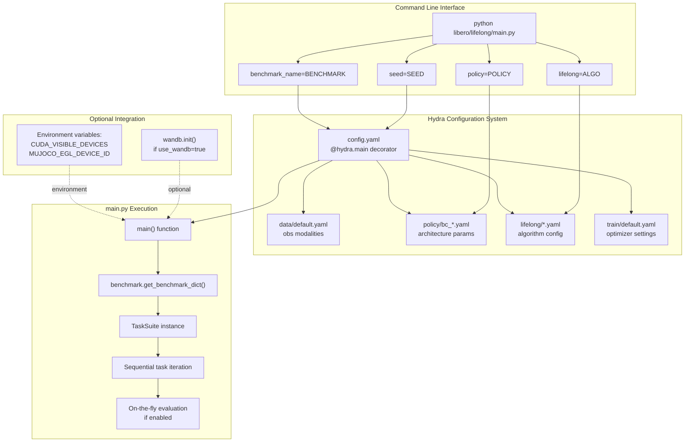
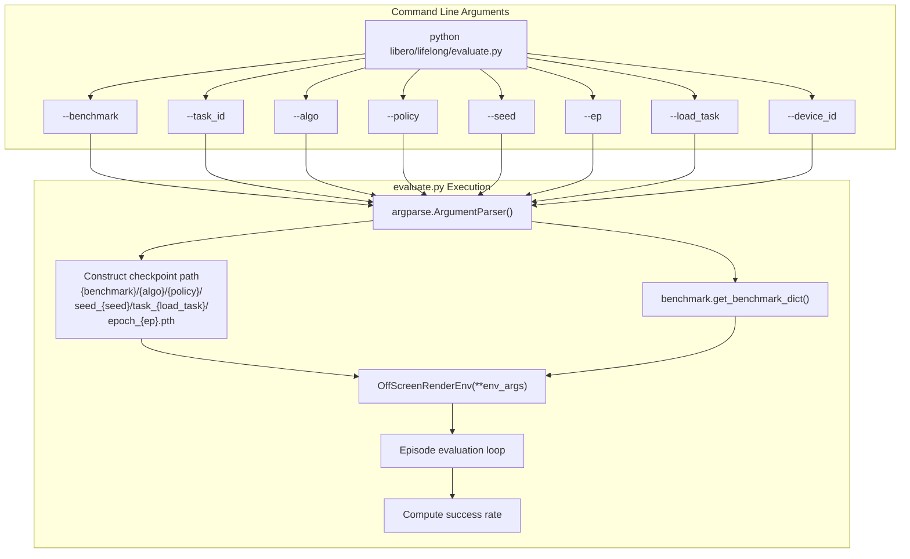
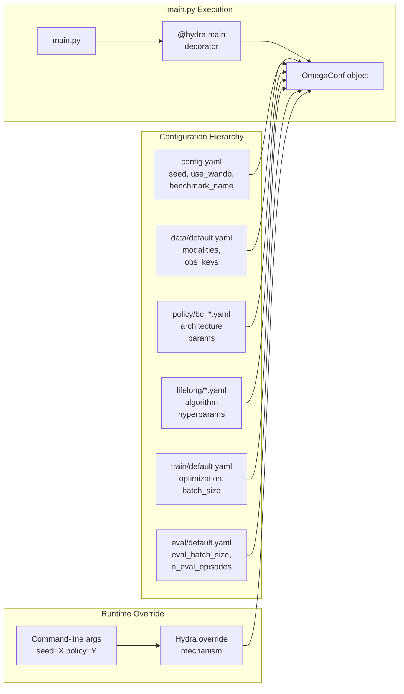
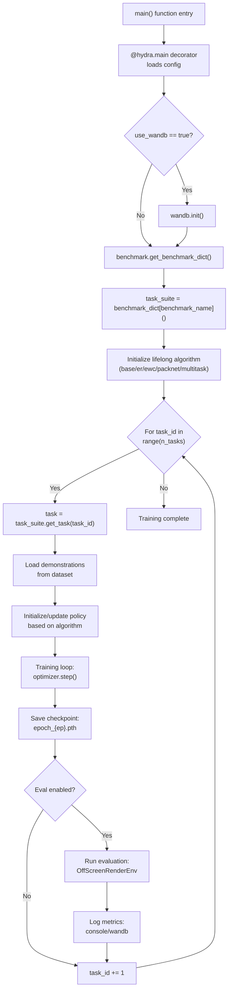

<!-- source: DeepWiki mcp.deepwiki.com · repo allenai/molmoact · page 6.4 LIBERO Training and Evaluation Scripts · fetched 2026-10-26 -->

# LIBERO Training and Evaluation Scripts

<details>
<summary>Relevant source files</summary>

The following files were used as context for generating this wiki page:

- [experiments/LIBERO/README.md](experiments/LIBERO/README.md)

</details>


This page documents the primary training and evaluation entrypoints for the LIBERO benchmark framework. The two main Python scripts provide command-line interfaces for training imitation learning policies and evaluating their performance on LIBERO task suites.

For information about the underlying lifelong learning algorithms, see [Lifelong Learning Algorithms](#6.3). For utility scripts such as task validation and dataset downloads, see [LIBERO Utility Scripts](#6.5). For configuration options, see [Configuration System](#7).

## Script Overview

The LIBERO framework provides two executable Python scripts located in `experiments/LIBERO/libero/lifelong/`:

1. **Training Script** ([experiments/LIBERO/libero/lifelong/main.py]()): Trains policies using lifelong learning algorithms on LIBERO task suites. Uses Hydra decorator-based configuration loading.
2. **Evaluation Script** ([experiments/LIBERO/libero/lifelong/evaluate.py]()): Evaluates trained policies independently of the training loop. Uses argparse for command-line argument parsing.

Both scripts integrate with the Hydra configuration system (see [Configuration System](#7)) and support multiple policy architectures (`bc_rnn_policy`, `bc_transformer_policy`, `bc_vilt_policy`), lifelong learning algorithms (`base`, `er`, `ewc`, `packnet`, `multitask`), and task suites (`LIBERO_SPATIAL`, `LIBERO_OBJECT`, `LIBERO_GOAL`, `LIBERO_90`, `LIBERO_10`).

Sources: [experiments/LIBERO/README.md:135-166]()

## Training Entrypoint Architecture

**Diagram: Training Script Architecture and Parameter Flow**



Sources: [experiments/LIBERO/README.md:135-151]()

## Training Script Usage

### Basic Command Structure

The training script [experiments/LIBERO/libero/lifelong/main.py]() is invoked with Hydra-based parameter overrides:

```shell
export CUDA_VISIBLE_DEVICES=GPU_ID && \
export MUJOCO_EGL_DEVICE_ID=GPU_ID && \
python libero/lifelong/main.py seed=SEED \
                               benchmark_name=BENCHMARK \
                               policy=POLICY \
                               lifelong=ALGO
```

The `@hydra.main` decorator in `main.py` loads the base configuration from `experiments/LIBERO/libero/configs/config.yaml` and merges command-line overrides.

### Required Parameters

| Parameter | Valid Values | Description |
|-----------|--------------|-------------|
| `seed` | Integer | Random seed for reproducibility (NumPy, PyTorch, environment) |
| `benchmark_name` | `LIBERO_SPATIAL`, `LIBERO_OBJECT`, `LIBERO_GOAL`, `LIBERO_90`, `LIBERO_10` | Target task suite from `benchmark.get_benchmark_dict()` |
| `policy` | `bc_rnn_policy`, `bc_transformer_policy`, `bc_vilt_policy` | Policy architecture loaded from `policy/*.yaml` |
| `lifelong` | `base`, `er`, `ewc`, `packnet`, `multitask` | Lifelong learning algorithm from `lifelong/*.yaml` |

### Environment Variables

The training process requires two environment variables for GPU configuration:

- **CUDA_VISIBLE_DEVICES**: Specifies which GPU device(s) to use for PyTorch operations
- **MUJOCO_EGL_DEVICE_ID**: Specifies which GPU to use for MuJoCo off-screen rendering (must match CUDA device for `OffScreenRenderEnv`)

### Configuration Defaults

The global configuration file `experiments/LIBERO/libero/configs/config.yaml` provides default values:

| Parameter | Default | Type |
|-----------|---------|------|
| `seed` | `10000` | Integer |
| `use_wandb` | `false` | Boolean |
| `wandb_project` | `"lifelong learning"` | String |
| `device` | `"cuda"` | String |
| `task_embedding_format` | `"bert"` | String |
| `benchmark_name` | `"LIBERO_SPATIAL"` | String |

Sources: [experiments/LIBERO/README.md:143-150]()

## Evaluation Entrypoint Architecture

**Diagram: Evaluation Script Architecture and Argument Flow**



Sources: [experiments/LIBERO/README.md:158-166]()

## Evaluation Script Usage

### Basic Command Structure

The evaluation script [experiments/LIBERO/libero/lifelong/evaluate.py]() provides independent model evaluation using argparse:

```shell
python libero/lifelong/evaluate.py --benchmark BENCHMARK_NAME \
                                   --task_id TASK_ID \ 
                                   --algo ALGO_NAME \
                                   --policy POLICY_NAME \
                                   --seed SEED \
                                   --ep EPOCH \
                                   --load_task LOAD_TASK \
                                   --device_id CUDA_ID
```

### Command-Line Arguments

| Argument | Type | Description |
|----------|------|-------------|
| `--benchmark` | String | Benchmark suite name from `benchmark.get_benchmark_dict()` |
| `--task_id` | Integer | Specific task ID within the suite to evaluate |
| `--algo` | String | Lifelong learning algorithm name (for checkpoint path) |
| `--policy` | String | Policy architecture name (for checkpoint path) |
| `--seed` | Integer | Random seed used during training |
| `--ep` | Integer | Training epoch/checkpoint to load |
| `--load_task` | Integer | Which task's checkpoint to load (lifelong learning context) |
| `--device_id` | Integer | CUDA device ID for `torch.device` and `OffScreenRenderEnv` |

### Use Case: Resource-Constrained Evaluation

The separate evaluation script is designed for scenarios with limited GPU resources, as noted in the README: "If you have limited computing resource of GPUs, we offer an evaluation script for you to evaluate models separately." This enables:

1. Training on high-performance GPU clusters with checkpointing
2. Post-training evaluation on different hardware
3. Parallel evaluation jobs on separate GPUs
4. Decoupled evaluation from training loop

### Checkpoint Resolution

The evaluation script constructs the checkpoint path using the pattern:

```
{output_dir}/{benchmark}/{algo}/{policy}/seed_{seed}/task_{load_task}/epoch_{ep}.pth
```

This hierarchical structure enables precise checkpoint identification in lifelong learning experiments where multiple tasks are trained sequentially. The `--task_id` argument specifies which task to evaluate, while `--load_task` specifies which checkpoint to load (allowing evaluation of early-task performance after training on later tasks).

Sources: [experiments/LIBERO/README.md:153-166]()

## Integration with Configuration System



**Diagram: Configuration System Integration with Training Script**

### Configuration Loading Mechanism

The training script [experiments/LIBERO/libero/lifelong/main.py]() uses Hydra's `@hydra.main` decorator for configuration loading:

1. The decorator specifies `config_path="./configs"` and `config_name="config"` to load `experiments/LIBERO/libero/configs/config.yaml`
2. Hydra composes configurations from the `defaults` list:
   - `data: default` → loads `data/default.yaml`
   - `policy: bc_transformer_policy` → loads `policy/bc_transformer_policy.yaml`
   - `train: default` → loads `train/default.yaml`
   - `eval: default` → loads `eval/default.yaml`
   - `lifelong: base` → loads `lifelong/base.yaml`
3. Command-line arguments override composed configuration values via Hydra's override syntax

### Default Configuration Hierarchy

The configuration hierarchy from `experiments/LIBERO/libero/configs/config.yaml`:

| Config Group | Default File | Purpose |
|--------------|--------------|---------|
| `data` | `default.yaml` | Observation modalities, image dimensions, sequence length |
| `policy` | `bc_transformer_policy.yaml` | Policy architecture and hyperparameters |
| `train` | `default.yaml` | Optimizer settings, batch size, learning rate |
| `eval` | `default.yaml` | Evaluation batch size, number of episodes |
| `lifelong` | `base.yaml` | Lifelong learning algorithm configuration |

Users can override any configuration component: `policy=bc_rnn_policy` loads `policy/bc_rnn_policy.yaml` instead of the default transformer policy.

Sources: [experiments/LIBERO/README.md:143-150]()

## Training Workflow and On-the-Fly Evaluation

### Training Execution Flow

**Diagram: Training Script Execution Flow with Task-Sequential Processing**



### On-the-Fly Evaluation

The training script [experiments/LIBERO/libero/lifelong/main.py]() includes built-in evaluation during training. Policies are evaluated periodically as specified in `experiments/LIBERO/libero/configs/eval/default.yaml`. The evaluation process:

1. Pauses training at configured intervals
2. Loads current policy state into `OffScreenRenderEnv`
3. Runs evaluation episodes on current and previous tasks (lifelong learning metrics)
4. Computes success rates and logs to console and W&B (if enabled)
5. Resumes training

The README notes: "By default the policies will be evaluated on the fly during training. If you have limited computing resource of GPUs, we offer an evaluation script for you to evaluate models separately." Users can disable on-the-fly evaluation and use the standalone [experiments/LIBERO/libero/lifelong/evaluate.py]() script post-training.

Sources: [experiments/LIBERO/README.md:153-156]()

## Script Internals and Key Functions

### Training Script Internal Structure

The training script [experiments/LIBERO/libero/lifelong/main.py]() follows this internal structure:

1. **Configuration Loading**: `@hydra.main` decorator loads configuration from `experiments/LIBERO/libero/configs/config.yaml`
2. **Benchmark Initialization**: `benchmark.get_benchmark_dict()` retrieves available task suites
3. **Task Suite Selection**: `task_suite = benchmark_dict[cfg.benchmark_name]()` instantiates the target suite
4. **Sequential Task Processing**: Iterates through tasks using `task_suite.get_task(task_id)`
5. **Policy Training**: Loads demonstrations, initializes policy, and runs optimizer
6. **Checkpoint Saving**: Saves model state to hierarchical directory structure
7. **Evaluation**: Optionally evaluates on current and previous tasks

### Evaluation Script Internal Structure

The evaluation script [experiments/LIBERO/libero/lifelong/evaluate.py]() follows this structure:

1. **Argument Parsing**: `argparse.ArgumentParser()` parses command-line arguments
2. **Checkpoint Path Construction**: Builds path using benchmark/algo/policy/seed/task/epoch hierarchy
3. **Model Loading**: Loads trained checkpoint from disk
4. **Environment Setup**: Initializes `OffScreenRenderEnv` with task-specific BDDL file
5. **Episode Execution**: Runs multiple evaluation episodes with model inference
6. **Metrics Computation**: Calculates success rate from episode outcomes

### Key Code Entities

| Entity | Location | Purpose |
|--------|----------|---------|
| `benchmark.get_benchmark_dict()` | `libero.libero.benchmark` | Returns dict of available task suites |
| `task_suite.get_task(task_id)` | `TaskSuite` class | Retrieves specific task definition |
| `OffScreenRenderEnv` | `libero.libero.envs` | Environment for off-screen rendering |
| `@hydra.main` | Hydra decorator | Configuration loading mechanism |
| `argparse.ArgumentParser()` | Standard library | Command-line parsing for evaluate.py |

Sources: [experiments/LIBERO/README.md:97-132]()

## Checkpoint Management

### Checkpoint Naming Convention

Trained model checkpoints from [experiments/LIBERO/libero/lifelong/main.py]() are organized using a hierarchical directory structure:

```
{output_dir}/
├── {benchmark_name}/           # e.g., LIBERO_SPATIAL
│   ├── {algo_name}/            # e.g., base, er, ewc
│   │   ├── {policy_name}/      # e.g., bc_transformer_policy
│   │   │   ├── seed_{seed}/    # e.g., seed_42
│   │   │   │   ├── task_{task_id}/  # e.g., task_0, task_1
│   │   │   │   │   ├── epoch_{ep}.pth  # e.g., epoch_100.pth
```

This structure provides:

| Feature | Benefit |
|---------|---------|
| **Seed-specific paths** | Ensures experimental reproducibility across runs |
| **Task isolation** | Separate checkpoints for each task in lifelong learning sequence |
| **Epoch granularity** | Multiple checkpoints per task enable temporal analysis |
| **Algorithm comparison** | Parallel directory structure for comparing different algorithms |

### Checkpoint Loading in Evaluation

The [experiments/LIBERO/libero/lifelong/evaluate.py]() script reconstructs the checkpoint path from command-line arguments:

```python
# Checkpoint path construction
checkpoint_path = f"{output_dir}/{benchmark}/{algo}/{policy}/seed_{seed}/task_{load_task}/epoch_{ep}.pth"
```

| Argument | Path Level | Example |
|----------|-----------|---------|
| `--benchmark` | Level 1 | `LIBERO_SPATIAL` |
| `--algo` | Level 2 | `er` |
| `--policy` | Level 3 | `bc_transformer_policy` |
| `--seed` | Level 4 | `seed_42` |
| `--load_task` | Level 5 | `task_5` |
| `--ep` | Filename | `epoch_100.pth` |

This hierarchical scheme allows precise checkpoint selection for evaluating any training run at any task and epoch. The distinction between `--task_id` (which task to evaluate) and `--load_task` (which checkpoint to load) enables measuring catastrophic forgetting by evaluating early-task performance using late-task checkpoints.

Sources: [experiments/LIBERO/README.md:158-165]()

## Global Configuration Parameters

The `experiments/LIBERO/libero/configs/config.yaml` file provides global parameters affecting both [experiments/LIBERO/libero/lifelong/main.py]() and [experiments/LIBERO/libero/lifelong/evaluate.py]():

### Core Parameters

| Parameter | Default | Type | Description |
|-----------|---------|------|-------------|
| `seed` | `10000` | Integer | Random seed for `numpy.random.seed()`, `torch.manual_seed()`, and `env.seed()` |
| `device` | `"cuda"` | String | PyTorch device for `torch.device()` |
| `benchmark_name` | `"LIBERO_SPATIAL"` | String | Key for `benchmark.get_benchmark_dict()` |

### Directory Configuration

| Parameter | Default | Type | Description |
|-----------|---------|------|-------------|
| `folder` | `null` | String/Null | Output directory for checkpoint hierarchy (uses default if null) |
| `bddl_folder` | `null` | String/Null | Path to BDDL task definition files for `OffScreenRenderEnv` |
| `init_states_folder` | `null` | String/Null | Path to initial state files from `task_suite.get_task_init_states()` |

### Experiment Tracking

| Parameter | Default | Type | Description |
|-----------|---------|------|-------------|
| `use_wandb` | `false` | Boolean | Enable `wandb.init()` for experiment logging |
| `wandb_project` | `"lifelong learning"` | String | W&B project name for `wandb.init(project=...)` |

### Task Embedding

| Parameter | Default | Type | Description |
|-----------|---------|------|-------------|
| `task_embedding_format` | `"bert"` | String | Format for encoding `task.language` (task description) |
| `task_embedding_one_hot_offset` | `1` | Integer | Offset for one-hot encoded task embeddings |

### Pre-training

| Parameter | Default | Type | Description |
|-----------|---------|------|-------------|
| `pretrain` | `false` | Boolean | Enable loading of pre-trained model checkpoint |
| `pretrain_model_path` | `""` | String | Filesystem path to pre-trained `.pth` checkpoint |
| `load_previous_model` | `false` | Boolean | Continue training from previous checkpoint |

Sources: [experiments/LIBERO/README.md:143-150]()

## Example Training Commands

### Basic Sequential Training

Train a BC Transformer policy on LIBERO-Spatial using sequential fine-tuning:

```shell
export CUDA_VISIBLE_DEVICES=0 && \
export MUJOCO_EGL_DEVICE_ID=0 && \
python libero/lifelong/main.py seed=42 \
                               benchmark_name=LIBERO_SPATIAL \
                               policy=bc_transformer_policy \
                               lifelong=base
```

### Experience Replay Training

Train with Experience Replay algorithm:

```shell
export CUDA_VISIBLE_DEVICES=0 && \
export MUJOCO_EGL_DEVICE_ID=0 && \
python libero/lifelong/main.py seed=42 \
                               benchmark_name=LIBERO_OBJECT \
                               policy=bc_rnn_policy \
                               lifelong=er
```

### Multi-Task Training

Train on all tasks simultaneously:

```shell
export CUDA_VISIBLE_DEVICES=0 && \
export MUJOCO_EGL_DEVICE_ID=0 && \
python libero/lifelong/main.py seed=42 \
                               benchmark_name=LIBERO_GOAL \
                               policy=bc_vilt_policy \
                               lifelong=multitask
```

### Training with W&B Logging

Enable Weights & Biases experiment tracking:

```shell
export CUDA_VISIBLE_DEVICES=0 && \
export MUJOCO_EGL_DEVICE_ID=0 && \
python libero/lifelong/main.py seed=42 \
                               benchmark_name=LIBERO_90 \
                               policy=bc_transformer_policy \
                               lifelong=ewc \
                               use_wandb=true \
                               wandb_project="my-libero-experiments"
```

Sources: [experiments/LIBERO/README.md:143-150]()

## Example Evaluation Commands

### Evaluate Specific Task Checkpoint

Evaluate task 3 at epoch 100:

```shell
python libero/lifelong/evaluate.py --benchmark LIBERO_SPATIAL \
                                   --task_id 3 \
                                   --algo base \
                                   --policy bc_transformer_policy \
                                   --seed 42 \
                                   --ep 100 \
                                   --load_task 3 \
                                   --device_id 0
```

### Evaluate After Lifelong Learning

Evaluate performance on an early task after training on later tasks:

```shell
python libero/lifelong/evaluate.py --benchmark LIBERO_OBJECT \
                                   --task_id 0 \
                                   --algo er \
                                   --policy bc_rnn_policy \
                                   --seed 42 \
                                   --ep 200 \
                                   --load_task 9 \
                                   --device_id 0
```

This command evaluates performance on task 0 using the checkpoint from task 9, measuring catastrophic forgetting.

Sources: [experiments/LIBERO/README.md:158-166]()

---

