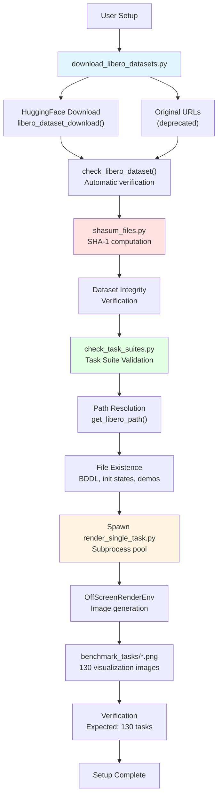
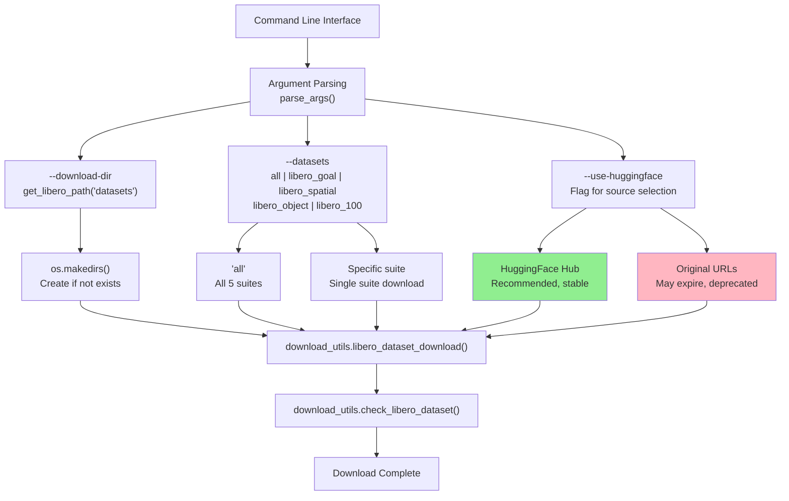
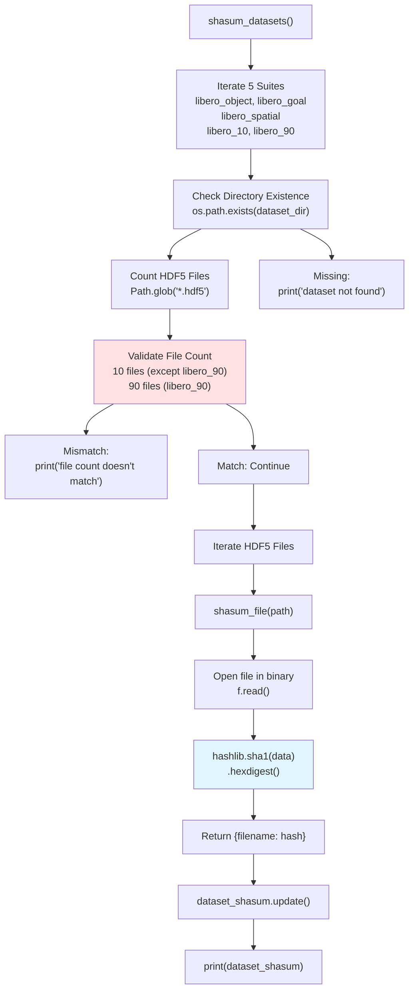
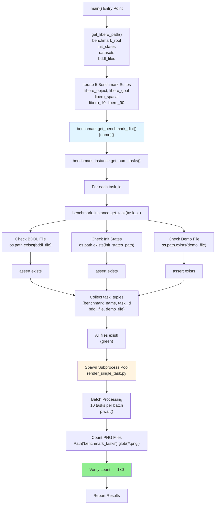
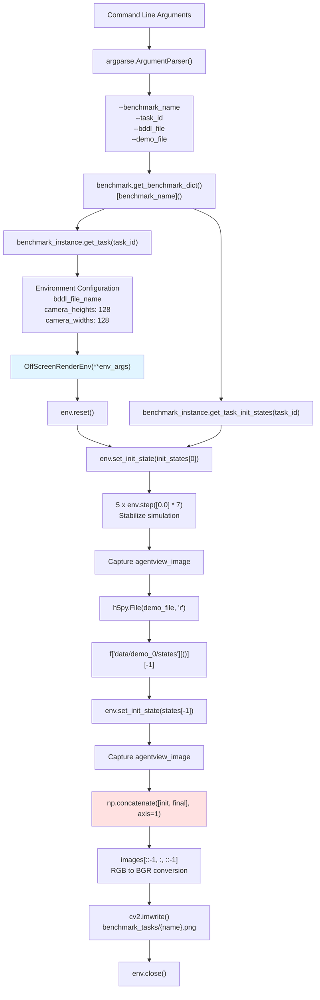
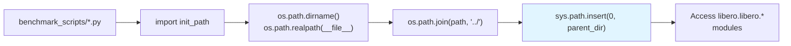
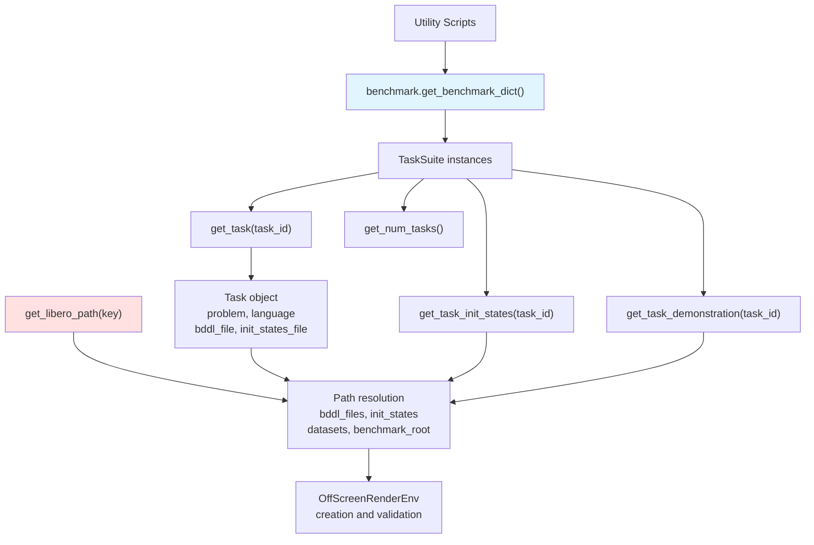

<!-- source: DeepWiki mcp.deepwiki.com · repo allenai/molmoact · page 6.5 LIBERO Utility Scripts · fetched 2026-10-26 -->

# LIBERO Utility Scripts

<details>
<summary>Relevant source files</summary>

The following files were used as context for generating this wiki page:

- [experiments/LIBERO/benchmark_scripts/check_task_suites.py](experiments/LIBERO/benchmark_scripts/check_task_suites.py)
- [experiments/LIBERO/benchmark_scripts/download_libero_datasets.py](experiments/LIBERO/benchmark_scripts/download_libero_datasets.py)
- [experiments/LIBERO/benchmark_scripts/init_path.py](experiments/LIBERO/benchmark_scripts/init_path.py)
- [experiments/LIBERO/benchmark_scripts/render_single_task.py](experiments/LIBERO/benchmark_scripts/render_single_task.py)
- [experiments/LIBERO/benchmark_scripts/shasum_files.py](experiments/LIBERO/benchmark_scripts/shasum_files.py)

</details>


This document describes the utility scripts in the LIBERO benchmark framework that support dataset management, task validation, visualization, and integrity checking. These scripts are located in [experiments/LIBERO/benchmark_scripts/]() and provide essential infrastructure for working with LIBERO's 130 tasks across five suites.

For LIBERO training and evaluation entrypoints, see [LIBERO Training and Evaluation Scripts](#6.4). For task retrieval and environment interaction patterns, see [Task Retrieval and Environment Interaction](#6.2).

## Overview

The LIBERO benchmark framework includes five primary utility scripts that handle setup, validation, and diagnostic operations:

| Script | Purpose | Primary Operations |
|--------|---------|-------------------|
| `download_libero_datasets.py` | Dataset acquisition | Download task demonstrations via HuggingFace or direct URLs |
| `shasum_files.py` | Dataset integrity | Compute SHA-1 checksums for verification |
| `check_task_suites.py` | Comprehensive validation | Verify all 130 tasks load correctly with proper file paths |
| `render_single_task.py` | Task visualization | Generate side-by-side images of initial and final states |
| `init_path.py` | Path configuration | Configure Python import paths for benchmark scripts |

These scripts operate independently but are designed to work together in a typical workflow: download datasets, verify integrity, validate task suites, and optionally render visualizations for debugging.

**Sources**: [experiments/LIBERO/benchmark_scripts/check_task_suites.py](), [experiments/LIBERO/benchmark_scripts/download_libero_datasets.py](), [experiments/LIBERO/benchmark_scripts/render_single_task.py](), [experiments/LIBERO/benchmark_scripts/shasum_files.py](), [experiments/LIBERO/benchmark_scripts/init_path.py]()

## Workflow Integration



**Workflow Description**: The typical setup begins with `download_libero_datasets.py` fetching demonstration files from HuggingFace (recommended) or original URLs. The download utility automatically calls `check_libero_dataset()` for basic validation. Users then run `shasum_files.py` to compute SHA-1 checksums for integrity verification. The comprehensive validation script `check_task_suites.py` retrieves all 130 tasks via `benchmark.get_benchmark_dict()`, verifies file paths using `get_libero_path()`, and spawns parallel subprocesses to `render_single_task.py` for visualization. The final output is 130 PNG images in `benchmark_tasks/`, confirming that all tasks can be loaded and rendered successfully.

**Sources**: [experiments/LIBERO/benchmark_scripts/download_libero_datasets.py:49-62](), [experiments/LIBERO/benchmark_scripts/check_task_suites.py:42-114]()

## Dataset Download and Acquisition

### Download Script Configuration

The `download_libero_datasets.py` script provides flexible dataset acquisition with support for selective downloading and multiple data sources.



**Command-Line Interface**:
- `--download-dir`: Target directory (defaults to `get_libero_path("datasets")`)
- `--datasets`: Suite selection from `["all", "libero_goal", "libero_spatial", "libero_object", "libero_100"]`
- `--use-huggingface`: Enable HuggingFace download source (recommended over original URLs which may expire)

The script prompts users if they attempt to use original URLs without the HuggingFace flag [experiments/LIBERO/benchmark_scripts/download_libero_datasets.py:43-47]() and automatically switches to HuggingFace if declined.

**Sources**: [experiments/LIBERO/benchmark_scripts/download_libero_datasets.py:10-66]()

### Download Utilities Module

The actual download logic resides in `libero.libero.utils.download_utils` module, which provides two key functions:

| Function | Purpose | Parameters |
|----------|---------|------------|
| `libero_dataset_download()` | Fetch demonstration files | `download_dir`, `datasets`, `use_huggingface` |
| `check_libero_dataset()` | Verify downloaded files | `download_dir` |

The `check_libero_dataset()` function is automatically invoked after download completion [experiments/LIBERO/benchmark_scripts/download_libero_datasets.py:62]() to ensure files were retrieved successfully.

**Sources**: [experiments/LIBERO/benchmark_scripts/download_libero_datasets.py:6-7](), [experiments/LIBERO/benchmark_scripts/download_libero_datasets.py:50-62]()

## Dataset Integrity Verification

### SHA-1 Checksum Computation

The `shasum_files.py` script provides cryptographic verification of dataset files through SHA-1 checksums, enabling users to detect corrupted or incomplete downloads.



**Verification Logic**: The script expects specific file counts for validation:
- `libero_object`, `libero_goal`, `libero_spatial`, `libero_10`: 10 HDF5 files each
- `libero_90`: 90 HDF5 files

The `shasum_file()` function [experiments/LIBERO/benchmark_scripts/shasum_files.py:6-14]() computes SHA-1 hashes using `hashlib.sha1()` and returns a dictionary mapping filenames to hexadecimal hash strings.

**Sources**: [experiments/LIBERO/benchmark_scripts/shasum_files.py:6-49]()

### Expected File Structure

The verification process assumes the following directory structure:

```
datasets/
├── libero_object/
│   ├── task_file_0.hdf5
│   ├── task_file_1.hdf5
│   └── ... (10 total)
├── libero_goal/
│   └── ... (10 total)
├── libero_spatial/
│   └── ... (10 total)
├── libero_10/
│   └── ... (10 total)
└── libero_90/
    └── ... (90 total)
```

**Sources**: [experiments/LIBERO/benchmark_scripts/shasum_files.py:17-40]()

## Comprehensive Task Suite Validation

### Validation Architecture

The `check_task_suites.py` script performs end-to-end validation of the LIBERO benchmark infrastructure, verifying that all 130 tasks can be properly loaded, their associated files exist, and environments can be instantiated.



**Validation Sequence**: The script follows a three-phase validation process:
1. **File Existence Phase**: Retrieves all 130 tasks via `benchmark.get_benchmark_dict()` [experiments/LIBERO/benchmark_scripts/check_task_suites.py:59](), validates BDDL files, initial state files, and demonstration files exist with assertions [experiments/LIBERO/benchmark_scripts/check_task_suites.py:73-84]()
2. **Rendering Phase**: Spawns parallel subprocesses to `render_single_task.py` in batches of 10 [experiments/LIBERO/benchmark_scripts/check_task_suites.py:94-101]()
3. **Verification Phase**: Counts generated PNG files and reports success or failure [experiments/LIBERO/benchmark_scripts/check_task_suites.py:103-113]()

**Sources**: [experiments/LIBERO/benchmark_scripts/check_task_suites.py:42-117]()

### Path Resolution System

The validation script relies on `get_libero_path()` to resolve four critical directory paths:

| Path Key | Purpose | Typical Content |
|----------|---------|-----------------|
| `"benchmark_root"` | Root directory for LIBERO benchmark | Configuration and metadata |
| `"init_states"` | Initial state files | Multiple initial states per task |
| `"datasets"` | Demonstration files | HDF5 files with expert trajectories |
| `"bddl_files"` | Behavior descriptions | BDDL specification files |

These paths are retrieved at the start of validation [experiments/LIBERO/benchmark_scripts/check_task_suites.py:44-47]() and used to construct full file paths for verification.

**Sources**: [experiments/LIBERO/benchmark_scripts/check_task_suites.py:44-47]()

### Subprocess Rendering Pipeline

The validation script spawns parallel rendering processes to generate visualization images:

```python
command = f"python benchmark_scripts/render_single_task.py --benchmark_name {task_tuples[i][0]} --task_id {task_tuples[i][1]} --bddl_file {task_tuples[i][2]} --demo_file {task_tuples[i][3]}"
p = subprocess.Popen(command, shell=True)
processes.append(p)
if i % 10 == 9:
    for p in processes:
        p.wait()
    processes = []
```

This approach processes tasks in batches of 10 [experiments/LIBERO/benchmark_scripts/check_task_suites.py:98-101]() to manage resource usage while maintaining parallelism. The batch size of 10 prevents overwhelming the system with 130 simultaneous MuJoCo simulation environments.

**Sources**: [experiments/LIBERO/benchmark_scripts/check_task_suites.py:94-101]()

## Task Visualization and Rendering

### Single Task Renderer

The `render_single_task.py` script creates side-by-side visualizations of task initial and final states for debugging and verification purposes.



**Rendering Pipeline**: The script performs the following steps:
1. **Environment Setup**: Creates `OffScreenRenderEnv` with 128x128 camera resolution [experiments/LIBERO/benchmark_scripts/render_single_task.py:52-56]()
2. **Initial State Capture**: Sets first initial state and runs 5 timesteps to stabilize the simulation [experiments/LIBERO/benchmark_scripts/render_single_task.py:65-68]()
3. **Final State Capture**: Loads final state from demonstration HDF5 file [experiments/LIBERO/benchmark_scripts/render_single_task.py:70-72]()
4. **Image Composition**: Concatenates images horizontally and flips for BGR format [experiments/LIBERO/benchmark_scripts/render_single_task.py:74-77]()

The 5-timestep stabilization after setting initial state is critical to ensure the simulation physics have settled before capturing the image.

**Sources**: [experiments/LIBERO/benchmark_scripts/render_single_task.py:12-82]()

### Output Format

Rendered images are saved with the naming convention:
```
benchmark_tasks/{demo_file_basename}.png
```

For example, a demo file `libero_spatial/KITCHEN_SCENE9_turn_on_stove_and_put_pan_on_it_demo.hdf5` produces:
```
benchmark_tasks/KITCHEN_SCENE9_turn_on_stove_and_put_pan_on_it_demo.png
```

Each PNG contains two 128x128 images side-by-side:
- **Left**: Initial task state (from first initial state)
- **Right**: Goal state (from final state of demonstration)

This visual format allows quick verification that tasks are properly configured and environments render correctly.

**Sources**: [experiments/LIBERO/benchmark_scripts/render_single_task.py:76-77]()

### Camera Configuration

The rendering uses standard LIBERO camera settings:

```python
env_args = {
    "bddl_file_name": bddl_file,
    "camera_heights": 128,
    "camera_widths": 128,
}
```

These settings match the default observation resolution used in training and evaluation, ensuring rendered images reflect what policies actually observe. The `OffScreenRenderEnv` provides the `agentview_image` observation key, which captures the scene from the robot's perspective.

**Sources**: [experiments/LIBERO/benchmark_scripts/render_single_task.py:52-56]()

## Path Initialization System

### Import Path Configuration

The `init_path.py` script configures Python module imports for benchmark scripts that need to access the LIBERO library from within the `benchmark_scripts/` subdirectory.



**Implementation**: The script adds the parent directory (experiments/LIBERO/) to the Python search path [experiments/LIBERO/benchmark_scripts/init_path.py:4-5](), enabling scripts in `benchmark_scripts/` to import modules from `libero/libero/` without requiring package installation.

This pattern is used by:
- `download_libero_datasets.py` [experiments/LIBERO/benchmark_scripts/download_libero_datasets.py:1]()

The pattern allows benchmark scripts to function as standalone utilities while maintaining access to the core LIBERO library.

**Sources**: [experiments/LIBERO/benchmark_scripts/init_path.py:1-9]()

### Path Resolution Function

The `get_libero_path()` function [experiments/LIBERO/benchmark_scripts/check_task_suites.py:15]() provides centralized path resolution for LIBERO benchmark resources. This function is imported from `libero.libero` and used extensively across utility scripts.

**Common Path Keys**:
```python
benchmark_root = get_libero_path("benchmark_root")
init_states = get_libero_path("init_states")
datasets = get_libero_path("datasets")
bddl_files = get_libero_path("bddl_files")
```

This abstraction allows the benchmark system to relocate resources without modifying individual scripts. The function returns absolute paths to standard LIBERO directories, typically under the experiments/LIBERO/ tree.

**Sources**: [experiments/LIBERO/benchmark_scripts/check_task_suites.py:44-47](), [experiments/LIBERO/benchmark_scripts/download_libero_datasets.py:7]()

## Usage Examples

### Complete Setup Workflow

A typical setup sequence for LIBERO datasets and validation:

```bash
# 1. Download all datasets using HuggingFace
cd experiments/LIBERO/benchmark_scripts
python download_libero_datasets.py --datasets all --use-huggingface

# 2. Verify dataset integrity
python shasum_files.py

# 3. Comprehensive validation with rendering
python check_task_suites.py

# 4. Render a specific task for inspection
python render_single_task.py \
    --benchmark_name libero_spatial \
    --task_id 0 \
    --bddl_file /path/to/bddl/file.bddl \
    --demo_file /path/to/demo/file.hdf5
```

**Sources**: [experiments/LIBERO/benchmark_scripts/download_libero_datasets.py](), [experiments/LIBERO/benchmark_scripts/shasum_files.py](), [experiments/LIBERO/benchmark_scripts/check_task_suites.py](), [experiments/LIBERO/benchmark_scripts/render_single_task.py]()

### Selective Dataset Download

Download only specific task suites:

```bash
# Download only spatial reasoning tasks
python download_libero_datasets.py \
    --datasets libero_spatial \
    --download-dir /custom/path \
    --use-huggingface

# Download only LIBERO-100 (combined 90+10)
python download_libero_datasets.py \
    --datasets libero_100 \
    --use-huggingface
```

The `--datasets` parameter accepts: `all`, `libero_goal`, `libero_spatial`, `libero_object`, `libero_100` [experiments/LIBERO/benchmark_scripts/download_libero_datasets.py:18-22]().

**Sources**: [experiments/LIBERO/benchmark_scripts/download_libero_datasets.py:10-28]()

### Validation Output Interpretation

The `check_task_suites.py` script produces several diagnostic outputs:

**Success Case**:
```
10 tasks in the benchmark libero_object:
The benchmark contains the following tasks:
...
All the files exist!
Expected 130 tasks, Rendered 130 tasks successfully.
```

**Failure Case**:
```
Expected 130 tasks, Rendered 125 tasks successfully.
Some tasks failed to render!
/path/to/missing/demo/file.hdf5
/path/to/another/missing/file.hdf5
```

The script lists specific demo files that failed to render [experiments/LIBERO/benchmark_scripts/check_task_suites.py:107-113](), enabling targeted debugging.

**Sources**: [experiments/LIBERO/benchmark_scripts/check_task_suites.py:89-113]()

## Integration with Main System

### Relationship to Training Pipeline

The utility scripts prepare the infrastructure required by LIBERO training and evaluation:

| Utility Script | Training System Dependency |
|----------------|----------------------------|
| `download_libero_datasets.py` | Provides demonstration data for imitation learning |
| `shasum_files.py` | Ensures data integrity before training |
| `check_task_suites.py` | Validates environment setup before experiments |
| `render_single_task.py` | Debugging tool for task visualization |

The downloaded datasets are consumed by `libero/lifelong/main.py` during training (see [LIBERO Training and Evaluation Scripts](#6.4)). The path resolution system ensures both utility scripts and training code reference the same data locations.

**Sources**: [experiments/LIBERO/benchmark_scripts/check_task_suites.py](), [experiments/LIBERO/benchmark_scripts/download_libero_datasets.py]()

### Relationship to Benchmark API

The utility scripts rely on the core LIBERO benchmark API:



The utility scripts serve as practical examples of proper benchmark API usage, demonstrating the standard patterns for task retrieval, path resolution, and environment instantiation. For detailed API documentation, see [Benchmark API](#9.1).

**Sources**: [experiments/LIBERO/benchmark_scripts/check_task_suites.py:15-87](), [experiments/LIBERO/benchmark_scripts/render_single_task.py:9-61]()

---

