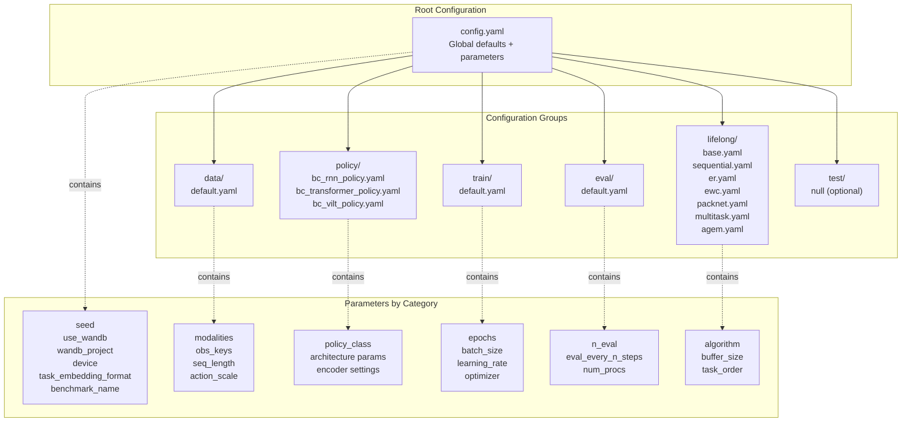
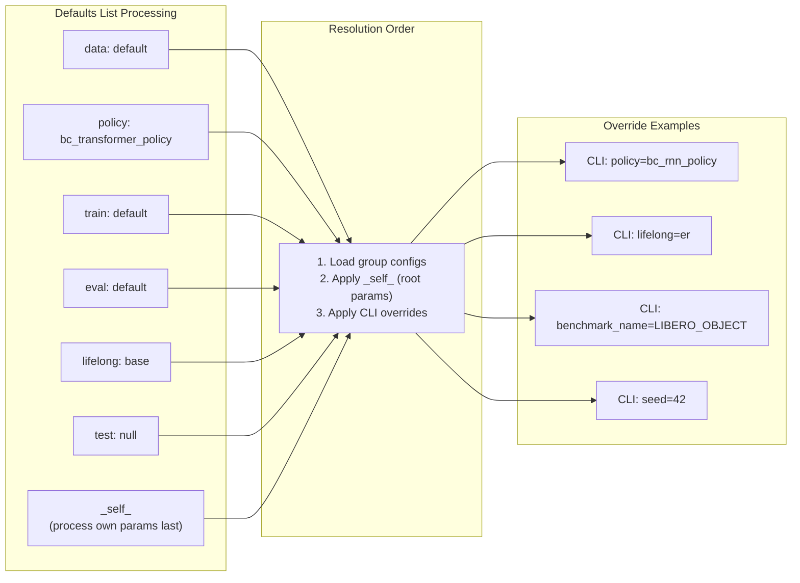
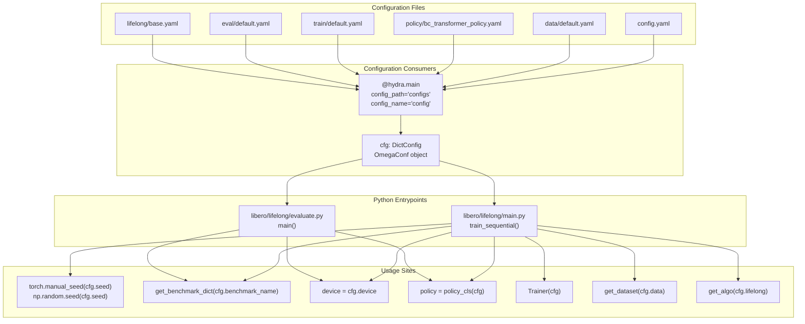

<!-- source: DeepWiki mcp.deepwiki.com · repo allenai/molmoact · page 7 Configuration System · fetched 2026-10-26 -->

# Configuration System

<details>
<summary>Relevant source files</summary>

The following files were used as context for generating this wiki page:

- [experiments/LIBERO/libero/configs/config.yaml](experiments/LIBERO/libero/configs/config.yaml)

</details>


## Purpose and Scope

This document describes the hierarchical configuration system used in the LIBERO benchmark framework within MolmoAct. The system is built on [Hydra](https://hydra.cc/), a framework for elegantly configuring complex applications through composable configuration files. This configuration system manages all aspects of LIBERO training and evaluation, including data modalities, policy architectures, lifelong learning algorithms, and training hyperparameters.

For information about the LIBERO benchmark framework architecture, see [LIBERO Benchmark Framework](#6). For details on training and evaluation execution, see [LIBERO Training and Evaluation Scripts](#6.4). For specific policy architecture implementations, see [Policy Architecture Configurations](#7.3).

**Sources:** [experiments/LIBERO/libero/configs/config.yaml]()

---

## Configuration Architecture Overview

The LIBERO configuration system uses a hierarchical structure with six primary configuration layers that compose together to define complete experimental setups. The root configuration file (`config.yaml`) serves as the entry point, importing specialized configuration groups through Hydra's defaults mechanism.

### Configuration File Hierarchy



**Sources:** [experiments/LIBERO/libero/configs/config.yaml:1-25](), [experiments/LIBERO/README.md]()

---

## Hydra Defaults Composition System

The configuration system uses Hydra's defaults list to compose configurations from multiple sources. The root configuration file defines the composition order and default selections for each configuration group.



The `_self_` entry in the defaults list ([config.yaml:4]()) ensures that parameters defined directly in `config.yaml` are processed after group defaults, allowing them to override group-level settings. This is critical for maintaining global parameters like `seed`, `device`, and `benchmark_name` regardless of which policy or lifelong learning algorithm is selected.

**Sources:** [experiments/LIBERO/libero/configs/config.yaml:3-10]()

---

## Configuration Layer Summary

The following table summarizes the six configuration layers, their purposes, and key parameters:

| Layer | File Location | Purpose | Key Parameters |
|-------|--------------|---------|----------------|
| **Global** | `config.yaml` | Root configuration with experiment-level settings | `seed`, `use_wandb`, `device`, `task_embedding_format`, `benchmark_name` |
| **Data** | `data/default.yaml` | Data modalities and observation specifications | `modalities`, `obs_keys`, `seq_length`, `frame_stack`, `action_scale` |
| **Policy** | `policy/*.yaml` | Neural network architecture definitions | `policy_class`, encoder configs, head configs, architecture-specific params |
| **Training** | `train/default.yaml` | Training loop hyperparameters | `epochs`, `batch_size`, `lr`, `optimizer`, `scheduler`, `grad_norm` |
| **Evaluation** | `eval/default.yaml` | Evaluation execution parameters | `n_eval`, `eval_every_n_steps`, `num_procs`, `max_steps` |
| **Lifelong** | `lifelong/*.yaml` | Lifelong learning algorithm settings | `algo_name`, `n_tasks`, `task_order_index`, buffer/regularization params |

**Sources:** [experiments/LIBERO/libero/configs/config.yaml](), [experiments/LIBERO/README.md]()

---

## Global Configuration Parameters

The root configuration file defines experiment-wide parameters that apply regardless of the specific data, policy, or algorithm configuration. These parameters are located in [experiments/LIBERO/libero/configs/config.yaml:12-25]().

### Core Parameters

| Parameter | Type | Default | Description |
|-----------|------|---------|-------------|
| `seed` | int | 10000 | Random seed for reproducibility across PyTorch, NumPy, and Python |
| `use_wandb` | bool | false | Enable Weights & Biases experiment tracking |
| `wandb_project` | str | "lifelong learning" | W&B project name for experiment organization |
| `device` | str | "cuda" | Compute device: "cuda" or "cpu" |
| `benchmark_name` | str | "LIBERO_SPATIAL" | Task suite selection: LIBERO_SPATIAL, LIBERO_OBJECT, LIBERO_GOAL, LIBERO_10, LIBERO_90 |

### Path Configuration

| Parameter | Type | Default | Description |
|-----------|------|---------|-------------|
| `folder` | str/null | null | Custom experiment output directory (uses default if null) |
| `bddl_folder` | str/null | null | Custom BDDL task definition directory (uses default if null) |
| `init_states_folder` | str/null | null | Custom initial states directory (uses default if null) |

### Task Embedding Configuration

| Parameter | Type | Default | Description |
|-----------|------|---------|-------------|
| `task_embedding_format` | str | "bert" | Task embedding method: "bert" for learned embeddings or "one_hot" for discrete encoding |
| `task_embedding_one_hot_offset` | int | 1 | Offset for one-hot task embeddings (starts at task ID 1 instead of 0) |

### Model Loading

| Parameter | Type | Default | Description |
|-----------|------|---------|-------------|
| `load_previous_model` | bool | false | Load checkpoint from previous task for continual learning scenarios |
| `pretrain` | bool | false | Use pretrained model initialization |
| `pretrain_model_path` | str | "" | Path to pretrained checkpoint file |

**Sources:** [experiments/LIBERO/libero/configs/config.yaml:12-25]()

---

## Configuration File to Code Entity Mapping

This diagram shows how configuration files map to Python classes and functions that consume them:



The configuration files are loaded by Hydra decorators in the main entry points. For training, [libero/lifelong/main.py]() uses the `@hydra.main` decorator to load the configuration. For evaluation, [libero/lifelong/evaluate.py]() similarly loads the composed configuration. The resulting `cfg` object (an OmegaConf `DictConfig`) is then passed to various components for initialization.

**Sources:** [experiments/LIBERO/libero/configs/config.yaml](), [experiments/LIBERO/README.md]()

---

## Configuration Override Patterns

Hydra supports command-line overrides of any configuration parameter. This enables flexible experimentation without modifying configuration files.

### Common Override Examples

```bash
# Change policy architecture
python main.py policy=bc_rnn_policy

# Select different lifelong learning algorithm
python main.py lifelong=er lifelong.buffer_size=5000

# Change benchmark and seed
python main.py benchmark_name=LIBERO_OBJECT seed=42

# Override nested parameters
python main.py train.batch_size=64 train.lr=0.001

# Enable W&B tracking
python main.py use_wandb=true wandb_project="my_experiment"

# Combine multiple overrides
python main.py policy=bc_vilt_policy lifelong=ewc benchmark_name=LIBERO_GOAL seed=123
```

### Override Precedence

The configuration resolution order follows this precedence (highest to lowest):

1. **Command-line overrides** (highest priority)
2. **Root config parameters** (from `config.yaml` after `_self_`)
3. **Group config defaults** (from `data/`, `policy/`, etc.)
4. **Schema defaults** (lowest priority)

This precedence allows CLI overrides to take precedence over all configuration file settings, enabling rapid experimentation.

**Sources:** [experiments/LIBERO/libero/configs/config.yaml:3-10]()

---

## Configuration Validation

While the provided files do not show explicit schema validation, the configuration system relies on:

1. **Hydra's structured configs**: Type checking through OmegaConf
2. **Required parameters**: Missing required parameters cause immediate failures at startup
3. **Default values**: All configuration files provide sensible defaults
4. **Benchmark validation**: The `benchmark_name` parameter is validated against available task suites through `get_benchmark_dict()`

The configuration loading occurs before any training or evaluation begins, ensuring early detection of configuration errors.

**Sources:** [experiments/LIBERO/libero/configs/config.yaml]()

---

## Related Configuration Systems

While this page focuses on the LIBERO configuration system within MolmoAct, note that:

- **MolmoAct training pipeline** (see [Training Pipeline](#2)) uses its own training scripts with different configuration mechanisms
- **SimplerEnv evaluation** (see [SimplerEnv Evaluation](#5.1)) uses command-line arguments rather than Hydra configs
- **LIBERO-specific configurations** only apply to experiments within the `experiments/LIBERO/` directory

The LIBERO configuration system is self-contained and does not interact with the main MolmoAct training configuration, as LIBERO serves primarily as a benchmark and evaluation framework.

**Sources:** [experiments/LIBERO/libero/configs/config.yaml](), [experiments/LIBERO/README.md]()

---

