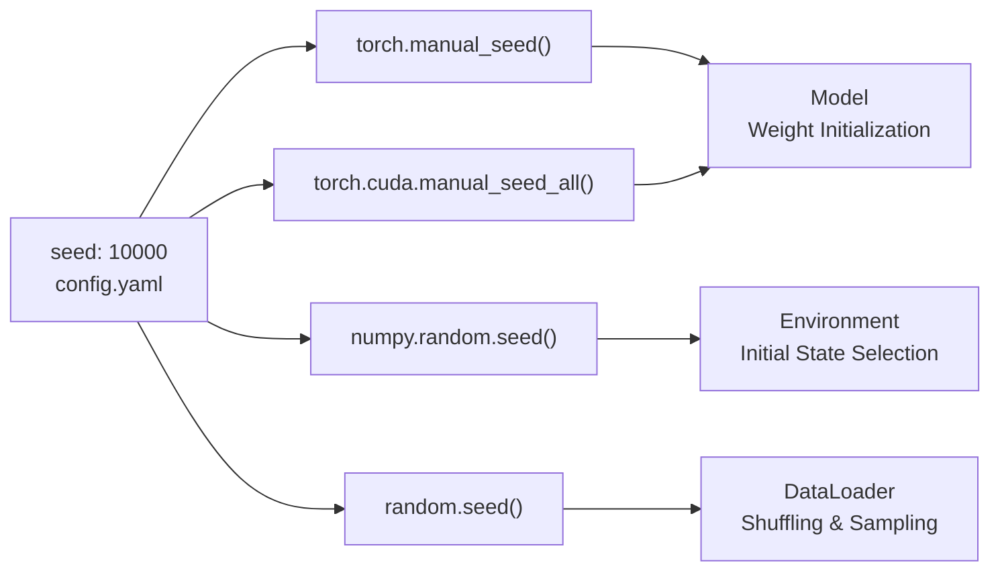
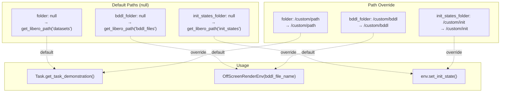
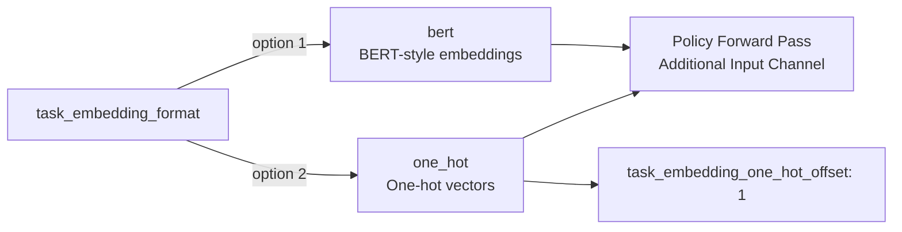
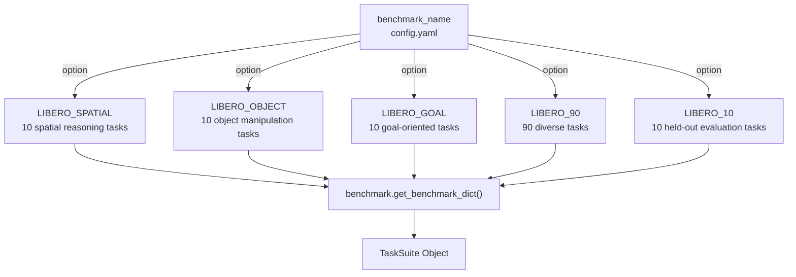
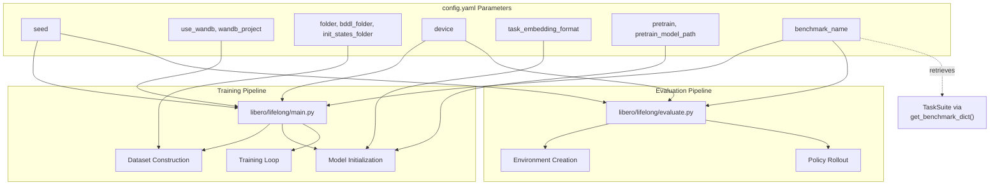

<!-- source: DeepWiki mcp.deepwiki.com · repo allenai/molmoact · page 7.1 Global Configuration · fetched 2026-10-26 -->

# Global Configuration

<details>
<summary>Relevant source files</summary>

The following files were used as context for generating this wiki page:

- [experiments/LIBERO/libero/configs/config.yaml](experiments/LIBERO/libero/configs/config.yaml)

</details>


## Purpose and Scope

This document describes the global configuration layer in the LIBERO benchmark framework, defined in [experiments/LIBERO/libero/configs/config.yaml](). The global configuration establishes top-level parameters that control experiment reproducibility, infrastructure settings, and benchmark selection. It serves as the root of the Hydra configuration hierarchy, importing and coordinating five specialized configuration groups: data, policy, train, eval, and lifelong learning algorithms.

For information about the sub-configurations that inherit from this global layer, see:
- Data configuration parameters: [Data Configuration](#7.2)
- Policy architecture settings: [Policy Architecture Configurations](#7.3)
- Training hyperparameters: [Training Configuration](#7.4)
- Evaluation settings: [Evaluation Configuration](#7.5)

## Configuration File Structure

The global configuration file uses Hydra's defaults mechanism to establish a hierarchical configuration system. The configuration is located at [experiments/LIBERO/libero/configs/config.yaml:1-25]() and defines both the composition hierarchy and global parameters.

### Configuration Hierarchy

The following diagram shows how the global configuration composes sub-configurations:

```mermaid
graph TB
    config["config.yaml<br/>Global Configuration"]
    
    data["data/default.yaml<br/>Modalities & Observations"]
    policy["policy/bc_transformer_policy.yaml<br/>Architecture Default"]
    train["train/default.yaml<br/>Training Parameters"]
    eval["eval/default.yaml<br/>Evaluation Parameters"]
    lifelong["lifelong/base.yaml<br/>Learning Algorithm"]
    test["test: null<br/>Optional Test Config"]
    
    config -->|defaults[1]| data
    config -->|defaults[2]| policy
    config -->|defaults[3]| train
    config -->|defaults[4]| eval
    config -->|defaults[5]| lifelong
    config -->|defaults[6]| test
    
    config -->|global params| seed["seed: 10000"]
    config -->|global params| wandb["use_wandb: false"]
    config -->|global params| device["device: cuda"]
    config -->|global params| benchmark["benchmark_name:<br/>LIBERO_SPATIAL"]
```

**Sources:** [experiments/LIBERO/libero/configs/config.yaml:3-10]()

## Global Configuration Parameters

The following table documents all global configuration parameters defined at the root level:

| Parameter | Type | Default Value | Description |
|-----------|------|---------------|-------------|
| `seed` | int | `10000` | Random seed for reproducibility across PyTorch, NumPy, and Python random |
| `use_wandb` | bool | `false` | Enable Weights & Biases experiment tracking |
| `wandb_project` | str | `"lifelong learning"` | W&B project name for logging runs |
| `folder` | str | `null` | Override default dataset folder path (uses default if null) |
| `bddl_folder` | str | `null` | Override default BDDL task definition folder (uses default if null) |
| `init_states_folder` | str | `null` | Override default initial states folder (uses default if null) |
| `load_previous_model` | bool | `false` | Load checkpoint from previous task in lifelong learning sequence |
| `device` | str | `"cuda"` | PyTorch device specification (cuda, cpu, or cuda:N) |
| `task_embedding_format` | str | `"bert"` | Task embedding representation format (bert or one_hot) |
| `task_embedding_one_hot_offset` | int | `1` | Offset for one-hot task embeddings when format is one_hot |
| `pretrain` | bool | `false` | Enable loading pretrained model weights |
| `pretrain_model_path` | str | `""` | Path to pretrained model checkpoint file |
| `benchmark_name` | str | `"LIBERO_SPATIAL"` | LIBERO benchmark suite identifier |

**Sources:** [experiments/LIBERO/libero/configs/config.yaml:12-24]()

## Reproducibility Configuration

The `seed` parameter controls randomness across the entire training and evaluation pipeline:



**Sources:** [experiments/LIBERO/libero/configs/config.yaml:12]()

## Experiment Tracking Configuration

The Weights & Biases integration is controlled by two parameters:

- **`use_wandb`**: Boolean flag to enable/disable W&B logging. When `false`, training proceeds without remote logging
- **`wandb_project`**: Project name under which experiments are organized in W&B dashboard

These parameters are referenced during training initialization to conditionally create W&B runs and log metrics, checkpoints, and artifacts.

**Sources:** [experiments/LIBERO/libero/configs/config.yaml:13-14]()

## Path Configuration System

Three optional path override parameters allow customization of resource locations:



The `get_libero_path()` utility function (see [Utility Functions](#9.3)) resolves default paths based on the LIBERO installation directory when these parameters are `null`.

**Sources:** [experiments/LIBERO/libero/configs/config.yaml:15-17]()

## Execution Environment Configuration

The `device` parameter specifies PyTorch device allocation:

| Device String | Behavior |
|---------------|----------|
| `"cuda"` | Use default CUDA device (typically GPU 0) |
| `"cuda:N"` | Use specific GPU with index N |
| `"cpu"` | Use CPU for all operations |

This parameter is passed to `model.to(device)` and `torch.tensor().to(device)` calls throughout the training and evaluation pipeline.

**Sources:** [experiments/LIBERO/libero/configs/config.yaml:19]()

## Task Embedding Configuration

Task embeddings provide task-specific context to policies during lifelong learning:



**Configuration Options:**

- **`task_embedding_format: "bert"`**: Uses BERT-based task embeddings derived from task descriptions
- **`task_embedding_format: "one_hot"`**: Uses one-hot encoded task identifiers
- **`task_embedding_one_hot_offset: 1`**: Adds offset to one-hot indices (e.g., task 0 → index 1)

The offset is useful when task ID 0 needs to be reserved for special purposes or when 1-indexed task identifiers are preferred.

**Sources:** [experiments/LIBERO/libero/configs/config.yaml:20-21]()

## Model Initialization Configuration

Pre-training configuration controls whether to load existing model weights:

| Parameter | Purpose |
|-----------|---------|
| `pretrain` | Boolean flag enabling pretrained weight loading |
| `pretrain_model_path` | File system path to `.pth` or `.ckpt` checkpoint file |

**Usage Pattern:**

When `pretrain: true` and `pretrain_model_path` points to a valid checkpoint, the training script loads the state dictionary before beginning training. This is distinct from `load_previous_model`, which specifically handles sequential task loading in lifelong learning scenarios (see [Lifelong Learning Algorithms](#6.3)).

**Sources:** [experiments/LIBERO/libero/configs/config.yaml:22-23]()

## Benchmark Selection

The `benchmark_name` parameter determines which LIBERO task suite to use:



The benchmark name is passed to `get_benchmark_dict()` (see [Benchmark API](#9.1)) to retrieve the corresponding `TaskSuite` object containing task definitions.

**Sources:** [experiments/LIBERO/libero/configs/config.yaml:24]()

## Configuration Override Mechanism

Hydra enables command-line overrides of any parameter:

```bash
# Override benchmark and seed
python libero/lifelong/main.py benchmark_name=LIBERO_OBJECT seed=42

# Enable W&B logging with custom project
python libero/lifelong/main.py use_wandb=true wandb_project="experiment_v2"

# Override nested configuration
python libero/lifelong/main.py policy=bc_rnn_policy train.epochs=200

# Override multiple path configurations
python libero/lifelong/main.py \
    folder=/custom/datasets \
    bddl_folder=/custom/bddl \
    device=cuda:1
```

The command-line syntax follows Hydra's override grammar, where dotted paths access nested configurations and simple names access root-level parameters.

**Sources:** [experiments/LIBERO/libero/configs/config.yaml:1-25]()

## Relationship Between Configuration Layers

The following diagram maps configuration parameters to their primary consumers in the codebase:



**Sources:** [experiments/LIBERO/libero/configs/config.yaml:1-25]()

---

