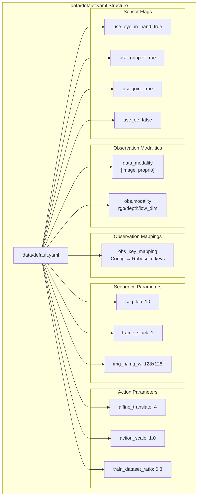
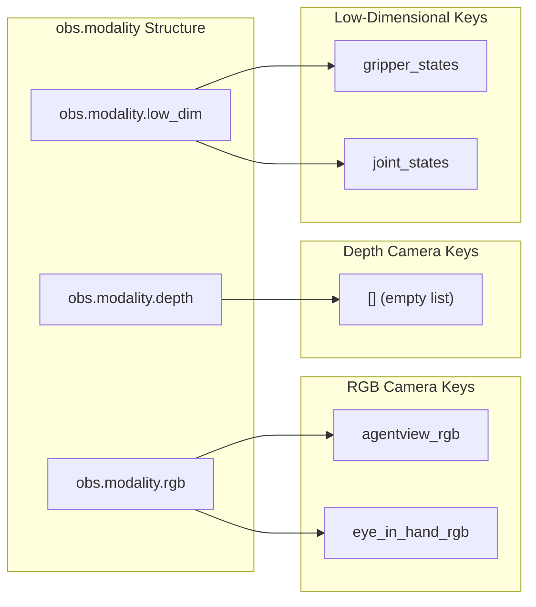
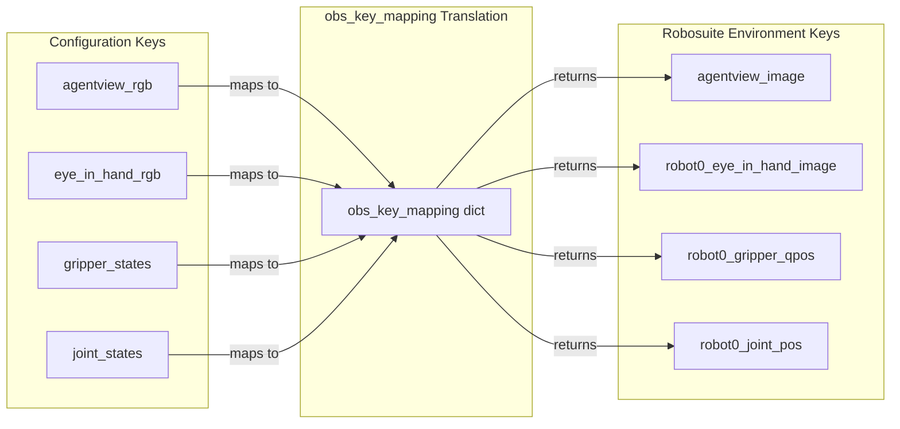
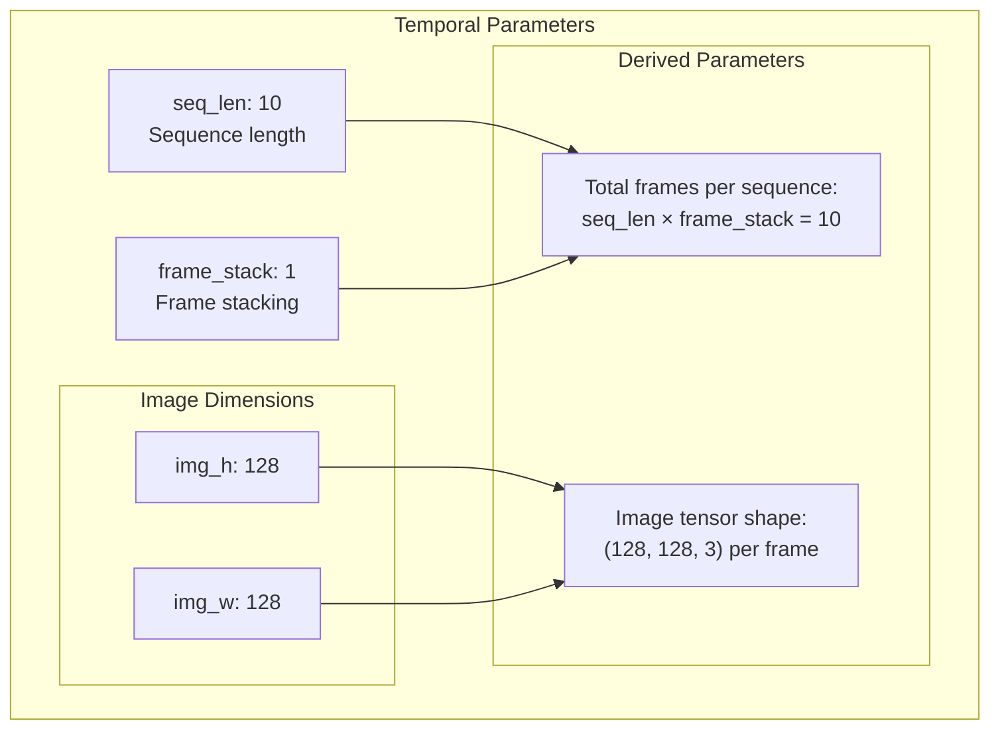
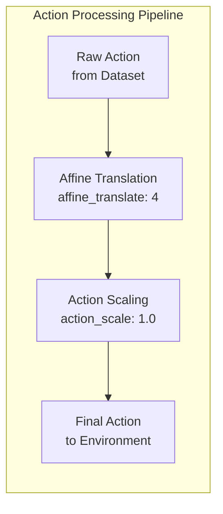
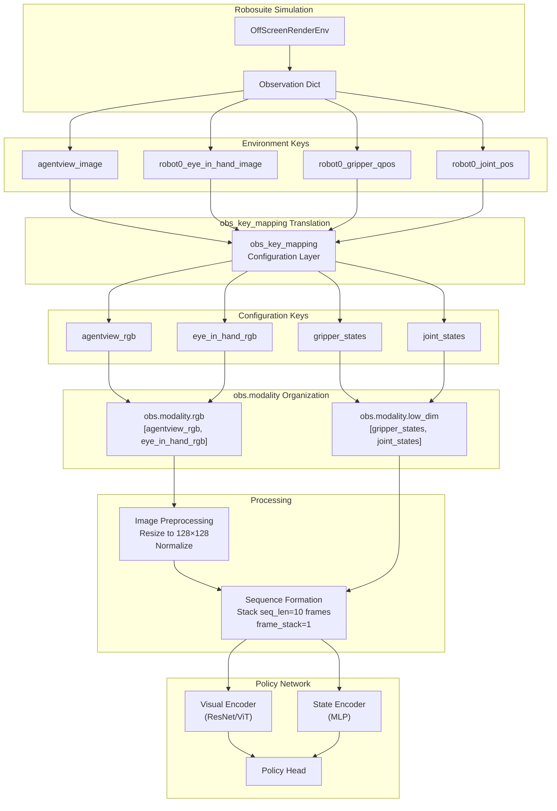

<!-- source: DeepWiki mcp.deepwiki.com · repo allenai/molmoact · page 7.2 Data Configuration · fetched 2026-10-26 -->

# Data Configuration

Relevant source files

The following files were used as context for generating this wiki page:

- [experiments/LIBERO/libero/configs/data/default.yaml](experiments/LIBERO/libero/configs/data/default.yaml)

## Purpose and Scope

This document describes the data configuration layer in the LIBERO system's Hydra-based configuration hierarchy. The data configuration defines how observations are processed, which sensors are used, how sequences are structured, and how actions are scaled during training and evaluation. This configuration is primarily defined in [experiments/LIBERO/libero/configs/data/default.yaml:1-40]().

For global system parameters such as random seeds and device allocation, see [Global Configuration](#7.1). For evaluation parameters including batch sizes and episode limits, see [Evaluation Configuration](#7.3). For lifelong learning algorithm-specific parameters, see [Lifelong Learning Algorithm Configuration](#7.4).

**Sources**: experiments/LIBERO/libero/configs/data/default.yaml

---

## Configuration File Structure

The data configuration file is organized into four main sections: observation modalities, observation mappings, sequence parameters, and action parameters. The file uses YAML format and is loaded by Hydra during experiment initialization.

**Sources**: experiments/LIBERO/libero/configs/data/default.yaml

---

## Data Modalities

The `data_modality` parameter specifies which types of sensory input are used during training and evaluation. The default configuration uses two modalities defined at [experiments/LIBERO/libero/configs/data/default.yaml:2-4]():

| Parameter | Value | Description |
|-----------|-------|-------------|
| `data_modality[0]` | `"image"` | Visual observations from cameras |
| `data_modality[1]` | `"proprio"` | Proprioceptive state information (joint positions, gripper state) |

These modalities determine which observation processing pipelines are activated in the policy networks. Image modality triggers CNN/ViT encoders, while proprio modality processes low-dimensional continuous state vectors.

**Sources**: experiments/LIBERO/libero/configs/data/default.yaml:2-4

---

## Observation Structure and Modality Mapping

The observation structure is defined in the `obs` section at [experiments/LIBERO/libero/configs/data/default.yaml:23-27](), which maps modality types to specific observation keys:

### RGB Observations

The default configuration uses two RGB cameras:
- `agentview_rgb`: Third-person view of the manipulation scene
- `eye_in_hand_rgb`: Wrist-mounted camera (controlled by `use_eye_in_hand: true` flag)

### Depth Observations

The `depth` list is empty by default, indicating depth maps are not used in the standard configuration.

### Low-Dimensional Observations

Two low-dimensional state vectors are included:
- `gripper_states`: Gripper joint positions (controlled by `use_gripper: true` flag)
- `joint_states`: Robot arm joint positions (controlled by `use_joint: true` flag)

**Sources**: experiments/LIBERO/libero/configs/data/default.yaml:23-27

---

## Observation Key Mapping

The `obs_key_mapping` section at [experiments/LIBERO/libero/configs/data/default.yaml:30-34]() provides a critical translation layer between configuration observation keys and the actual keys returned by the robosuite simulation environment:

### Mapping Table

| Configuration Key | Robosuite Environment Key | Data Type |
|-------------------|---------------------------|-----------|
| `agentview_rgb` | `agentview_image` | RGB image (H×W×3) |
| `eye_in_hand_rgb` | `robot0_eye_in_hand_image` | RGB image (H×W×3) |
| `gripper_states` | `robot0_gripper_qpos` | Vector (gripper DoF) |
| `joint_states` | `robot0_joint_pos` | Vector (7 joints) |

This mapping allows the policy configuration to use semantic names (e.g., `agentview_rgb`) while the environment interface retrieves data using simulator-specific keys (e.g., `agentview_image`). The `robot0_` prefix indicates observations from the first robot in multi-robot scenarios.

**Sources**: experiments/LIBERO/libero/configs/data/default.yaml:30-34

---

## Sequence and Frame Parameters

These parameters control temporal aspects of observation processing:

### Parameter Definitions

| Parameter | Value | Location | Description |
|-----------|-------|----------|-------------|
| `seq_len` | `10` | [default.yaml:5]() | Number of consecutive timesteps in each training sequence |
| `frame_stack` | `1` | [default.yaml:6]() | Number of frames stacked per timestep (1 = no stacking) |
| `img_h` | `128` | [default.yaml:16]() | Image height in pixels |
| `img_w` | `128` | [default.yaml:17]() | Image width in pixels |

### Additional Parameters

| Parameter | Value | Location | Description |
|-----------|-------|----------|-------------|
| `max_word_len` | `25` | [default.yaml:12]() | Maximum length for task descriptions in tokens |
| `state_dim` | `null` | [default.yaml:14]() | Dimension of state vector (computed dynamically) |
| `num_kp` | `64` | [default.yaml:15]() | Number of keypoints for spatial representations |

**Sources**: experiments/LIBERO/libero/configs/data/default.yaml:5-17

---

## Sensor Configuration Flags

Boolean flags at [experiments/LIBERO/libero/configs/data/default.yaml:7-10]() control which sensors are active:

| Flag | Value | Description |
|------|-------|-------------|
| `use_eye_in_hand` | `true` | Include wrist-mounted camera observations |
| `use_gripper` | `true` | Include gripper joint position in proprioceptive state |
| `use_joint` | `true` | Include arm joint positions in proprioceptive state |
| `use_ee` | `false` | Include end-effector pose (disabled by default) |

These flags allow flexible sensor configurations without modifying the observation structure. When a flag is `false`, the corresponding observation key is excluded from data loading pipelines.

**Sources**: experiments/LIBERO/libero/configs/data/default.yaml:7-10

---

## Action Configuration

Action-related parameters at [experiments/LIBERO/libero/configs/data/default.yaml:37-39]() control how actions are processed:

### Parameter Definitions

| Parameter | Value | Location | Description |
|-----------|-------|----------|-------------|
| `affine_translate` | `4` | [default.yaml:37]() | Affine transformation parameter for action space normalization |
| `action_scale` | `1.0` | [default.yaml:38]() | Global scaling factor applied to all action dimensions |
| `train_dataset_ratio` | `0.8` | [default.yaml:39]() | Fraction of demonstrations used for training (remainder for validation) |

The `train_dataset_ratio` of 0.8 creates an 80/20 train/validation split from the demonstration dataset, enabling validation during training without a separate validation set.

**Sources**: experiments/LIBERO/libero/configs/data/default.yaml:37-39

---

## Task Organization Parameters

Parameters at [experiments/LIBERO/libero/configs/data/default.yaml:19-21]() control how tasks are grouped and ordered during lifelong learning:

| Parameter | Value | Description |
|-----------|-------|-------------|
| `task_group_size` | `1` | Number of tasks trained simultaneously (1 = sequential learning) |
| `task_order_index` | `0` | Index selecting predefined task ordering (for reproducibility) |
| `shuffle_task` | `false` | Whether to randomize task order within groups |

These parameters are particularly relevant for lifelong learning experiments where multiple tasks are learned sequentially or in groups. A `task_group_size` of 1 with `shuffle_task: false` ensures strict sequential learning in a deterministic order.

**Sources**: experiments/LIBERO/libero/configs/data/default.yaml:19-21

---

## Data Flow: Simulation to Model

The complete data processing pipeline shows how observations flow from the robosuite simulator through the configuration layer to the policy network:

**Sources**: experiments/LIBERO/libero/configs/data/default.yaml

---

## Usage in Training and Evaluation

The data configuration is loaded via Hydra and accessed throughout the LIBERO codebase. The configuration object is typically passed to dataset loaders, environment wrappers, and policy networks to ensure consistent data processing.

### Key Integration Points

1. **Dataset Loading**: The `data_modality` and `obs.modality` parameters determine which observation streams are loaded from HDF5 demonstration files.

2. **Environment Interface**: The `obs_key_mapping` is used to translate between environment observations and policy inputs during evaluation.

3. **Sequence Formation**: `seq_len` and `frame_stack` control how temporal sequences are constructed for recurrent or transformer policies.

4. **Action Normalization**: `affine_translate` and `action_scale` are applied during action prediction and execution.

5. **Train/Val Split**: `train_dataset_ratio` determines the dataset split for training and validation phases.

**Sources**: experiments/LIBERO/libero/configs/data/default.yaml

---

