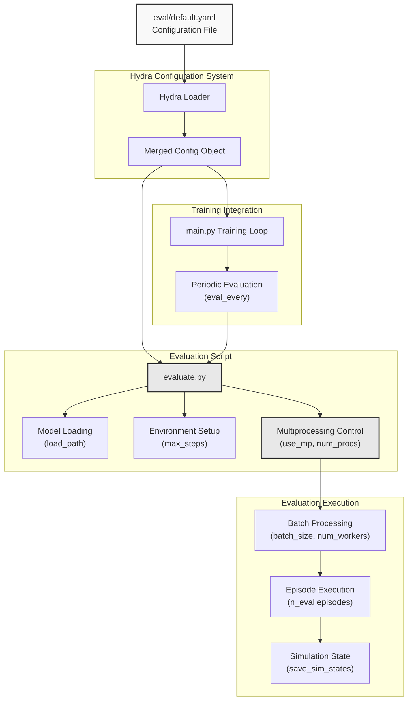
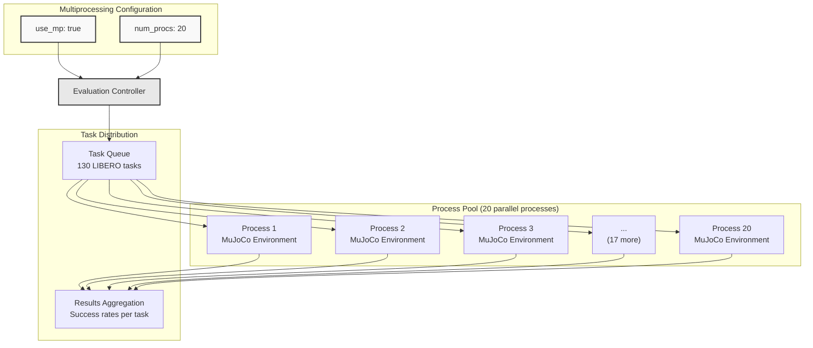
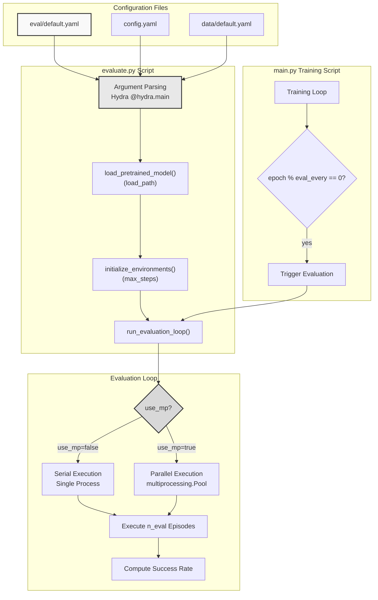

<!-- source: DeepWiki mcp.deepwiki.com · repo allenai/molmoact · page 7.3 Evaluation Configuration · fetched 2026-10-26 -->

# Evaluation Configuration

<details>
<summary>Relevant source files</summary>

The following files were used as context for generating this wiki page:

- [experiments/LIBERO/libero/configs/eval/default.yaml](experiments/LIBERO/libero/configs/eval/default.yaml)

</details>


## Purpose and Scope

This document describes the evaluation configuration system for the LIBERO benchmark framework. The evaluation configuration defines parameters that control how trained models are evaluated across LIBERO's task suites, including batch processing, multiprocessing settings, episode limits, and simulation state management.

For information about the broader configuration system structure, see [Global Configuration](#7.1). For training-related configurations, see [Lifelong Learning Algorithm Configuration](#7.4). For details on the evaluation script execution, see [LIBERO Training and Evaluation Scripts](#6.4).

**Sources:** [experiments/LIBERO/libero/configs/eval/default.yaml:1-11]()

---

## Configuration File Location

The evaluation configuration is defined in `experiments/LIBERO/libero/configs/eval/default.yaml`. This file is part of LIBERO's Hydra-based configuration system and is automatically loaded when running evaluation tasks.

```yaml
load_path: ""
eval: true
batch_size: 64
num_workers: 4
n_eval: 20
eval_every: 5
max_steps: 600
use_mp: true
num_procs: 20
save_sim_states: false
```

**Sources:** [experiments/LIBERO/libero/configs/eval/default.yaml:1-11]()

---

## Configuration Parameters

### Parameter Reference Table

| Parameter | Type | Default Value | Description |
|-----------|------|---------------|-------------|
| `load_path` | string | `""` | Path to pretrained model checkpoint for standalone evaluation |
| `eval` | boolean | `true` | Flag to enable evaluation mode |
| `batch_size` | integer | `64` | Number of samples processed in parallel during evaluation |
| `num_workers` | integer | `4` | Number of data loader worker threads |
| `n_eval` | integer | `20` | Number of evaluation episodes per task |
| `eval_every` | integer | `5` | Frequency of evaluation during training (in epochs) |
| `max_steps` | integer | `600` | Maximum number of environment steps per episode |
| `use_mp` | boolean | `true` | Enable multiprocessing for parallel environment execution |
| `num_procs` | integer | `20` | Number of parallel processes when multiprocessing is enabled |
| `save_sim_states` | boolean | `false` | Whether to save MuJoCo simulation states during evaluation |

**Sources:** [experiments/LIBERO/libero/configs/eval/default.yaml:1-11]()

---

## Evaluation Configuration Flow

The following diagram illustrates how evaluation configuration parameters flow through the LIBERO evaluation system:



**Sources:** [experiments/LIBERO/libero/configs/eval/default.yaml:1-11]()

---

## Detailed Parameter Descriptions

### Model Loading Parameters

#### `load_path`
- **Type:** string
- **Default:** `""` (empty string)
- **Usage:** Specifies the file system path to a pretrained model checkpoint
- **Context:** Only used when running standalone evaluation (`evaluate.py`) separately from training. During integrated training runs with periodic evaluation, the current training checkpoint is used automatically.

#### `eval`
- **Type:** boolean
- **Default:** `true`
- **Usage:** Master flag that enables evaluation mode
- **Context:** When set to `true`, the evaluation pipeline is activated. This flag distinguishes evaluation runs from training-only runs.

**Sources:** [experiments/LIBERO/libero/configs/eval/default.yaml:1-2]()

---

### Batch Processing Parameters

#### `batch_size`
- **Type:** integer
- **Default:** `64`
- **Usage:** Controls the number of samples processed simultaneously during policy rollout
- **Impact:** Larger batch sizes improve GPU utilization but require more memory. This parameter affects the speed-memory tradeoff during evaluation.

#### `num_workers`
- **Type:** integer
- **Default:** `4`
- **Usage:** Number of worker threads for data loading operations
- **Impact:** Higher values can improve data loading throughput but consume more CPU resources. The optimal value depends on the I/O characteristics of the evaluation dataset.

**Sources:** [experiments/LIBERO/libero/configs/eval/default.yaml:3-4]()

---

### Episode Execution Parameters

#### `n_eval`
- **Type:** integer
- **Default:** `20`
- **Usage:** Number of evaluation episodes executed per task
- **Context:** LIBERO tasks are evaluated across multiple episodes to compute success rate statistics. Each episode runs until task completion or `max_steps` is reached.

#### `eval_every`
- **Type:** integer
- **Default:** `5`
- **Usage:** Evaluation frequency during training, measured in epochs
- **Context:** When training with `main.py`, evaluation is triggered every `eval_every` epochs. This allows monitoring model performance throughout the training process without excessive overhead.

#### `max_steps`
- **Type:** integer
- **Default:** `600`
- **Usage:** Maximum number of environment steps allowed per episode
- **Context:** Episodes terminate when either the task is completed successfully or `max_steps` is reached. This prevents infinite episodes and bounds evaluation time.

**Sources:** [experiments/LIBERO/libero/configs/eval/default.yaml:5-7]()

---

## Multiprocessing Configuration

The evaluation system supports parallel execution across multiple processes to accelerate evaluation across LIBERO's 130 tasks.



### Multiprocessing Parameters

#### `use_mp`
- **Type:** boolean
- **Default:** `true`
- **Usage:** Enables parallel evaluation across multiple processes
- **Behavior:** When `true`, the evaluation system spawns `num_procs` worker processes, each running independent MuJoCo simulation instances. When `false`, evaluation runs serially in a single process.

#### `num_procs`
- **Type:** integer
- **Default:** `20`
- **Usage:** Number of parallel worker processes for multiprocessing evaluation
- **Context:** Each process maintains its own MuJoCo physics simulation. With 20 processes evaluating 20 episodes per task, a single task's evaluation can complete in approximately 1/20th of the serial execution time.
- **Hardware Considerations:** The optimal value depends on available CPU cores. The default of 20 is suitable for workstations with 20+ cores.

**Sources:** [experiments/LIBERO/libero/configs/eval/default.yaml:8-9]()

---

## Simulation State Management

#### `save_sim_states`
- **Type:** boolean
- **Default:** `false`
- **Usage:** Controls whether MuJoCo simulation states are saved during evaluation
- **Context:** When enabled, the system persists the complete simulation state at each timestep, allowing for later replay and analysis. This feature is useful for debugging and trajectory visualization but significantly increases storage requirements.
- **Storage Impact:** Simulation states include all object positions, velocities, and physics solver state. For a 600-step episode, this can consume several megabytes per episode.

**Sources:** [experiments/LIBERO/libero/configs/eval/default.yaml:10]()

---

## Integration with Evaluation Scripts

The following diagram shows how the evaluation configuration integrates with LIBERO's execution scripts:



**Sources:** [experiments/LIBERO/libero/configs/eval/default.yaml:1-11]()

---

## Configuration Override Examples

The Hydra configuration system allows runtime overrides of evaluation parameters. Here are common usage patterns:

### Standalone Evaluation with Custom Checkpoint
```bash
python evaluate.py \
    eval.load_path=/path/to/checkpoint.pth \
    eval.n_eval=50 \
    eval.max_steps=1000
```

### Disable Multiprocessing for Debugging
```bash
python evaluate.py \
    eval.use_mp=false \
    eval.save_sim_states=true
```

### High-Throughput Evaluation
```bash
python evaluate.py \
    eval.batch_size=128 \
    eval.num_procs=40 \
    eval.num_workers=8
```

### Training with Frequent Evaluation
```bash
python main.py \
    eval.eval_every=1 \
    eval.n_eval=10
```

**Sources:** [experiments/LIBERO/libero/configs/eval/default.yaml:1-11]()

---

## Performance Considerations

### Computational Trade-offs

| Parameter | Increase Effect | Resource Impact |
|-----------|----------------|-----------------|
| `batch_size` | Faster GPU utilization | Higher GPU memory usage |
| `num_workers` | Faster data loading | Higher CPU usage, more memory overhead |
| `n_eval` | More reliable statistics | Longer evaluation time |
| `num_procs` | Faster parallel evaluation | Higher CPU/memory usage, `n_eval × num_procs` concurrent envs |
| `max_steps` | Allows longer episodes | Increased per-episode time |

### Recommended Configurations

**Fast Development Testing:**
```yaml
n_eval: 5
num_procs: 4
max_steps: 300
```

**Production Evaluation:**
```yaml
n_eval: 20
num_procs: 20
max_steps: 600
```

**High-Precision Benchmarking:**
```yaml
n_eval: 50
num_procs: 40
max_steps: 1000
save_sim_states: true
```

**Sources:** [experiments/LIBERO/libero/configs/eval/default.yaml:1-11]()

---

## Related Configuration Files

The evaluation configuration works in conjunction with other LIBERO configuration files:

- **Global Configuration ([7.1](#7.1))**: Provides seed values, device allocation, and wandb integration that affect evaluation reproducibility
- **Data Configuration ([7.2](#7.2))**: Defines observation modalities and image dimensions used during policy rollout
- **Algorithm Configuration ([7.4](#7.4))**: Specifies policy architecture parameters that are loaded during evaluation

These configurations are merged by Hydra at runtime to form the complete evaluation environment configuration.

**Sources:** [experiments/LIBERO/libero/configs/eval/default.yaml:1-11]()

---

