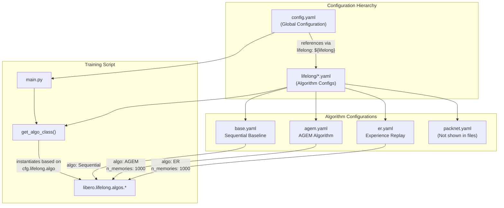
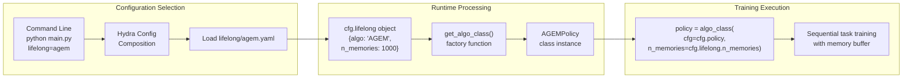
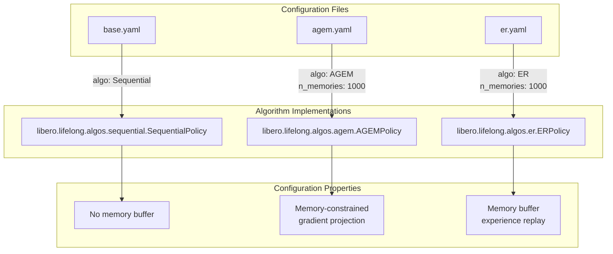

<!-- source: DeepWiki mcp.deepwiki.com · repo allenai/molmoact · page 7.4 Lifelong Learning Algorithm Configuration · fetched 2026-10-26 -->

# Lifelong Learning Algorithm Configuration

<details>
<summary>Relevant source files</summary>

The following files were used as context for generating this wiki page:

- [experiments/LIBERO/libero/configs/lifelong/agem.yaml](experiments/LIBERO/libero/configs/lifelong/agem.yaml)
- [experiments/LIBERO/libero/configs/lifelong/base.yaml](experiments/LIBERO/libero/configs/lifelong/base.yaml)
- [experiments/LIBERO/libero/configs/lifelong/er.yaml](experiments/LIBERO/libero/configs/lifelong/er.yaml)

</details>


## Purpose and Scope

This document describes the configuration files for lifelong learning algorithms in the LIBERO benchmark framework. These YAML configuration files define algorithm selection and hyperparameters for continual learning experiments, including memory-based methods and sequential baselines.

For information about the lifelong learning algorithms themselves (AGEM, ER, PackNet) and their implementations, see [Lifelong Learning Algorithms](#6.3). For the overall configuration system architecture and how these configurations integrate with global settings, see [Configuration System](#7). For training execution using these configurations, see [LIBERO Training and Evaluation Scripts](#6.4).

## Configuration File Structure

The lifelong learning algorithm configurations are located in `experiments/LIBERO/libero/configs/lifelong/` and follow a simple key-value structure compatible with Hydra's configuration composition system. Each configuration file specifies an algorithm type and its associated hyperparameters.



**Sources:** [experiments/LIBERO/libero/configs/lifelong/base.yaml:1-2](), [experiments/LIBERO/libero/configs/lifelong/agem.yaml:1-3](), [experiments/LIBERO/libero/configs/lifelong/er.yaml:1-3]()

## Algorithm Configuration Files

### Base Sequential Configuration

The `base.yaml` configuration defines the sequential baseline approach, where tasks are learned one after another without any continual learning strategy.

```yaml
algo: Sequential
```

This configuration specifies only the algorithm type with no additional hyperparameters. The `Sequential` algorithm trains on each task independently without attempting to mitigate catastrophic forgetting.

**Sources:** [experiments/LIBERO/libero/configs/lifelong/base.yaml:1-2]()

### AGEM Configuration

The `agem.yaml` configuration defines the Average Gradient Episodic Memory (AGEM) algorithm, which uses a memory buffer to prevent catastrophic forgetting.

```yaml
algo: AGEM
n_memories: 1000
```

| Parameter | Type | Value | Description |
|-----------|------|-------|-------------|
| `algo` | string | `"AGEM"` | Algorithm identifier for class instantiation |
| `n_memories` | integer | `1000` | Number of experiences stored in episodic memory buffer |

The `n_memories` parameter controls the size of the replay buffer used to constrain gradient updates. AGEM maintains a memory of past experiences and projects the current gradient to ensure it does not increase loss on stored memories.

**Sources:** [experiments/LIBERO/libero/configs/lifelong/agem.yaml:1-3]()

### Experience Replay Configuration

The `er.yaml` configuration defines the Experience Replay (ER) algorithm, which interleaves training on current tasks with replayed experiences from previous tasks.

```yaml
algo: ER
n_memories: 1000
```

| Parameter | Type | Value | Description |
|-----------|------|-------|-------------|
| `algo` | string | `"ER"` | Algorithm identifier for class instantiation |
| `n_memories` | integer | `1000` | Number of experiences stored in replay buffer |

Experience Replay maintains a buffer of past experiences and samples from this buffer during training on new tasks to maintain performance on previously learned tasks. The `n_memories` parameter determines the buffer capacity.

**Sources:** [experiments/LIBERO/libero/configs/lifelong/er.yaml:1-3]()

## Configuration Parameter Summary

The following table summarizes all configuration parameters across lifelong learning algorithms:

| Parameter | Sequential | AGEM | ER | Description |
|-----------|-----------|------|----|----|
| `algo` | ✓ | ✓ | ✓ | Algorithm identifier (required) |
| `n_memories` | - | ✓ | ✓ | Memory buffer size (for memory-based methods) |

## Configuration Usage Pattern



When executing a LIBERO training run, users specify the lifelong learning algorithm via command-line argument:

```bash
python main.py lifelong=agem benchmark=libero_spatial
```

This causes Hydra to load `experiments/LIBERO/libero/configs/lifelong/agem.yaml` and merge it into the global configuration under `cfg.lifelong`. The training script then uses `cfg.lifelong.algo` to instantiate the appropriate algorithm class and passes `cfg.lifelong.n_memories` (if present) to configure the memory buffer.

**Sources:** [experiments/LIBERO/libero/configs/lifelong/agem.yaml:1-3](), [experiments/LIBERO/libero/configs/lifelong/er.yaml:1-3](), [experiments/LIBERO/libero/configs/lifelong/base.yaml:1-2]()

## Memory Buffer Configuration Guidelines

For memory-based algorithms (AGEM and ER), the `n_memories` parameter represents a critical trade-off:

- **Lower values** (e.g., 100-500): Reduced memory overhead, faster training, but potentially weaker prevention of catastrophic forgetting
- **Default value** (1000): Balanced trade-off suitable for most LIBERO benchmark tasks
- **Higher values** (e.g., 2000-5000): Stronger retention of previous tasks but increased memory consumption and potential overfitting to stored experiences

The default value of 1000 is calibrated for LIBERO's task complexity and typical trajectory lengths. For experiments on LIBERO-90 (90 tasks for pre-training), this provides sufficient capacity to maintain diverse experiences across the task sequence.

## Algorithm-Configuration Mapping



Each configuration file maps directly to a specific policy implementation class in `libero.lifelong.algos`. The `algo` field determines which class is instantiated, while additional parameters like `n_memories` are passed to the class constructor.

**Sources:** [experiments/LIBERO/libero/configs/lifelong/base.yaml:1-2](), [experiments/LIBERO/libero/configs/lifelong/agem.yaml:1-3](), [experiments/LIBERO/libero/configs/lifelong/er.yaml:1-3]()

## Integration with Global Configuration

The lifelong learning configuration integrates with the broader LIBERO configuration system through Hydra's composition mechanism. The global `config.yaml` includes a reference to the lifelong configuration:

```yaml
defaults:
  - lifelong: ${lifelong}
```

This allows runtime selection of the algorithm configuration, defaulting to the value specified by the `lifelong` variable (which can be overridden via command line). The selected configuration is then accessible throughout the codebase as `cfg.lifelong`.

For details on other configuration components (data, evaluation, policy), see:
- [Global Configuration](#7.1) for overall configuration structure
- [Data Configuration](#7.2) for observation and data processing settings
- [Evaluation Configuration](#7.3) for evaluation parameters

**Sources:** [experiments/LIBERO/libero/configs/lifelong/base.yaml:1-2](), [experiments/LIBERO/libero/configs/lifelong/agem.yaml:1-3](), [experiments/LIBERO/libero/configs/lifelong/er.yaml:1-3]()

---

