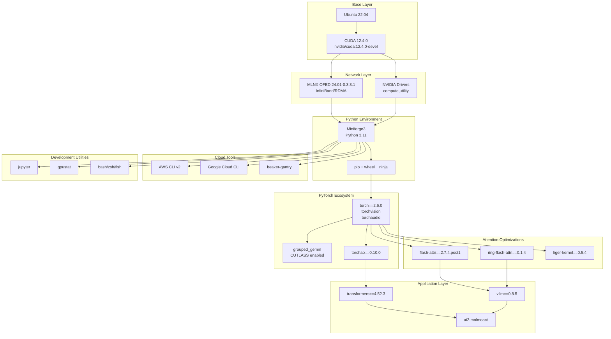
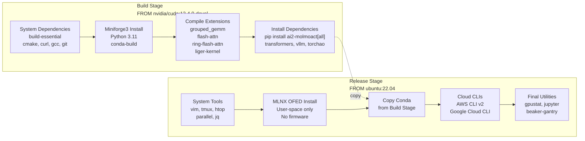
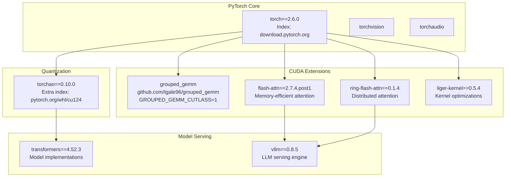
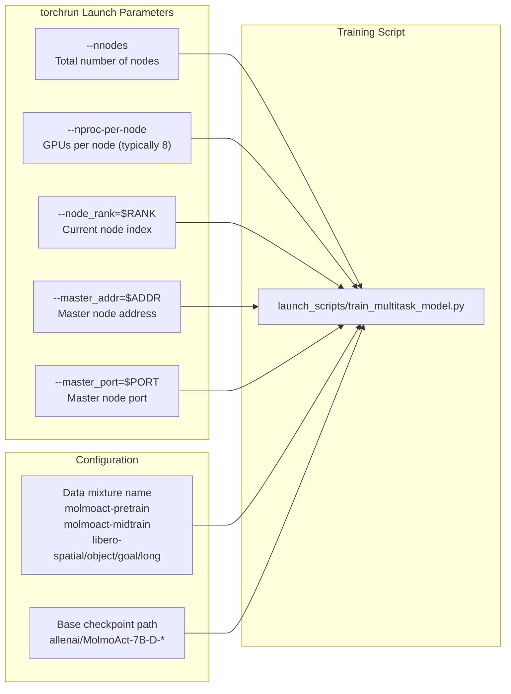
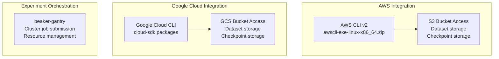
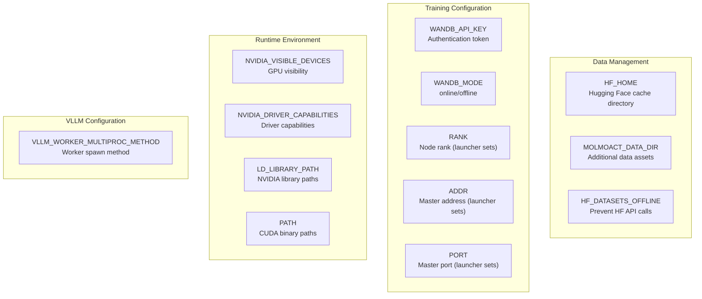

<!-- source: DeepWiki mcp.deepwiki.com · repo allenai/molmoact · page 8 Infrastructure and Deployment · fetched 2026-10-26 -->

# Infrastructure and Deployment

<details>
<summary>Relevant source files</summary>

The following files were used as context for generating this wiki page:

- [.dockerignore](.dockerignore)
- [Dockerfile](Dockerfile)

</details>


## Purpose and Scope

This document describes the infrastructure and deployment architecture for the MolmoAct training and evaluation system. It covers the Docker-based containerization strategy, GPU compute stack, distributed training setup, and cloud integration components. For training pipeline configuration and execution, see [Training Pipeline](#2). For evaluation infrastructure specifics, see [Evaluation Pipelines](#5).

---

## Infrastructure Architecture Overview

MolmoAct uses a layered infrastructure stack built on Ubuntu 22.04 with CUDA 12.4.0, designed to support multi-node distributed training on GPU clusters with InfiniBand networking.

### Infrastructure Stack Layers



**Sources:** [Dockerfile:1-178]()

### Key Component Versions

| Component | Version | Purpose |
|-----------|---------|---------|
| Ubuntu | 22.04 | Base operating system |
| CUDA | 12.4.0 | GPU compute platform |
| Python | 3.11 | Runtime environment |
| PyTorch | 2.6.0 | ML framework |
| MLNX OFED | 24.01-0.3.3.1 | InfiniBand drivers |
| transformers | 4.52.3 | Model implementations |
| vllm | 0.8.5 | High-throughput inference |
| flash-attn | 2.7.4.post1 | Memory-efficient attention |
| torchao | 0.10.0 | Quantization support |

**Sources:** [Dockerfile:1-95]()

---

## Docker Multi-Stage Build Process

The Docker build uses a two-stage architecture to optimize build time and runtime image size.

### Build Stage Architecture



**Sources:** [Dockerfile:9-178]()

### Build Stage Details

The build stage ([Dockerfile:13-95]()) uses `nvidia/cuda:12.4.0-devel-ubuntu22.04` as the base image to compile CUDA extensions:

1. **System Dependencies** ([Dockerfile:18-29]()): Installs build tools including `build-essential`, `cmake`, `gcc`, `git`.

2. **Miniforge3 Installation** ([Dockerfile:32-42]()): Downloads and installs Miniforge3 with Python 3.11, setting `PATH=/opt/conda/bin:$PATH`.

3. **PyTorch Installation** ([Dockerfile:44-49]()): Installs PyTorch 2.6.0 from test wheel index with `torchao`, `torchvision`, `torchaudio`.

4. **CUDA Architecture Targeting** ([Dockerfile:51]()): Sets `TORCH_CUDA_ARCH_LIST="8.0 9.0"` for Ampere and Hopper architectures.

5. **Grouped GEMM Compilation** ([Dockerfile:53-58]()): Builds `grouped_gemm` with CUTLASS support enabled via `GROUPED_GEMM_CUTLASS="1"`.

6. **Attention Kernel Compilation** ([Dockerfile:60-70]()): Compiles three attention optimization libraries:
   - `flash-attn==2.7.4.post1`
   - `ring-flash-attn==0.1.4`
   - `liger-kernel==0.5.4`

7. **Application Dependencies** ([Dockerfile:72-78]()): Installs `ai2-molmoact[all]` dependencies from `pyproject.toml`, then uninstalls the package itself.

8. **Specialized Libraries** ([Dockerfile:80-94]()): Installs `transformers==4.52.3`, `vllm==0.8.5`, and `torchao==0.10.0`.

### Release Stage Details

The release stage ([Dockerfile:100-178]()) creates an optimized runtime image:

1. **Base Image** ([Dockerfile:100]()): Switches to `ubuntu:22.04` (no CUDA toolkit).

2. **System Tools** ([Dockerfile:103-134]()): Installs runtime dependencies including development tools (`vim`, `emacs`), shells (`bash`, `zsh`, `fish`), utilities (`htop`, `tmux`, `parallel`, `jq`).

3. **MLNX OFED Installation** ([Dockerfile:136-145]()): Installs Mellanox OpenFabrics Enterprise Distribution for InfiniBand/RDMA support:
   ```
   MOFED_VER="24.01-0.3.3.1"
   mlnxofedinstall --basic --user-space-only --without-fw-update
   ```

4. **Conda Copy** ([Dockerfile:147-148]()): Copies compiled Python environment from build stage.

5. **Environment Variables** ([Dockerfile:150-154]()): Sets runtime environment:
   ```
   NVIDIA_VISIBLE_DEVICES=all
   NVIDIA_DRIVER_CAPABILITIES=compute,utility
   LD_LIBRARY_PATH=/usr/local/nvidia/lib:/usr/local/nvidia/lib64
   PATH=/usr/local/nvidia/bin:/usr/local/cuda/bin:$PATH
   ```

6. **Cloud CLIs** ([Dockerfile:156-165]()): Installs AWS CLI v2 and Google Cloud CLI.

7. **Python Utilities** ([Dockerfile:167-172]()): Installs `gpustat`, `jupyter`, `beaker-gantry`, `oocmap`.

**Sources:** [Dockerfile:9-178]()

---

## GPU and CUDA Configuration

### CUDA and GPU Architecture

MolmoAct targets specific GPU architectures through the `TORCH_CUDA_ARCH_LIST` environment variable.

| GPU Architecture | Compute Capability | Example GPUs |
|-----------------|-------------------|--------------|
| Ampere | 8.0 | A100, A30 |
| Hopper | 9.0 | H100, H200 |

**Sources:** [Dockerfile:51]()

### NVIDIA Runtime Configuration

The release image configures NVIDIA runtime through environment variables ([Dockerfile:151-154]()):

| Variable | Value | Purpose |
|----------|-------|---------|
| `NVIDIA_VISIBLE_DEVICES` | `all` | Makes all GPUs visible to container |
| `NVIDIA_DRIVER_CAPABILITIES` | `compute,utility` | Enables compute and utility capabilities |
| `LD_LIBRARY_PATH` | `/usr/local/nvidia/lib:/usr/local/nvidia/lib64` | NVIDIA library paths |
| `PATH` | `/usr/local/nvidia/bin:/usr/local/cuda/bin:$PATH` | CUDA binary paths |

### MLNX OFED for InfiniBand

The infrastructure includes MLNX OFED (Mellanox OpenFabrics Enterprise Distribution) version 24.01-0.3.3.1 for high-performance InfiniBand networking ([Dockerfile:136-145]()):

```bash
mlnxofedinstall --basic --user-space-only --without-fw-update -q
```

This enables RDMA (Remote Direct Memory Access) for efficient multi-node communication during distributed training.

**Sources:** [Dockerfile:136-154]()

---

## ML Framework and Optimization Stack

### PyTorch Ecosystem Components



**Sources:** [Dockerfile:44-95]()

### Attention Optimization Libraries

Three specialized attention libraries are compiled from source:

| Library | Version | Purpose | Build Configuration |
|---------|---------|---------|-------------------|
| flash-attn | 2.7.4.post1 | Memory-efficient attention mechanism | `--no-build-isolation` |
| ring-flash-attn | 0.1.4 | Distributed attention across devices | `--no-build-isolation` |
| liger-kernel | 0.5.4 | Fused kernel optimizations | `--no-build-isolation` |

All three are built with `--no-build-isolation` to ensure they use the same CUDA configuration ([Dockerfile:60-70]()).

### Grouped GEMM Configuration

The `grouped_gemm` library is compiled with CUTLASS support enabled ([Dockerfile:53-58]()):

```bash
export GROUPED_GEMM_CUTLASS="1"
pip install --no-build-isolation "grouped_gemm @ git+https://git@github.com/tgale96/grouped_gemm.git@main"
```

This enables passing batch sizes on GPU for efficient batched operations.

**Sources:** [Dockerfile:44-95]()

---

## Distributed Training Infrastructure

### Environment Variables for Multi-Node Training

MolmoAct uses standard PyTorch distributed training environment variables:

| Variable | Purpose | Example Values |
|----------|---------|---------------|
| `HF_HOME` | Hugging Face cache location | `/data/molmoact/huggingface` |
| `MOLMOACT_DATA_DIR` | Additional data assets | `/data/molmoact` |
| `HF_DATASETS_OFFLINE` | Prevent rate limiting | `1` |
| `WANDB_API_KEY` | Weights & Biases authentication | User-provided |
| `WANDB_MODE` | W&B logging mode | `offline` or omitted |
| `VLLM_WORKER_MULTIPROC_METHOD` | vllm worker spawn method | `spawn` |

**Sources:** [README.md:116-123](), [README.md:178-205](), [README.md:325]()

### Torchrun Configuration

Distributed training uses `torchrun` launcher with the following parameters:



**Sources:** [README.md:177-196](), [README.md:225-243](), [README.md:257-278]()

### Training Launch Examples

**Pre-training (256 GPUs, 32 nodes):**
```bash
torchrun \
    --nnodes=32 --nproc-per-node=8 \
    --node_rank="${RANK}" --master_addr="${ADDR}" --master_port="${PORT}" \
    launch_scripts/train_multitask_model.py \
    molmoact-pretrain allenai/MolmoAct-7B-D-Captioner-0812 \
    --global_batch_size 512
```

**Mid-training (128 GPUs, 16 nodes):**
```bash
torchrun --nnodes=16 --nproc-per-node=8 \
    --node_rank="${RANK}" --master_addr="${ADDR}" --master_port="${PORT}" \
    launch_scripts/train_multitask_model.py \
    molmoact-midtrain allenai/MolmoAct-7B-D-Pretrain-0812 \
    --global_batch_size 256
```

**Post-training (64 GPUs, 8 nodes):**
```bash
torchrun --nnodes=8 --nproc-per-node=8 \
    --node_rank="${RANK}" --master_addr="${ADDR}" --master_port="${PORT}" \
    launch_scripts/train_multitask_model.py \
    libero-spatial allenai/MolmoAct-7B-D-0812 \
    --global_batch_size 128
```

**Sources:** [README.md:177-196](), [README.md:225-243](), [README.md:257-278]()

### Weights & Biases Integration

W&B integration is configured through command-line arguments:

| Parameter | Purpose | Example |
|-----------|---------|---------|
| `--wandb.name` | Run name | `molmoact-pretrain-v1` |
| `--wandb.entity` | W&B entity/team | Organization name |
| `--wandb.project` | Project name | `molmoact-training` |
| `--wandb=null` | Disable W&B | Disables all logging |

Offline mode is enabled by setting `WANDB_MODE=offline` ([README.md:204]()).

### HF Datasets Offline Mode

To prevent rate limiting during distributed training, set:

```bash
export HF_DATASETS_OFFLINE=1
```

This prevents all nodes from simultaneously requesting data from Hugging Face APIs during initialization ([README.md:171]()).

**Sources:** [README.md:177-206](), [README.md:171]()

---

## Cloud Storage and Orchestration

### Cloud CLI Integration



**Sources:** [Dockerfile:156-172]()

### AWS CLI Installation

AWS CLI v2 is installed via official Linux installer ([Dockerfile:156-160]()):

```bash
curl "https://awscli.amazonaws.com/awscli-exe-linux-x86_64.zip" -o "awscliv2.zip"
unzip awscliv2.zip
sudo ./aws/install
rm -rf aws
```

### Google Cloud CLI Installation

Google Cloud CLI is installed via APT repository ([Dockerfile:162-165]()):

```bash
curl https://packages.cloud.google.com/apt/doc/apt-key.gpg | sudo gpg --dearmor -o /usr/share/keyrings/cloud.google.gpg
echo "deb [signed-by=/usr/share/keyrings/cloud.google.gpg] https://packages.cloud.google.com/apt cloud-sdk main" | sudo tee -a /etc/apt/sources.list.d/google-cloud-sdk.list
sudo apt-get update && sudo apt-get -y install google-cloud-cli
```

### Beaker Gantry

The `beaker-gantry` package ([Dockerfile:171]()) provides experiment orchestration capabilities for cluster-based training:
- Job submission to Beaker clusters
- Resource allocation and management
- Experiment tracking and reproducibility

**Sources:** [Dockerfile:156-172]()

---

## Development and Monitoring Tools

### GPU Monitoring

The `gpustat` utility ([Dockerfile:169]()) provides real-time GPU monitoring:
- GPU utilization
- Memory usage
- Temperature monitoring
- Process listing

### Interactive Development

| Tool | Purpose | Installation |
|------|---------|--------------|
| jupyter | Notebook environment | [Dockerfile:170]() |
| vim | Text editor | [Dockerfile:116]() |
| emacs | Text editor | [Dockerfile:125]() |
| tmux | Terminal multiplexer | [Dockerfile:123]() |

### Shell Environments

Three shell options are installed ([Dockerfile:119-121]()):
- `bash` (default)
- `zsh`
- `fish`

### Additional Utilities

| Utility | Purpose |
|---------|---------|
| htop | Process monitoring |
| parallel | Parallel command execution |
| jq | JSON processing |
| rsync | File synchronization |

**Sources:** [Dockerfile:103-134](), [Dockerfile:167-172]()

---

## Build and Runtime Optimization

### Multi-Stage Build Benefits

The two-stage build provides several optimizations:

1. **Build Stage Isolation**: Heavy compilation dependencies (build-essential, cmake) are excluded from final image.

2. **Shared CUDA Extensions**: Compiled CUDA extensions are built once in the build stage and copied to release.

3. **Reduced Image Size**: Final image contains only runtime dependencies and compiled artifacts.

4. **Layer Caching**: Build stage layers are cached independently, speeding up rebuilds when only application code changes.

### Docker Build Arguments

Key build arguments control the build process:

| Argument | Default | Purpose |
|----------|---------|---------|
| `UBUNTU_VERSION` | 22.04 | Base OS version |
| `CUDA_VERSION` | 12.4.0 | CUDA toolkit version |
| `PYTHON_VERSION` | 3.11 | Python version |
| `TORCH_VERSION` | 2.6.0 | PyTorch version |
| `FLASH_ATTN_VERSION` | 2.7.4.post1 | flash-attn version |
| `VLLM_VERSION` | 0.8.5 | vllm version |
| `TRANSFORMERS_VERSION` | 4.52.3 | transformers version |

**Sources:** [Dockerfile:1-95]()

### Node Capacity

The build stage is configured with capacity for 32-node training clusters, as evidenced by the pre-training configuration using `--nnodes=32` ([README.md:179]()).

**Sources:** [Dockerfile:1-178](), [README.md:177-196]()

---

## Checkpoint and Storage Management

### Checkpoint Saving Configuration

Training scripts support flexible checkpoint management through command-line arguments:

| Parameter | Purpose | Default Behavior |
|-----------|---------|------------------|
| `--save_folder` | Checkpoint directory | Required |
| `--save_overwrite` | Overwrite existing checkpoints | Disabled |
| `--save_interval` | Steps between checkpoints | Varies by stage |
| `--save_num_checkpoints_to_keep` | Checkpoint retention limit | 5 |
| `--save_final_unsharded_checkpoint` | Save unsharded final checkpoint | Enabled |
| `--save_intermediate_unsharded_checkpoint` | Save unsharded intermediate checkpoints | Disabled |

**Sources:** [README.md:177-210]()

### Checkpoint Format Strategy

By default, intermediate checkpoints are saved in sharded format for efficiency, while the final checkpoint is also saved in unsharded format for easier deployment ([README.md:207-209]()).

### Storage Requirements

Approximate storage requirements per training stage:

| Stage | Duration | Checkpoints | Approximate Storage |
|-------|----------|-------------|-------------------|
| Pre-training | 100k steps | 5 (every 20k) | ~200GB |
| Mid-training | 50k steps | 5 (every 10k) | ~200GB |
| Post-training | 40k-80k steps | 5 (every 10k) | ~100GB |

**Sources:** [README.md:177-296]()

---

## Environment Variable Reference

### Complete Environment Variable List



**Sources:** [Dockerfile:150-154](), [README.md:116-123](), [README.md:178-206](), [README.md:325]()

### Environment Setup Script Example

```bash
# Data directories
export MOLMOACT_DATA_DIR=/data/molmoact
export HF_HOME=/data/molmoact/huggingface

# Prevent rate limiting
export HF_DATASETS_OFFLINE=1

# Weights & Biases
export WANDB_API_KEY=<your_key>
export WANDB_MODE=offline  # Optional

# VLLM configuration
export VLLM_WORKER_MULTIPROC_METHOD=spawn
```

**Sources:** [README.md:116-123](), [README.md:171](), [README.md:325]()

---

