<!-- source: DeepWiki mcp.deepwiki.com · repo allenai/molmoact · page 8.1 Docker Environment · fetched 2026-10-26 -->

# Docker Environment

<details>
<summary>Relevant source files</summary>

The following files were used as context for generating this wiki page:

- [.dockerignore](.dockerignore)
- [Dockerfile](Dockerfile)

</details>


## Purpose and Scope

This document describes the Docker containerization system for MolmoAct, which packages the entire training and inference stack into reproducible container images. The multi-stage build architecture optimizes for both comprehensive dependency installation and minimal final image size, supporting deployment to local GPU workstations, multi-node training clusters, and cloud platforms.

For information about distributed training configuration across multiple nodes, see [Distributed Training Setup](#8.3). For GPU-specific configuration details, see [GPU and CUDA Configuration](#8.2). For local development without Docker, see [Development Environment](#8.4).

**Sources:** [Dockerfile:1-178]()

---

## Multi-stage Build Architecture

The Docker build uses a two-stage architecture where a development image compiles all dependencies, and a minimal release image copies only the runtime artifacts. This approach reduces the final image size while maintaining a complete build toolchain during compilation.

### Build Flow Diagram

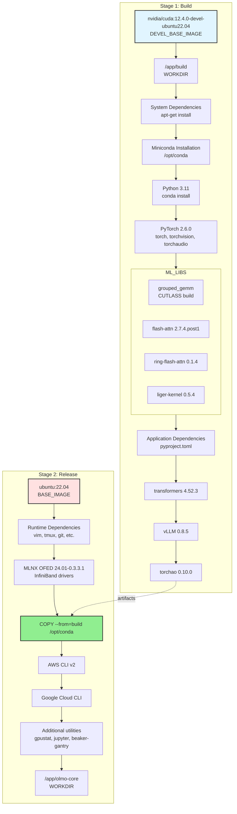

The build stage uses `nvidia/cuda:12.4.0-devel-ubuntu22.04` which includes CUDA development headers and compilers required for building GPU-accelerated Python packages. The release stage uses minimal `ubuntu:22.04` and copies only the compiled `/opt/conda` directory, reducing the final image size by excluding build tools.

**Sources:** [Dockerfile:1-7](), [Dockerfile:13-95](), [Dockerfile:100-178]()

---

## Build Stage Configuration

The build stage installs and compiles all dependencies required for MolmoAct training and inference.

### Base Image and System Dependencies

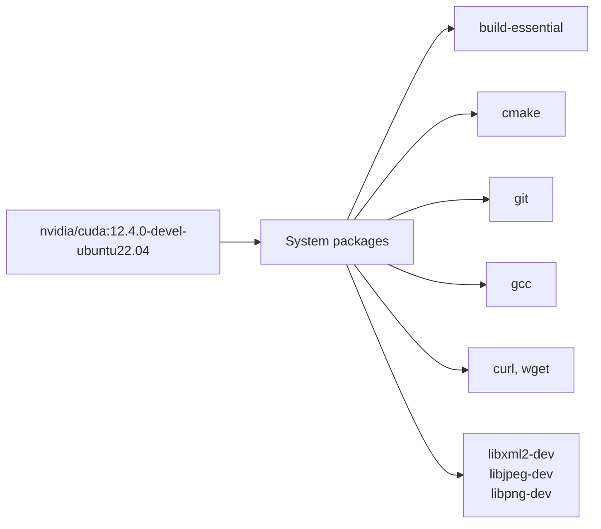

The base image selection is controlled by build arguments at [Dockerfile:1-7]():

| Build Argument | Default Value | Purpose |
|---------------|---------------|---------|
| `UBUNTU_VERSION` | `22.04` | Ubuntu base OS version |
| `CUDA_VERSION` | `12.4.0` | CUDA toolkit version |
| `CUDA_VERSION_PATH` | `cu124` | PyTorch wheel identifier |
| `PYTHON_VERSION` | `3.11` | Python interpreter version |
| `DEVEL_BASE_IMAGE` | `nvidia/cuda:${CUDA_VERSION}-devel-ubuntu${UBUNTU_VERSION}` | Build stage base |

**Sources:** [Dockerfile:1-7](), [Dockerfile:18-29]()

### Python Environment Setup

Miniconda is installed to `/opt/conda` and added to the system `PATH`:

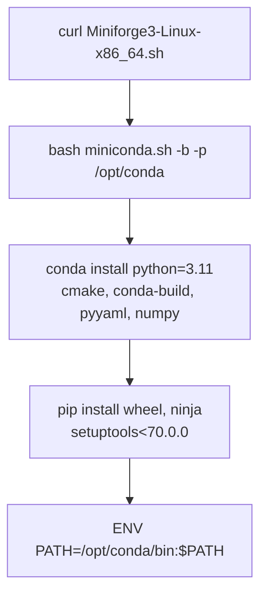

The Python environment configuration is at [Dockerfile:31-42](). Note the constraint on `setuptools<70.0.0` to ensure compatibility with legacy build systems.

**Sources:** [Dockerfile:31-42]()

### PyTorch and ML Acceleration Libraries

The build installs PyTorch 2.6.0 with CUDA 12.4 support, followed by specialized GPU kernels:

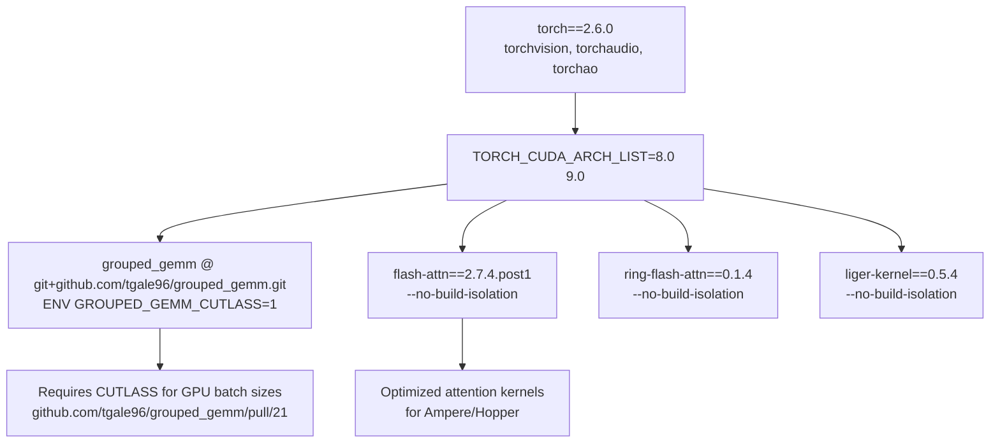

The `TORCH_CUDA_ARCH_LIST="8.0 9.0"` environment variable at [Dockerfile:51]() configures compilation for:
- **8.0**: NVIDIA Ampere architecture (A100, A40)
- **9.0**: NVIDIA Hopper architecture (H100)

The `GROUPED_GEMM_CUTLASS="1"` setting at [Dockerfile:56]() enables CUTLASS-based grouped matrix multiplication, required for passing batch sizes on GPU.

**Sources:** [Dockerfile:44-71]()

### Application Dependencies

MolmoAct application dependencies are installed from `pyproject.toml`:

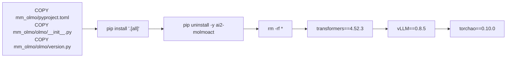

The installation process at [Dockerfile:73-78]() installs dependencies but immediately uninstalls the `ai2-molmoact` package itself, as the source code will be mounted at runtime. This allows the container to have all dependencies pre-installed while using the latest source code from the host.

**Sources:** [Dockerfile:73-94]()

### Key Version Matrix

| Package | Version | Purpose |
|---------|---------|---------|
| `torch` | 2.6.0 | Core deep learning framework |
| `transformers` | 4.52.3 | HuggingFace model loading for MolmoAct |
| `vllm` | 0.8.5 | Optimized inference server |
| `flash-attn` | 2.7.4.post1 | Fast attention kernels |
| `grouped_gemm` | main branch | Grouped matrix multiplication |
| `ring-flash-attn` | 0.1.4 | Ring attention for distributed training |
| `liger-kernel` | 0.5.4 | Additional kernel optimizations |
| `torchao` | 0.10.0 | Tensor parallelism utilities |

**Sources:** [Dockerfile:46-94]()

---

## Release Stage Configuration

The release stage creates a minimal runtime environment by copying compiled artifacts from the build stage.

### Minimal Base and Runtime Dependencies

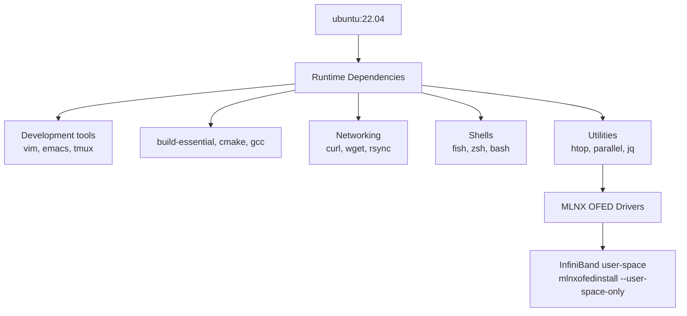

Runtime dependencies at [Dockerfile:103-134]() include development tools for debugging and utilities for multi-node coordination. The comprehensive toolset supports interactive development and cluster operations.

**Sources:** [Dockerfile:100-134]()

### InfiniBand Support

MLNX OFED (Mellanox OpenFabrics Enterprise Distribution) drivers enable high-speed InfiniBand networking for multi-node training:

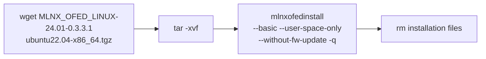

The installation at [Dockerfile:136-145]() uses these flags:
- `--basic`: Minimal installation without development files
- `--user-space-only`: Skip kernel drivers (host provides these)
- `--without-fw-update`: Skip firmware update (not needed in container)
- `-q`: Quiet mode for automated installation

**Sources:** [Dockerfile:136-145]()

### Conda Environment Copy

The compiled Python environment is copied from the build stage:

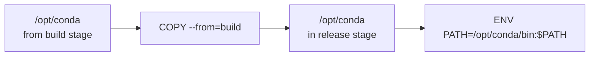

This single `COPY --from=build /opt/conda /opt/conda` instruction at [Dockerfile:148]() transfers all compiled packages (~5GB) without including build tools (~15GB), significantly reducing image size.

**Sources:** [Dockerfile:147-154]()

### Cloud Integration Tools

Cloud CLI tools are installed for data synchronization and cluster management:

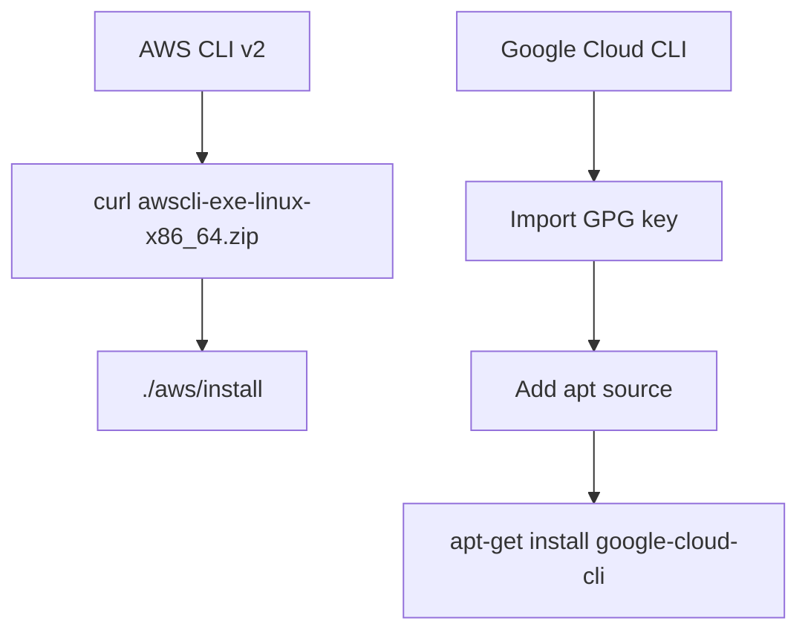

Installation details:
- **AWS CLI**: Installed from official AWS distribution at [Dockerfile:156-160]()
- **Google Cloud CLI**: Installed via apt repository at [Dockerfile:162-165]()

These tools enable direct data transfer from cloud storage (S3, GCS) to training nodes without intermediate staging.

**Sources:** [Dockerfile:156-165]()

### Additional Python Utilities

Final utilities are installed via pip:

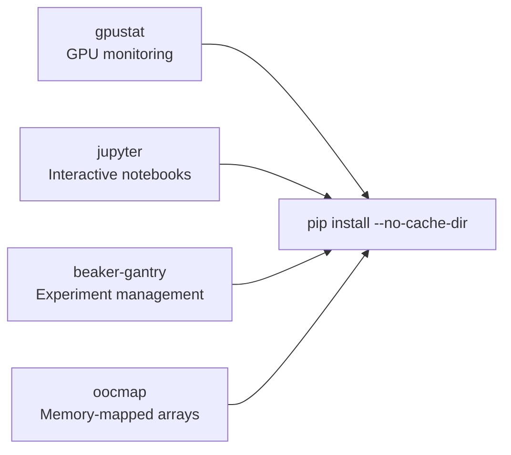

**Sources:** [Dockerfile:168-172]()

---

## Build Optimization with .dockerignore

The `.dockerignore` file excludes files from the Docker build context, reducing build time and preventing unnecessary cache invalidation:

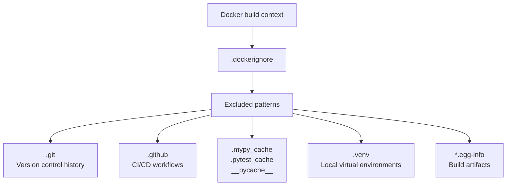

Each excluded pattern at [.dockerignore:1-7]() prevents specific directories from being sent to the Docker daemon:

| Pattern | Type | Impact |
|---------|------|--------|
| `.git` | Version control | Excludes Git history (~100MB+) |
| `.github` | CI/CD | Excludes workflow definitions |
| `.mypy_cache`, `.pytest_cache` | Type checking/testing | Excludes analysis caches |
| `__pycache__` | Python bytecode | Excludes compiled Python files |
| `.venv` | Virtual environment | Excludes local development environment |
| `*.egg-info` | Build artifacts | Excludes package metadata |

**Sources:** [.dockerignore:1-7]()

---

## Runtime Environment Configuration

The release image configures environment variables for GPU access and library paths:

### GPU and CUDA Environment

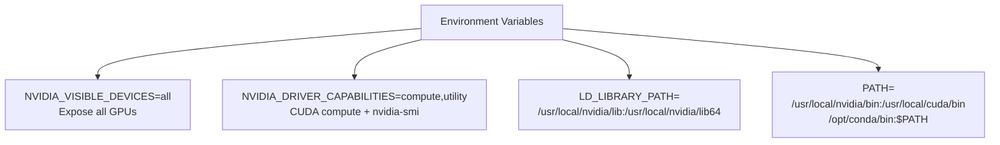

Environment variable configuration at [Dockerfile:151-154]():

| Variable | Value | Purpose |
|----------|-------|---------|
| `NVIDIA_VISIBLE_DEVICES` | `all` | Makes all host GPUs accessible to container |
| `NVIDIA_DRIVER_CAPABILITIES` | `compute,utility` | Enables CUDA compute and nvidia-smi utility |
| `LD_LIBRARY_PATH` | `/usr/local/nvidia/lib:/usr/local/nvidia/lib64` | NVIDIA library search path |
| `PATH` | `/usr/local/nvidia/bin:/usr/local/cuda/bin:/opt/conda/bin:$PATH` | Binary search path |

**Sources:** [Dockerfile:151-154]()

### Working Directory

The container sets its working directory to `/app/olmo-core` at [Dockerfile:178](), where the MolmoAct source code is expected to be mounted at runtime.

**Sources:** [Dockerfile:178]()

---

## Deployment Targets and Usage

The Docker image supports multiple deployment scenarios:

### Deployment Target Matrix

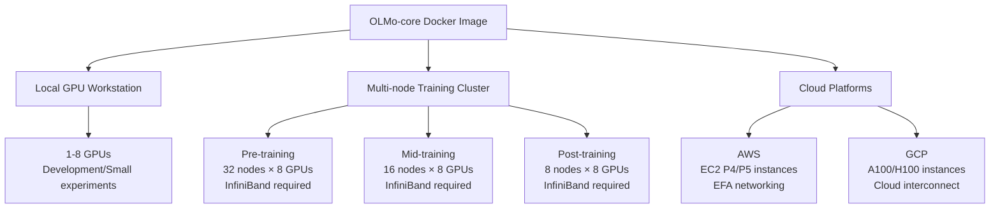

### Local Development Usage

For local development with source code mounting:

```bash
docker run --gpus all \
  -v $(pwd)/mm_olmo:/app/olmo-core/mm_olmo \
  -it olmo-core:latest bash
```

This mounts the local `mm_olmo` directory into the container, allowing code changes without rebuilding the image.

### Multi-node Cluster Usage

For distributed training with InfiniBand (requires MLNX OFED drivers on host):

```bash
docker run --gpus all \
  --network host \
  --ipc host \
  --ulimit memlock=-1 \
  --ulimit stack=67108864 \
  --device=/dev/infiniband \
  -v /path/to/data:/data \
  -it olmo-core:latest \
  torchrun --nnodes=32 --nproc_per_node=8 ...
```

The `--device=/dev/infiniband` flag exposes InfiniBand devices to the container, enabling RDMA (Remote Direct Memory Access) for high-speed inter-node communication during distributed training.

**Sources:** [Dockerfile:136-145]()

---

## Build Arguments and Customization

All major versions can be customized via Docker build arguments:

### Customizable Build Arguments

| Argument | Default | Usage |
|----------|---------|-------|
| `UBUNTU_VERSION` | `22.04` | Ubuntu base version |
| `CUDA_VERSION` | `12.4.0` | CUDA toolkit version |
| `CUDA_VERSION_PATH` | `cu124` | PyTorch wheel identifier |
| `PYTHON_VERSION` | `3.11` | Python interpreter |
| `TORCH_VERSION` | `2.6.0` | PyTorch version |
| `TRANSFORMERS_VERSION` | `4.52.3` | HuggingFace Transformers |
| `VLLM_VERSION` | `0.8.5` | vLLM inference server |
| `FLASH_ATTN_VERSION` | `2.7.4.post1` | Flash attention |
| `TORCHAO_VERSION` | `0.10.0` | Tensor parallelism |

Example custom build:

```bash
docker build \
  --build-arg CUDA_VERSION=12.5.0 \
  --build-arg TORCH_VERSION=2.7.0 \
  -t olmo-core:custom .
```

**Sources:** [Dockerfile:1-94]()

---

## Summary

The MolmoAct Docker environment provides a comprehensive, optimized container image for training and inference:

- **Multi-stage build** reduces final image size from ~20GB to ~8GB
- **CUDA 12.4** with PyTorch 2.6.0 supports Ampere (8.0) and Hopper (9.0) architectures
- **Specialized ML kernels** (flash-attn, grouped-gemm) accelerate attention and matrix operations
- **InfiniBand support** via MLNX OFED enables high-speed multi-node training
- **Cloud integration** (AWS CLI, gcloud) facilitates data transfer and deployment
- **Build optimization** via .dockerignore excludes ~100MB+ of unnecessary files

The container serves as the foundation for all deployment scenarios, from local development to 32-node training clusters, with consistent dependencies and configurations across environments.

**Sources:** [Dockerfile:1-178](), [.dockerignore:1-7]()

---

