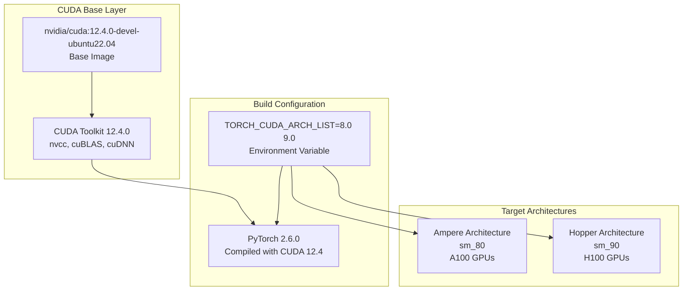
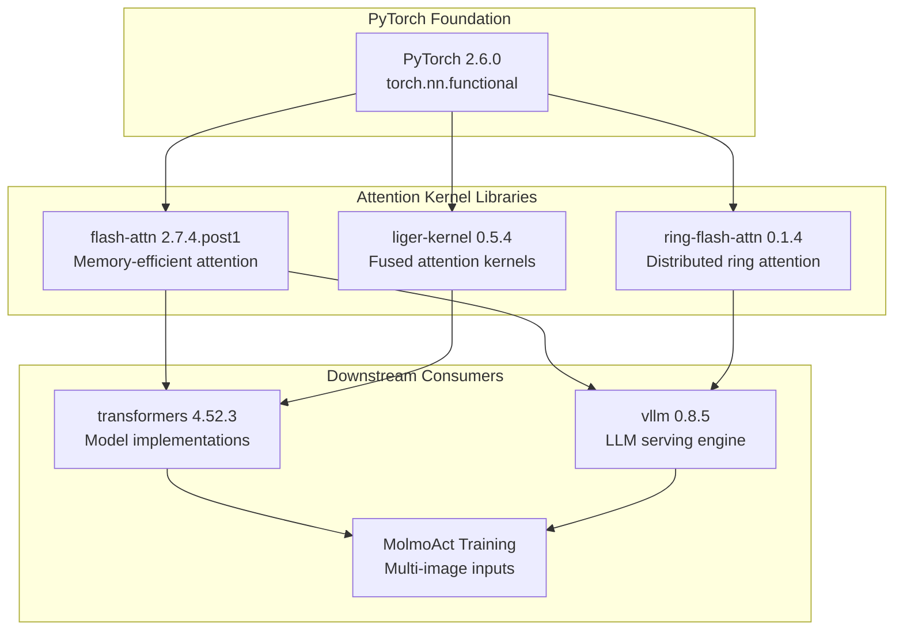
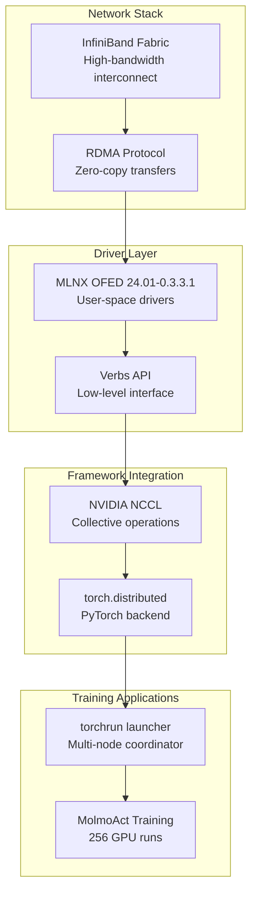
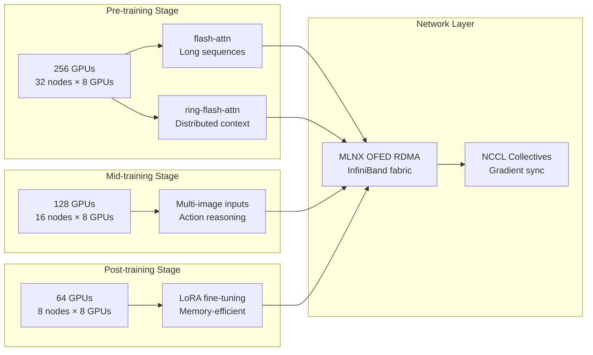

<!-- source: DeepWiki mcp.deepwiki.com · repo allenai/molmoact · page 8.2 GPU and CUDA Configuration · fetched 2026-10-26 -->

# GPU and CUDA Configuration

<details>
<summary>Relevant source files</summary>

The following files were used as context for generating this wiki page:

- [Dockerfile](Dockerfile)

</details>


This document describes the GPU and CUDA configuration used in the MolmoAct training and evaluation infrastructure. It covers CUDA version setup, target GPU architectures, attention optimization libraries, and network acceleration for distributed training. For information about the broader Docker environment, see [Docker Environment](#8.1). For distributed training orchestration, see [Distributed Training Setup](#8.3).

## Purpose and Scope

The GPU configuration in MolmoAct is optimized for large-scale distributed training on NVIDIA Ampere (A100) and Hopper (H100) architecture GPUs. The stack includes CUDA 12.4.0, specialized attention kernels for memory-efficient transformers, and InfiniBand networking support for multi-node RDMA communication. This configuration enables training runs with up to 256 GPUs across 32 nodes.

## CUDA Environment Setup

### CUDA Version and Base Configuration

The system uses CUDA 12.4.0 as the base CUDA toolkit, installed through the `nvidia/cuda:12.4.0-devel-ubuntu22.04` base image. The development variant provides the full CUDA compiler toolchain required for building custom kernels and extensions.

**Sources:** [Dockerfile:3-7]()



**Sources:** [Dockerfile:1-7](), [Dockerfile:44-51]()

### Target GPU Architectures

The `TORCH_CUDA_ARCH_LIST` environment variable specifies which GPU compute capabilities to target during compilation. The configuration `"8.0 9.0"` corresponds to:

| Compute Capability | Architecture | GPU Models | Features |
|-------------------|--------------|------------|----------|
| 8.0 | Ampere | A100, A30, A10 | Tensor Cores 3rd Gen, Sparse Tensor Cores |
| 9.0 | Hopper | H100, H200 | Tensor Cores 4th Gen, FP8 Support, Transformer Engine |

This targeted compilation ensures optimal performance by generating architecture-specific GPU code (PTX) while avoiding unnecessary binary bloat from unsupported architectures.

**Sources:** [Dockerfile:51]()

### CUDA Environment Variables

The runtime container configures three critical NVIDIA environment variables:

```bash
NVIDIA_VISIBLE_DEVICES=all
NVIDIA_DRIVER_CAPABILITIES=compute,utility
LD_LIBRARY_PATH=/usr/local/nvidia/lib:/usr/local/nvidia/lib64
PATH=/usr/local/nvidia/bin:/usr/local/cuda/bin:$PATH
```

| Variable | Value | Purpose |
|----------|-------|---------|
| `NVIDIA_VISIBLE_DEVICES` | `all` | Makes all GPUs visible to the container |
| `NVIDIA_DRIVER_CAPABILITIES` | `compute,utility` | Enables compute and utility functions (e.g., nvidia-smi) |
| `LD_LIBRARY_PATH` | `/usr/local/nvidia/lib:...` | Locates NVIDIA driver libraries at runtime |
| `PATH` | `/usr/local/nvidia/bin:...` | Provides access to CUDA binaries |

**Sources:** [Dockerfile:151-154]()

## Attention Optimization Stack

MolmoAct incorporates three specialized attention libraries to enable efficient training of large vision-language models. These libraries implement memory-efficient attention mechanisms that reduce GPU memory consumption and increase training throughput.



**Sources:** [Dockerfile:60-70](), [Dockerfile:81-86]()

### flash-attn: Memory-Efficient Attention

The `flash-attn` library (version 2.7.4.post1) implements the FlashAttention-2 algorithm, which reduces memory complexity from O(N²) to O(N) for sequence length N by recomputing attention on-the-fly during the backward pass rather than storing intermediate activations.

Installation requires building from source with the CUDA compiler:

```bash
pip install --no-build-isolation --no-cache-dir flash-attn==2.7.4.post1
```

The `--no-build-isolation` flag ensures the build process uses the container's CUDA environment rather than creating an isolated build environment.

**Sources:** [Dockerfile:60-62]()

### ring-flash-attn: Distributed Attention

The `ring-flash-attn` library (version 0.1.4) extends FlashAttention to distributed settings by implementing ring-based communication patterns. This enables attention computation across sequence chunks distributed over multiple GPUs, essential for the long context windows used in action reasoning with multi-image inputs.

**Sources:** [Dockerfile:64-66]()

### liger-kernel: Fused Kernel Optimizations

The `liger-kernel` library (version 0.5.4) provides fused CUDA kernels for common transformer operations beyond attention, including layer normalization, activation functions, and embedding lookups. These fused kernels reduce kernel launch overhead and memory bandwidth requirements.

**Sources:** [Dockerfile:68-70]()

## Network Acceleration with MLNX OFED

### InfiniBand and RDMA Support

For multi-node distributed training, the container includes Mellanox OpenFabrics Enterprise Distribution (MLNX OFED) version 24.01-0.3.3.1, which provides user-space drivers for InfiniBand networking and Remote Direct Memory Access (RDMA) capabilities.



**Sources:** [Dockerfile:136-145]()

### MLNX OFED Installation

The OFED driver installation is performed during the Docker build with the following configuration:

```bash
mlnxofedinstall --basic --user-space-only --without-fw-update -q
```

| Flag | Purpose |
|------|---------|
| `--basic` | Installs core drivers without optional components |
| `--user-space-only` | Skips kernel module installation (provided by host) |
| `--without-fw-update` | Prevents firmware updates to hardware |
| `-q` | Quiet mode for automated builds |

This user-space-only installation is critical for containerized environments, where the host system provides the kernel modules while the container provides user-space libraries that must match the kernel version.

**Sources:** [Dockerfile:136-145]()

## Specialized Library Configurations

### grouped_gemm with CUTLASS

The `grouped_gemm` library provides batched general matrix multiplication (GEMM) operations optimized for scenarios with varying batch sizes, such as mixture-of-experts models or variable-length sequence batching.

The installation requires the CUTLASS flag to enable GPU-side batch size handling:

```bash
export GROUPED_GEMM_CUTLASS="1"
pip install --no-build-isolation --no-cache-dir "grouped_gemm @ git+https://git@github.com/tgale96/grouped_gemm.git@main"
```

Setting `GROUPED_GEMM_CUTLASS="1"` enables the CUTLASS backend, which allows passing batch size arrays on the GPU rather than requiring CPU-GPU synchronization for each batch. This is essential for high-throughput training with dynamic batching.

**Sources:** [Dockerfile:53-58]()

### torchao Quantization

The `torchao` library (version 0.10.0) provides quantization utilities for reducing model size and improving inference speed. The installation specifies the CUDA 12.4-compatible wheel:

```bash
pip install --no-cache-dir \
    --extra-index-url https://download.pytorch.org/whl/cu124 \
    torchao==0.10.0
```

While primarily used for inference optimization, `torchao` can also enable mixed-precision training strategies for memory-constrained scenarios.

**Sources:** [Dockerfile:89-94]()

## GPU Monitoring and Utilities

### gpustat for Real-Time Monitoring

The container includes `gpustat`, a lightweight command-line utility for monitoring GPU utilization, memory usage, and process information:

```bash
pip install --no-cache-dir gpustat
```

This tool provides more user-friendly output than `nvidia-smi` for quick status checks during development and debugging.

**Sources:** [Dockerfile:168-172]()

### NVIDIA Utility Access

The `NVIDIA_DRIVER_CAPABILITIES=compute,utility` setting enables access to NVIDIA utilities including:

- `nvidia-smi`: GPU status and process monitoring
- `nvidia-debugdump`: Debug information collection
- `nvidia-persistenced`: Persistence daemon for reducing driver load time

These utilities are essential for debugging GPU allocation issues, monitoring memory leaks, and profiling training performance.

**Sources:** [Dockerfile:152]()

## Build-Time vs. Runtime Configuration

The GPU configuration distinguishes between build-time settings (affecting compilation) and runtime settings (affecting execution):

### Build-Time Configuration

| Setting | Location | Purpose |
|---------|----------|---------|
| `TORCH_CUDA_ARCH_LIST="8.0 9.0"` | [Dockerfile:51]() | Controls CUDA code generation for target GPUs |
| `GROUPED_GEMM_CUTLASS="1"` | [Dockerfile:56]() | Enables CUTLASS backend during compilation |
| `--no-build-isolation` | Multiple pip commands | Uses container CUDA environment for builds |

### Runtime Configuration

| Setting | Location | Purpose |
|---------|----------|---------|
| `NVIDIA_VISIBLE_DEVICES=all` | [Dockerfile:151]() | GPU visibility control |
| `NVIDIA_DRIVER_CAPABILITIES=compute,utility` | [Dockerfile:152]() | Driver function access |
| `LD_LIBRARY_PATH=/usr/local/nvidia/lib:...` | [Dockerfile:153]() | NVIDIA library resolution |

This separation allows the same container image to work across different GPU counts and configurations by adjusting runtime environment variables.

**Sources:** [Dockerfile:51](), [Dockerfile:56](), [Dockerfile:151-154]()

## Integration with Training Pipeline

The GPU configuration directly supports the multi-stage training pipeline described in [Training Pipeline](#2):



**Sources:** [Dockerfile:51](), [Dockerfile:60-70](), [Dockerfile:136-145]()

## Verification and Troubleshooting

### Verifying CUDA Installation

After container launch, verify CUDA is correctly configured:

```bash
nvidia-smi  # Check driver version and GPU visibility
nvcc --version  # Verify CUDA compiler version (should show 12.4.0)
python -c "import torch; print(torch.cuda.is_available())"  # Check PyTorch CUDA
python -c "import torch; print(torch.version.cuda)"  # Verify CUDA version in PyTorch
```

### Verifying Attention Libraries

Confirm attention optimization libraries are properly installed:

```bash
python -c "import flash_attn; print(flash_attn.__version__)"  # Should show 2.7.4.post1
python -c "import ring_flash_attn"  # Should import without errors
python -c "import liger_kernel"  # Should import without errors
```

### Verifying InfiniBand Support

Check MLNX OFED installation and InfiniBand device detection:

```bash
ibv_devices  # List InfiniBand devices
ibstat  # Show IB port status
```

For detailed troubleshooting guidance, see [Troubleshooting Guide](#10.2).

**Sources:** [Dockerfile:60-70](), [Dockerfile:136-145]()

---

