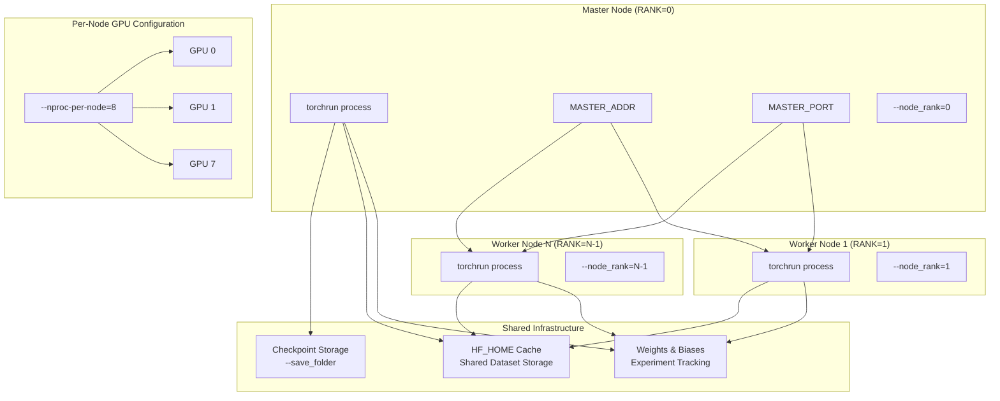
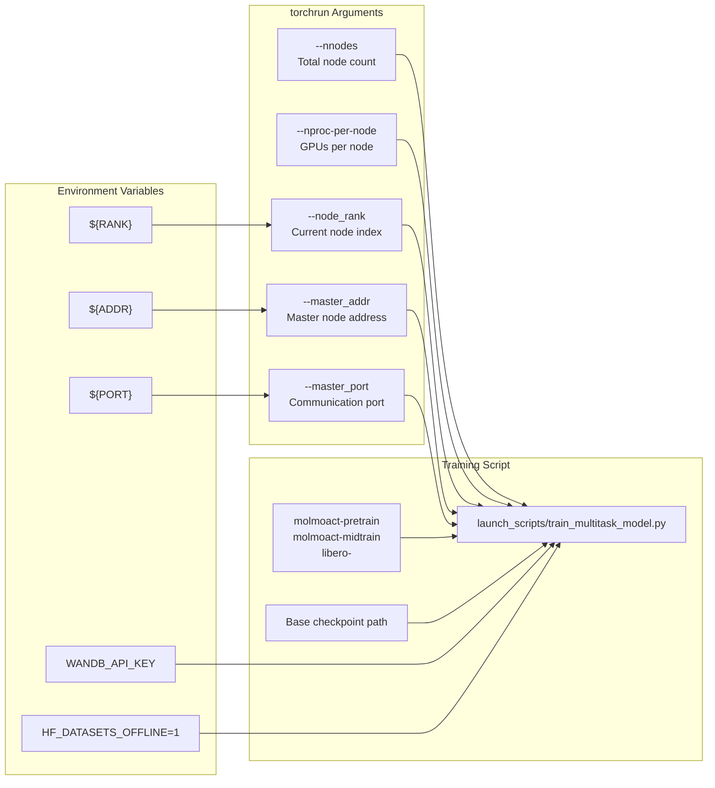
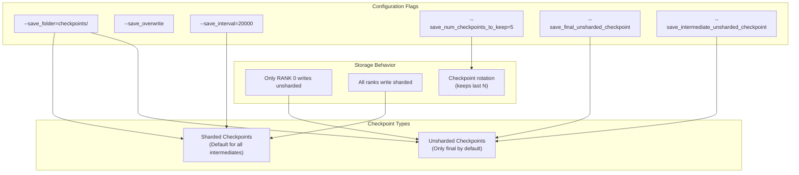
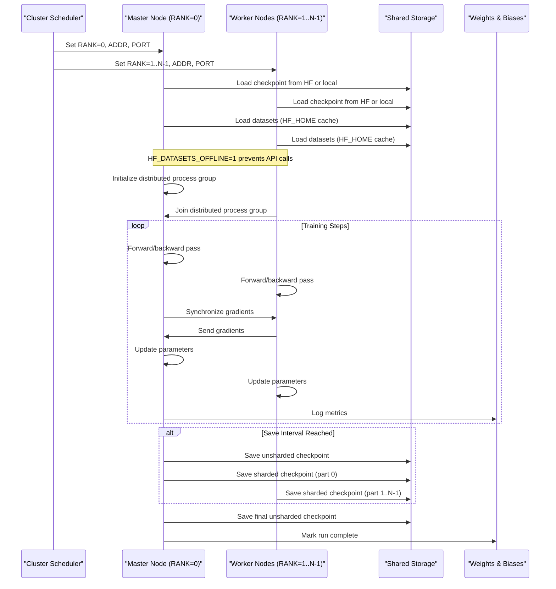

<!-- source: DeepWiki mcp.deepwiki.com · repo allenai/molmoact · page 8.3 Distributed Training Setup · fetched 2026-10-26 -->

# Distributed Training Setup

<details>
<summary>Relevant source files</summary>

The following files were used as context for generating this wiki page:

- [Dockerfile](Dockerfile)
- [README.md](README.md)

</details>


## Purpose and Scope

This document describes the distributed training infrastructure for MolmoAct, including the `torchrun` launcher configuration, multi-node setup, environment variables for data management and rate limiting, and integration with Weights & Biases for experiment tracking. The focus is on the orchestration layer that enables training across multiple GPUs and nodes.

For information about the GPU and CUDA software stack, see [GPU and CUDA Configuration](#8.2). For cloud-based experiment orchestration tools like beaker-gantry, see [Cloud Integration](#8.5). For details on the Docker container that provides the runtime environment, see [Docker Environment](#8.1).

---

## Distributed Training Architecture

MolmoAct uses PyTorch's distributed training capabilities via the `torchrun` launcher, supporting multi-node, multi-GPU training across different stages of the curriculum learning pipeline. The training scales from 64 GPUs (post-training) to 256 GPUs (pre-training).

### Training Scale by Stage

| Training Stage | Nodes | GPUs per Node | Total GPUs | Global Batch Size | Duration |
|---------------|-------|---------------|------------|-------------------|----------|
| Pre-training  | 32    | 8             | 256        | 512               | 100k steps |
| Mid-training  | 16    | 8             | 128        | 256               | 50k steps |
| Post-training (LIBERO) | 8 | 8        | 64         | 128               | 40k-80k steps |

### Multi-Node Training Topology



**Sources:** [README.md:174-296](), [Dockerfile:136-145]()

---

## Launch Configuration

### torchrun Command Structure

The `torchrun` launcher orchestrates distributed training across multiple nodes. Each training stage uses the same command structure with different hyperparameters.



### Pre-training Launch Example

The pre-training command demonstrates the full distributed setup:

```bash
WANDB_API_KEY=<your_wandb_api_key> torchrun \
    --nnodes=32 --nproc-per-node=8 \
    --node_rank="${RANK}" --master_addr="${ADDR}" --master_port="${PORT}" \
    launch_scripts/train_multitask_model.py \
    molmoact-pretrain allenai/MolmoAct-7B-D-Captioner-0812 \
    --wandb.name=<name> --wandb.entity=<entity> --wandb.project=<project>
```

**Key Parameters:**
- `--nnodes=32`: Total number of nodes in the distributed cluster
- `--nproc-per-node=8`: Number of GPU processes per node (8 GPUs)
- `--node_rank="${RANK}"`: Zero-indexed rank of the current node
- `--master_addr="${ADDR}"`: Network address of the master node
- `--master_port="${PORT}"`: Port for inter-node communication

**Sources:** [README.md:176-196]()

### Mid-training Launch Example

Mid-training uses half the compute resources:

```bash
WANDB_API_KEY=<your_wandb_api_key> torchrun --nnodes=16 --nproc-per-node=8 \
    --node_rank="${RANK}" --master_addr="${ADDR}" --master_port="${PORT}" \
    launch_scripts/train_multitask_model.py \
    molmoact-midtrain allenai/MolmoAct-7B-D-Pretrain-0812
```

**Sources:** [README.md:224-243]()

### Post-training (LIBERO) Launch Example

Post-training further reduces to 8 nodes and adds LoRA-specific flags:

```bash
WANDB_API_KEY=<your_wandb_api_key> torchrun --nnodes=8 --nproc-per-node=8 \
    --node_rank="${RANK}" --master_addr="${ADDR}" --master_port="${PORT}" \
    launch_scripts/train_multitask_model.py \
    libero-<task_suite> allenai/MolmoAct-7B-D-0812 \
    --lora_enable --lora_rank 32 --lora_alpha 16 --lora_dropout 0.0
```

**Sources:** [README.md:257-278]()

---

## Environment Variables for Distributed Training

### Critical Environment Variables

```mermaid
graph TB
    subgraph "Cluster Coordination Variables"
        RANK["RANK<br/>Node index in cluster<br/>(set by cluster scheduler)"]
        ADDR["ADDR<br/>Master node network address<br/>(set by cluster scheduler)"]
        PORT["PORT<br/>Communication port<br/>(set by cluster scheduler)"]
    end
    
    subgraph "Experiment Tracking"
        WANDB_API_KEY["WANDB_API_KEY<br/>Authentication for W&B"]
        WANDB_MODE["WANDB_MODE<br/>offline/online/disabled"]
    end
    
    subgraph "Data Management"
        HF_HOME["HF_HOME<br/>HuggingFace cache location<br/>/data/molmoact/huggingface"]
        MOLMOACT_DATA_DIR["MOLMOACT_DATA_DIR<br/>Additional data assets<br/>/data/molmoact"]
        HF_DATASETS_OFFLINE["HF_DATASETS_OFFLINE=1<br/>Prevent HF API rate limiting"]
    end
    
    subgraph "LIBERO Evaluation"
        VLLM_WORKER["VLLM_WORKER_MULTIPROC_METHOD=spawn<br/>Required for vllm evaluation"]
    end
    
    RANK --> TORCHRUN["torchrun --node_rank"]
    ADDR --> TORCHRUN
    PORT --> TORCHRUN
    
    WANDB_API_KEY --> TRAINING["Training Process"]
    WANDB_MODE --> TRAINING
    
    HF_HOME --> DATASET_LOADING["Dataset Loading"]
    MOLMOACT_DATA_DIR --> DATASET_LOADING
    HF_DATASETS_OFFLINE --> DATASET_LOADING
    
    VLLM_WORKER --> EVAL["LIBERO Evaluation"]
```



### HF_DATASETS_OFFLINE for Rate Limiting Prevention

The `HF_DATASETS_OFFLINE=1` environment variable prevents nodes from flooding HuggingFace servers with simultaneous requests during initialization:

```bash
# Recommended: Download data first, then set offline mode
export HF_DATASETS_OFFLINE=1
```

This is critical in distributed settings where all nodes initialize datasets simultaneously, potentially causing rate limiting errors from HuggingFace's API.

**Sources:** [README.md:113-123](), [README.md:171]()

### Data Storage Configuration

```bash
# Set before downloading datasets and training
export MOLMOACT_DATA_DIR=/data/molmoact
export HF_HOME=/data/molmoact/huggingface
```

Both paths should point to shared storage accessible from all nodes in the cluster. `HF_HOME` controls where HuggingFace datasets cache files, while `MOLMOACT_DATA_DIR` stores additional assets (e.g., manually downloaded datasets).

**Sources:** [README.md:113-123]()

### Weights & Biases Configuration

```bash
# Online logging (default)
WANDB_API_KEY=<your_api_key>

# Offline logging
WANDB_MODE=offline

# Disable W&B completely
# Replace --wandb.name/entity/project flags with --wandb=null
```

**Sources:** [README.md:203-205]()

---

## Checkpoint Management in Distributed Settings

### Checkpoint Saving Strategy



### Checkpoint Configuration Example

```bash
# Pre-training checkpoint configuration
--save_folder=checkpoints/<exp_name> \
--save_overwrite \
--save_interval 20000 \
--save_num_checkpoints_to_keep 5 \
--save_final_unsharded_checkpoint
```

**Checkpoint Behavior:**
- **Sharded checkpoints**: Saved every `--save_interval` steps, distributed across all ranks
- **Unsharded checkpoints**: Only the final checkpoint is saved unsharded by default
- **Rotation**: Only the last `--save_num_checkpoints_to_keep` checkpoints are retained
- **Override**: `--save_overwrite` allows overwriting existing checkpoint directories
- **Optional**: `--save_intermediate_unsharded_checkpoint` saves unsharded copies at every interval

**Sources:** [README.md:207-209]()

### Memory Considerations

```bash
# WARNING: Avoid pin_memory with large datasets in distributed settings
# Can cause OOM during data loading across multiple processes
# The README explicitly warns against using --pin_memory
```

**Sources:** [README.md:216]()

---

## Distributed Training Workflow



**Sources:** [README.md:174-296](), [Dockerfile:136-145]()

---

## Network Configuration for Distributed Training

### MLNX OFED for InfiniBand

The Docker environment includes Mellanox OpenFabrics Enterprise Distribution (MLNX OFED) for high-performance networking:

```dockerfile
# MLNX OFED installation in Dockerfile
ENV MOFED_VER="24.01-0.3.3.1"
RUN wget --quiet https://content.mellanox.com/ofed/MLNX_OFED-${MOFED_VER}/...
```

This provides:
- **InfiniBand support** for RDMA (Remote Direct Memory Access)
- **Reduced latency** for gradient synchronization across nodes
- **Higher bandwidth** for large model parameter updates

**Sources:** [Dockerfile:136-145]()

### NVIDIA Driver Capabilities

```dockerfile
ENV NVIDIA_VISIBLE_DEVICES all
ENV NVIDIA_DRIVER_CAPABILITIES compute,utility
```

These environment variables ensure all GPUs are visible to the distributed training processes and enable both compute and utility operations.

**Sources:** [Dockerfile:151-152]()

---

## Integration with Training Scripts

### Configuration Name Mapping

The first positional argument to `launch_scripts/train_multitask_model.py` selects the training configuration:

| Configuration Name | Training Stage | Dataset Mixture |
|-------------------|----------------|-----------------|
| `molmoact-pretrain` | Pre-training | Robot + Web data |
| `molmoact-midtrain` | Mid-training | MolmoAct Dataset |
| `libero-spatial` | Post-training | LIBERO Spatial tasks |
| `libero-object` | Post-training | LIBERO Object tasks |
| `libero-goal` | Post-training | LIBERO Goal tasks |
| `libero-long` | Post-training | LIBERO Long tasks |

### Base Checkpoint Paths

The second positional argument specifies the HuggingFace checkpoint to initialize from:

```bash
# Pre-training starts from captioner checkpoint
allenai/MolmoAct-7B-D-Captioner-0812

# Mid-training starts from pre-trained checkpoint
allenai/MolmoAct-7B-D-Pretrain-0812

# Post-training starts from mid-trained checkpoint
allenai/MolmoAct-7B-D-0812
```

**Sources:** [README.md:182](), [README.md:228](), [README.md:261]()

---

## Distributed Training Best Practices

### Data Download Strategy

1. **Pre-download all datasets** before starting distributed training
2. **Set `HF_DATASETS_OFFLINE=1`** to prevent simultaneous API requests from all nodes
3. **Use shared storage** for `HF_HOME` and `MOLMOACT_DATA_DIR` accessible to all nodes
4. **Verify downloads** complete successfully before launching training

```bash
# Download robot datasets for pre-training
python3 scripts/download_robot_data.py pretrain --n_proc 16

# Download web datasets
python3 scripts/download_data.py all --n_proc 16

# Then set offline mode
export HF_DATASETS_OFFLINE=1
```

**Sources:** [README.md:127-172]()

### Monitoring and Debugging

- **Check W&B dashboard** for training progress across all nodes
- **Monitor GPU utilization** with `gpustat` (included in Docker environment)
- **Verify checkpoint saving** completes successfully on RANK 0
- **Check logs** for synchronization errors or timeouts

**Sources:** [Dockerfile:169]()

### Common Pitfalls

| Issue | Solution |
|-------|----------|
| Rate limiting from HuggingFace | Set `HF_DATASETS_OFFLINE=1` after downloading data |
| OOM during data loading | Avoid `--pin_memory` flag with large datasets |
| Checkpoint save failures | Ensure only RANK 0 has write permissions for unsharded checkpoints |
| W&B authentication errors | Verify `WANDB_API_KEY` is set correctly |
| Network timeouts | Check InfiniBand connectivity and MLNX OFED installation |

**Sources:** [README.md:171](), [README.md:216](), [Dockerfile:136-145]()

---

