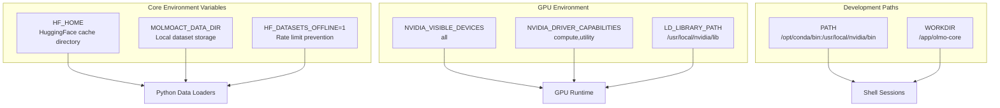
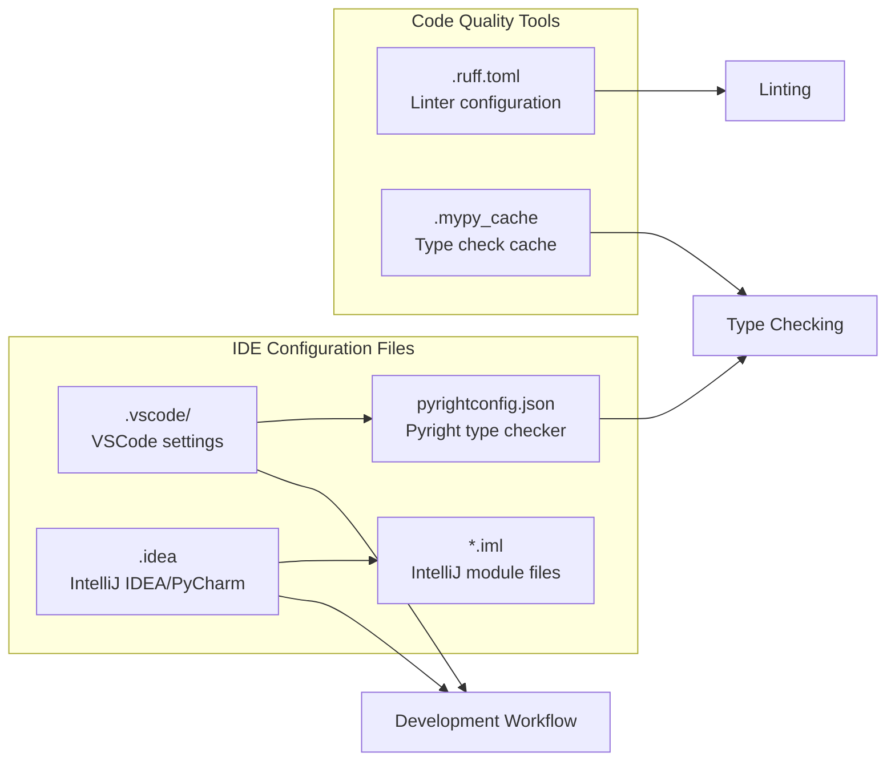
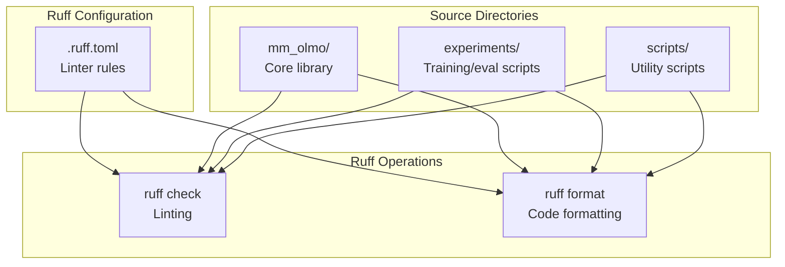
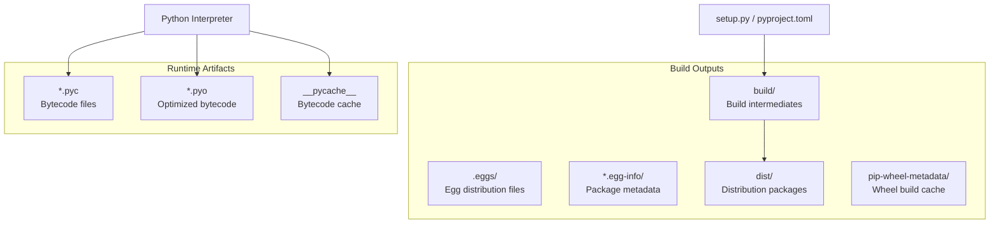
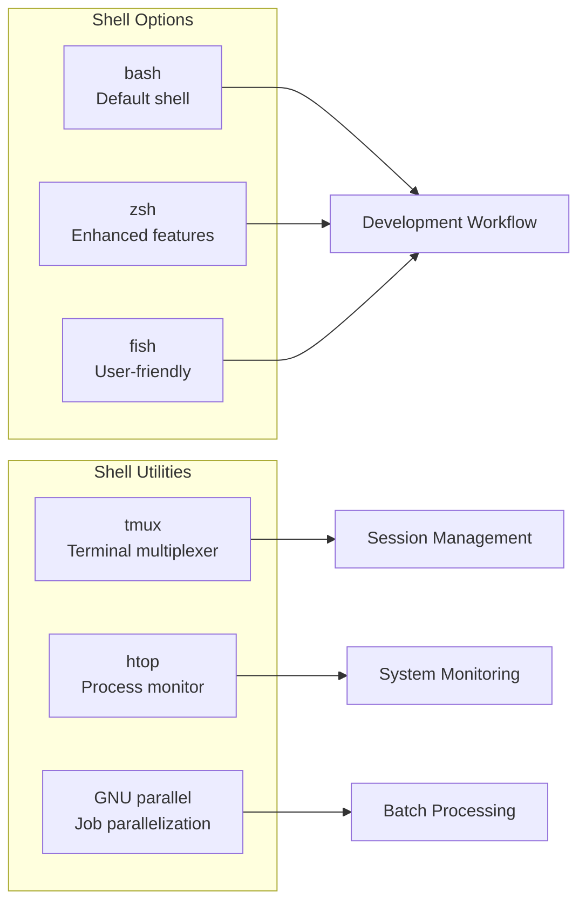
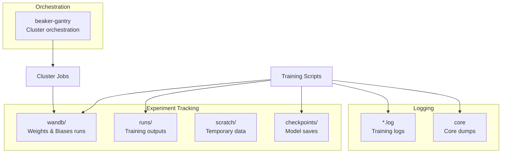
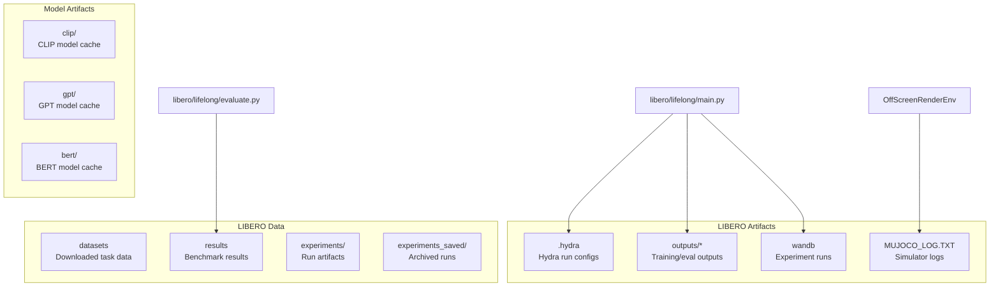
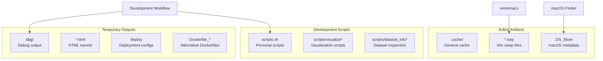

<!-- source: DeepWiki mcp.deepwiki.com · repo allenai/molmoact · page 8.4 Development Environment · fetched 2026-10-26 -->

# Development Environment

<details>
<summary>Relevant source files</summary>

The following files were used as context for generating this wiki page:

- [.gitignore](.gitignore)
- [experiments/LIBERO/.gitignore](experiments/LIBERO/.gitignore)

</details>


This document provides guidance for setting up a local development environment for the MolmoAct codebase. It covers Python environment configuration, IDE setup, development tooling, and shell environments. For Docker-based deployment environments, see [Docker Environment](#8.1). For distributed training infrastructure, see [Distributed Training Setup](#8.3).

## Overview

The MolmoAct repository supports development both within the Docker container and on local machines. The development environment includes Python 3.11, multiple IDE configurations, type checking and linting tools, Jupyter notebook support, and multiple shell options. The codebase structure allows for both experimentation (Jupyter notebooks) and production code development (Python modules with proper tooling).

**Sources:** [Dockerfile:1-178](), [.gitignore:1-77]()

## Python Environment Setup

### Conda Environment

The Docker container includes a Miniforge-based conda environment at `/opt/conda` with Python 3.11. For local development outside Docker, users should replicate this environment:

```bash
# Environment is pre-installed in Docker at /opt/conda
ENV PATH /opt/conda/bin:$PATH
```

The conda environment includes core build tools (`cmake`, `conda-build`, `pyyaml`, `numpy`, `ipython`) and package management tools (`pip`, `wheel`, `packaging`, `setuptools<70.0.0`, `ninja`).

**Sources:** [Dockerfile:31-42]()

### Virtual Environment Support

For local development outside Docker, the repository supports Python virtual environments. The `.venv/` directory is excluded from version control:

| Configuration File | Purpose |
|-------------------|---------|
| `.python-version` | Python version specification (ignored) |
| `.venv/` | Virtual environment directory (ignored) |
| `.envrc` | direnv configuration for auto-activation (ignored) |

**Sources:** [.gitignore:14-17]()

### Environment Variables

Development requires setting specific environment variables:



**Environment Variable Configuration:**

| Variable | Purpose | Default/Expected Value |
|----------|---------|----------------------|
| `HF_HOME` | HuggingFace cache location | User-specified directory |
| `MOLMOACT_DATA_DIR` | Local dataset storage | User-specified directory |
| `HF_DATASETS_OFFLINE` | Prevent HF API rate limiting | `1` (enabled) |
| `NVIDIA_VISIBLE_DEVICES` | GPU visibility | `all` |
| `NVIDIA_DRIVER_CAPABILITIES` | NVIDIA driver features | `compute,utility` |
| `LD_LIBRARY_PATH` | NVIDIA library paths | `/usr/local/nvidia/lib:/usr/local/nvidia/lib64` |
| `PATH` | Executable search paths | `/opt/conda/bin:/usr/local/nvidia/bin:/usr/local/cuda/bin:$PATH` |

**Sources:** [Dockerfile:150-154]()

## IDE Configuration

### Supported IDEs

The repository includes configuration artifacts for two major IDEs, as indicated by `.gitignore` entries:



**Sources:** [.gitignore:15-20]()

### VSCode Configuration

The `.vscode/` directory (ignored by git) typically contains:

- **`settings.json`**: Python interpreter path, formatting settings, linter configurations
- **`launch.json`**: Debug configurations for training/evaluation scripts
- **`extensions.json`**: Recommended extensions (Python, Pylance, Jupyter)

VSCode integration with `pyrightconfig.json` provides static type checking through the Pylance language server.

**Sources:** [.gitignore:17,19]()

### IntelliJ IDEA / PyCharm Configuration

The `.idea` directory and `*.iml` files contain project-specific configurations:

- **`.idea/`**: Project structure, run configurations, inspection profiles
- **`*.iml`**: Module definitions for multi-module projects

**Sources:** [.gitignore:15,18]()

## Python Development Tools

### Type Checking with mypy

The repository uses `mypy` for static type checking. The cache is stored in `.mypy_cache/`:

```bash
# Typical mypy usage (configuration likely in pyproject.toml or setup.cfg)
mypy mm_olmo/ experiments/
```

Type checking artifacts are excluded from version control.

**Sources:** [.gitignore:4]()

### Code Formatting and Linting

The repository uses `ruff` for fast Python linting and formatting:



The `.ruff.toml` file (ignored by git) contains project-specific linting rules, line length limits, and exclusion patterns.

**Sources:** [.gitignore:20]()

### Testing with pytest

The repository uses `pytest` for unit and integration testing. Test artifacts are excluded from version control:

| Artifact | Purpose |
|----------|---------|
| `.pytest_cache/` | pytest execution cache |
| `.coverage` | Code coverage data |
| `.benchmarks` | Performance benchmark results |
| `/tests` | Test directory (excluded from repo) |

**Sources:** [.gitignore:45-47,62]()

### Build Artifacts

Python build artifacts are excluded from version control:



**Sources:** [.gitignore:1-8,37-40]()

## Jupyter Notebook Support

### Notebook Environment

Jupyter notebooks are installed in the Docker environment:

```bash
# Jupyter installation
pip install jupyter
```

Notebook checkpoints are excluded from version control:

| Path | Purpose |
|------|---------|
| `.ipynb_checkpoints` | Jupyter auto-save checkpoints |
| `test.ipynb` | Temporary test notebook (ignored) |

**Sources:** [Dockerfile:168-170](), [.gitignore:25,68]()

### Notebook Usage Patterns

Development notebooks are used for:
- **Data exploration**: Loading and visualizing datasets
- **Model prototyping**: Testing model architectures
- **Evaluation analysis**: Analyzing benchmark results
- **Visualization**: Creating plots and diagrams

Example notebook workflow:

```python
# Typical notebook setup
import sys
sys.path.insert(0, '/app/olmo-core')

from olmo import ...  # Import MolmoAct modules
```

**Sources:** [.gitignore:25,68]()

## Shell Environment Options

### Available Shells

The Docker environment includes three shell options:



**Sources:** [Dockerfile:119-123]()

### Shell Configuration

Shell-specific configurations (ignored by git):
- **`.bashrc`**: Bash startup script
- **`.zshrc`**: Zsh startup script
- **`.config/fish/config.fish`**: Fish startup script
- **`.envrc`**: direnv auto-activation script

The Dockerfile uses bash as the default shell for RUN commands:

```dockerfile
SHELL ["/bin/bash", "-c"]
```

**Sources:** [Dockerfile:175](), [.gitignore:13]()

### Terminal Utilities

Additional terminal tools installed in the environment:

| Utility | Purpose |
|---------|---------|
| `tmux` | Terminal multiplexing for persistent sessions |
| `htop` | Interactive process viewer |
| `parallel` | GNU parallel for batch job execution |
| `vim`, `emacs` | Text editors |
| `man-db`, `manpages-*` | Manual page system |

**Sources:** [Dockerfile:103-134]()

## Development Workflow Tools

### GPU Monitoring

The `gpustat` utility provides GPU status monitoring:

```bash
# GPU status monitoring
gpustat -cp

# Continuous monitoring
watch -n 1 gpustat -cp
```

**Sources:** [Dockerfile:168-169]()

### Experiment Management

Development tools for experiment tracking:



**Sources:** [.gitignore:54-66](), [Dockerfile:171]()

### Cloud CLI Tools

Both AWS and Google Cloud CLIs are installed for accessing cloud storage:

```bash
# AWS CLI v2
aws s3 ls s3://bucket-name/

# Google Cloud CLI
gcloud storage ls gs://bucket-name/
```

**Sources:** [Dockerfile:156-165]()

### Additional Development Utilities

The environment includes various development aids:

| Utility | Purpose | Installation |
|---------|---------|--------------|
| `oocmap` | Memory mapping utilities | `pip install oocmap` |
| `beaker-gantry` | Cluster job submission | `pip install beaker-gantry` |
| `jq` | JSON processing | `apt-get install jq` |
| `rsync` | File synchronization | `apt-get install rsync` |
| `wget`, `curl` | File downloading | `apt-get install wget curl` |

**Sources:** [Dockerfile:168-172,103-134]()

## LIBERO-Specific Development

### LIBERO Development Artifacts

The LIBERO subsystem has its own development artifacts:



**Sources:** [experiments/LIBERO/.gitignore:1-19]()

### LIBERO Development Setup

The LIBERO package uses egg-info for editable installation:

```bash
# Editable installation creates this directory
libero.egg-info/
```

VSCode configuration specific to LIBERO development is excluded:

```bash
# LIBERO-specific IDE config
.vscode/
```

**Sources:** [experiments/LIBERO/.gitignore:17-18]()

## Documentation Development

Documentation artifacts are excluded from version control:

| Path | Purpose |
|------|---------|
| `doc/_build/` | Sphinx documentation builds |
| `docs/build` | Alternative docs build directory |
| `site/` | MkDocs site output |

**Sources:** [.gitignore:31,50-52]()

## Temporary and Cache Files

The development environment excludes various temporary files:



**Sources:** [.gitignore:28-34,64-77]()

## Development Workflow Summary

A typical development workflow involves:

1. **Environment Setup**: Activate conda environment or enter Docker container
2. **IDE Configuration**: Open project in VSCode or PyCharm with appropriate settings
3. **Code Development**: Write code with type hints, run `mypy` for type checking
4. **Testing**: Run `pytest` on modified modules
5. **Linting**: Run `ruff check` and `ruff format` before committing
6. **Experimentation**: Use Jupyter notebooks for prototyping
7. **Training**: Launch experiments with proper logging (W&B, local logs)
8. **Monitoring**: Use `gpustat` and `htop` to monitor resource usage
9. **Git Operations**: Ensure build artifacts, caches, and temporary files are properly ignored

**Sources:** [.gitignore:1-77](), [Dockerfile:1-178](), [experiments/LIBERO/.gitignore:1-19]()

---

