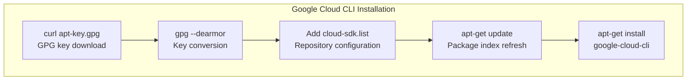
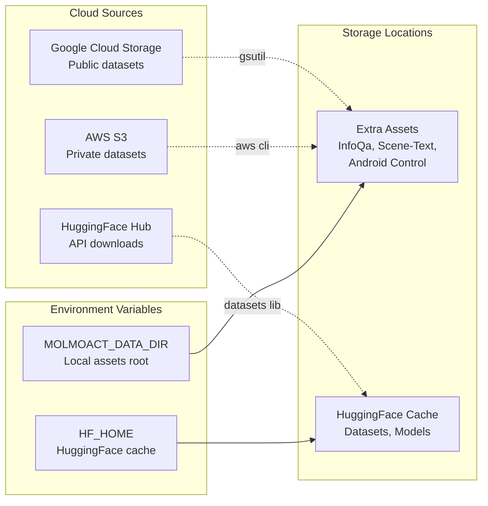
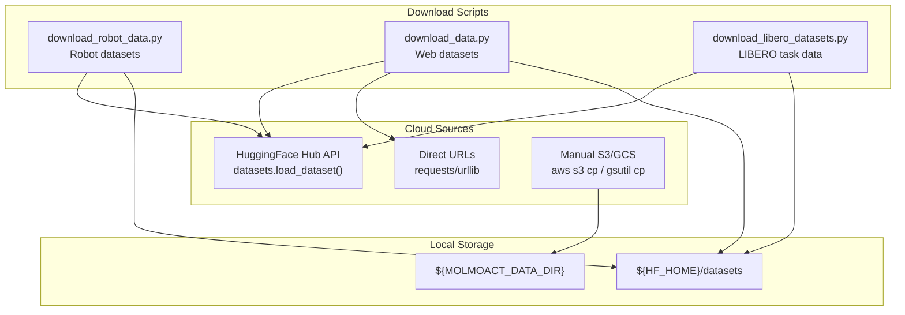
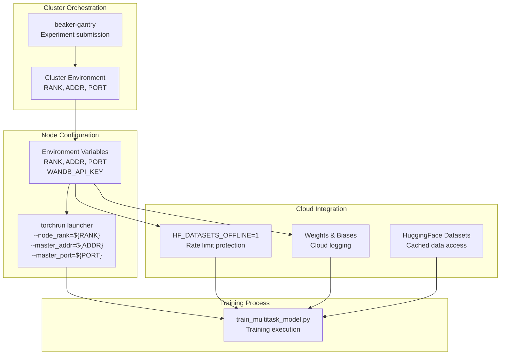
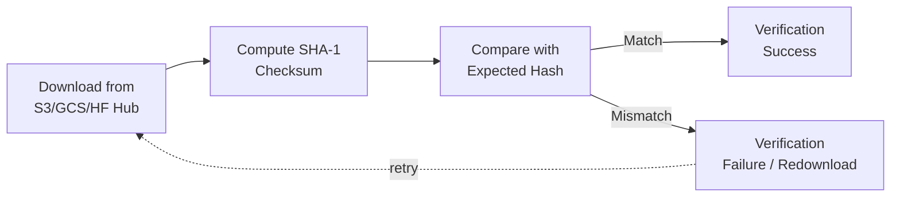

<!-- source: DeepWiki mcp.deepwiki.com · repo allenai/molmoact · page 8.5 Cloud Integration · fetched 2026-10-26 -->

# Cloud Integration

<details>
<summary>Relevant source files</summary>

The following files were used as context for generating this wiki page:

- [Dockerfile](Dockerfile)
- [README.md](README.md)

</details>


## Purpose and Scope

This document describes the cloud infrastructure integration in the MolmoAct codebase, covering AWS CLI v2, Google Cloud CLI, and beaker-gantry experiment orchestration. It explains how these tools are installed in the Docker environment, configured for use, and integrated with the training and data management pipelines.

For distributed training setup using torchrun, see [Distributed Training Setup](#8.3). For Docker environment details, see [Docker Environment](#8.1). For data management workflows, see [Data Management System](#3).

---

## Cloud CLI Installation

### AWS CLI v2

AWS CLI v2 is installed in the Docker release stage to provide access to Amazon S3 storage. The installation uses the official AWS installer package.

**Installation Process:**

| Step | Action | Location |
|------|--------|----------|
| 1 | Download awscliv2.zip | [Dockerfile:157]() |
| 2 | Unzip package | [Dockerfile:158]() |
| 3 | Run installer with sudo | [Dockerfile:159]() |
| 4 | Cleanup installation files | [Dockerfile:160]() |

The AWS CLI is installed system-wide and available to all users in the container. No specific version pinning is used; the installer fetches the latest v2 release from AWS.

**Sources:** [Dockerfile:156-160]()

---

### Google Cloud CLI

Google Cloud CLI (including `gcloud` and `gsutil` commands) is installed via the official Google Cloud apt repository. The installation includes GPG key configuration for package verification.

**Installation Steps:**



**Installation Commands Mapping:**

| Line | Command | Purpose |
|------|---------|---------|
| [Dockerfile:163]() | `curl packages.cloud.google.com/apt/doc/apt-key.gpg` | Fetch GPG key for package verification |
| [Dockerfile:163]() | `gpg --dearmor -o /usr/share/keyrings/cloud.google.gpg` | Convert key to binary format |
| [Dockerfile:164]() | `tee -a /etc/apt/sources.list.d/google-cloud-sdk.list` | Add repository to apt sources |
| [Dockerfile:165]() | `apt-get install google-cloud-cli` | Install CLI tools |

The installation uses the signed repository approach, ensuring package authenticity and enabling automatic updates through the system package manager.

**Sources:** [Dockerfile:162-165]()

---

## beaker-gantry Experiment Orchestration

`beaker-gantry` is a Python package installed via pip for orchestrating experiments on Beaker clusters. It provides programmatic interfaces for experiment submission, monitoring, and result retrieval.

**Installation:**

The package is installed alongside other development utilities in the release image:

```
/opt/conda/bin/pip install --no-cache-dir beaker-gantry
```

**Key Features:**

| Feature | Description |
|---------|-------------|
| Experiment Submission | Programmatic job submission to Beaker clusters |
| Resource Management | GPU and node allocation configuration |
| Result Collection | Automated artifact retrieval from experiments |
| Multi-node Support | Coordination of distributed training jobs |

`beaker-gantry` integrates with the training pipeline through environment variables and configuration files, enabling seamless experiment orchestration across cluster resources.

**Sources:** [Dockerfile:168-172]()

---

## Cloud Storage Workflows

### Environment Variables for Cloud Storage

Two primary environment variables control data storage locations:



**Configuration Example:**

```bash
export MOLMOACT_DATA_DIR=/data/molmoact
export HF_HOME=/data/molmoact/huggingface
```

**Variable Usage:**

| Variable | Purpose | Used By |
|----------|---------|---------|
| `MOLMOACT_DATA_DIR` | Root directory for manually downloaded assets | Manual download scripts |
| `HF_HOME` | HuggingFace cache location for datasets and models | HuggingFace Datasets library |
| `HF_DATASETS_OFFLINE` | Prevent runtime HuggingFace API calls (rate limiting) | Training launcher scripts |

**Sources:** [README.md:114-123](), [README.md:171]()

---

### Data Download Patterns

The codebase provides multiple download scripts that integrate with cloud storage services:



**Download Script Commands:**

| Script | Command Example | Cloud Integration |
|--------|----------------|-------------------|
| Robot Data | `python3 scripts/download_robot_data.py all --n_proc 16` | HuggingFace Hub API |
| Web Data | `python3 scripts/download_data.py all --n_proc 16` | HuggingFace Hub + URL fetching |
| LIBERO Data | `python3 scripts/download_libero_datasets.py` | HuggingFace Hub API |

**Manual Download Requirements:**

Some datasets require manual download from cloud storage:

- **InfoQa**: Requires direct S3/GCS access
- **Scene-Text**: Requires direct S3/GCS access  
- **Android Control**: Requires TFRecord parsing dependencies

These downloads use AWS CLI or Google Cloud CLI directly:

```bash
# Example AWS S3 download pattern
aws s3 cp s3://bucket-name/dataset/ ${MOLMOACT_DATA_DIR}/dataset/ --recursive

# Example GCS download pattern
gsutil -m cp -r gs://bucket-name/dataset/ ${MOLMOACT_DATA_DIR}/dataset/
```

**Sources:** [README.md:127-171](), [Dockerfile:156-172]()

---

### Checkpoint Management

Model checkpoints are saved to local storage and can be synced to cloud storage for persistence and sharing.

**Checkpoint Save Locations:**

Training commands specify checkpoint save folders using the `--save_folder` parameter:

```bash
--save_folder=checkpoints/<exp_name>
```

**Cloud Sync Patterns:**

| Operation | AWS S3 | Google Cloud Storage |
|-----------|--------|---------------------|
| Upload checkpoint | `aws s3 sync checkpoints/ s3://bucket/checkpoints/` | `gsutil -m rsync -r checkpoints/ gs://bucket/checkpoints/` |
| Download checkpoint | `aws s3 sync s3://bucket/checkpoints/ checkpoints/` | `gsutil -m rsync -r gs://bucket/checkpoints/ checkpoints/` |
| List checkpoints | `aws s3 ls s3://bucket/checkpoints/` | `gsutil ls gs://bucket/checkpoints/` |

**Checkpoint Format Options:**

The training pipeline supports both sharded and unsharded checkpoint formats:

| Flag | Behavior |
|------|----------|
| `--save_final_unsharded_checkpoint` | Save final checkpoint in unsharded format (default) |
| `--save_intermediate_unsharded_checkpoint` | Save all intermediate checkpoints unsharded |
| Default (no flag) | All intermediate checkpoints are sharded |

Unsharded checkpoints are easier to share via cloud storage but take more disk space during saving.

**Sources:** [README.md:207-210](), [README.md:178-196]()

---

## Integration with Training Pipeline

### Distributed Training Cloud Configuration

Training commands use environment variables for multi-node configuration, which are often set by cluster orchestration tools (like beaker-gantry):



**Training Command Structure:**

```bash
WANDB_API_KEY=<key> torchrun \
    --nnodes=32 --nproc-per-node=8 \
    --node_rank="${RANK}" \
    --master_addr="${ADDR}" \
    --master_port="${PORT}" \
    launch_scripts/train_multitask_model.py \
    molmoact-pretrain allenai/MolmoAct-7B-D-Captioner-0812 \
    --wandb.name=<name> --wandb.entity=<entity> --wandb.project=<project>
```

**Environment Variables:**

| Variable | Source | Purpose |
|----------|--------|---------|
| `RANK` | Cluster scheduler | Node rank in distributed setup |
| `ADDR` | Cluster scheduler | Master node address |
| `PORT` | Cluster scheduler | Master node port |
| `WANDB_API_KEY` | User configuration | Weights & Biases authentication |
| `HF_DATASETS_OFFLINE` | User configuration | Prevent HuggingFace API rate limiting |

**Sources:** [README.md:178-213](), [README.md:171]()

---

### Weights & Biases Cloud Integration

Weights & Biases (W&B) provides cloud-based experiment tracking. The training scripts support multiple W&B configurations:

**W&B Configuration Options:**

| Configuration | Command Flag | Behavior |
|---------------|-------------|----------|
| Online logging | `--wandb.name=<name> --wandb.entity=<entity> --wandb.project=<project>` | Log to W&B cloud |
| Offline logging | `WANDB_MODE=offline` | Save logs locally for later upload |
| Disabled | `--wandb=null` | No W&B logging |

**W&B Integration Points:**

- Experiment metadata and hyperparameters
- Training loss and validation metrics  
- GPU utilization and system metrics
- Model checkpoint artifacts (optional)

The W&B API key must be provided via the `WANDB_API_KEY` environment variable for cloud logging to work.

**Sources:** [README.md:203-205]()

---

## Authentication and Configuration

### AWS CLI Configuration

AWS CLI requires authentication configuration before accessing S3 resources:

```bash
# Configure AWS credentials
aws configure

# Or set environment variables
export AWS_ACCESS_KEY_ID=<access_key>
export AWS_SECRET_ACCESS_KEY=<secret_key>
export AWS_DEFAULT_REGION=us-west-2
```

**AWS CLI Usage Patterns:**

| Operation | Command |
|-----------|---------|
| List buckets | `aws s3 ls` |
| Sync directory to S3 | `aws s3 sync <local_dir> s3://<bucket>/<prefix>` |
| Copy file from S3 | `aws s3 cp s3://<bucket>/<key> <local_path>` |
| Set bucket region | `aws configure set region <region>` |

**Sources:** [Dockerfile:156-160]()

---

### Google Cloud CLI Configuration

Google Cloud CLI requires project and authentication setup:

```bash
# Initialize gcloud
gcloud init

# Or authenticate with service account
gcloud auth activate-service-account --key-file=<key_file.json>

# Set default project
gcloud config set project <project_id>
```

**gsutil Usage Patterns:**

| Operation | Command |
|-----------|---------|
| List buckets | `gsutil ls` |
| Sync directory to GCS | `gsutil -m rsync -r <local_dir> gs://<bucket>/<prefix>` |
| Copy file from GCS | `gsutil cp gs://<bucket>/<object> <local_path>` |
| Set default project | `gsutil config set project <project_id>` |

The `-m` flag enables parallel processing for faster transfers with multiple files.

**Sources:** [Dockerfile:162-165]()

---

### beaker-gantry Configuration

`beaker-gantry` requires Beaker API credentials and workspace configuration:

```python
# Example beaker-gantry usage pattern (not in codebase)
from beaker import Beaker

beaker = Beaker.from_env()  # Reads BEAKER_TOKEN from environment
experiment = beaker.experiment.create(
    name="molmoact-pretrain",
    workspace="<workspace>",
    tasks=[task_spec]
)
```

**Required Environment Variables:**

| Variable | Purpose |
|----------|---------|
| `BEAKER_TOKEN` | API authentication token |
| `BEAKER_WORKSPACE` | Default workspace for experiments |

Beaker experiments can orchestrate multi-node training jobs across cluster resources, automatically setting `RANK`, `ADDR`, and `PORT` environment variables for distributed training.

**Sources:** [Dockerfile:168-172]()

---

## Cloud Storage Verification

### Data Integrity Checks

Downloaded datasets can be verified using SHA-1 checksums to ensure data integrity after cloud transfer:

**Verification Workflow:**



The download scripts implement resumable downloads, allowing interrupted transfers to continue without restarting from the beginning.

**Resumability Features:**

- HuggingFace Datasets library caches partial downloads
- Custom download scripts track completed files
- SHA-1 verification confirms successful transfers
- Parallel processing with `--n_proc` parameter

**Sources:** [README.md:166-171]()

---

