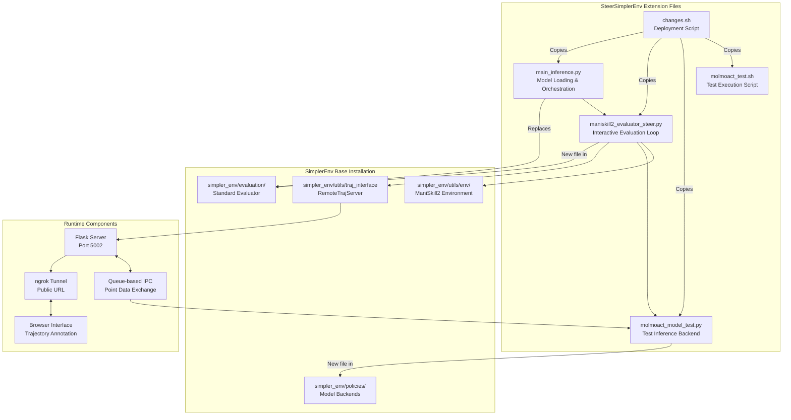
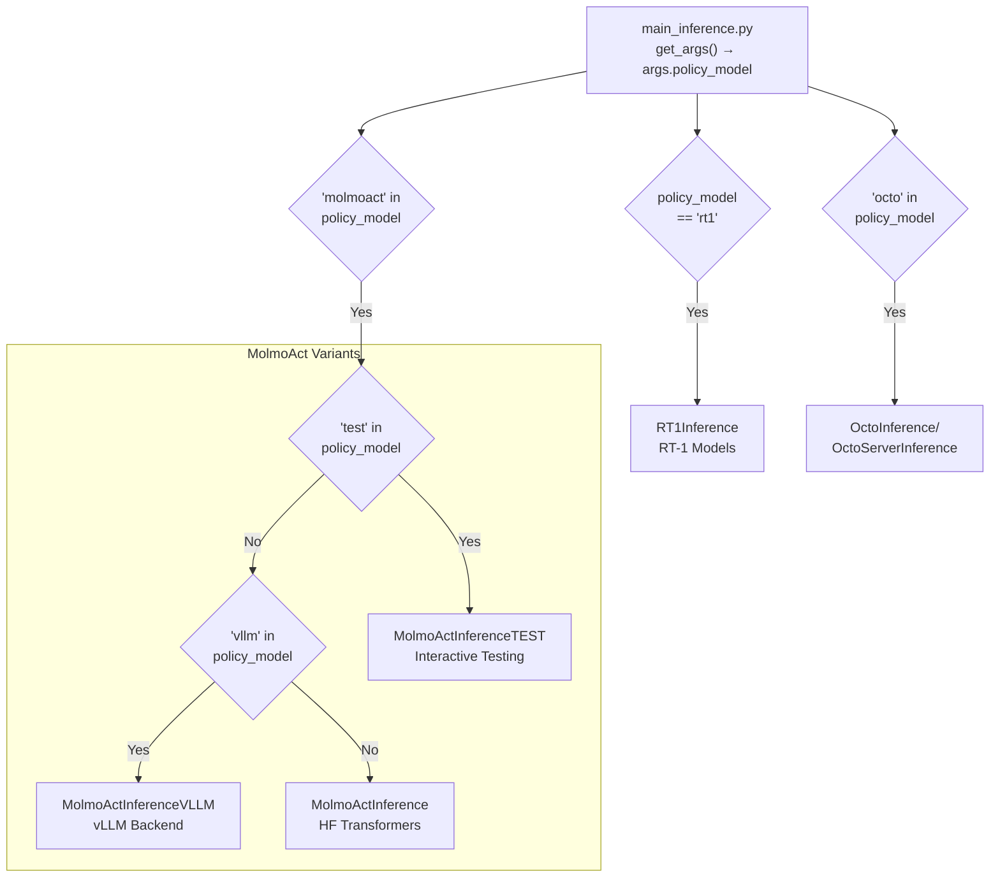
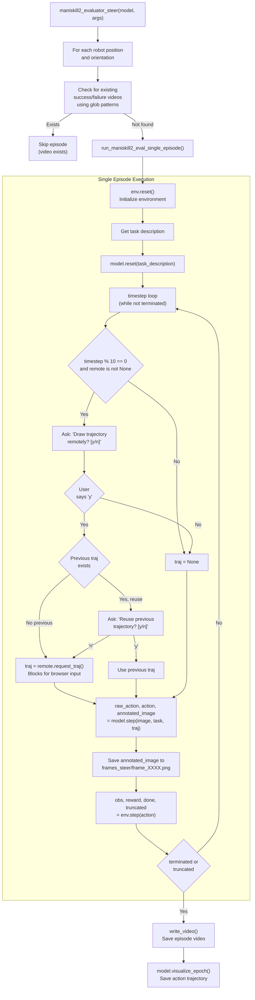
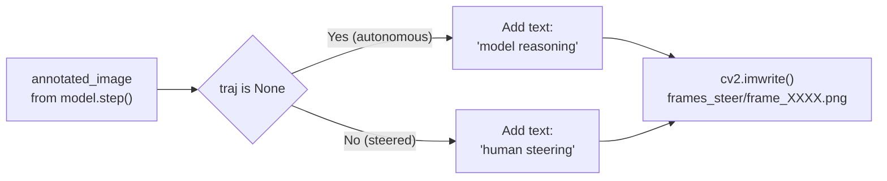
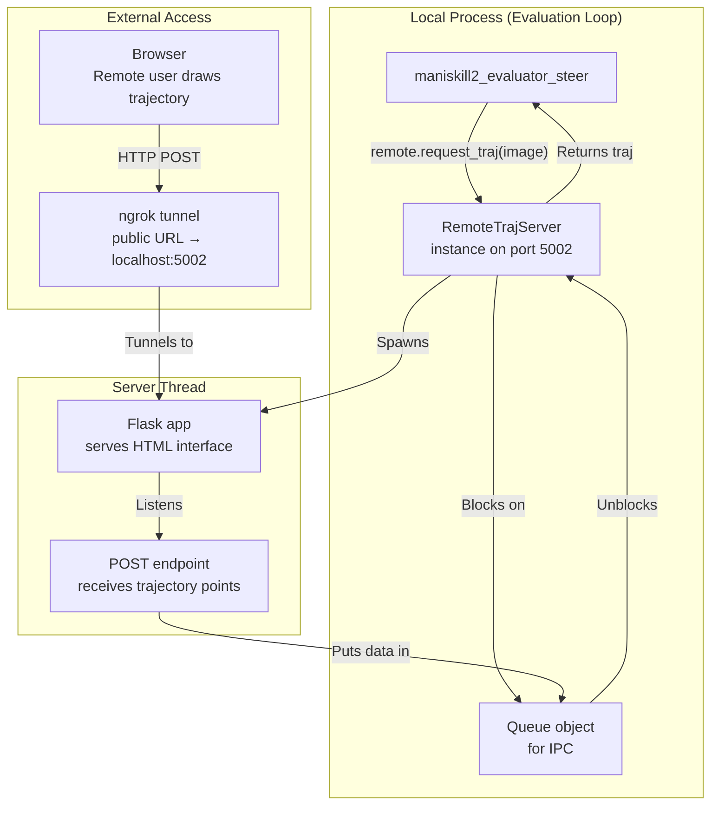

<!-- source: DeepWiki mcp.deepwiki.com · repo allenai/molmoact · page 9 SteerSimplerEnv Extension System · fetched 2026-10-26 -->

# SteerSimplerEnv Extension System

<details>
<summary>Relevant source files</summary>

The following files were used as context for generating this wiki page:

- [SteerSimplerEnv/changes.sh](SteerSimplerEnv/changes.sh)
- [SteerSimplerEnv/main_inference.py](SteerSimplerEnv/main_inference.py)
- [SteerSimplerEnv/maniskill2_evaluator_steer.py](SteerSimplerEnv/maniskill2_evaluator_steer.py)

</details>


## Purpose and Scope

The SteerSimplerEnv Extension System adds interactive human-in-the-loop evaluation capabilities to the SimplerEnv framework. This extension enables remote users to provide trajectory guidance to robot policies during evaluation through a browser-based annotation interface, allowing researchers to compare autonomous model behavior with human-steered execution on the same tasks.

For standard (non-interactive) SimplerEnv evaluation, see [SimplerEnv Evaluation](#5.1). For LIBERO benchmark evaluation, see [LIBERO Benchmark Evaluation](#5.3). For training model checkpoints, see [Training Pipeline](#2).

**Sources:** [SteerSimplerEnv/main_inference.py:1-107](), [SteerSimplerEnv/maniskill2_evaluator_steer.py:1-477]()

---

## System Architecture Overview

The SteerSimplerEnv extension operates as a set of files that are deployed into an existing SimplerEnv installation. The system consists of four primary components: a main inference orchestrator, an interactive evaluation engine, a remote trajectory annotation server, and a deployment script.



**Sources:** [SteerSimplerEnv/changes.sh:1-80](), [SteerSimplerEnv/main_inference.py:1-107](), [SteerSimplerEnv/maniskill2_evaluator_steer.py:1-477]()

---

## Deployment System

### File Deployment via changes.sh

The `changes.sh` script automates deployment of SteerSimplerEnv extension files into an existing SimplerEnv installation. The script performs four file operations:

| Source File | Destination | Operation |
|-------------|-------------|-----------|
| `molmoact/SteerSimplerEnv/main_inference.py` | `SimplerEnv/simpler_env/main_inference.py` | Replace |
| `molmoact/SteerSimplerEnv/maniskill2_evaluator_steer.py` | `SimplerEnv/simpler_env/evaluation/maniskill2_evaluator_steer.py` | Copy |
| `molmoact/SteerSimplerEnv/molmoact_model_test.py` | `SimplerEnv/simpler_env/policies/molmoact/molmoact_model_test.py` | Copy |
| `molmoact/SteerSimplerEnv/molmoact_test.sh` | `SimplerEnv/scripts/molmoact_test.sh` | Copy + chmod +x |

The script validates each source file exists before copying and creates target directories as needed. The replacement of `main_inference.py` is the critical operation that enables the interactive evaluation mode.

**Sources:** [SteerSimplerEnv/changes.sh:1-80]()

### Deployment Verification

The script provides console feedback for each operation and will exit with an error if any source file is missing. After deployment, the SimplerEnv installation contains both the original `maniskill2_evaluator` and the new `maniskill2_evaluator_steer` evaluators.

**Sources:** [SteerSimplerEnv/changes.sh:12-76]()

---

## Main Inference Orchestrator

### Model Backend Selection

The `main_inference.py` orchestrator supports five model backend types through conditional instantiation:



**Sources:** [SteerSimplerEnv/main_inference.py:28-98]()

### GPU Initialization Order

The orchestrator implements a critical GPU initialization sequence to prevent TensorFlow from interfering with PyTorch/vLLM CUDA context:

| Condition | Action | Reason |
|-----------|--------|--------|
| `"molmoact" in args.policy_model and "vllm" in args.policy_model` | Initialize PyTorch CUDA first | Prevents TensorFlow from leaving CUDA in bad state |
| Always | Import TensorFlow after PyTorch | Allows TensorFlow to detect GPU devices correctly |
| Always | Configure TensorFlow memory limit | Prevents single process from taking all GPU memory |

**Sources:** [SteerSimplerEnv/main_inference.py:35-52]()

### Evaluator Selection

The orchestrator selects between standard and interactive evaluation based on the `TEST` global flag:

```python
# Line 9
TEST = True

# Lines 101-104
if TEST:
    success_arr = maniskill2_evaluator_steer(model, args)
else:
    success_arr = maniskill2_evaluator(model, args)
```

When `TEST=True`, the interactive `maniskill2_evaluator_steer` is invoked instead of the standard `maniskill2_evaluator`.

**Sources:** [SteerSimplerEnv/main_inference.py:9-104]()

---

## Interactive Evaluation System

### Episode Execution Flow

The `maniskill2_evaluator_steer` function modifies the standard evaluation loop to incorporate human trajectory input:



**Sources:** [SteerSimplerEnv/maniskill2_evaluator_steer.py:34-328](), [SteerSimplerEnv/maniskill2_evaluator_steer.py:332-477]()

### Human-in-the-Loop Trajectory Input

The interactive trajectory input system operates on a 10-timestep interval:

**Trajectory Request Flow:**

1. **Prompt User** [maniskill2_evaluator_steer.py:149-154](): At `timestep % 10 == 0`, prompt asks if user wants to draw trajectory remotely
2. **Reuse Check** [maniskill2_evaluator_steer.py:156-162](): If trajectory exists from previous iteration, ask if user wants to reuse it
3. **Remote Request** [maniskill2_evaluator_steer.py:164](): `traj = remote.request_traj(image, timeout=120)` blocks until browser posts trajectory points or timeout expires
4. **Model Step** [maniskill2_evaluator_steer.py:173](): Trajectory passed to `model.step(image, task_description, traj)` for action generation

The `traj` variable contains trajectory points in format determined by the `RemoteTrajServer` interface. When `traj=None`, the model operates in autonomous mode.

**Sources:** [SteerSimplerEnv/maniskill2_evaluator_steer.py:148-173]()

### Remote Trajectory Server Initialization

The `RemoteTrajServer` is instantiated conditionally in the main process only:

```python
# Lines 17-22
import multiprocessing as mp
from simpler_env.utils.traj_interface import RemoteTrajServer
if mp.current_process().name == "MainProcess":
    remote = RemoteTrajServer(port=5002)
else:
    remote = None
```

This prevents multiple server instances when using multiprocessing for parallel evaluation. The server listens on port 5002 and provides the `request_traj()` method for blocking trajectory requests.

**Sources:** [SteerSimplerEnv/maniskill2_evaluator_steer.py:17-22]()

### Frame Saving and Annotation

Each timestep saves an annotated frame with mode indicator:



The frame directory `frames_steer/` is created at episode start and cleared of existing frames to ensure clean output.

**Sources:** [SteerSimplerEnv/maniskill2_evaluator_steer.py:138-243]()

### Video Skipping Logic

The evaluator implements intelligent video skipping to avoid re-running completed episodes:

| Variation Mode | Success Pattern | Failure Pattern |
|----------------|----------------|-----------------|
| `xy` | `success_obj_{x}_{y}_*.mp4` | `failure_obj_{x}_{y}_*.mp4` |
| `episode` | `success_obj_episode_{id}_*.mp4` | `failure_obj_episode_{id}_*.mp4` |

Before running an episode, the evaluator constructs glob patterns for both success and failure outcomes. If any matching video file exists, the episode is skipped and not added to `success_arr`.

**Sources:** [SteerSimplerEnv/maniskill2_evaluator_steer.py:374-445]()

### Fail-Safe Action Handling

The evaluator implements fail-safe exception handling for model inference failures:

```python
# Lines 172-190
try:
    raw_action, action, annotated_image = model.step(image, task_description, traj)
except Exception as e:
    print(f"[Fail-safe triggered] model.step() failed at timestep {timestep}: {e}")
    
    # Fail-safe defaults
    raw_action = {
        "world_vector": np.array([0.0, 0.0, 0.0]),
        "rotation_delta": np.array([0.0, 0.0, 0.0]),
        "open_gripper": np.array([1.0]),
    }
    annotated_image = image.copy()
    
    action = {
        "world_vector": raw_action["world_vector"],
        "rot_axangle": np.array([0.0, 0.0, 0.0]),
        "gripper": np.array([1.0]),
        "terminate_episode": np.array([0.0]),
    }
```

The fail-safe produces a no-op action (zero movement, gripper open) to allow the episode to continue rather than crashing.

**Sources:** [SteerSimplerEnv/maniskill2_evaluator_steer.py:172-190]()

---

## Remote Trajectory Server Interface

### Server Architecture

The `RemoteTrajServer` class (referenced but not shown in provided files) implements a Flask-based HTTP server with ngrok tunneling to expose the trajectory annotation interface:



**Sources:** [SteerSimplerEnv/maniskill2_evaluator_steer.py:17-22]()

### Request-Response Flow

The `request_traj()` method implements blocking trajectory request:

1. **Send Image:** Server encodes current observation image and serves it via Flask endpoint
2. **Generate Public URL:** ngrok creates public URL that remote user can access
3. **Wait for Input:** `request_traj()` blocks on queue waiting for browser to POST trajectory
4. **Timeout Handling:** Returns `None` if timeout (120 seconds default) expires without input
5. **Return Trajectory:** Unblocks and returns trajectory points to evaluation loop

This architecture allows researchers to remotely annotate trajectories on any browser-enabled device without VPN or SSH access to the evaluation machine.

**Sources:** [SteerSimplerEnv/maniskill2_evaluator_steer.py:164]()

---

## Model Testing Interface

### MolmoActInferenceTEST Class

The `molmoact_model_test.py` file (referenced but not provided) implements a specialized inference backend for testing with trajectory visualization capabilities. Based on the integration pattern:

```python
# Lines 22-23, 82-86
from simpler_env.policies.molmoact.molmoact_model_test import MolmoActInferenceTEST

if "test" in args.policy_model:
    model = MolmoActInferenceTEST(
        saved_model_path = args.ckpt_path,
        policy_setup = args.policy_setup,
    )
```

The test variant is instantiated when the policy model string contains "test" and receives trajectory data through the `step()` method's `traj` parameter.

**Sources:** [SteerSimplerEnv/main_inference.py:22-86]()

### Integration with Queue-Based IPC

The MolmoActInferenceTEST class receives trajectory data through the standard model interface:

```python
raw_action, action, annotated_image = model.step(image, task_description, traj)
```

When `traj` is not `None`, the model can use the trajectory points to guide action generation, visualize the trajectory on the image, or perform analysis comparing trajectory-based and autonomous predictions.

**Sources:** [SteerSimplerEnv/maniskill2_evaluator_steer.py:173]()

---

## Test Execution Scripts

### molmoact_test.sh Script

The `molmoact_test.sh` script (copied to `SimplerEnv/scripts/`) provides a convenient wrapper for executing test evaluations with the SteerSimplerEnv extension. The script is made executable by the deployment script:

```bash
# Line 75
chmod +x "$DST_SCRIPT"
```

This allows direct execution without shell prefix: `./molmoact_test.sh`

**Sources:** [SteerSimplerEnv/changes.sh:63-76]()

---

## Integration with SimplerEnv Base

### File System Layout After Deployment

After running `changes.sh`, the SimplerEnv installation contains the following structure:

```
SimplerEnv/
├── simpler_env/
│   ├── main_inference.py          ← REPLACED by extension
│   ├── evaluation/
│   │   ├── maniskill2_evaluator.py      ← Original evaluator (preserved)
│   │   └── maniskill2_evaluator_steer.py ← NEW interactive evaluator
│   ├── policies/
│   │   └── molmoact/
│   │       ├── molmoact_model.py          ← Standard inference
│   │       ├── molmoact_model_vllm.py     ← vLLM inference
│   │       └── molmoact_model_test.py     ← NEW test inference
│   └── utils/
│       ├── env/
│       │   └── env_builder.py
│       └── traj_interface.py       ← RemoteTrajServer (assumed)
└── scripts/
    └── molmoact_test.sh            ← NEW test script
```

The extension preserves the original evaluator, allowing users to switch between standard and interactive evaluation by modifying the `TEST` flag in `main_inference.py`.

**Sources:** [SteerSimplerEnv/changes.sh:1-80](), [SteerSimplerEnv/main_inference.py:1-107]()

### Environment Variable Dependencies

The interactive evaluator inherits environment variable configuration from the standard SimplerEnv setup:

| Environment Variable | Purpose | Set Location |
|---------------------|---------|--------------|
| `DISPLAY` | Set to `""` to disable display | [main_inference.py:31]() |
| `XLA_PYTHON_CLIENT_PREALLOCATE` | Set to `"false"` to prevent JAX GPU memory hogging | [main_inference.py:33]() |
| `NVIDIA_VISIBLE_DEVICES` | GPU device selection (inherited) | Docker/system |
| `TF_MEMORY_LIMIT` | TensorFlow GPU memory cap | [main_inference.py:51]() |

**Sources:** [SteerSimplerEnv/main_inference.py:31-52]()

---

## Comparison: Standard vs Interactive Evaluation

| Aspect | Standard Evaluator | Interactive Evaluator (Steer) |
|--------|-------------------|------------------------------|
| Entry point | `maniskill2_evaluator()` | `maniskill2_evaluator_steer()` |
| Human input | None | Trajectory annotation every 10 timesteps |
| RemoteTrajServer | Not used | Initialized in main process |
| Frame saving | Optional | Always saves to `frames_steer/` with mode annotation |
| Model interface | `model.step(image, task)` | `model.step(image, task, traj)` |
| Episode skipping | Based on success/failure video existence | Same, with glob pattern matching |
| Use case | Autonomous evaluation | Human-guided debugging and comparison |

**Sources:** [SteerSimplerEnv/main_inference.py:101-104](), [SteerSimplerEnv/maniskill2_evaluator_steer.py:332-477]()

---

## Usage Pattern

### Typical Workflow

1. **Deploy Extension:**
   ```bash
   cd molmoact
   bash SteerSimplerEnv/changes.sh
   ```

2. **Configure Interactive Mode:**
   Ensure `TEST = True` in [main_inference.py:9]()

3. **Start Evaluation:**
   Run evaluation with desired policy model, e.g., `--policy_model molmoact-test`

4. **Annotate Trajectories:**
   - Every 10 timesteps, terminal prompts for trajectory input
   - Access ngrok URL from remote browser
   - Draw trajectory on displayed observation image
   - POST submission unblocks evaluation loop

5. **Review Results:**
   - Videos saved to standard SimplerEnv output directory
   - Frames with mode annotations in `frames_steer/`
   - Action trajectory visualizations in `actions/` subdirectory

**Sources:** [SteerSimplerEnv/changes.sh:1-80](), [SteerSimplerEnv/main_inference.py:9](), [SteerSimplerEnv/maniskill2_evaluator_steer.py:149-164]()

---

## Error Handling and Debugging

### Debugger Configuration

The evaluator includes commented-out debugpy configuration for remote debugging:

```python
# Lines 25-30 (commented out)
# if os.environ.get("RANK", "0") == "0":
#     import debugpy
#     debugpy.listen(("172.17.0.1", 5678))
#     print("Debugger is listening on port 5678. Waiting for client to attach...")
#     debugpy.wait_for_client()
```

This allows attaching a remote debugger to rank 0 process in distributed evaluation scenarios.

**Sources:** [SteerSimplerEnv/maniskill2_evaluator_steer.py:25-30]()

### Fault Handler

The evaluator enables Python's fault handler for better crash debugging:

```python
# Lines 31-32
import faulthandler
faulthandler.enable()
```

This prints a traceback on segfaults, bus errors, and other fatal signals.

**Sources:** [SteerSimplerEnv/maniskill2_evaluator_steer.py:31-32]()

### Non-Interactive Fallback

The trajectory annotation system handles non-interactive execution (e.g., batch jobs) gracefully:

```python
# Lines 151-153
try:
    ans = input(f"[t={timestep}] Draw trajectory remotely? [y/n] ").strip().lower()
except EOFError:  # non-interactive run
    ans = "n"
```

When stdin is closed (EOF), the system defaults to autonomous mode without trajectory input.

**Sources:** [SteerSimplerEnv/maniskill2_evaluator_steer.py:149-153]()

---

