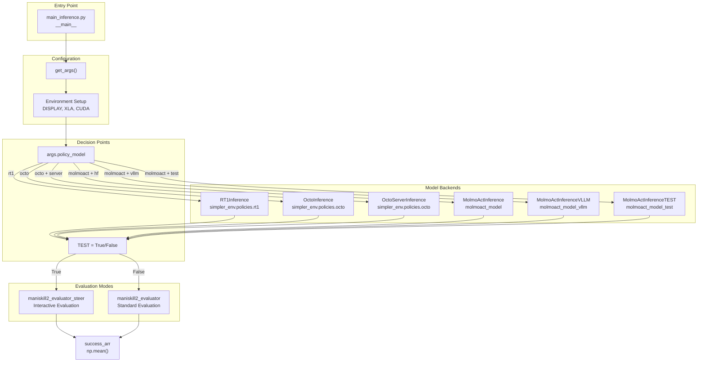
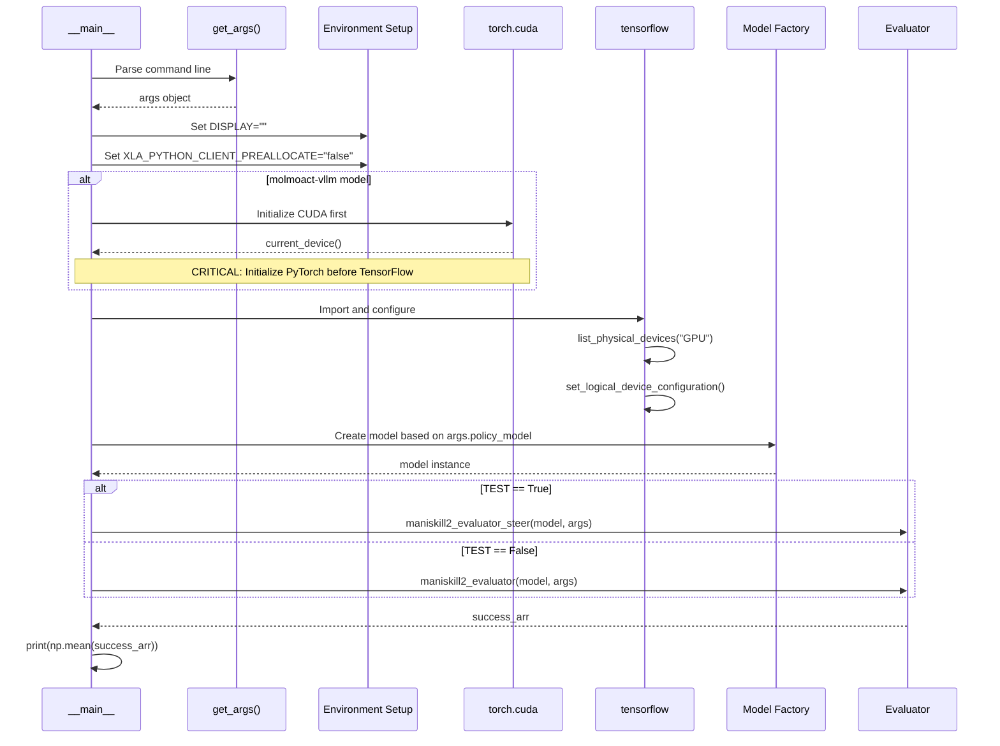
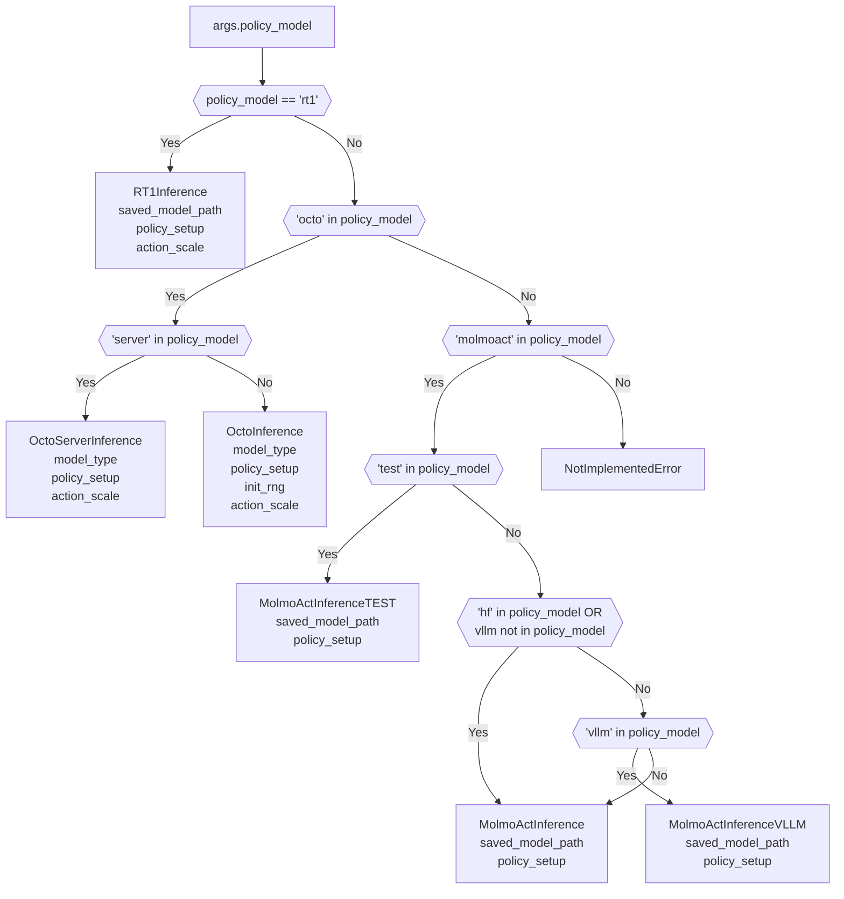
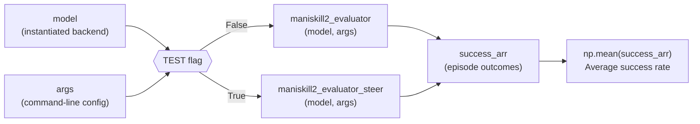

<!-- source: DeepWiki mcp.deepwiki.com · repo allenai/molmoact · page 9.1 Main Inference Engine · fetched 2026-10-26 -->

# Main Inference Engine

<details>
<summary>Relevant source files</summary>

The following files were used as context for generating this wiki page:

- [SteerSimplerEnv/main_inference.py](SteerSimplerEnv/main_inference.py)

</details>


## Purpose and Scope

This document describes the main inference orchestrator located in `SteerSimplerEnv/main_inference.py`, which serves as the entry point for running model inference and evaluation in the SteerSimplerEnv extension. This module provides a unified interface for loading multiple model backends (MolmoAct, Octo, RT-1) and executing either standard or interactive evaluations.

For information about the interactive evaluation system that this engine can invoke, see [Interactive Evaluation System](#9.2). For details about the remote trajectory annotation capability, see [Remote Trajectory Server](#9.3). For model testing with visualization, see [Model Testing Interface](#9.4).

## System Architecture

The main inference engine follows a factory pattern design, where command-line arguments determine which model backend to instantiate and which evaluation mode to execute. The system handles critical initialization ordering between PyTorch/vLLM and TensorFlow to prevent GPU device registration conflicts.



**Sources:** [SteerSimplerEnv/main_inference.py:1-107]()

## Initialization Sequence

The initialization flow addresses a critical GPU device registration issue between PyTorch/vLLM and TensorFlow. For MolmoAct models using the vLLM backend, PyTorch CUDA must be initialized before TensorFlow imports to prevent TensorFlow from failing to register GPU devices.



**Sources:** [SteerSimplerEnv/main_inference.py:28-53]()

## Command-Line Argument Processing

The system uses the `get_args()` function from SimplerEnv's argparse module to parse configuration parameters. Key arguments include:

| Argument | Purpose | Used By |
|----------|---------|---------|
| `args.policy_model` | Determines which model backend to load | Model factory logic |
| `args.ckpt_path` | Path to model checkpoint | All model backends |
| `args.policy_setup` | Policy configuration string | All model backends |
| `args.action_scale` | Action scaling factor | RT-1, Octo backends |
| `args.tf_memory_limit` | TensorFlow GPU memory limit (MB) | TensorFlow configuration |
| `args.octo_init_rng` | Random seed for Octo initialization | Octo backend |

**Sources:** [SteerSimplerEnv/main_inference.py:29]()

## Environment Configuration

### Display and JAX Configuration

The system sets critical environment variables before initializing GPU frameworks:

```
os.environ["DISPLAY"] = ""  # Disable X11 display
os.environ["XLA_PYTHON_CLIENT_PREALLOCATE"] = "false"  # Prevent JAX from pre-allocating all GPU memory
```

This configuration prevents issues with headless execution and ensures multiple processes can share GPU resources.

**Sources:** [SteerSimplerEnv/main_inference.py:31-33]()

### PyTorch CUDA Initialization

For MolmoAct models using the vLLM backend, PyTorch CUDA must be initialized first:

```python
if "molmoact" in args.policy_model and "vllm" in args.policy_model:
    import torch
    if torch.cuda.is_available():
        print(f"Initializing PyTorch CUDA first: {torch.cuda.device_count()} device(s) available")
        _ = torch.cuda.current_device()
```

This critical fix ensures TensorFlow can properly register GPU devices when imported afterward.

**Sources:** [SteerSimplerEnv/main_inference.py:35-42]()

### TensorFlow GPU Configuration

After PyTorch initialization (if needed), TensorFlow is imported and configured with memory limits:

```python
import tensorflow as tf
gpus = tf.config.list_physical_devices("GPU")
if len(gpus) > 0:
    tf.config.set_logical_device_configuration(
        gpus[0],
        [tf.config.LogicalDeviceConfiguration(memory_limit=args.tf_memory_limit)],
    )
```

This prevents TensorFlow from monopolizing GPU memory, allowing co-existence with PyTorch/vLLM processes.

**Sources:** [SteerSimplerEnv/main_inference.py:44-52]()

## Model Backend Factory

The main inference engine implements a factory pattern to instantiate the appropriate model backend based on the `args.policy_model` string. The factory supports six distinct backends:



**Sources:** [SteerSimplerEnv/main_inference.py:54-98]()

### RT-1 Backend

The RT-1 backend requires an explicit checkpoint path and creates an `RT1Inference` instance:

**Location:** [SteerSimplerEnv/main_inference.py:55-62]()

**Required Arguments:**
- `saved_model_path`: Path to RT-1 SavedModel checkpoint (must not be None)
- `policy_setup`: Policy configuration string
- `action_scale`: Action scaling factor

### Octo Backend

The Octo backend supports two variants:

1. **OctoServerInference**: For server-based inference ([SteerSimplerEnv/main_inference.py:64-72]())
2. **OctoInference**: For direct inference ([SteerSimplerEnv/main_inference.py:74-79]())

If `args.ckpt_path` is None or "None", it defaults to `args.policy_model` as the model type.

**Required Arguments:**
- `model_type`: HuggingFace model identifier or checkpoint path
- `policy_setup`: Policy configuration string
- `action_scale`: Action scaling factor
- `init_rng`: Random seed for Octo initialization (OctoInference only)

### MolmoAct Backend

The MolmoAct backend provides three variants with distinct initialization strategies:

#### MolmoActInferenceTEST

Used when "test" appears in `args.policy_model`. This variant supports interactive trajectory visualization and human-in-the-loop annotation.

**Location:** [SteerSimplerEnv/main_inference.py:82-86]()

**Required Arguments:**
- `saved_model_path`: Path to MolmoAct checkpoint
- `policy_setup`: Policy configuration string

For details on the TEST interface, see [Model Testing Interface](#9.4).

#### MolmoActInference

The standard HuggingFace Transformers backend, used when "hf" appears in the policy model string or when "vllm" is absent.

**Location:** [SteerSimplerEnv/main_inference.py:87-91]()

**Required Arguments:**
- `saved_model_path`: Path to MolmoAct checkpoint
- `policy_setup`: Policy configuration string

#### MolmoActInferenceVLLM

The vLLM-accelerated backend for optimized inference, used when "vllm" appears in the policy model string.

**Location:** [SteerSimplerEnv/main_inference.py:92-96]()

**Required Arguments:**
- `saved_model_path`: Path to MolmoAct checkpoint
- `policy_setup`: Policy configuration string

This backend requires PyTorch CUDA initialization before TensorFlow imports (handled automatically by the initialization sequence).

**Sources:** [SteerSimplerEnv/main_inference.py:80-96]()

## Evaluation Execution

After model instantiation, the system executes evaluation using one of two evaluators based on the `TEST` flag:



**Sources:** [SteerSimplerEnv/main_inference.py:100-106]()

### TEST Flag Control

The `TEST` variable at [SteerSimplerEnv/main_inference.py:9]() controls which evaluator is invoked:

| TEST Value | Evaluator | Description |
|------------|-----------|-------------|
| `True` | `maniskill2_evaluator_steer` | Interactive evaluation with human-in-the-loop steering |
| `False` | `maniskill2_evaluator` | Standard autonomous evaluation |

The current codebase sets `TEST = True`, enabling interactive evaluation by default.

### Return Value

Both evaluators return `success_arr`, a NumPy array containing binary success indicators (0 or 1) for each evaluation episode. The main inference engine computes and prints the average success rate:

```python
print(" " * 10, "Average success", np.mean(success_arr))
```

**Sources:** [SteerSimplerEnv/main_inference.py:100-106]()

## Import Error Handling

The system implements defensive import strategies with try-except blocks to gracefully handle missing dependencies:

### Octo Import Handling

```python
try:
    from simpler_env.policies.octo.octo_model import OctoInference
except ImportError as e:
    print("Octo is not correctly imported.")
    print(e)
```

**Location:** [SteerSimplerEnv/main_inference.py:11-15]()

### MolmoAct Import Handling

```python
try:
    from simpler_env.policies.molmoact.molmoact_model import MolmoActInference
    from simpler_env.policies.molmoact.molmoact_model_vllm import MolmoActInferenceVLLM
    from simpler_env.policies.molmoact.molmoact_model_test import MolmoActInferenceTEST
except ImportError as e:
    print("MolmoAct is not correctly imported.")
    print(e)
```

**Location:** [SteerSimplerEnv/main_inference.py:18-25]()

These error handlers allow the system to continue execution even if specific model backends are unavailable, enabling partial functionality in incomplete installations.

## Module Dependencies

The main inference engine depends on the following external modules:

| Module | Purpose | Import Location |
|--------|---------|-----------------|
| `simpler_env.evaluation.argparse` | Command-line argument parsing | Line 5 |
| `simpler_env.evaluation.maniskill2_evaluator` | Standard evaluation loop | Line 6 |
| `simpler_env.evaluation.maniskill2_evaluator_steer` | Interactive evaluation loop | Line 7 |
| `simpler_env.policies.octo.octo_model` | Octo direct inference | Line 12 |
| `simpler_env.policies.octo.octo_server_model` | Octo server inference | Line 64 |
| `simpler_env.policies.rt1.rt1_model` | RT-1 inference | Line 56 |
| `simpler_env.policies.molmoact.molmoact_model` | MolmoAct HF inference | Line 19 |
| `simpler_env.policies.molmoact.molmoact_model_vllm` | MolmoAct vLLM inference | Line 20 |
| `simpler_env.policies.molmoact.molmoact_model_test` | MolmoAct test interface | Line 22 |

**Sources:** [SteerSimplerEnv/main_inference.py:1-26]()

## Usage Patterns

### Standard MolmoAct Inference

```bash
python main_inference.py \
    --policy_model molmoact-hf \
    --ckpt_path /path/to/checkpoint \
    --policy_setup google_robot \
    --tf_memory_limit 4096
```

### vLLM-Accelerated Inference

```bash
python main_inference.py \
    --policy_model molmoact-vllm \
    --ckpt_path /path/to/checkpoint \
    --policy_setup google_robot \
    --tf_memory_limit 4096
```

### Interactive Testing with Visualization

```bash
python main_inference.py \
    --policy_model molmoact-test \
    --ckpt_path /path/to/checkpoint \
    --policy_setup google_robot \
    --tf_memory_limit 4096
```

Note: The TEST flag in the source code controls whether interactive evaluation (`maniskill2_evaluator_steer`) or standard evaluation (`maniskill2_evaluator`) is used.

**Sources:** [SteerSimplerEnv/main_inference.py:28-107]()

---

