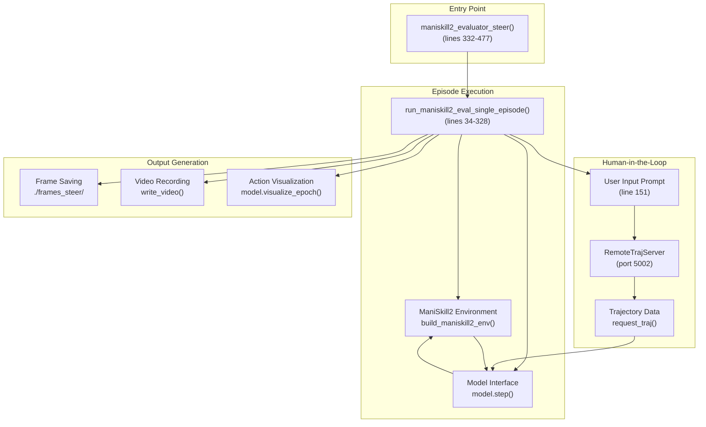
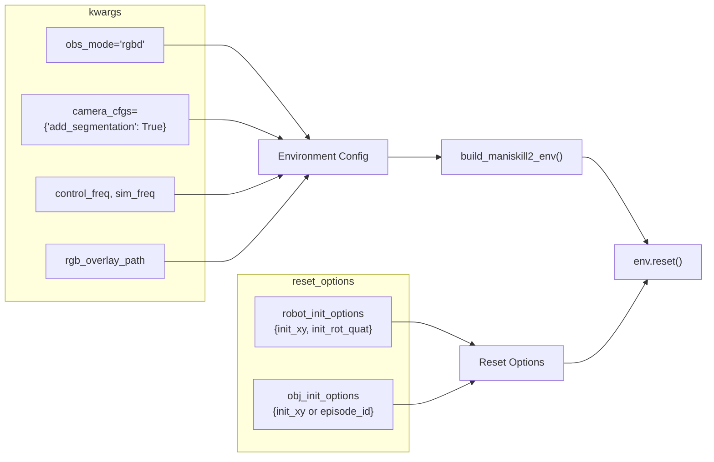
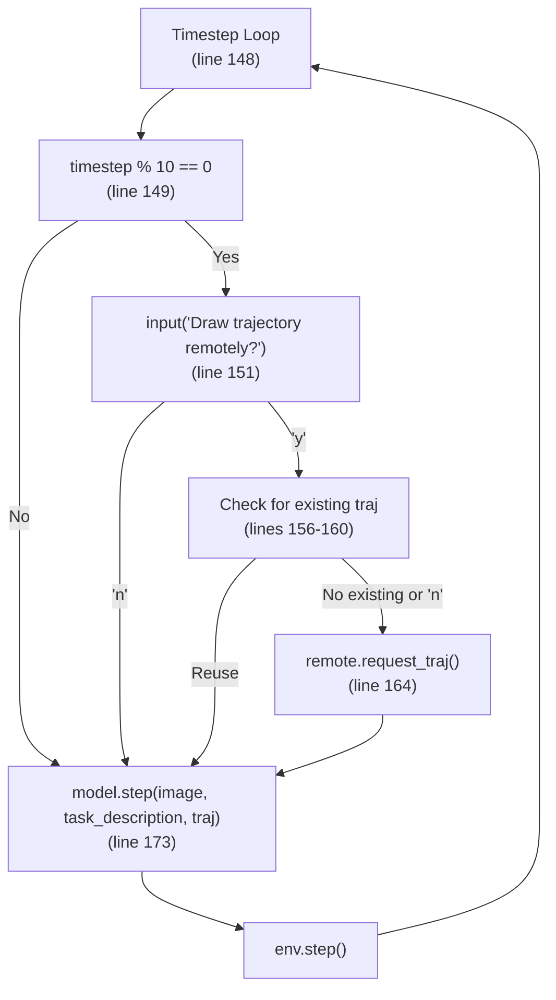
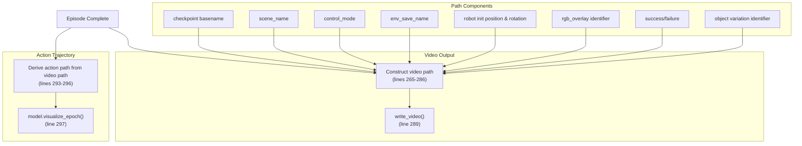
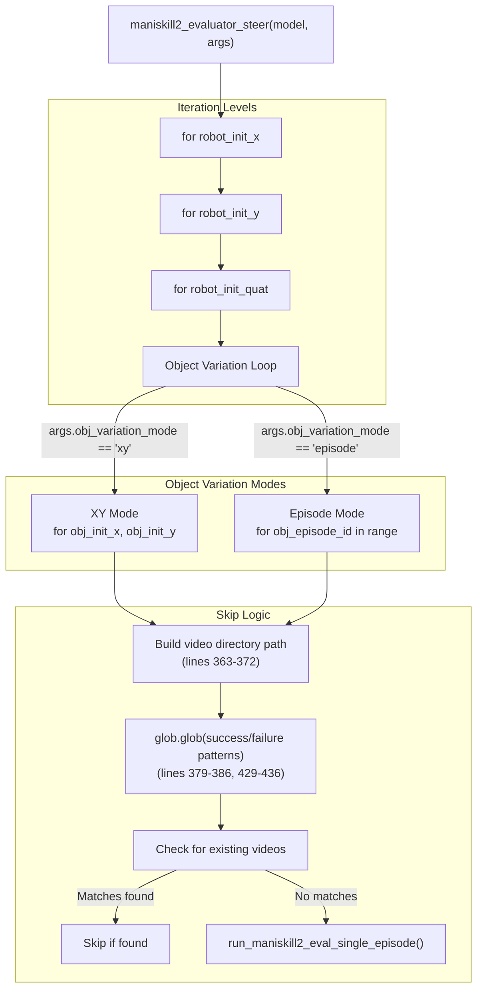

<!-- source: DeepWiki mcp.deepwiki.com · repo allenai/molmoact · page 9.2 Interactive Evaluation System · fetched 2026-10-26 -->

# Interactive Evaluation System

<details>
<summary>Relevant source files</summary>

The following files were used as context for generating this wiki page:

- [SteerSimplerEnv/maniskill2_evaluator_steer.py](SteerSimplerEnv/maniskill2_evaluator_steer.py)

</details>


## Purpose and Scope

The Interactive Evaluation System provides human-in-the-loop capabilities for evaluating robot policies in simulated ManiSkill2 environments. This system extends the standard SimplerEnv evaluation (see [5.1](#5.1)) by allowing human operators to interactively steer robot actions during policy rollouts via remote trajectory annotation.

The system is implemented in [SteerSimplerEnv/maniskill2_evaluator_steer.py]() and works in conjunction with the Remote Trajectory Server (see [9.3](#9.3)) and Model Testing Interface (see [9.4](#9.4)).

**Sources:** [SteerSimplerEnv/maniskill2_evaluator_steer.py:1-10]()

## System Architecture

The interactive evaluation system consists of two main components: a single-episode executor and a multi-episode orchestrator that together enable human intervention during policy evaluation.



**Sources:** [SteerSimplerEnv/maniskill2_evaluator_steer.py:17-22, 34-328, 332-477]()

## Single Episode Execution

The `run_maniskill2_eval_single_episode` function orchestrates a complete episode rollout with optional human steering. It accepts 23 parameters controlling robot initialization, environment configuration, and logging behavior.

### Function Signature

| Parameter | Type | Description |
|-----------|------|-------------|
| `model` | Model interface | Policy model with `reset()`, `step()`, and `visualize_epoch()` methods |
| `ckpt_path` | str | Model checkpoint path for logging organization |
| `robot_name` | str | Robot type (e.g., "google_robot_static") |
| `env_name` | str | ManiSkill2 environment name |
| `scene_name` | str | Scene configuration identifier |
| `robot_init_x/y` | float | Initial robot XY position |
| `robot_init_quat` | array | Initial robot orientation quaternion |
| `control_mode` | str | Robot control mode (e.g., "arm_pd_ee_delta_pose_align_interpolate_by_planner_gripper_pd_joint_target_delta_pos_interpolate_by_planner") |
| `obj_init_x/y` | float | Object XY initialization (optional, XY mode) |
| `obj_episode_id` | int | Episode ID for object initialization (optional, episode mode) |
| `max_episode_steps` | int | Maximum timesteps per episode (default: 80) |
| `control_freq` | int | Control frequency in Hz (default: 3) |
| `sim_freq` | int | Simulation frequency in Hz (default: 513) |
| `instruction` | str | Custom task instruction (optional) |
| `logging_dir` | str | Output directory for videos and visualizations |

**Sources:** [SteerSimplerEnv/maniskill2_evaluator_steer.py:34-57]()

### Environment Initialization

The function builds a ManiSkill2 environment with RGB-D observations and segmentation masks:



**Sources:** [SteerSimplerEnv/maniskill2_evaluator_steer.py:62-109]()

### Human Steering Loop

Every 10 timesteps, the system prompts for human intervention. If the user responds affirmatively, the `RemoteTrajServer` blocks until trajectory points are received or a 120-second timeout occurs.



The trajectory data structure passed to `model.step()` contains 2D pixel coordinates that the model can use to guide action generation. When `traj=None`, the model operates in pure reasoning mode.

**Sources:** [SteerSimplerEnv/maniskill2_evaluator_steer.py:148-170, 173]()

### Fail-Safe Mechanism

The system includes error handling for model failures during inference. If `model.step()` raises an exception, default safe actions are applied:

| Action Component | Default Value |
|------------------|---------------|
| `world_vector` | `[0.0, 0.0, 0.0]` |
| `rotation_delta` | `[0.0, 0.0, 0.0]` |
| `open_gripper` | `[1.0]` (open) |
| `rot_axangle` | `[0.0, 0.0, 0.0]` |
| `terminate_episode` | `[0.0]` (continue) |

**Sources:** [SteerSimplerEnv/maniskill2_evaluator_steer.py:172-190]()

### Frame Annotation and Saving

Each timestep's observation is annotated with steering status and saved to `./frames_steer/`:

1. Clear existing frames in directory [line 144-145]()
2. Receive annotated image from `model.step()` [line 173]()
3. Add text overlay indicating mode [lines 217-234]():
   - "model reasoning" when `traj=None`
   - "human steering" when trajectory provided
4. Save frame as `frame_{timestep:04d}.png` [lines 205-243]()

**Sources:** [SteerSimplerEnv/maniskill2_evaluator_steer.py:138-243]()

### Output Generation

Upon episode completion, the system generates three output types:



The video filename encodes success status and object configuration:
- XY mode: `{success}_obj_{obj_init_x}_{obj_init_y}_*.mp4`
- Episode mode: `{success}_obj_episode_{obj_episode_id}_*.mp4`

**Sources:** [SteerSimplerEnv/maniskill2_evaluator_steer.py:263-297]()

## Multi-Episode Orchestration

The `maniskill2_evaluator_steer` function orchestrates evaluation across multiple robot and object configurations, with intelligent skip logic to avoid re-evaluating existing episodes.

### Evaluation Loop Structure



**Sources:** [SteerSimplerEnv/maniskill2_evaluator_steer.py:332-476]()

### Skip Logic Implementation

The skip logic prevents redundant evaluations by checking for existing video files matching specific patterns:

**XY Variation Mode:**
```
video_dir/success_obj_{obj_init_x}_{obj_init_y}_*.mp4
video_dir/failure_obj_{obj_init_x}_{obj_init_y}_*.mp4
```

**Episode Variation Mode:**
```
video_dir/success_obj_episode_{obj_episode_id}_*.mp4
video_dir/failure_obj_episode_{obj_episode_id}_*.mp4
```

If any matching files exist, the configuration is skipped and a message is printed: `[SKIP] Found existing video: {path}`.

**Sources:** [SteerSimplerEnv/maniskill2_evaluator_steer.py:374-395, 424-445]()

### Video Directory Structure

The hierarchical directory structure encodes all evaluation parameters:

```
{logging_dir}/
└── {ckpt_path_basename}/
    └── {scene_name}/
        └── {control_mode}/
            └── {env_save_name}/
                └── rob_{x}_{y}_rot_{r}_{p}_{y}_rgb_overlay_{overlay_str}/
                    ├── success_obj_*.mp4
                    ├── failure_obj_*.mp4
                    └── actions/
                        ├── success_obj_*.png
                        └── failure_obj_*.png
```

Where:
- `env_save_name` includes all `additional_env_build_kwargs` as `{env_name}_{k}_{v}...`
- Robot rotation angles `(r, p, y)` are derived from quaternion using `quat2euler`
- Action visualizations are stored in a parallel `actions/` subdirectory

**Sources:** [SteerSimplerEnv/maniskill2_evaluator_steer.py:337-372]()

## RemoteTrajServer Integration

The interactive evaluation system instantiates a single `RemoteTrajServer` in the main process:

```python
if mp.current_process().name == "MainProcess":
    remote = RemoteTrajServer(port=5002)
else:
    remote = None
```

This conditional instantiation prevents multiple server instances when using multiprocessing. Only the main process can request trajectories; worker processes have `remote=None` and skip the interaction prompts.

The `remote.request_traj(image, timeout=120)` call:
1. Encodes the image and sends it to connected browsers
2. Blocks until trajectory points are received or timeout expires
3. Returns trajectory data or `None` on timeout

**Sources:** [SteerSimplerEnv/maniskill2_evaluator_steer.py:17-22, 149-165]()

## Configuration Parameters

The evaluation system accepts the following arguments via the `args` object:

| Parameter | Type | Description |
|-----------|------|-------------|
| `args.ckpt_path` | str | Model checkpoint path |
| `args.robot` | str | Robot type identifier |
| `args.env_name` | str | Environment name |
| `args.scene_name` | str | Scene configuration |
| `args.robot_init_xs` | list[float] | Robot X positions to test |
| `args.robot_init_ys` | list[float] | Robot Y positions to test |
| `args.robot_init_quats` | list[array] | Robot orientations to test |
| `args.obj_variation_mode` | str | "xy" or "episode" |
| `args.obj_init_xs` | list[float] | Object X positions (XY mode) |
| `args.obj_init_ys` | list[float] | Object Y positions (XY mode) |
| `args.obj_episode_range` | tuple[int, int] | Episode ID range (episode mode) |
| `args.additional_env_build_kwargs` | dict | Extra environment parameters |
| `args.rgb_overlay_path` | str | Path to RGB overlay image |
| `args.obs_camera_name` | str | Observation camera identifier |
| `args.control_freq` | int | Control frequency (Hz) |
| `args.sim_freq` | int | Simulation frequency (Hz) |
| `args.max_episode_steps` | int | Maximum steps per episode |
| `args.enable_raytracing` | bool | Enable ray-traced rendering |
| `args.additional_env_save_tags` | str | Extra tags for output paths |
| `args.logging_dir` | str | Root directory for outputs |
| `args.policy_model` | str | Policy model type for control mode derivation |

**Sources:** [SteerSimplerEnv/maniskill2_evaluator_steer.py:333-476]()

## Return Values and Success Tracking

Both evaluation functions return success indicators:

- `run_maniskill2_eval_single_episode()` returns `bool`: `True` if episode succeeded (`done==True`), `False` otherwise [line 328]()
- `maniskill2_evaluator_steer()` returns `list[bool]`: success status for each evaluated configuration [line 334, 398, 447]()

Success is determined by the environment's `done` flag, which indicates task completion according to the environment's internal success criteria.

**Sources:** [SteerSimplerEnv/maniskill2_evaluator_steer.py:250, 328, 334, 398, 447]()

## Long-Horizon Task Support

The system supports long-horizon tasks with multiple subtasks:

1. Check if current subtask is final: `env.unwrapped.is_final_subtask()` [line 112]()
2. When model predicts termination on non-final subtask:
   - Override termination flag [line 199]()
   - Advance to next subtask: `env.unwrapped.advance_to_next_subtask()` [line 200]()
3. Update task description: `env.unwrapped.get_language_instruction()` [line 251]()
4. Re-check final subtask status [line 255]()

This allows the model to progress through multi-stage manipulation tasks without premature termination.

**Sources:** [SteerSimplerEnv/maniskill2_evaluator_steer.py:112, 197-200, 251-255]()

---

