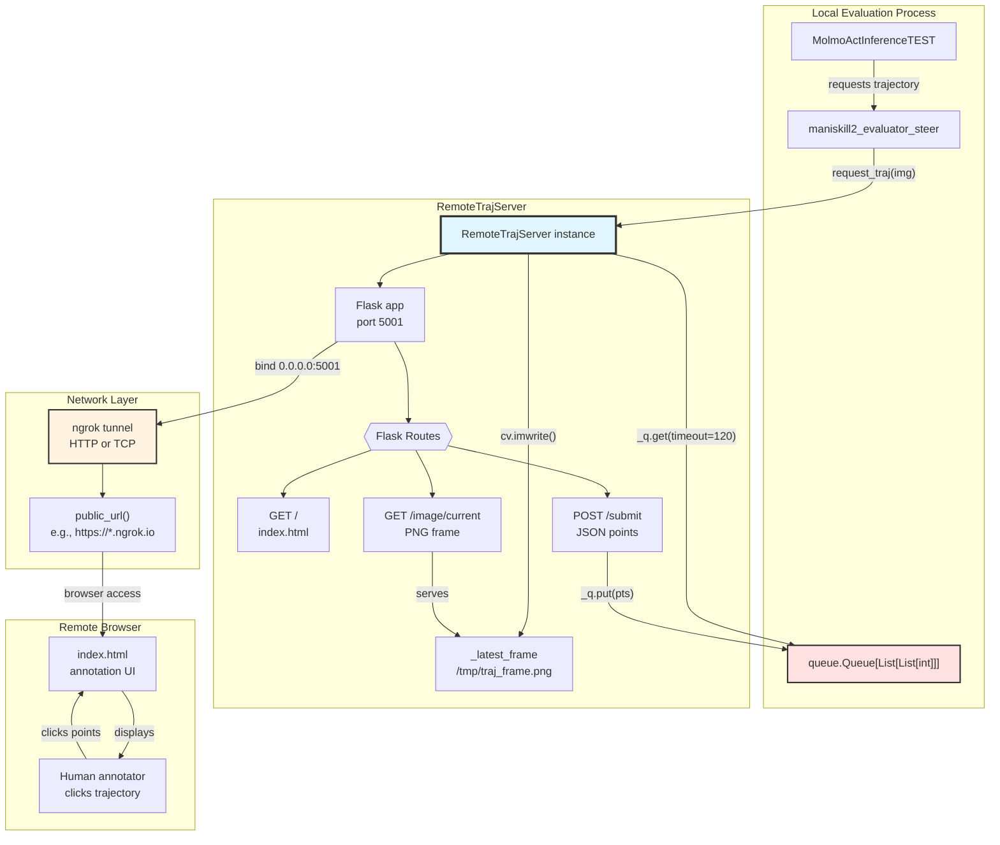
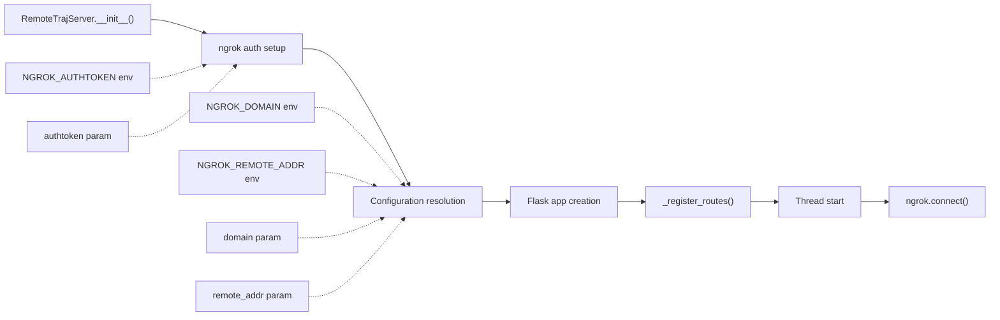
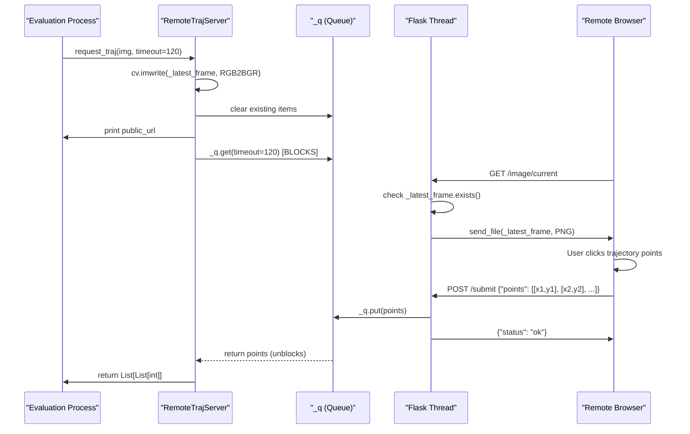
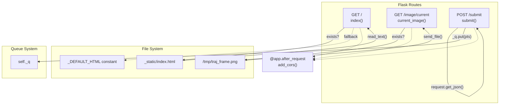
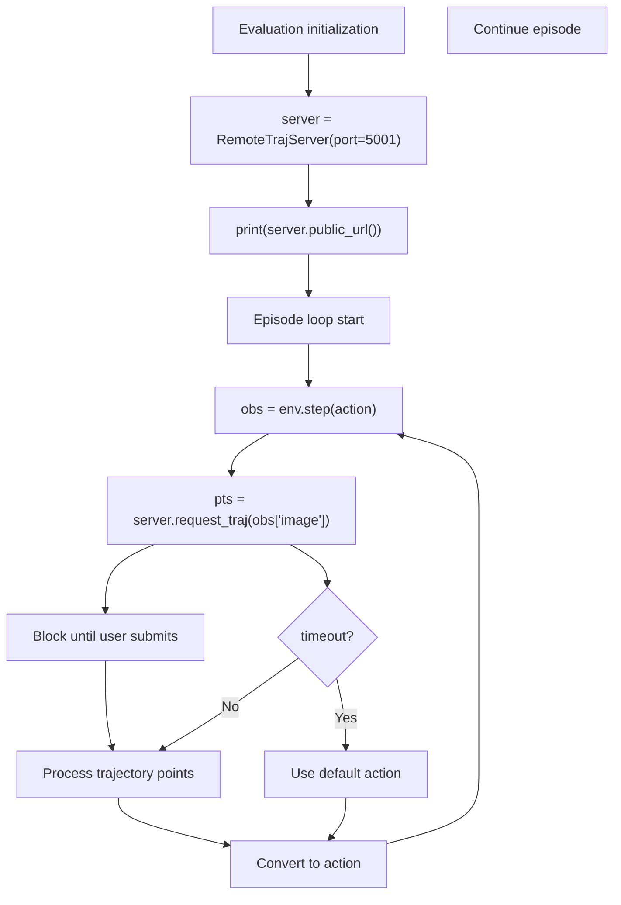

<!-- source: DeepWiki mcp.deepwiki.com · repo allenai/molmoact · page 9.3 Remote Trajectory Server · fetched 2026-10-26 -->

# Remote Trajectory Server

<details>
<summary>Relevant source files</summary>

The following files were used as context for generating this wiki page:

- [SteerSimplerEnv/traj_interface.py](SteerSimplerEnv/traj_interface.py)

</details>


## Purpose and Scope

The Remote Trajectory Server provides a web-based interface for human-in-the-loop trajectory annotation during robot policy evaluation. It enables remote users to click on images through a browser to specify desired robot trajectories, which are then consumed by the evaluation system in real-time. This system is a core component of the SteerSimplerEnv interactive evaluation framework.

For information about the broader interactive evaluation system that uses this server, see [Interactive Evaluation System](#9.2). For details on how the annotated trajectories are consumed by model inference engines, see [Model Testing Interface](#9.4).

**Sources:** [SteerSimplerEnv/traj_interface.py:1-10]()

---

## Architecture Overview

The Remote Trajectory Server implements a client-server architecture where a Flask web application serves an HTML annotation interface to remote browsers via an ngrok tunnel, while maintaining a queue-based communication channel with the local evaluation process.



**Diagram: RemoteTrajServer Architecture and Data Flow**

The server operates asynchronously: it serves HTTP requests in a daemon thread while the main evaluation process blocks on `request_traj()` waiting for user annotations.

**Sources:** [SteerSimplerEnv/traj_interface.py:36-98]()

---

## Core Components

### RemoteTrajServer Class

The `RemoteTrajServer` class [SteerSimplerEnv/traj_interface.py:36-152]() encapsulates all functionality for remote trajectory annotation. It initializes with the following key components:

| Component | Type | Purpose |
|-----------|------|---------|
| `_app` | `Flask` | Web application serving annotation interface |
| `_q` | `queue.Queue[list[list[int]] \| None]` | Maxsize-1 queue for point data exchange |
| `_latest_frame` | `Path` | Temporary file storing current image (`/tmp/traj_frame.png`) |
| `_thread` | `threading.Thread` | Daemon thread running Flask server |
| `_tunnel` | `ngrok.NgrokTunnel` | ngrok tunnel providing public URL |
| `_public_url` | `str` | Public URL for browser access |

**Sources:** [SteerSimplerEnv/traj_interface.py:56-66]()

### Initialization and Configuration



**Diagram: RemoteTrajServer Initialization Sequence**

The initialization process [SteerSimplerEnv/traj_interface.py:37-97]() follows this sequence:

1. **Authentication Setup**: Reads ngrok authtoken from parameter or `NGROK_AUTHTOKEN` environment variable
2. **Configuration Resolution**: Resolves `domain` or `remote_addr` from parameters or environment variables (`NGROK_DOMAIN`, `NGROK_REMOTE_ADDR`)
3. **Queue Initialization**: Creates a `maxsize=1` queue to ensure only the latest annotation is buffered
4. **Flask App Setup**: Creates Flask application and registers routes via `_register_routes()`
5. **Thread Launch**: Starts daemon thread running Flask on `0.0.0.0:5001`
6. **Tunnel Creation**: Establishes ngrok tunnel using either HTTP (with reserved domain) or TCP (with reserved address)

**Sources:** [SteerSimplerEnv/traj_interface.py:37-97]()

### Protocol Support

The server supports two ngrok tunnel protocols:

| Protocol | Required Parameter | Environment Variable | Use Case |
|----------|-------------------|---------------------|----------|
| `http` | `domain` | `NGROK_DOMAIN` | HTTP/TLS with reserved domain (e.g., `my-simpler.ngrok.app`) |
| `tcp` | `remote_addr` | `NGROK_REMOTE_ADDR` | TCP tunnel with reserved address (e.g., `2.tcp.ngrok.io:12345`) |

On ngrok pay-as-you-go plans, reserved endpoints are required [SteerSimplerEnv/traj_interface.py:68-97](). The error handler specifically catches `ERR_NGROK_15002` to provide helpful error messages.

**Sources:** [SteerSimplerEnv/traj_interface.py:68-97]()

---

## Communication Protocol

### Request-Response Flow



**Diagram: Trajectory Annotation Request-Response Sequence**

The communication protocol operates through two primary methods:

**Sources:** [SteerSimplerEnv/traj_interface.py:103-115](), [SteerSimplerEnv/traj_interface.py:139-146]()

### request_traj() Method

The `request_traj()` method [SteerSimplerEnv/traj_interface.py:103-115]() implements the blocking interface for trajectory requests:

```python
def request_traj(self, img: np.ndarray, timeout: int = 120) -> Optional[List[List[int]]]
```

**Parameters:**
- `img`: RGB numpy array to display for annotation
- `timeout`: Maximum wait time in seconds (default: 120)

**Behavior:**
1. Converts RGB to BGR and writes to `_latest_frame` via OpenCV
2. Clears any stale entries from the queue
3. Prints the public URL for user access
4. Blocks on `_q.get(timeout)` waiting for browser submission
5. Returns `None` on timeout, otherwise returns list of `[x, y]` coordinate pairs

**Sources:** [SteerSimplerEnv/traj_interface.py:103-115]()

---

## API Endpoints

### Flask Route Definitions

The server exposes three HTTP endpoints via `_register_routes()` [SteerSimplerEnv/traj_interface.py:118-152]():



**Diagram: Flask Route Architecture**

**Sources:** [SteerSimplerEnv/traj_interface.py:118-152]()

#### GET /

**Handler:** `index()` [SteerSimplerEnv/traj_interface.py:121-126]()

Serves the HTML annotation interface. The HTML file is expected at `_static/index.html` relative to the module. If not found, creates `_static/` directory and writes `_DEFAULT_HTML` placeholder [SteerSimplerEnv/traj_interface.py:32-33]().

**Response:** HTML content (UTF-8)

**Sources:** [SteerSimplerEnv/traj_interface.py:121-126](), [SteerSimplerEnv/traj_interface.py:29-33]()

#### GET /image/current

**Handler:** `current_image()` [SteerSimplerEnv/traj_interface.py:128-137]()

Serves the current frame PNG for annotation. Implements Flask version compatibility logic:
- Flask 3.x: Uses `max_age=0` parameter
- Flask 2.x: Uses `cache_timeout=0` parameter

This is detected via `inspect.signature(send_file).parameters` [SteerSimplerEnv/traj_interface.py:133-136]().

**Response:** 
- Success: PNG image with no-cache headers
- Error: `"No image yet"` with 404 status if frame doesn't exist

**Sources:** [SteerSimplerEnv/traj_interface.py:128-137]()

#### POST /submit

**Handler:** `submit()` [SteerSimplerEnv/traj_interface.py:139-146]()

Accepts trajectory point submissions from the browser.

**Request Body:**
```json
{
  "points": [[x1, y1], [x2, y2], ..., [xn, yn]]
}
```

**Validation:** Checks that `points` is a list; returns 400 error if invalid

**Response:** 
```json
{"status": "ok"}
```

The points are immediately placed in the queue via `_q.put(pts)`, which unblocks the waiting `request_traj()` call.

**Sources:** [SteerSimplerEnv/traj_interface.py:139-146]()

#### CORS Configuration

All routes include CORS headers via `add_cors()` after-request handler [SteerSimplerEnv/traj_interface.py:148-152]():

```
Access-Control-Allow-Origin: *
Access-Control-Allow-Headers: Content-Type
```

This enables the annotation interface to work from any origin.

**Sources:** [SteerSimplerEnv/traj_interface.py:148-152]()

---

## Static Files and HTML Interface

### Directory Structure

The server expects a static HTML file at a specific location:

| Path Variable | Value | Description |
|--------------|-------|-------------|
| `_STATIC_DIR` | `Path(__file__).with_suffix("").parent / "_static"` | Static assets directory |
| `_HTML_PAGE` | `_STATIC_DIR / "index.html"` | Main annotation interface |
| `_DEFAULT_HTML` | Simple placeholder HTML | Fallback if index.html missing |

**Sources:** [SteerSimplerEnv/traj_interface.py:29-33]()

The `_DEFAULT_HTML` constant [SteerSimplerEnv/traj_interface.py:32-33]() provides a minimal placeholder:

```html
<!DOCTYPE html>
<html lang="en">
  <head>
    <meta charset="utf-8">
    <title>Trajectory</title>
  </head>
  <body>Simple placeholder</body>
</html>
```

In production, a full-featured annotation interface should be provided at `_static/index.html` with JavaScript to:
1. Fetch images from `/image/current`
2. Display the image in a canvas
3. Capture user clicks as trajectory points
4. Submit points to `/submit` endpoint

**Sources:** [SteerSimplerEnv/traj_interface.py:32-33]()

---

## Integration with Evaluation System

### Usage Pattern

The typical integration pattern in the evaluation system:



**Diagram: Integration Pattern in Evaluation Loop**

**Sources:** [SteerSimplerEnv/traj_interface.py:103-115]()

### Connection to MolmoActInferenceTEST

The `MolmoActInferenceTEST` class (see [Model Testing Interface](#9.4)) uses this server to enable human trajectory steering during action reasoning. When steering mode is enabled, the model queries `request_traj()` to obtain human-annotated trajectories instead of purely predicted ones.

**Sources:** [SteerSimplerEnv/traj_interface.py:1-152]()

---

## Error Handling and Edge Cases

### ngrok Plan Requirements

The server implements specific error handling for ngrok plan limitations [SteerSimplerEnv/traj_interface.py:91-97]():

```python
except PyngrokNgrokHTTPError as e:
    if "ERR_NGROK_15002" in str(e):
        raise RuntimeError(
            "ngrok requires a reserved domain (HTTP/TLS) or reserved TCP address on your plan. "
            "Reserve one and set NGROK_DOMAIN or NGROK_REMOTE_ADDR."
        ) from e
    raise
```

Error code `ERR_NGROK_15002` indicates the plan requires reserved endpoints. The error message guides users to configure `NGROK_DOMAIN` or `NGROK_REMOTE_ADDR`.

**Sources:** [SteerSimplerEnv/traj_interface.py:91-97]()

### Queue Management

The queue is initialized with `maxsize=1` [SteerSimplerEnv/traj_interface.py:57]() to ensure only the latest annotation is buffered. Before each `request_traj()` call, the queue is explicitly cleared [SteerSimplerEnv/traj_interface.py:105-109]():

```python
while not self._q.empty():
    try:
        self._q.get_nowait()
    except queue.Empty:
        break
```

This prevents stale annotations from previous requests from being returned.

**Sources:** [SteerSimplerEnv/traj_interface.py:57](), [SteerSimplerEnv/traj_interface.py:105-109]()

### Timeout Behavior

If no annotation is received within the timeout period (default 120 seconds), `request_traj()` returns `None` [SteerSimplerEnv/traj_interface.py:111-115]():

```python
try:
    pts = self._q.get(timeout=timeout)
except queue.Empty:
    return None
return pts
```

The calling code must handle this case, typically by using a default action or skipping the evaluation step.

**Sources:** [SteerSimplerEnv/traj_interface.py:111-115]()

---

## Configuration Summary

### Constructor Parameters

| Parameter | Type | Default | Description |
|-----------|------|---------|-------------|
| `port` | `int` | `5001` | Local Flask server port |
| `authtoken` | `str \| None` | `None` | ngrok authentication token (falls back to `NGROK_AUTHTOKEN` env) |
| `proto` | `str` | `"http"` | Protocol: `"http"` or `"tcp"` |
| `domain` | `str \| None` | `None` | Reserved domain for HTTP/TLS (falls back to `NGROK_DOMAIN` env) |
| `remote_addr` | `str \| None` | `None` | Reserved address for TCP (falls back to `NGROK_REMOTE_ADDR` env) |

**Sources:** [SteerSimplerEnv/traj_interface.py:37-54]()

### Environment Variables

| Variable | Purpose | Example |
|----------|---------|---------|
| `NGROK_AUTHTOKEN` | Authentication for ngrok service | `2abc...xyz` |
| `NGROK_DOMAIN` | Reserved domain for HTTP tunnels | `my-simpler.ngrok.app` |
| `NGROK_REMOTE_ADDR` | Reserved TCP address | `2.tcp.ngrok.io:12345` |

**Sources:** [SteerSimplerEnv/traj_interface.py:47-54]()

### Public Methods

| Method | Signature | Purpose |
|--------|-----------|---------|
| `public_url()` | `() -> str` | Returns the public ngrok URL for browser access |
| `request_traj()` | `(img: np.ndarray, timeout: int = 120) -> Optional[List[List[int]]]` | Displays image and blocks awaiting trajectory annotation |

**Sources:** [SteerSimplerEnv/traj_interface.py:100-115]()

---

