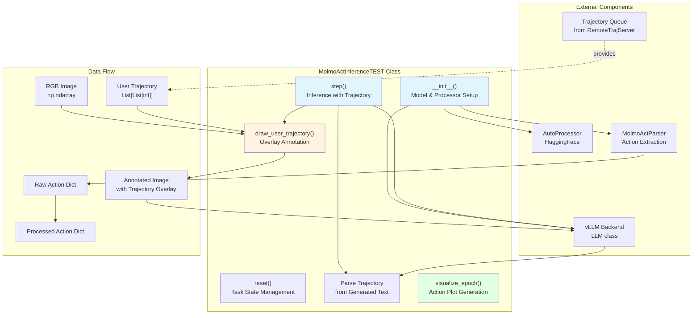
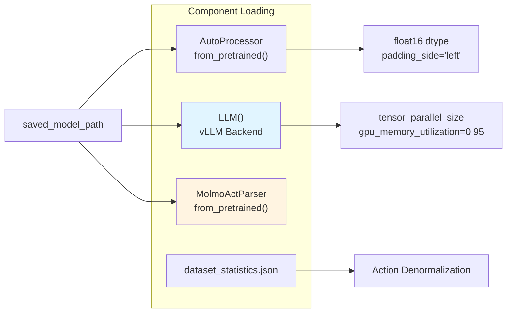
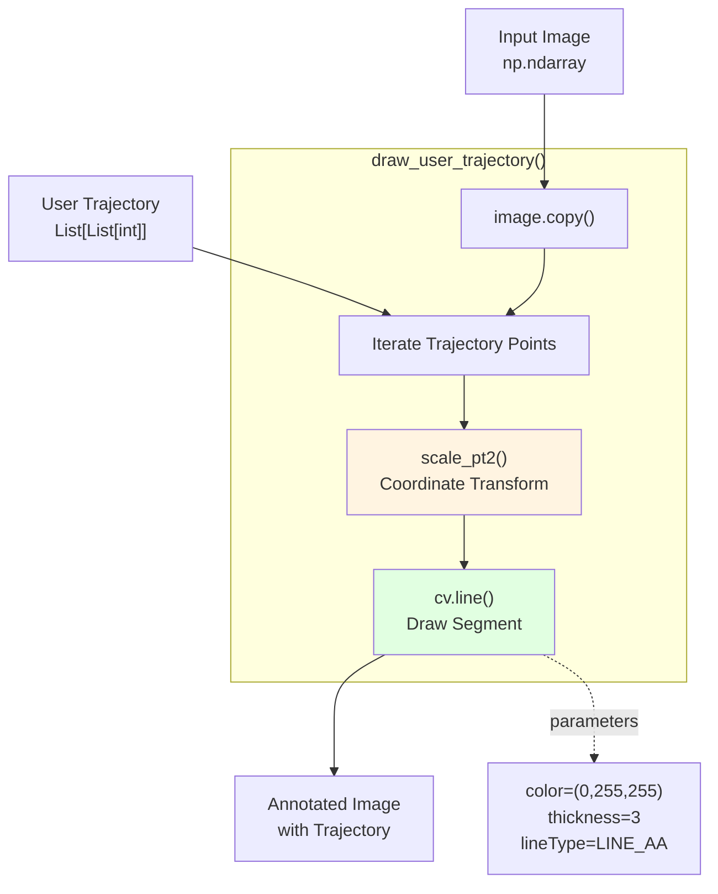
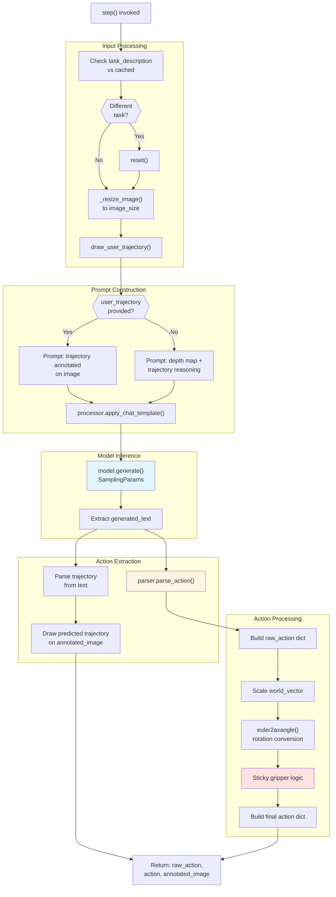
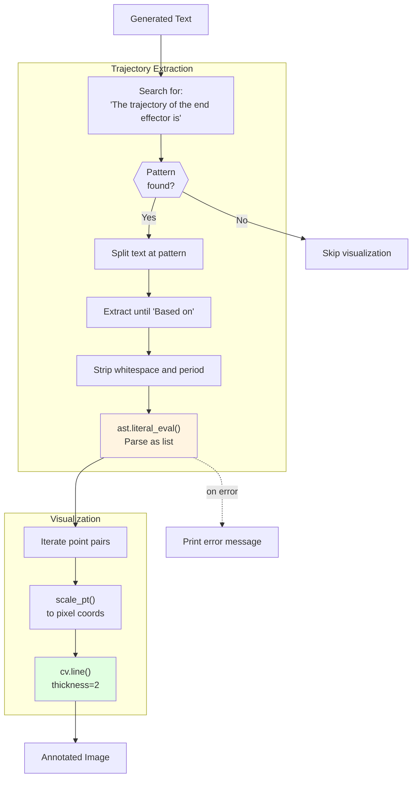
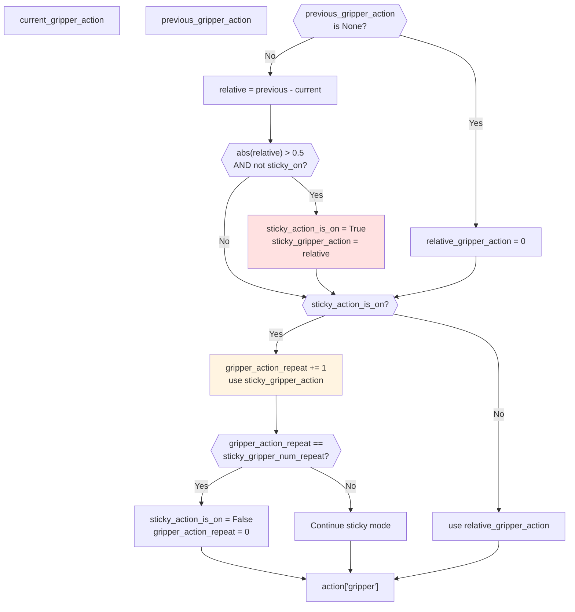
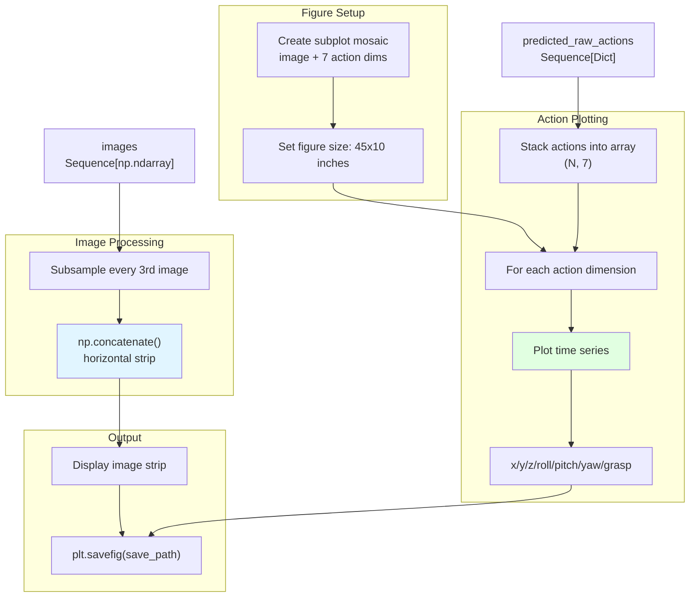
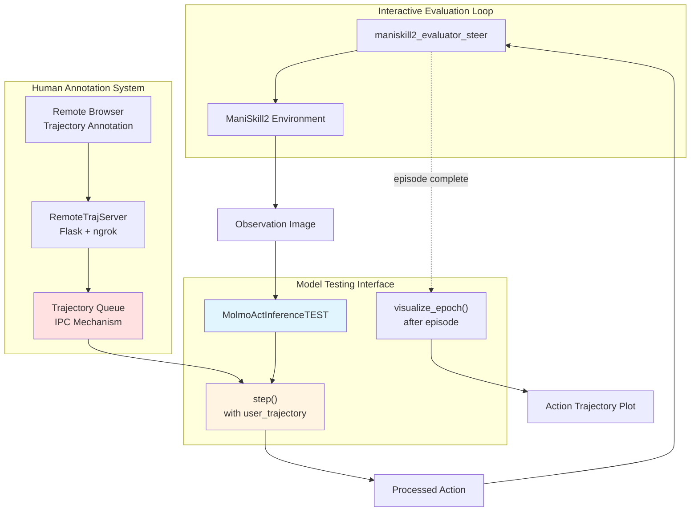

<!-- source: DeepWiki mcp.deepwiki.com · repo allenai/molmoact · page 9.4 Model Testing Interface · fetched 2026-10-26 -->

# Model Testing Interface

<details>
<summary>Relevant source files</summary>

The following files were used as context for generating this wiki page:

- [SteerSimplerEnv/molmoact_model_test.py](SteerSimplerEnv/molmoact_model_test.py)

</details>


The Model Testing Interface provides a specialized inference class `MolmoActInferenceTEST` that extends standard MolmoAct inference with trajectory visualization and annotation capabilities. This interface enables interactive debugging and human-in-the-loop evaluation by overlaying user-provided or model-predicted trajectories on observation images.

For standard non-interactive model inference, see [Main Inference Engine](#9.1). For the remote trajectory annotation server that provides trajectory data to this interface, see [Remote Trajectory Server](#9.3). For the evaluation loop that uses this interface, see [Interactive Evaluation System](#9.2).

## Purpose and Architecture

The `MolmoActInferenceTEST` class serves as a development and testing interface for action reasoning models, providing visual feedback on predicted end-effector trajectories and allowing human-annotated trajectories to guide model inference.

**Key Capabilities:**
- Overlay user-provided trajectories on observation images
- Parse and visualize model-predicted trajectories from generated text
- Annotate images with trajectory paths for debugging
- Generate action sequence plots across episodes
- Support both autonomous and human-guided inference modes

### Component Architecture



Sources: [SteerSimplerEnv/molmoact_model_test.py:22-318]()

## Initialization and Configuration

The `MolmoActInferenceTEST` class is initialized with policy-specific settings and loads the model using vLLM for optimized inference.

### Constructor Parameters

| Parameter | Type | Default | Description |
|-----------|------|---------|-------------|
| `saved_model_path` | `str` | `""` | Path to MolmoAct checkpoint |
| `unnorm_key` | `Optional[str]` | `None` | Dataset statistics key for action denormalization |
| `policy_setup` | `str` | `"google_robot"` | Robot platform configuration |
| `image_size` | `list[int]` | `[256, 256]` | Input image dimensions |
| `action_scale` | `float` | `1.0` | Action scaling factor |

### Policy Setup Configurations

The initialization adapts to different robot platforms:

**Google Robot Setup:**
- Default unnorm_key: `"fractal20220817_data"`
- Sticky gripper repeat: 15 steps
- Relative gripper actions

**WidowX Bridge Setup:**
- Default unnorm_key: `"bridge_orig"`
- Sticky gripper repeat: 1 step
- Binary gripper actions

Sources: [SteerSimplerEnv/molmoact_model_test.py:23-105]()

### Model Backend Initialization



The vLLM backend is configured with:
- `tensor_parallel_size`: Set to `torch.cuda.device_count()` for multi-GPU parallelism
- `gpu_memory_utilization`: 0.95 (95% GPU memory allocation)
- `dtype`: `"float16"` for memory efficiency
- `trust_remote_code`: True (required for MolmoActForActionReasoning)

Sources: [SteerSimplerEnv/molmoact_model_test.py:46-82]()

### State Management

The class maintains sticky gripper action state to handle gripper action repeatability:

```python
self.sticky_action_is_on = False
self.gripper_action_repeat = 0
self.sticky_gripper_action = 0.0
self.previous_gripper_action = None
```

The `reset()` method reinitializes state when task descriptions change:

Sources: [SteerSimplerEnv/molmoact_model_test.py:89-111]()

## Trajectory Visualization System

The core distinction of the testing interface is its ability to overlay trajectories on observation images for visual debugging.

### Coordinate Space Conversion

Two coordinate transformation methods handle different scaling scenarios:

**`scale_pt(pt, w, h)` - Basic Scaling:**
Converts from [0, 255] normalized space to image pixel coordinates:

```
x_pixel = round(x / 255.0 * (w - 1))
y_pixel = round(y / 255.0 * (h - 1))
```

**`scale_pt2(pt, orig_w, orig_h, new_w, new_h)` - Dual-Resolution Scaling:**
Converts from one image resolution to another, maintaining aspect ratio:

Sources: [SteerSimplerEnv/molmoact_model_test.py:114-131]()

### Trajectory Drawing Pipeline



The trajectory is drawn as connected line segments with anti-aliasing:
- Color: `(0, 255, 255)` (cyan in BGR format)
- Thickness: 3 pixels for user trajectories
- Line type: `cv.LINE_AA` for anti-aliased rendering

Sources: [SteerSimplerEnv/molmoact_model_test.py:133-147]()

## Step Execution with Trajectory Support

The `step()` method implements the core inference loop with optional trajectory guidance.

### Method Signature

```python
def step(
    self, 
    image: np.ndarray,  # (H, W, 3), uint8
    task_description: Optional[str] = None,
    user_trajectory: Optional[list] = None,
    *args, **kwargs
) -> tuple[dict[str, np.ndarray], dict[str, np.ndarray], np.ndarray]:
```

**Returns:**
1. `raw_action`: Dictionary with unnormalized action components
2. `action`: Dictionary with processed environment-ready actions
3. `annotated_image`: RGB image with trajectory overlay

Sources: [SteerSimplerEnv/molmoact_model_test.py:149-163]()

### Inference Flow



Sources: [SteerSimplerEnv/molmoact_model_test.py:149-317]()

### Prompt Construction

Two distinct prompts handle different inference modes:

**With User Trajectory:**
```
"The task is {task_description}. Notice that the trajectory of the end 
effector is annotated on the image. Based on the trajectory annotated 
on the image, what is the action that the robot should take?"
```

**Without User Trajectory (Autonomous):**
```
"The task is {language_instruction}. What is the action that the robot 
should take. To figure out the action that the robot should take to 
{language_instruction}, let's think through it step by step. First, 
what is the depth map for this image? Second, what is the trajectory 
of the end effector? Based on the depth map of the image and the 
trajectory of the end effector, what is the action that the robot 
should take?"
```

The autonomous prompt encourages chain-of-thought reasoning through depth estimation and trajectory prediction.

Sources: [SteerSimplerEnv/molmoact_model_test.py:178-204]()

## Action Parsing and Processing

### Text Parsing for Trajectory Extraction

When no user trajectory is provided, the model generates trajectory coordinates in its response text. The parsing logic extracts these coordinates:



Sources: [SteerSimplerEnv/molmoact_model_test.py:250-272]()

### Action Dictionary Construction

The parsed action is split into three components:

**Raw Action Dictionary:**
```python
{
    "world_vector": unnormalized_action[:3],      # xyz translation
    "rotation_delta": unnormalized_action[3:6],   # roll, pitch, yaw
    "open_gripper": unnormalized_action[6:7],     # gripper state
}
```

**Processed Action Dictionary:**
```python
{
    "world_vector": scaled_translation,           # scaled xyz
    "rot_axangle": rotation_axangle,              # axis-angle rotation
    "gripper": gripper_action,                    # relative/absolute gripper
    "terminate_episode": np.array([0.0]),         # termination flag
}
```

Sources: [SteerSimplerEnv/molmoact_model_test.py:275-315]()

### Rotation Representation Conversion

The model outputs Euler angles (roll, pitch, yaw) which are converted to axis-angle representation:

```
1. Extract: roll, pitch, yaw = action_rotation_delta
2. Convert: action_rotation_ax, action_rotation_angle = euler2axangle(roll, pitch, yaw)
3. Compute: action_rotation_axangle = action_rotation_ax * action_rotation_angle
4. Scale: action["rot_axangle"] = action_rotation_axangle * action_scale
```

This conversion uses the `transforms3d.euler.euler2axangle` function.

Sources: [SteerSimplerEnv/molmoact_model_test.py:283-287]()

### Sticky Gripper Logic

For the Google Robot policy setup, gripper actions use a "sticky" mechanism to ensure gripper state changes are sustained:



The sticky gripper mechanism repeats large gripper actions for `sticky_gripper_num_repeat` steps (15 for Google Robot) to ensure reliable gripper state changes.

Sources: [SteerSimplerEnv/molmoact_model_test.py:289-310]()

## Episode Visualization

The `visualize_epoch()` method generates comprehensive action trajectory plots for offline analysis.

### Visualization Components

**Input Parameters:**
- `predicted_raw_actions`: Sequence of raw action dictionaries
- `images`: Sequence of RGB observation images
- `save_path`: Output file path for the plot

**Generated Plot Structure:**
```
+------------------------------------------------------------------+
|                    Image Strip (subsampled)                      |
+------------------------------------------------------------------+
| x-axis | y-axis | z-axis | roll | pitch | yaw | grasp |
|  plot  |  plot  |  plot  | plot | plot  | plot| plot  |
+------------------------------------------------------------------+
```

Sources: [SteerSimplerEnv/molmoact_model_test.py:325-354]()

### Plot Generation Pipeline



The visualization provides:
- **Temporal context:** Image strip shows key frames
- **Action continuity:** Plots reveal action smoothness and patterns
- **Dimension-specific analysis:** Individual plots for each action component
- **Diagnostic tool:** Identifies issues like action spikes or gripper inconsistencies

Sources: [SteerSimplerEnv/molmoact_model_test.py:325-354]()

## Integration with Interactive Evaluation

The `MolmoActInferenceTEST` class integrates with the broader SteerSimplerEnv evaluation system:



**Workflow:**
1. Remote user annotates trajectory via web browser
2. `RemoteTrajServer` receives annotation and queues it
3. Evaluation loop retrieves trajectory from queue
4. `MolmoActInferenceTEST.step()` receives user trajectory
5. Model generates action based on annotated trajectory
6. After episode completion, `visualize_epoch()` generates diagnostic plot

The testing interface enables rapid iteration on model behavior by allowing human experts to guide the model and analyze resulting actions through comprehensive visualizations.

Sources: [SteerSimplerEnv/molmoact_model_test.py:1-367]()

## Usage Patterns

### Autonomous Mode

```python
test_model = MolmoActInferenceTEST(
    saved_model_path="path/to/checkpoint",
    policy_setup="google_robot",
    image_size=[256, 256]
)

test_model.reset("pick up the red block")
raw_action, action, annotated_image = test_model.step(
    image=observation,
    task_description="pick up the red block"
)
```

### Human-Guided Mode

```python
# Trajectory provided by RemoteTrajServer
user_trajectory = [[128, 100], [140, 110], [150, 120], ...]

raw_action, action, annotated_image = test_model.step(
    image=observation,
    task_description="pick up the red block",
    user_trajectory=user_trajectory
)
```

### Episode Visualization

```python
# Collect actions and images during episode
actions = []
images = []

for step in range(max_steps):
    raw_action, action, annotated = test_model.step(image, task)
    actions.append(raw_action)
    images.append(annotated)

# Generate diagnostic plot
test_model.visualize_epoch(
    predicted_raw_actions=actions,
    images=images,
    save_path="episode_analysis.png"
)
```

Sources: [SteerSimplerEnv/molmoact_model_test.py:22-354]()

---

