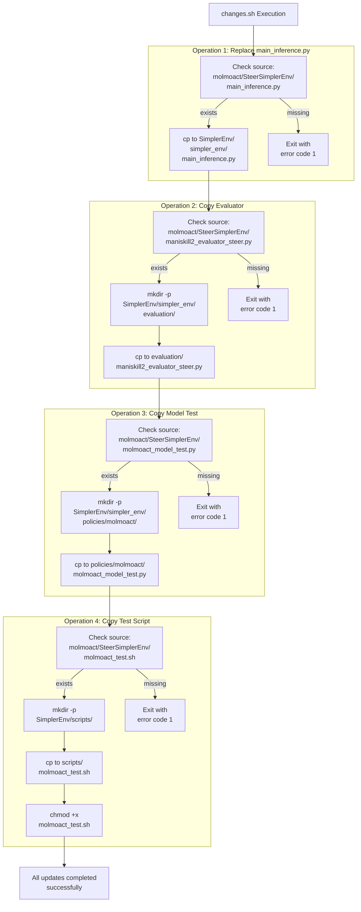
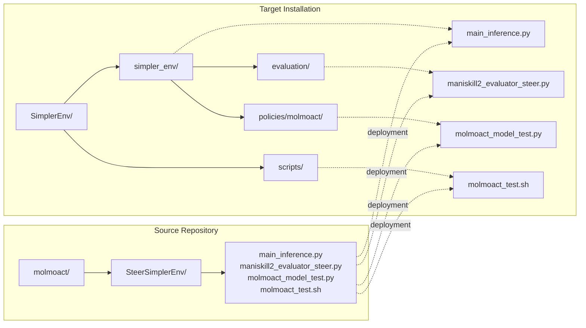
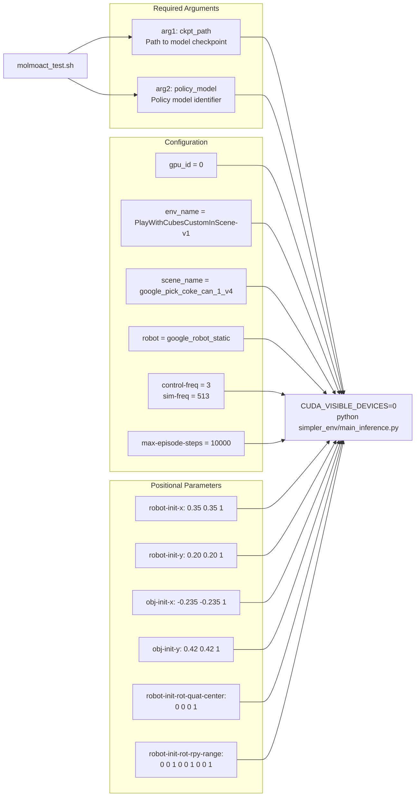
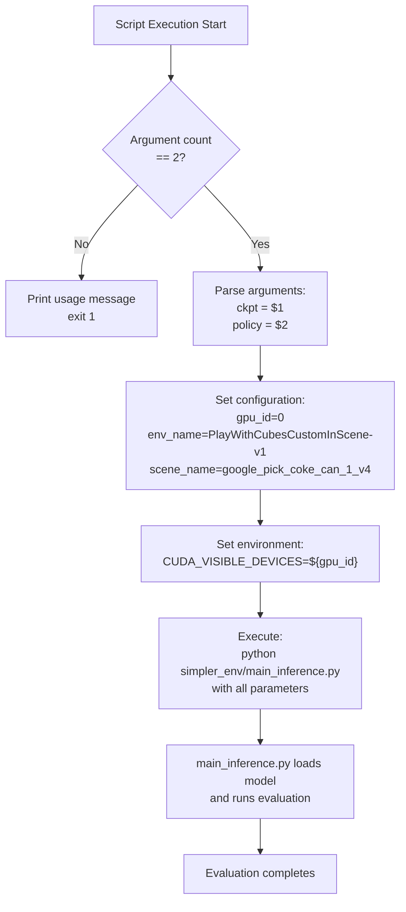
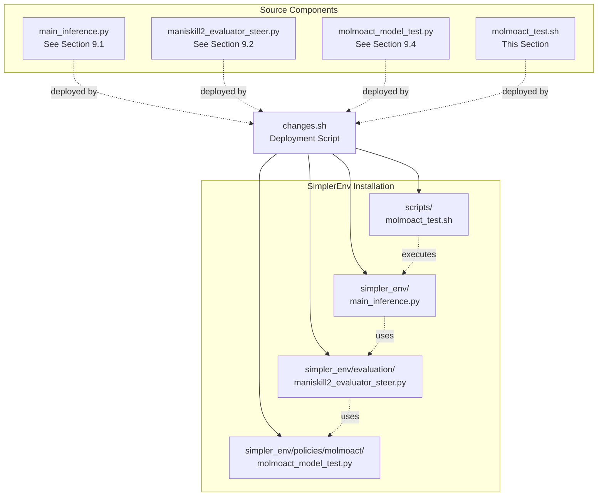

<!-- source: DeepWiki mcp.deepwiki.com · repo allenai/molmoact · page 9.5 Deployment and Testing Scripts · fetched 2026-10-26 -->

# Deployment and Testing Scripts

<details>
<summary>Relevant source files</summary>

The following files were used as context for generating this wiki page:

- [SteerSimplerEnv/changes.sh](SteerSimplerEnv/changes.sh)
- [SteerSimplerEnv/molmoact_test.sh](SteerSimplerEnv/molmoact_test.sh)

</details>


## Purpose and Scope

This document covers the automation scripts for deploying the SteerSimplerEnv extension and executing test evaluations. The deployment script (`changes.sh`) automates the process of copying SteerSimplerEnv components into an existing SimplerEnv installation. The test execution script (`molmoact_test.sh`) provides a standardized interface for running inference evaluations with MolmoAct models.

For information about the components being deployed, see [Main Inference Engine](#9.1), [Interactive Evaluation System](#9.2), [Remote Trajectory Server](#9.3), and [Model Testing Interface](#9.4). For general SimplerEnv evaluation procedures, see [SimplerEnv Evaluation](#5.1).

---

## Deployment Script Overview

The `changes.sh` script automates the deployment of SteerSimplerEnv extension files into a SimplerEnv installation. It performs file replacement and copying operations with error checking to ensure all required components are properly installed.

### File Operations Workflow



**Deployment Workflow**: The `changes.sh` script performs four sequential operations, each with validation and error handling. Operations 2-4 create target directories as needed before copying files.

Sources: [SteerSimplerEnv/changes.sh:1-80]()

### Source to Destination Mapping

The deployment script maps files from the MolmoAct repository structure to the SimplerEnv installation structure:

| Operation | Source File | Destination File | Action | Notes |
|-----------|-------------|------------------|--------|-------|
| 1 | `molmoact/SteerSimplerEnv/main_inference.py` | `SimplerEnv/simpler_env/main_inference.py` | Replace | Overwrites existing file |
| 2 | `molmoact/SteerSimplerEnv/maniskill2_evaluator_steer.py` | `SimplerEnv/simpler_env/evaluation/maniskill2_evaluator_steer.py` | Copy | Creates directory if needed |
| 3 | `molmoact/SteerSimplerEnv/molmoact_model_test.py` | `SimplerEnv/simpler_env/policies/molmoact/molmoact_model_test.py` | Copy | Creates directory if needed |
| 4 | `molmoact/SteerSimplerEnv/molmoact_test.sh` | `SimplerEnv/scripts/molmoact_test.sh` | Copy + chmod | Makes script executable |

Sources: [SteerSimplerEnv/changes.sh:9-76]()

### Directory Structure Requirements



**Directory Structure**: The deployment assumes a specific repository structure on the source side and creates the necessary directory hierarchy on the target side.

Sources: [SteerSimplerEnv/changes.sh:9-76]()

### Error Handling

The script implements robust error handling for each file operation:

1. **Pre-copy validation**: Each operation checks if the source file exists before attempting to copy [SteerSimplerEnv/changes.sh:12-14](), [SteerSimplerEnv/changes.sh:31-33](), [SteerSimplerEnv/changes.sh:50-52](), [SteerSimplerEnv/changes.sh:69-71]()
2. **Error reporting**: Missing files trigger an error message identifying the specific file [SteerSimplerEnv/changes.sh:13]()
3. **Early exit**: The script exits with code 1 if any source file is missing [SteerSimplerEnv/changes.sh:14]()
4. **Success confirmation**: Each successful operation prints a confirmation message [SteerSimplerEnv/changes.sh:18](), [SteerSimplerEnv/changes.sh:37](), [SteerSimplerEnv/changes.sh:56](), [SteerSimplerEnv/changes.sh:76]()

Sources: [SteerSimplerEnv/changes.sh:12-76]()

---

## Test Execution Script

The `molmoact_test.sh` script provides a standardized interface for running MolmoAct model inference evaluations in the SteerSimplerEnv environment.

### Command-line Interface



**Command-line Structure**: The script accepts two required arguments and uses hardcoded configuration values for environment setup and robot initialization.

Sources: [SteerSimplerEnv/molmoact_test.sh:1-33]()

### Script Parameters

#### Required Arguments

The script requires exactly two positional arguments [SteerSimplerEnv/molmoact_test.sh:7-9]():

| Position | Variable | Purpose | Example |
|----------|----------|---------|---------|
| 1 | `ckpt` | Model checkpoint path | `/path/to/checkpoint` |
| 2 | `policy` | Policy model identifier | `molmoact_test` |

#### Environment Configuration

The script configures the evaluation environment with these parameters [SteerSimplerEnv/molmoact_test.sh:18-25]():

| Parameter | Value | Description |
|-----------|-------|-------------|
| `gpu_id` | `0` | GPU device index |
| `env_name` | `PlayWithCubesCustomInScene-v1` | ManiSkill2 environment |
| `scene_name` | `google_pick_coke_can_1_v4` | Specific scene variant |

Commented-out alternatives show other available environments [SteerSimplerEnv/molmoact_test.sh:19-22]():
- `PlayWithObjectsCustomInScene-v2`
- `PlayWithCubesCustomInSceneSteer-v0`
- `GraspSingleOpenedCokeCanDistractorInScene-v0`
- `PlaceIntoClosedDrawerCustomInScene-v0`

#### Robot Configuration

Robot and simulation parameters [SteerSimplerEnv/molmoact_test.sh:28-33]():

| Parameter | Value | Description |
|-----------|-------|-------------|
| `--robot` | `google_robot_static` | Robot type |
| `--control-freq` | `3` | Control frequency (Hz) |
| `--sim-freq` | `513` | Simulation frequency (Hz) |
| `--max-episode-steps` | `10000` | Maximum episode length |

#### Initialization Parameters

Spatial initialization uses range specifications in the format `min max num_samples` [SteerSimplerEnv/molmoact_test.sh:32-33]():

| Parameter | Min | Max | Samples | Description |
|-----------|-----|-----|---------|-------------|
| `robot-init-x` | 0.35 | 0.35 | 1 | Robot X position |
| `robot-init-y` | 0.20 | 0.20 | 1 | Robot Y position |
| `obj-init-x` | -0.235 | -0.235 | 1 | Object X position |
| `obj-init-y` | 0.42 | 0.42 | 1 | Object Y position |
| `robot-init-rot-quat-center` | 0 0 0 1 | - | - | Center quaternion |
| `robot-init-rot-rpy-range` | 0 0 1 0 0 1 0 0 1 | - | - | Roll-pitch-yaw ranges |

Sources: [SteerSimplerEnv/molmoact_test.sh:18-33]()

### Execution Flow



**Execution Flow**: The script validates arguments, configures the environment, and delegates to `main_inference.py` for actual evaluation.

Sources: [SteerSimplerEnv/molmoact_test.sh:1-33]()

---

## Usage Examples

### Deploying SteerSimplerEnv Components

From the repository root, execute the deployment script:

```bash
cd /path/to/molmoact
bash SteerSimplerEnv/changes.sh
```

Expected output:
```
=== Updating SimplerEnv Files ===
✔ Replaced: SimplerEnv/simpler_env/main_inference.py
✔ Copied evaluator to: SimplerEnv/simpler_env/evaluation/maniskill2_evaluator_steer.py
✔ Copied model test to: SimplerEnv/simpler_env/policies/molmoact/molmoact_model_test.py
✔ Copied test script to: SimplerEnv/scripts/molmoact_test.sh
=== All updates completed successfully! ===
```

Sources: [SteerSimplerEnv/changes.sh:1-80]()

### Running a Test Evaluation

After deployment, execute the test script from the SimplerEnv directory:

```bash
cd SimplerEnv
bash scripts/molmoact_test.sh /path/to/checkpoint molmoact_test
```

This will:
1. Load the model checkpoint from the specified path
2. Initialize the `PlayWithCubesCustomInScene-v1` environment with `google_pick_coke_can_1_v4` scene
3. Run inference using the `molmoact_test` policy
4. Execute up to 10,000 steps per episode

Sources: [SteerSimplerEnv/molmoact_test.sh:1-33]()

### Testing Alternative Environments

To test different environments, modify the `env_name` variable in the script [SteerSimplerEnv/molmoact_test.sh:23]():

```bash
# Example: Testing with drawer manipulation
env_name=PlaceIntoClosedDrawerCustomInScene-v0
```

Or use one of the commented alternatives [SteerSimplerEnv/molmoact_test.sh:19-22]().

---

## Integration with Other Components

### Deployment Integration



**Component Integration**: The deployment script bridges the MolmoAct repository structure with SimplerEnv's expected layout, enabling the test script to execute the integrated system.

Sources: [SteerSimplerEnv/changes.sh:1-80](), [SteerSimplerEnv/molmoact_test.sh:1-33]()

### Test Execution Dependencies

The `molmoact_test.sh` script depends on components described in other sections:

| Component | Section | Role in Test Execution |
|-----------|---------|----------------------|
| `main_inference.py` | [9.1](#9.1) | Orchestrates model loading and evaluation |
| `maniskill2_evaluator_steer` | [9.2](#9.2) | Provides interactive evaluation capabilities |
| `molmoact_model_test.py` | [9.4](#9.4) | Implements MolmoActInferenceTEST class |
| ManiSkill2 Environment | [5.1](#5.1) | Provides simulation environment |

The test script serves as a convenience wrapper that configures these components with appropriate parameters for standard test scenarios.

Sources: [SteerSimplerEnv/molmoact_test.sh:28-33]()

---

## Script Modifications

### Customizing Deployment Paths

The deployment script uses relative paths that assume specific directory structures. To modify deployment targets, edit the destination variables [SteerSimplerEnv/changes.sh:10](), [SteerSimplerEnv/changes.sh:26](), [SteerSimplerEnv/changes.sh:45](), [SteerSimplerEnv/changes.sh:64]():

```bash
# Example: Deploy to alternative SimplerEnv location
DST_MAIN="/path/to/alternative/SimplerEnv/simpler_env/main_inference.py"
```

### Customizing Test Parameters

The test script uses hardcoded values for quick testing. To customize:

1. **GPU Selection**: Modify `gpu_id` [SteerSimplerEnv/molmoact_test.sh:18]()
2. **Environment**: Change `env_name` [SteerSimplerEnv/molmoact_test.sh:23]()
3. **Scene**: Update `scene_name` [SteerSimplerEnv/molmoact_test.sh:24]()
4. **Robot Positions**: Adjust initialization ranges [SteerSimplerEnv/molmoact_test.sh:32-33]()

For more extensive customization, consider calling `main_inference.py` directly with custom parameters instead of using the test script.

Sources: [SteerSimplerEnv/molmoact_test.sh:18-33]()

---

