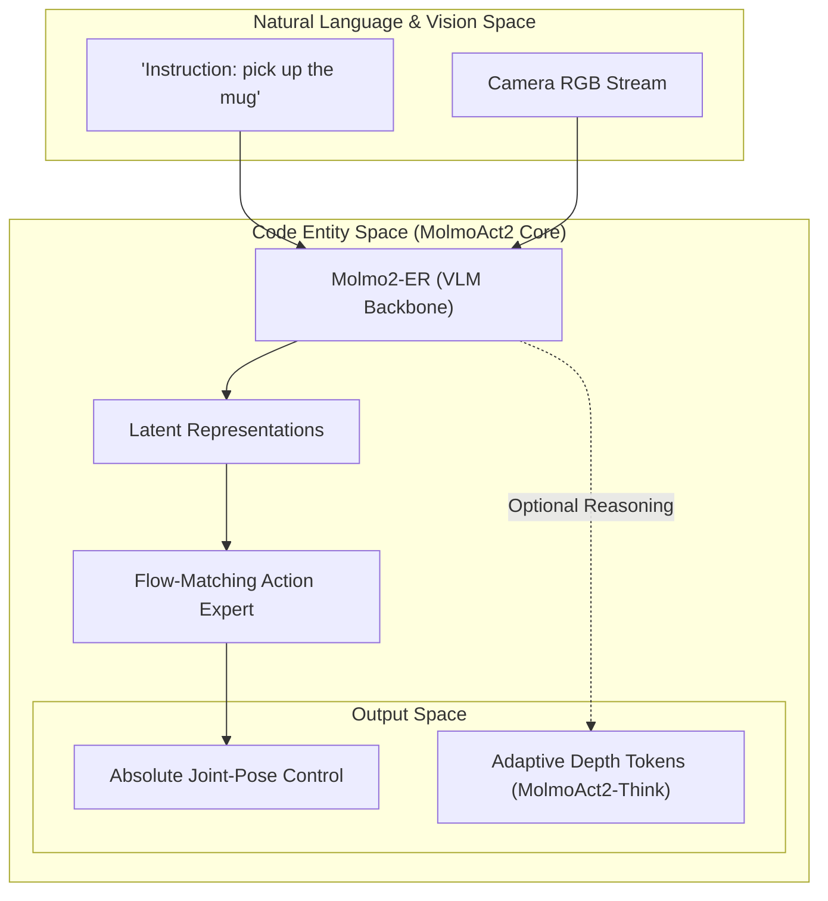
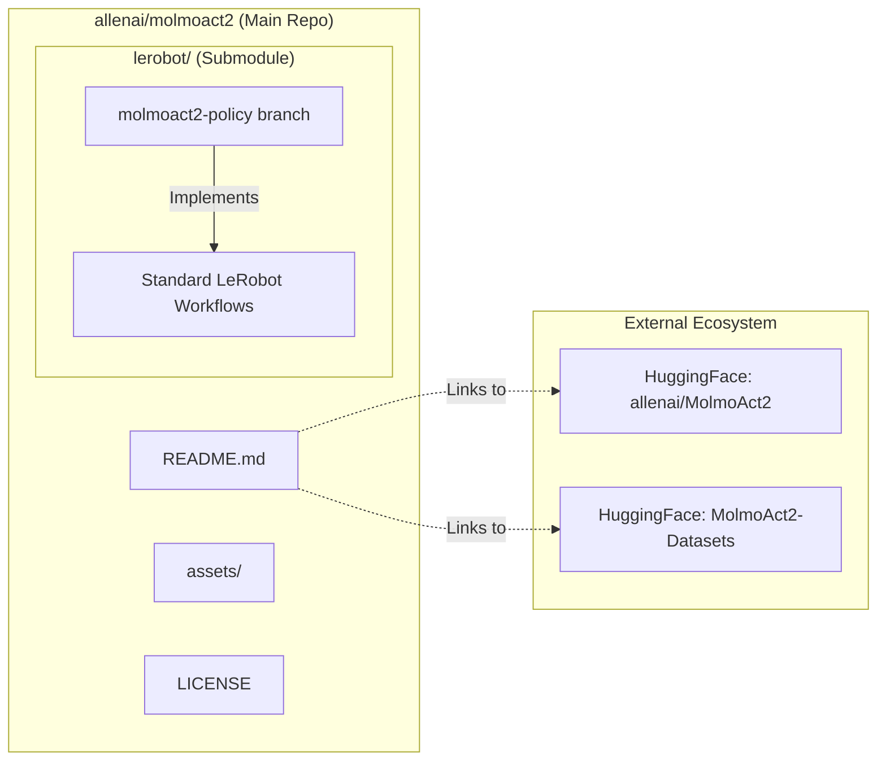

<!-- source: DeepWiki mcp.deepwiki.com · repo allenai/molmoact2 · page 1 Overview · fetched 2026-10-26 -->

# Overview

Relevant source files

The following files were used as context for generating this wiki page:

- [README.md](README.md)
- [assets/MolmoAct2.svg](assets/MolmoAct2.svg)

MolmoAct2 is the Allen Institute for AI's (Ai2) open-source family of action reasoning models designed for high-precision robot control and real-world deployment. It represents a significant advancement in the Vision-Language-Action (VLA) paradigm by integrating a robust embodied-reasoning backbone with a continuous flow-matching action expert [README.md:35-36]().

The project bridges the gap between high-level semantic understanding (e.g., "pick up the red mug") and low-level motor control (absolute joint-pose actions) through a multi-stage training pipeline and a modular architecture.

## System Concept

MolmoAct2 operates by processing visual observations and language instructions through the `Molmo2-ER` backbone to generate latent representations. These representations are then consumed by a continuous action expert that predicts smooth trajectories for robot manipulators [README.md:35-36]().

### From Language to Robot Control
The following diagram illustrates how natural language instructions and visual inputs are transformed into executable code-level action entities within the system.

**Action Reasoning Flow**

Sources: [README.md:35-36](), [README.md:52-55]()

## Repository Organization

The `molmoact2` repository serves as the central hub for model weights, dataset links, and integration logic. It leverages the `lerobot` framework as a submodule to provide standardized training and inference workflows [README.md:79-82]().

**Codebase Structure and Integration**

Sources: [README.md:39-41](), [README.md:79-82]()

## Key Components

### 1. Model Variants
The release includes several model stages, from the raw perception backbone to specialized "thinking" models:
*   **Molmo2-ER**: The base embodied-reasoning VLM [README.md:55]().
*   **MolmoAct2-Pretrain**: A discrete autoregressive VLA backbone used for initial action alignment [README.md:54]().
*   **MolmoAct2**: The standard foundation checkpoint featuring the continuous flow-matching expert [README.md:52]().
*   **MolmoAct2-Think**: An advanced variant that generates adaptive depth tokens to improve geometric reasoning before outputting actions [README.md:53]().

For more details on research motivation and the VLA paradigm, see [Project Background and Research Context](#1.1).

### 2. Training and Deployment
MolmoAct2 supports multiple robot embodiments including Franka (DROID), SO-100/101, and the Bimanual YAM platform [README.md:63-65](). 

*   **Datasets**: All robotics data is provided in **LeRobot v3.0** format, including the new BimanualYAM collection [README.md:73-77]().
*   **Framework**: Integration with `lerobot` allows for seamless fine-tuning and evaluation using standard command-line tools [README.md:39]().

For details on setting up the environment and the submodule, see [Repository Structure and Setup](#1.2).

## Quick Links
| Resource | Link |
| --- | --- |
| **ArXiv Paper** | [2605.02881](https://arxiv.org/abs/2605.02881) |
| **Base Models** | [HF Collection](https://huggingface.co/collections/allenai/molmoact2-models-69f81e05242e2499606b1be6) |
| **Finetuned Models** | [HF Collection](https://huggingface.co/collections/allenai/molmoact2-finetuned-models-69f81e23d5a7b34fde34f2ce) |
| **Robotics Datasets** | [HF Collection](https://huggingface.co/collections/allenai/molmoact2-datasets-69f81e316ec3daafe3f9555c) |
| **LeRobot Fork** | [allenai/lerobot (molmoact2-policy)](https://github.com/allenai/lerobot/tree/molmoact2-policy) |

Sources: [README.md:15-32](), [README.md:39-41]()

---

