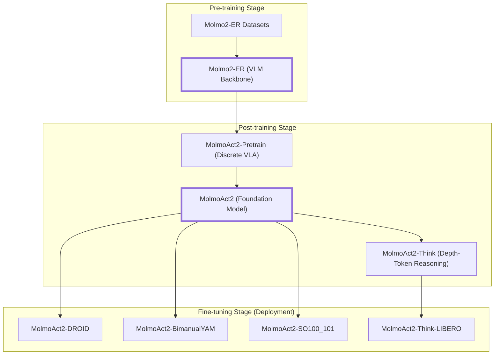
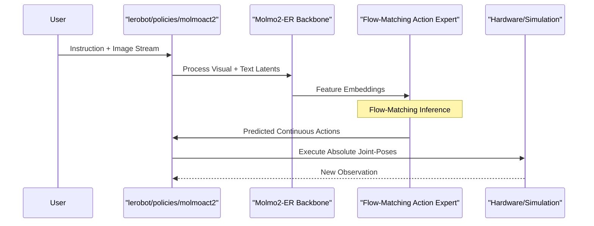

<!-- source: DeepWiki mcp.deepwiki.com · repo allenai/molmoact2 · page 1.1 Project Background and Research Context · fetched 2026-10-26 -->

# Project Background and Research Context

Relevant source files

The following files were used as context for generating this wiki page:

- [README.md](README.md)

This page details the research motivation and technical foundation of MolmoAct2, a family of open action-reasoning models designed for robot control. MolmoAct2 represents a shift from traditional Vision-Language-Action (VLA) models by integrating a high-capacity embodied-reasoning backbone with a continuous flow-matching action expert.

## Research Motivation and AI2 Robotics Program

MolmoAct2 is a core component of the Allen Institute for AI (Ai2) robotics research program, which focuses on developing open-source, general-purpose foundation models for physical interaction. The project aims to bridge the gap between high-level semantic reasoning (found in Large Language Models) and low-level motor control (required for robotics).

The research is documented in the arXiv paper **"MolmoAct2: Action Reasoning Models for Real-world Deployment" (2605.02881)** [README.md:15-17](). The project addresses three primary challenges in current VLA research:
1. **Geometric Grounding**: Traditional VLMs often lack the spatial awareness needed for precise manipulation.
2. **Action Continuity**: Discrete token prediction often leads to "jittery" or imprecise robot movements.
3. **Open Access**: Providing a complete stack of models, datasets (in LeRobot v3.0 format), and deployment code [README.md:35-37]().

## The Molmo2-ER Backbone

The foundation of MolmoAct2 is the **Molmo2-ER** (Embodied Reasoning) backbone. Unlike standard VLMs trained on general web data, Molmo2-ER is specifically pre-trained on a mixture of spatial, 3D, and visual reasoning datasets [README.md:55-55]().

### Key Characteristics of Molmo2-ER:
*   **Spatial Awareness**: Trained on datasets that emphasize depth, orientation, and relative positioning [README.md:75-75]().
*   **Latent Representations**: Produces rich visual-semantic features that serve as the input for downstream action generation.
*   **Base for Evolution**: It serves as the starting point for the `MolmoAct2-Pretrain` stage [README.md:54-55]().

## The VLA Paradigm: From Discrete to Continuous

MolmoAct2 evolves through a multi-stage training process that transitions from discrete reasoning to continuous control.

### Why Flow-Matching?
Most VLA models use autoregressive discrete token prediction for actions. MolmoAct2 utilizes **Continuous Flow-Matching (CFM)** for its "Action Expert" layer. 
*   **Precision**: Flow-matching allows the model to predict continuous action values (absolute joint-poses) rather than binned categories.
*   **Smoothness**: It produces smoother trajectories suitable for real-world hardware like the Franka or SO-100 arms.
*   **Efficiency**: CFM typically offers faster and more stable convergence during training compared to diffusion-based methods in certain robot configurations.

### Data Flow and Model Hierarchy
The following diagram illustrates the relationship between the research stages and the resulting model checkpoints.

**Model Evolution and Entity Relationship**

**Sources:** [README.md:50-67](), [README.md:71-75]()

## Technical Implementation and System Components

The MolmoAct2 system is integrated into the `lerobot` framework as a custom policy. The inference loop follows an "Observe → Instruct → Infer → Act" cycle.

### Core Components
*   **Vision-Language Backbone**: The `Molmo2-ER` weights process the camera feed and the language instruction (e.g., "pick up the red block").
*   **Action Expert**: A flow-matching head attached to the backbone that outputs the next set of robot states.
*   **Depth-Token Reasoning (Optional)**: The `MolmoAct2-Think` variant generates an adaptive depth map as an intermediate "thought" step before action generation to improve geometric accuracy [README.md:53-53]().

**Inference Data Flow (Code Entity Space)**

**Sources:** [README.md:35-37](), [README.md:52-54](), [README.md:81-83]()

## Summary of Training Stages

| Stage | Model Entity | Input | Output | Purpose |
| :--- | :--- | :--- | :--- | :--- |
| **Foundation** | `Molmo2-ER` | Images + Text | Latent Embeddings | General spatial/visual reasoning. |
| **Pre-train** | `MolmoAct2-Pretrain` | Images + Text | Discrete Action Tokens | Bridging VLM to Action space. |
| **Foundation** | `MolmoAct2` | Images + Text | Continuous Actions | The primary base for robot fine-tuning. |
| **Reasoning** | `MolmoAct2-Think` | Images + Text | Depth Tokens + Actions | Improved geometric grounding via depth. |

**Sources:** [README.md:50-55]()

---

