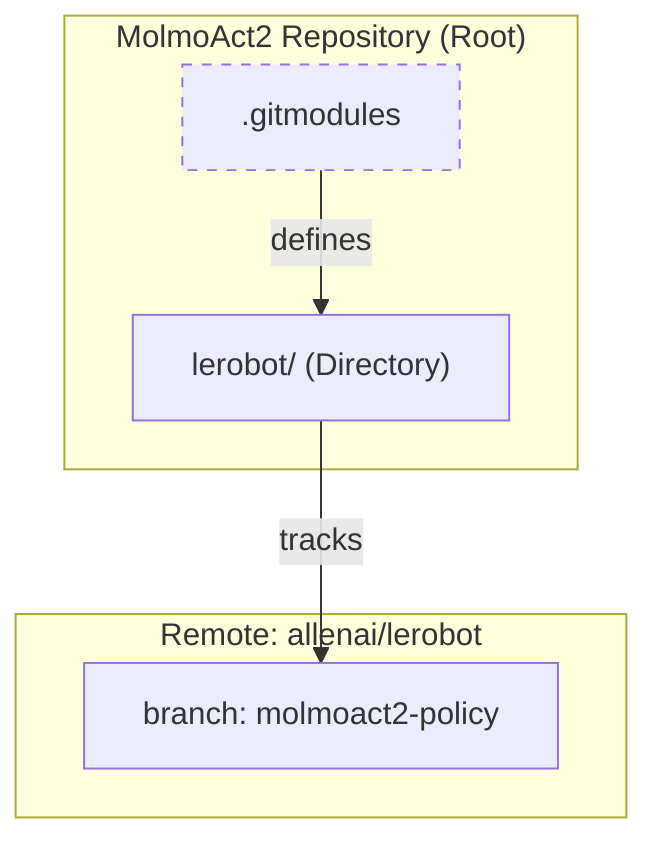
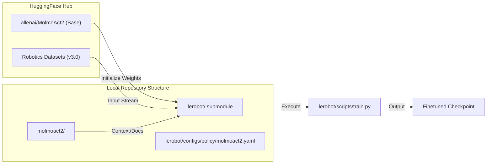

<!-- source: DeepWiki mcp.deepwiki.com · repo allenai/molmoact2 · page 1.2 Repository Structure and Setup · fetched 2026-10-26 -->

# Repository Structure and Setup

<details>
<summary>Relevant source files</summary>

The following files were used as context for generating this wiki page:

- [.gitmodules](.gitmodules)
- [README.md](README.md)

</details>


This page details the organizational layout of the `molmoact2` repository, the process for environment initialization, and the technical relationship between this repository and the `lerobot` framework. MolmoAct2 is designed to be used as a policy implementation within the LeRobot ecosystem, necessitating a specific submodule configuration for training and inference.

## Repository Layout

The repository serves as a central hub for model checkpoints, dataset links, and the integrated training/evaluation stack. It is structured to support both research exploration and real-world deployment on specific robotic embodiments.

| Component | Description |
| :--- | :--- |
| `assets/` | Contains static assets such as the MolmoAct2 logo and architecture diagrams used in documentation [README.md:2-2](). |
| `lerobot/` | A Git submodule pointing to the `allenai/lerobot` fork, specifically the `molmoact2-policy` branch [README.md:81-81](), [.gitmodules:1-4](). |
| `LICENSE` | The Apache 2.0 license governing the software and model weights [README.md:9-11](). |
| `README.md` | The primary entry point containing model tables, dataset links, and deployment instructions [README.md:1-83](). |

**Sources:** [README.md:1-83](), [.gitmodules:1-5]()

## Git Submodule and LeRobot Integration

MolmoAct2 is not a standalone codebase but is integrated into the LeRobot library as a policy class. This integration allows users to leverage standard LeRobot workflows for data loading (v3.0 format), training loops, and hardware interfacing [README.md:77-81]().

### Submodule Configuration
The repository uses a submodule to track a specific version of LeRobot maintained by Ai2. This fork contains the necessary `MolmoAct2Policy` implementation and configuration files required to load MolmoAct2 checkpoints.

**Code Entity Relationship: Submodule Mapping**

**Sources:** [.gitmodules:1-4](), [README.md:81-81]()

## Setup and Initialization

To correctly initialize the repository, users must perform a recursive clone or manually initialize the submodules to ensure the `lerobot` directory is populated with the `molmoact2-policy` branch code.

### 1. Cloning the Repository
```bash
# Clone with submodules
git clone --recurse-submodules https://github.com/allenai/molmoact2.git
```

### 2. Initializing Submodules (if cloned without --recurse)
If the repository was cloned normally, the `lerobot/` folder will be empty. Run the following to fetch the submodule content:
```bash
git submodule update --init --recursive
```

### 3. Branch Specificity
The submodule is pinned to the `molmoact2-policy` branch of the `allenai/lerobot` fork [README.md:81-81](). For users specifically looking to reproduce LIBERO benchmark results, a separate branch `molmoact2-hf-inference` is used within that fork to match the exact evaluation stack (v0.5.1) used in the paper.

**Sources:** [.gitmodules:1-5](), [README.md:81-81]()

## Data and Model Flow

The repository structure facilitates a data flow where raw datasets are converted to LeRobot v3.0 format, combined with language annotations, and fed into the `lerobot` training scripts using MolmoAct2 base checkpoints.

**System Data Flow: Training & Inference**


### Key Components for Setup:
*   **Base Checkpoints:** Foundation models like `MolmoAct2` or `MolmoAct2-Think` are used as starting points for fine-tuning [README.md:52-53]().
*   **Dataset Format:** All robotics datasets must be in LeRobot v3.0 format and include language annotations to be compatible with the Molmo2-ER backbone [README.md:77-77]().
*   **Policy Implementation:** The logic for the flow-matching action expert and depth-token reasoning resides within the `lerobot` submodule [README.md:35-35]().

**Sources:** [README.md:35-55](), [README.md:77-81]()

---

