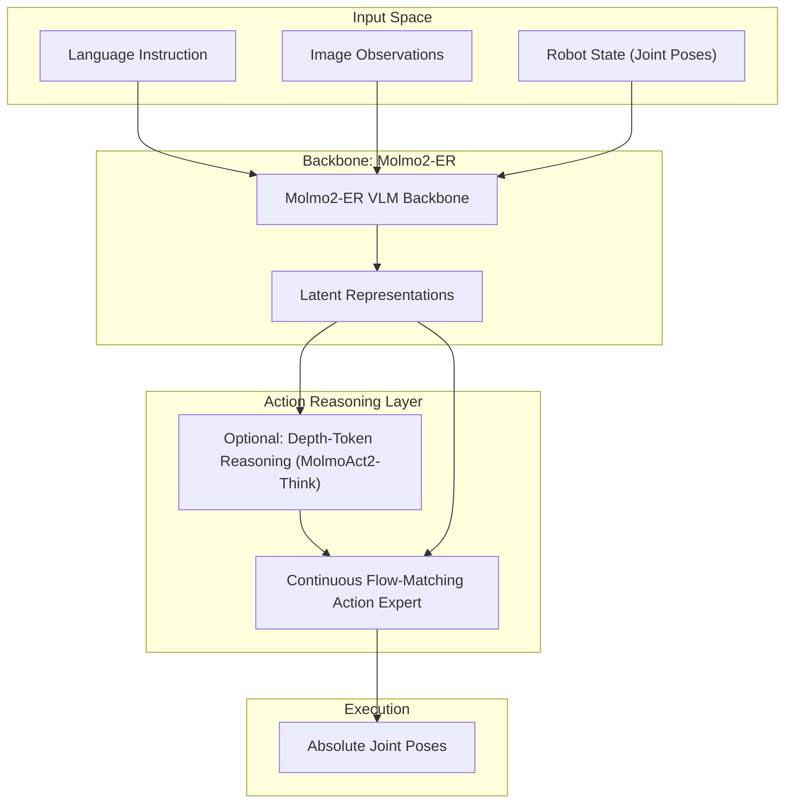
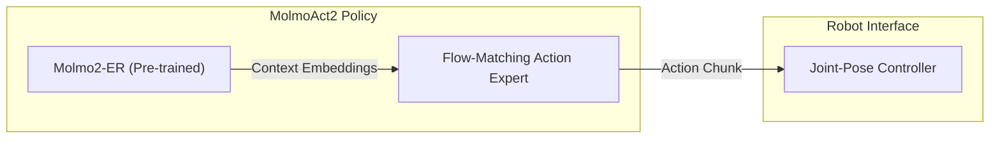

<!-- source: DeepWiki mcp.deepwiki.com · repo allenai/molmoact2 · page 2 Model Architecture · fetched 2026-10-26 -->

# Model Architecture

Relevant source files

The following files were used as context for generating this wiki page:

- [README.md](README.md)

MolmoAct2 employs a multi-stage architecture designed to bridge high-level vision-language understanding with low-level continuous robotic control. The system is built upon the **Molmo2-ER** (Embodied Reasoning) backbone, which provides the necessary spatial and geometric priors for manipulation. This backbone is augmented with specialized action heads and reasoning layers to transform visual observations and natural language instructions into precise robot trajectories.

The architecture evolves through three primary stages:
1.  **Perception & Reasoning:** A Vision-Language Model (VLM) backbone.
2.  **Discrete Action Modeling:** A pre-training stage using discrete tokens for action representation.
3.  **Continuous Action Execution:** A flow-matching expert that generates smooth, high-frequency control signals.

### System Overview: From Pixels to Actions

The following diagram illustrates the data flow from the input space (images and text) through the architectural components defined in the codebase.

**Diagram: MolmoAct2 High-Level Inference Flow**

**Sources:** [README.md:35-36](), [README.md:52-55]()

---

### [Backbone: Molmo2-ER Vision-Language Model](#2.1)

The foundation of MolmoAct2 is the **Molmo2-ER** model. Unlike standard VLMs optimized for OCR or general conversation, Molmo2-ER is specifically trained on embodied reasoning datasets including spatial, 3D, and robotics-specific visual data. This ensures the model has an inherent understanding of physical groundedness before any action training begins.

For details on the VLM's training and internal representations, see [Backbone: Molmo2-ER Vision-Language Model](#2.1).

**Sources:** [README.md:55-55](), [README.md:75-75]()

---

### [Continuous Flow-Matching Action Expert](#2.2)

The transition from "reasoning" to "acting" is handled by a continuous flow-matching expert. While the system begins with a discrete autoregressive stage (**MolmoAct2-Pretrain**), the final deployment models use flow-matching to produce smooth, non-quantized action sequences. This expert enables closed-loop control by processing the VLM's latent features alongside current robot states to infer the next set of absolute joint poses.

For details on the flow-matching implementation and the closed-loop pipeline, see [Continuous Flow-Matching Action Expert](#2.2).

**Diagram: Action Generation Logic**

**Sources:** [README.md:35-36](), [README.md:52-54]()

---

### [Depth-Token Reasoning (MolmoAct2-Think)](#2.3)

The **MolmoAct2-Think** variant introduces an intermediate "thinking" step. Before generating actions, the model produces adaptive depth tokens. This architectural layer forces the model to resolve the 3D geometry of the scene explicitly. These depth maps serve two purposes:
1.  **Geometric Grounding:** Improving the accuracy of spatial manipulation.
2.  **Interpretability:** Providing a visual safety check for the operator to see what the model "perceives" as the scene depth.

For details on the depth-token generation and the MolmoAct2-Think checkpoints, see [Depth-Token Reasoning (MolmoAct2-Think)](#2.3).

**Sources:** [README.md:53-53](), [README.md:67-67]()

---

### Progressive Training Pipeline

The MolmoAct2 architecture is the result of a staged training process, where each stage adds a new capability to the model.

| Stage | Model Name | Architectural Change | Primary Goal |
| :--- | :--- | :--- | :--- |
| **1. Perception** | `Molmo2-ER` | Base VLM | Spatial and visual reasoning. |
| **2. Alignment** | `MolmoAct2-Pretrain` | Discrete Action Tokens | Mapping language to discrete robot behaviors. |
| **3. Control** | `MolmoAct2` | Flow-Matching Expert | Continuous, high-precision robot control. |
| **4. Reasoning** | `MolmoAct2-Think` | Depth-Token Layer | Explicit geometric reasoning before action. |

**Sources:** [README.md:46-55](), [README.md:79-84]()

---

