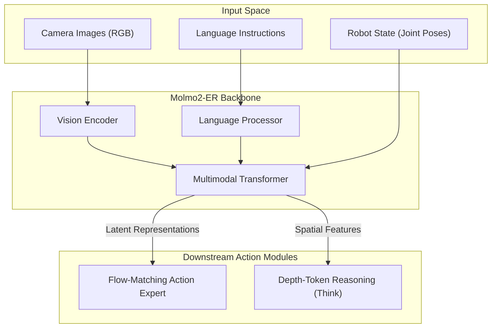

<!-- source: DeepWiki mcp.deepwiki.com · repo allenai/molmoact2 · page 2.1 Backbone: Molmo2-ER Vision-Language Model · fetched 2026-10-26 -->

# Backbone: Molmo2-ER Vision-Language Model

<details>
<summary>Relevant source files</summary>

The following files were used as context for generating this wiki page:

- [README.md](README.md)

</details>


The **Molmo2-ER** (Embodied Reasoning) Vision-Language Model (VLM) serves as the foundational perception and reasoning layer for the entire MolmoAct2 family [README.md:35-35](). It is designed to bridge the gap between high-level natural language instructions and the low-level geometric understanding required for robotic manipulation. Unlike general-purpose VLMs, Molmo2-ER is specifically pre-trained on datasets that emphasize spatial awareness, 3D structure, and physical scene reasoning [README.md:75-75]().

## Purpose and Role in MolmoAct2

Molmo2-ER functions as the "brain" of the MolmoAct2 architecture. It processes visual inputs (images from cameras) and language inputs (task instructions) to produce a rich latent representation. This representation is then consumed by downstream modules, such as the discrete autoregressive backbone in `MolmoAct2-Pretrain` or the continuous flow-matching action expert in the final `MolmoAct2` model [README.md:50-55]().

### Key Responsibilities:
*   **Visual Perception:** Encoding multi-view or single-view camera observations into a unified latent space.
*   **Language Understanding:** Parsing complex natural language instructions to ground them in the visual scene.
*   **Geometric Reasoning:** Providing the spatial priors necessary for 3D tasks, such as depth estimation and object localization.
*   **Latent Feature Generation:** Producing the hidden states that serve as the input for the action-generation layers.

## Data Flow and Architecture

The model architecture transforms raw sensor data into a format suitable for robotic decision-making. The following diagram illustrates how the Molmo2-ER backbone integrates into the broader system.

### Molmo2-ER System Context

**Sources:** [README.md:35-35](), [README.md:50-55]()

## Embodied Reasoning (ER) Training

The "ER" suffix denotes a specific training regime focused on spatial and 3D reasoning. While standard VLMs are often trained on web-scale image-text pairs (e.g., captions), Molmo2-ER is trained on a curated collection of datasets that provide stronger physical grounding [README.md:75-75]().

### Training Dataset Categories
| Dataset Category | Description | Purpose |
| --- | --- | --- |
| **Spatial Reasoning** | Data involving positional relationships (e.g., "left of", "inside"). | Improves grounding of instructions in 3D space. |
| **3D Reasoning** | Data containing depth, point clouds, or multi-view geometry. | Enables the model to understand scene depth and volume. |
| **Robotics Data** | Demonstrations and robot-centric observations. | Aligns visual features with robotic action spaces. |
| **Visual Reasoning** | Complex Q&A about physical properties and scene dynamics. | Enhances logical deduction about task completion. |

**Sources:** [README.md:30-32](), [README.md:75-75]()

## Implementation and Checkpoints

The Molmo2-ER model is available as a standalone foundation checkpoint. It is the starting point for the progressive training pipeline that leads to the deployment-ready MolmoAct2 models.

### Model Relationships
```mermaid
graph LR
    node ["Molmo2-ER"]
    pre ["MolmoAct2-Pretrain"]
    act ["MolmoAct2"]
    think ["MolmoAct2-Think"]

    node -- "Add Discrete Action Tokens" --> pre
    pre -- "Attach Flow-Matching Expert" --> act
    act -- "Add Depth Reasoning" --> think

    style node stroke-width:4px
```

### Technical Specifications
*   **Base Checkpoint:** `allenai/Molmo2-ER` [README.md:55-55]()
*   **Framework:** Integrated into the `lerobot` ecosystem via the `molmoact2-policy` branch [README.md:81-81]().
*   **Output:** High-dimensional latent vectors (hidden states) that encode both the visual scene and the target instruction.

**Sources:** [README.md:50-55](), [README.md:81-81]()

## Integration with LeRobot

In the MolmoAct2 repository, the Molmo2-ER backbone is utilized within the `lerobot` submodule [README.md:81-81](). When a policy is initialized, the backbone is loaded to handle the `observation` and `task` processing before passing control to the action-specific layers.

### Code Entity Mapping
| Concept | Code Entity / Path |
| --- | --- |
| **Model Definition** | `allenai/Molmo2-ER` (HuggingFace) |
| **Policy Integration** | `lerobot/` submodule (`molmoact2-policy` branch) |
| **Training Pipeline** | `allenai/lerobot` workflow |

**Sources:** [README.md:39-39](), [README.md:81-81]()

---

