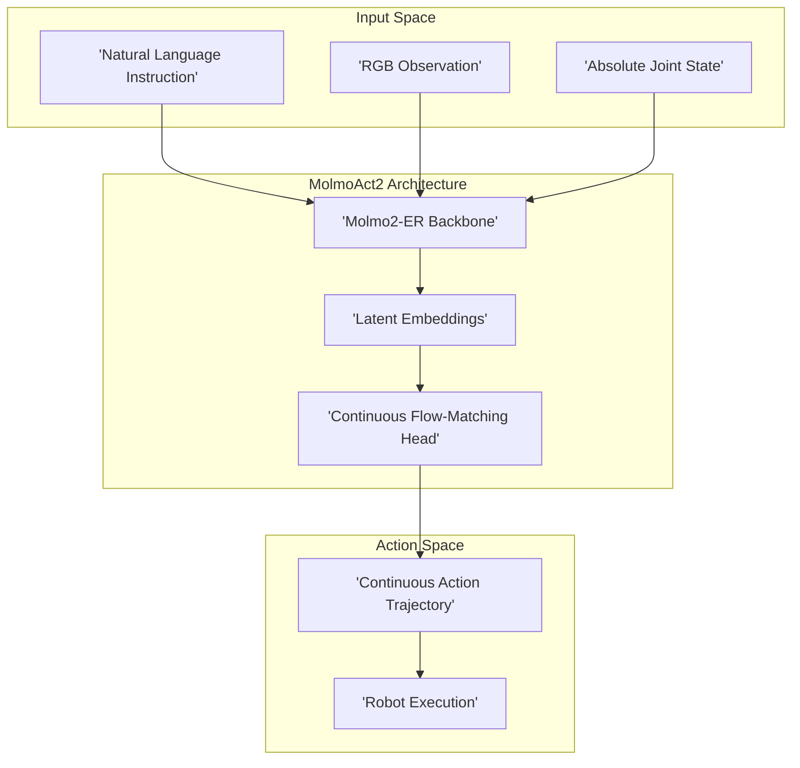
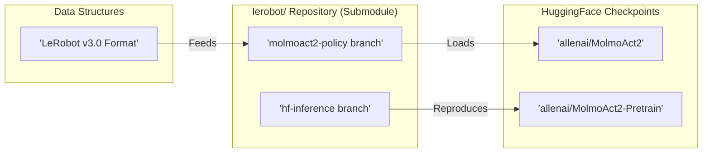

<!-- source: DeepWiki mcp.deepwiki.com · repo allenai/molmoact2 · page 2.2 Continuous Flow-Matching Action Expert · fetched 2026-10-26 -->

# Continuous Flow-Matching Action Expert

Relevant source files

The following files were used as context for generating this wiki page:

- [README.md](README.md)

The Continuous Flow-Matching Action Expert is the architectural component of MolmoAct2 responsible for translating high-level latent representations from the Molmo2-ER backbone into precise, continuous robot control signals [README.md:35-36](). While the model begins with a discrete autoregressive pre-training stage (MolmoAct2-Pretrain), the final foundation model (MolmoAct2) utilizes a flow-matching objective to produce smooth action trajectories suitable for real-world manipulation [README.md:52-54]().

## Architecture Overview

The MolmoAct2 architecture connects a Vision-Language Model (VLM) backbone to a flow-matching head. This transition from discrete token prediction to continuous flow-matching allows the model to handle the multi-modal nature of robot action distributions without the quantization artifacts common in purely discrete Vision-Language-Action (VLA) models [README.md:35-36]().

### Action Generation Pipeline
The pipeline follows a closed-loop control structure:
1.  **Observe**: The system captures visual input (RGB images) and robot state (absolute joint poses).
2.  **Instruct**: Natural language instructions are processed alongside visual tokens.
3.  **Infer**: The Molmo2-ER backbone produces latent embeddings.
4.  **Act**: The Flow-Matching Action Expert decodes these latents into a continuous action trajectory.
5.  **Execute**: The robot executes the predicted absolute joint-pose commands [README.md:35-36]().

### System Data Flow: Language to Action Expert
The following diagram illustrates the flow from natural language instructions and visual observations through the code entities that define the MolmoAct2 policy.

**Title: MolmoAct2 Policy Inference Flow**

Sources: [README.md:35-36](), [README.md:52-55]()

## Training Stages and Model Variants

The Action Expert is introduced in the final stages of the MolmoAct2 training pipeline. This distinguishes it from the earlier discrete pre-training stage.

| Stage | Model Checkpoint | Action Representation | Purpose |
| :--- | :--- | :--- | :--- |
| **Pre-training** | `MolmoAct2-Pretrain` | Discrete Autoregressive | Aligning VLM with robot state/action tokens [README.md:54](). |
| **Foundation** | `MolmoAct2` | Continuous Flow-Matching | Base checkpoint for fine-tuning on specific robot embodiments [README.md:52](). |
| **Reasoning** | `MolmoAct2-Think` | Depth + Continuous Action | Intermediate depth-token reasoning before action generation [README.md:53](). |

### Implementation in LeRobot
MolmoAct2 is integrated into the `lerobot` framework as a custom policy implementation [README.md:81-82](). The core logic for handling the flow-matching inference and training is contained within the `allenai/lerobot` fork on the `molmoact2-policy` branch [README.md:39]().

**Title: Code Entity Mapping for MolmoAct2 Policy**

Sources: [README.md:39](), [README.md:77](), [README.md:81-82]()

## Action Convention: Absolute Joint-Pose Control

Unlike many VLA models that predict relative end-effector displacements, MolmoAct2 is trained to produce **absolute joint-pose** control signals [README.md:63-65](). This convention is consistent across all fine-tuned deployment models:

*   **MolmoAct2-DROID**: Fine-tuned for Franka arms using absolute joint-poses [README.md:63]().
*   **MolmoAct2-BimanualYAM**: Handles dual-arm configurations with absolute joint-pose trajectories [README.md:64]().
*   **MolmoAct2-SO100_101**: Supports low-cost SO-100/101 arms with absolute joint-pose control [README.md:65]().

This convention simplifies the control stack by removing the need for complex inverse kinematics (IK) during high-frequency execution, as the model directly reasons about the robot's joint configuration in the workspace [README.md:35-36]().

## Integration with Depth Reasoning (MolmoAct2-Think)

For tasks requiring high geometric precision, the `MolmoAct2-Think` variant augments the action expert with **depth-token reasoning** [README.md:53](). Before the flow-matching head produces the final action trajectory, the model generates an adaptive depth map represented as discrete tokens. This intermediate step serves two purposes:
1.  **Geometric Grounding**: It forces the backbone to attend to the 3D structure of the scene [README.md:53]().
2.  **Safety Validation**: The depth map can be visually inspected as an interpretable safety check before the robot executes the action [README.md:67]().

Sources: [README.md:35-36](), [README.md:52-54](), [README.md:63-67]()

---

