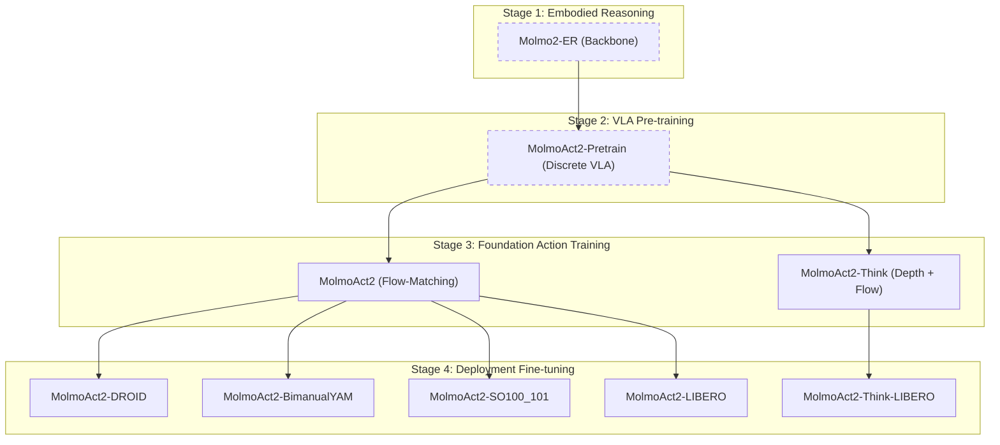
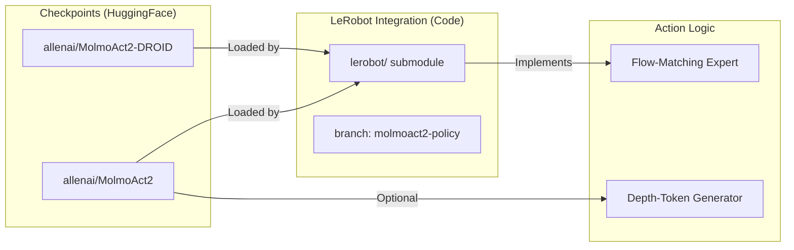

<!-- source: DeepWiki mcp.deepwiki.com · repo allenai/molmoact2 · page 3 Model Checkpoints and Training Stages · fetched 2026-10-26 -->

# Model Checkpoints and Training Stages

Relevant source files

The following files were used as context for generating this wiki page:

- [README.md](README.md)

MolmoAct2 models are released in a tiered structure representing the progression from a general-purpose vision-language model to a specialized robotic controller. This hierarchy allows researchers and engineers to enter the pipeline at different stages depending on whether they intend to perform foundational pre-training, task-specific fine-tuning, or direct deployment on supported hardware.

The training pipeline transitions from discrete token prediction (for reasoning and depth) to continuous flow-matching (for precise action control) [README.md:35-36]().

## Training Progression Overview

The following diagram illustrates the relationship between the released checkpoints and the training stages they represent.

### Model Lineage and Stage Transitions

**Sources:** [README.md:50-67]()

## Checkpoint Categories

### Base (Foundation) Checkpoints
These checkpoints serve as the starting points for further development. They range from the `Molmo2-ER` backbone, which contains no action-specific heads, to `MolmoAct2`, which is ready for robotic fine-tuning using the continuous action expert [README.md:46-55]().

*   **Molmo2-ER**: The vision-language foundation trained on spatial and 3D reasoning.
*   **MolmoAct2-Pretrain**: A discrete autoregressive version used for internal training stages.
*   **MolmoAct2**: The standard foundation for robot fine-tuning.
*   **MolmoAct2-Think**: A variant that incorporates depth-token reasoning for improved geometric understanding.

For detailed specifications and HuggingFace paths, see **[Base (Foundation) Checkpoints](#3.1)**.

### Fine-Tuned Deployment Checkpoints
These models have been trained on specific robotics datasets (e.g., DROID, LIBERO, or YAM) and are optimized for direct inference or near-neighbor transfer learning [README.md:57-68]().

*   **Hardware-Specific**: Checkpoints for Franka (DROID), SO-100/101, and Bimanual YAM.
*   **Benchmark-Specific**: Optimized versions for the LIBERO simulation suites.

For hardware configurations and action conventions, see **[Fine-Tuned Deployment Checkpoints](#3.2)**.

## Integration with Training Workflows

All MolmoAct2 checkpoints are compatible with the `allenai/lerobot` framework. The repository includes a submodule pinned to the `molmoact2-policy` branch, which provides the necessary `lerobot` policy classes to load these checkpoints for continued training or evaluation [README.md:81-83]().

### Mapping Code Entities to Training Stages

**Sources:** [README.md:39-41](), [README.md:81-83]()

## Summary Table

| Stage | Model Name | Primary Use Case |
| :--- | :--- | :--- |
| **Backbone** | `Molmo2-ER` | Starting point for new VLA architectures [README.md:55](). |
| **Pre-training** | `MolmoAct2-Pretrain` | Continuing discrete VLA training [README.md:54](). |
| **Foundation** | `MolmoAct2` | Default starting point for new robot embodiments [README.md:52](). |
| **Reasoning** | `MolmoAct2-Think` | Tasks requiring explicit geometric reasoning (depth) [README.md:53](). |
| **Deployment** | `MolmoAct2-[Variant]` | Direct inference or fine-tuning for specific hardware [README.md:63-67](). |

**Sources:** [README.md:50-67]()

---

