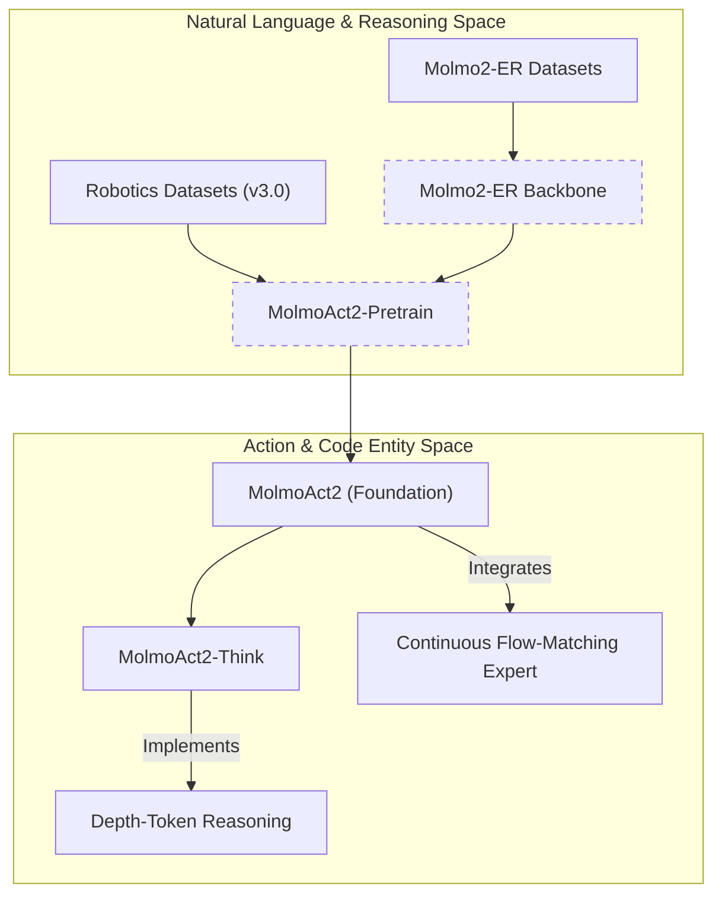
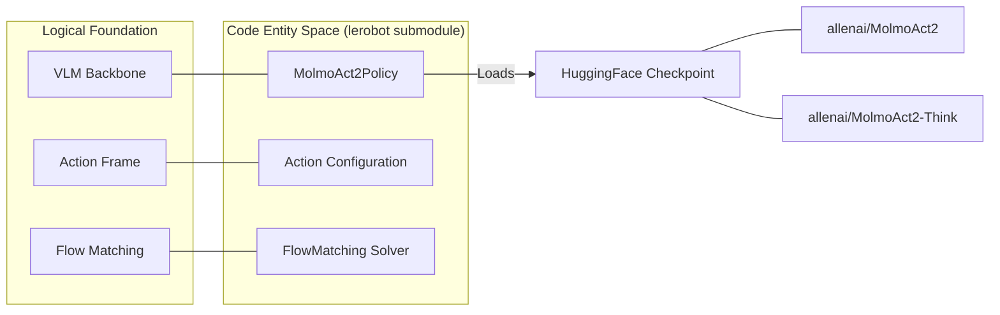

<!-- source: DeepWiki mcp.deepwiki.com · repo allenai/molmoact2 · page 3.1 Base (Foundation) Checkpoints · fetched 2026-10-26 -->

# Base (Foundation) Checkpoints

Relevant source files

The following files were used as context for generating this wiki page:

- [README.md](README.md)

This page provides a detailed reference for the four primary foundation checkpoints in the MolmoAct2 ecosystem. These checkpoints represent different stages of the model's evolution—from a general-purpose vision-language model (VLM) to a specialized Vision-Language-Action (VLA) model capable of continuous robot control. Understanding the transition between these checkpoints is critical for selecting the correct starting point for new robot embodiments or research experiments.

### Foundation Model Lineage

The MolmoAct2 training pipeline follows a progressive transition from high-level reasoning to low-level motor control. The checkpoints are organized by their position in this pipeline:

1.  **Molmo2-ER**: The vision-language backbone.
2.  **MolmoAct2-Pretrain**: The discrete action pre-training stage.
3.  **MolmoAct2**: The standard continuous control foundation.
4.  **MolmoAct2-Think**: The foundation model with adaptive depth reasoning.

#### Data Flow and Model Evolution
The following diagram illustrates how the system transitions from "Natural Language Space" (instructions and reasoning) to "Code Entity Space" (action experts and flow-matching).

**Diagram: MolmoAct2 Foundation Evolution**

Sources: [README.md:35-36](), [README.md:46-55]()

---

### Detailed Checkpoint Reference

#### 1. Molmo2-ER
*   **HuggingFace Path**: `allenai/Molmo2-ER`
*   **Purpose**: Embodied-Reasoning VLM backbone.
*   **Description**: This is the starting point for the entire family. It is a Molmo2-based VLM specifically trained on spatial, 3D, and visual reasoning datasets to build the geometric understanding necessary for robotics.
*   **Use Case**: Use this if you are performing fundamental research on VLM backbones or wish to train a completely new VLA from scratch using different action modeling techniques.

Sources: [README.md:55-55](), [README.md:75-75]()

#### 2. MolmoAct2-Pretrain
*   **HuggingFace Path**: `allenai/MolmoAct2-Pretrain`
*   **Purpose**: Post-training (Intermediate Stage).
*   **Description**: This checkpoint represents the model after it has been trained on robotics data using discrete autoregressive tokens. It has learned the relationship between images, instructions, and robot states but does not yet include the continuous action expert.
*   **Use Case**: Intended for continuing the MolmoAct2 training stages or experimenting with alternative action heads (e.g., Diffusion or different Flow-Matching implementations). **Note**: This model is not intended for direct continuous-control inference.

Sources: [README.md:54-54]()

#### 3. MolmoAct2 (Foundation)
*   **HuggingFace Path**: `allenai/MolmoAct2`
*   **Purpose**: General Fine-tuning.
*   **Description**: The primary foundation checkpoint. It features the Molmo2-ER backbone connected to a continuous flow-matching action expert. It has been trained on a large mixture of robotics data (DROID, BC-Z, Bridge, RT-1, etc.) to establish a robust baseline for manipulation.
*   **Use Case**: This is the **default starting point** for adapting MolmoAct2 to a new robot embodiment or a specific benchmark. It provides the best balance of general robotics knowledge and flexibility.

Sources: [README.md:52-52](), [README.md:83-84]()

#### 4. MolmoAct2-Think
*   **HuggingFace Path**: `allenai/MolmoAct2-Think`
*   **Purpose**: Specialized Fine-tuning (Geometric Reasoning).
*   **Description**: An extension of the base MolmoAct2 that incorporates "Think" tokens. Before outputting actions, the model generates compact depth predictions (adaptive depth maps). This forces the model to reason about the 3D structure of the scene before deciding on a motor command.
*   **Use Case**: Use this when the target task requires high precision or complex geometric reasoning. It is also useful for safety-critical applications where the intermediate depth map serves as an interpretable check of the model's perception.

Sources: [README.md:53-53]()

---

### Implementation Mapping

The following diagram maps the logical components of these foundation checkpoints to the software entities found within the `lerobot` integration used for training and deployment.

**Diagram: Logical Component to Code Entity Mapping**

Sources: [README.md:50-55](), [README.md:79-81]()

### Summary Table: Which Checkpoint to Use?

| Goal | Recommended Checkpoint | Reasoning |
| :--- | :--- | :--- |
| **New Robot Arm** | `allenai/MolmoAct2` | Provides the most general robotics foundation for adaptation. |
| **High-Precision Task** | `allenai/MolmoAct2-Think` | Depth-reasoning tokens improve spatial accuracy. |
| **VLA Research** | `allenai/MolmoAct2-Pretrain` | Clean VLA backbone without the continuous expert attached. |
| **VLM/ER Research** | `allenai/Molmo2-ER` | Base VLM with embodied reasoning but no action data. |

**Important Note on Fine-tuning**: While these base checkpoints are the foundation, if your robot is similar to one of the supported platforms (Franka, SO-100, or YAM), it is often more efficient to start from a **Fine-Tuned Deployment Checkpoint** (see Section 3.2) rather than these base foundation models.

Sources: [README.md:48-48](), [README.md:83-85]()

---

