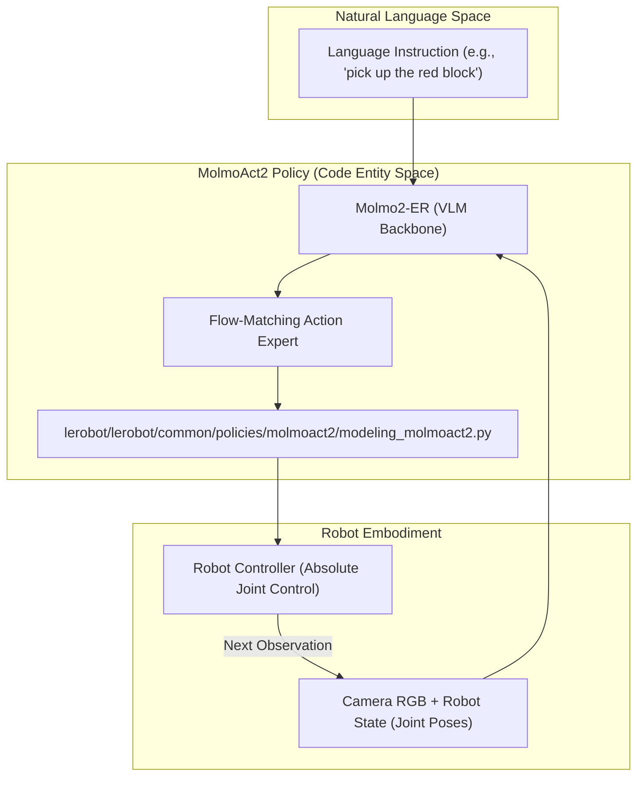
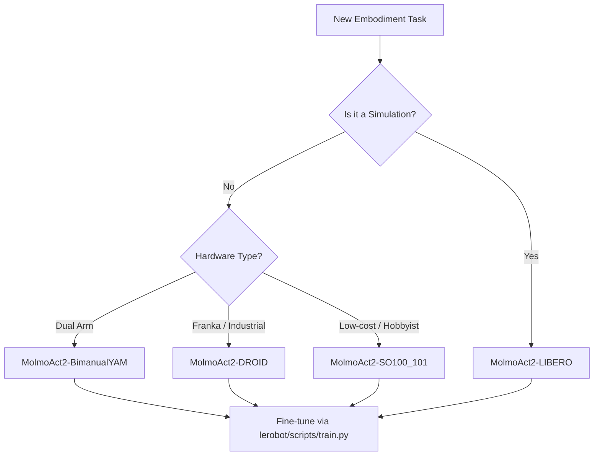

<!-- source: DeepWiki mcp.deepwiki.com · repo allenai/molmoact2 · page 3.2 Fine-Tuned Deployment Checkpoints · fetched 2026-10-26 -->

# Fine-Tuned Deployment Checkpoints

Relevant source files

The following files were used as context for generating this wiki page:

- [README.md](README.md)

This page provides a detailed reference for the five fine-tuned MolmoAct2 checkpoints released for direct deployment and specialized research. Unlike the base foundation models, these checkpoints are optimized for specific hardware configurations, action spaces, and benchmark suites. They serve as ready-to-use policies for their target embodiments or as high-quality starting points for cross-embodiment transfer learning.

## Overview of Fine-Tuned Variants

The fine-tuned checkpoints are derived from the `MolmoAct2` or `MolmoAct2-Think` base models. They have been trained on specific robotics dataset mixtures and follow an absolute joint-pose action convention.

### Checkpoint Summary Table

| Model | Primary Use Case | Target Hardware / Suite | HF Path |
| :--- | :--- | :--- | :--- |
| **MolmoAct2-DROID** | Franka Emika Panda | DROID Franka Setup | [allenai/MolmoAct2-DROID](https://huggingface.co/allenai/MolmoAct2-DROID) |
| **MolmoAct2-BimanualYAM** | Dual-arm YAM | Bimanual YAM | [allenai/MolmoAct2-BimanualYAM](https://huggingface.co/allenai/MolmoAct2-BimanualYAM) |
| **MolmoAct2-SO100_101** | Low-cost SO-100/101 | SO-100 & SO-101 Arms | [allenai/MolmoAct2-SO100_101](https://huggingface.co/allenai/MolmoAct2-SO100_101) |
| **MolmoAct2-LIBERO** | Simulation Benchmark | LIBERO (Spatial, Object, Goal, Long) | [allenai/MolmoAct2-LIBERO](https://huggingface.co/allenai/MolmoAct2-LIBERO) |
| **MolmoAct2-Think-LIBERO** | Reasoning in Sim | LIBERO with Depth-Tokens | [allenai/MolmoAct2-Think-LIBERO](https://huggingface.co/allenai/MolmoAct2-Think-LIBERO) |

Sources: [README.md:57-68]()

---

## Technical Implementation and Data Flow

The deployment checkpoints utilize a closed-loop inference pipeline integrated within the `lerobot` framework. The system processes visual input and language instructions to produce continuous control signals via a Flow-Matching Action Expert.

### Inference Data Flow Diagram

The following diagram illustrates how a fine-tuned checkpoint processes data during a real-world or simulation rollout, bridging high-level instructions to low-level robot actions.

Sources: [README.md:35-36](), [README.md:79-82]()

---

## Detailed Checkpoint Reference

### 1. MolmoAct2-DROID
*   **Target:** Franka Emika Panda robots.
*   **Dataset:** Filtered DROID Franka mixture [README.md:63]().
*   **Action Convention:** Absolute joint-pose control.
*   **Guidance:** Best for users with Franka setups or those performing research on large-scale multi-task data from the DROID collection.

### 2. MolmoAct2-BimanualYAM
*   **Target:** Bimanual YAM (Yet Another Manipulator) dual-arm platforms.
*   **Dataset:** Bimanual YAM mixture including annotated language instructions [README.md:64]().
*   **Action Convention:** Absolute joint-pose control for dual arms.
*   **Guidance:** Use this for any dual-arm setup. It provides a significantly better initialization than the base model for bimanual coordination tasks [README.md:83-85]().

### 3. MolmoAct2-SO100_101
*   **Target:** Low-cost SO-100 and SO-101 robot arms.
*   **Dataset:** Combined SO-100/SO-101 datasets with annotated language [README.md:65]().
*   **Action Convention:** Absolute joint-pose control.
*   **Guidance:** Ideal for the hobbyist and low-cost robotics community. Recommended as a starting point for other low-cost hobbyist arms (e.g., ALOHA-style or Interbotix) [README.md:83-85]().

### 4. MolmoAct2-LIBERO & MolmoAct2-Think-LIBERO
*   **Target:** LIBERO simulation benchmark.
*   **Dataset:** Full LIBERO training mixture (Spatial, Object, Goal, and Long suites) [README.md:66-67]().
*   **Special Feature (Think):** The `Think-LIBERO` variant generates adaptive depth-tokens as an intermediate reasoning step before action output [README.md:67]().
*   **Guidance:** Use these to reproduce benchmark results or as a baseline for simulated robot learning research.

---

## Selection Guidance for New Embodiments

When adapting MolmoAct2 to a new robot, selecting the correct starting checkpoint can significantly reduce training time and data requirements.

Sources: [README.md:83-85]()

### Deployment Integration
All checkpoints are compatible with the `allenai/lerobot` integration. They can be loaded directly using the `LeRobot` policy API. The implementation logic resides in the `molmoact2-policy` branch of the submodule [README.md:39](), [README.md:81]().

Sources: [README.md:79-82]()

---

