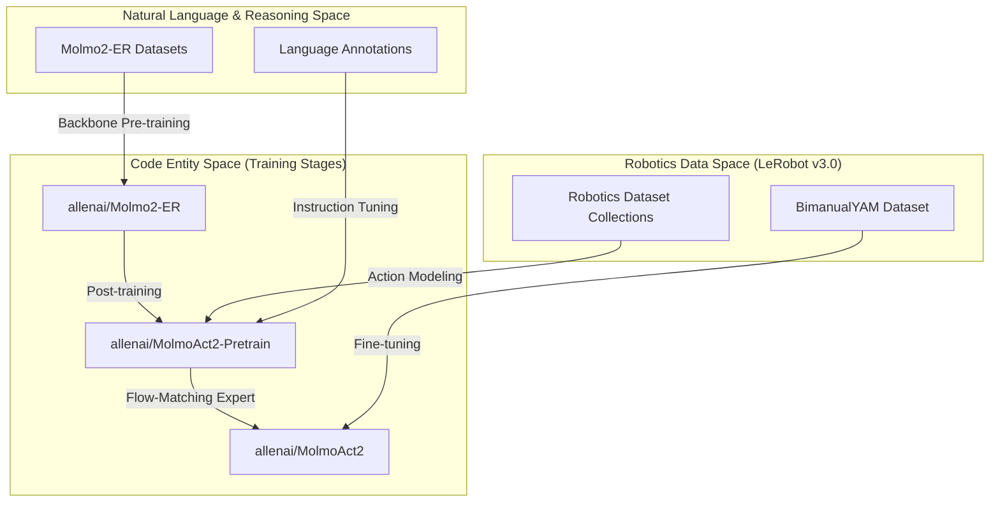
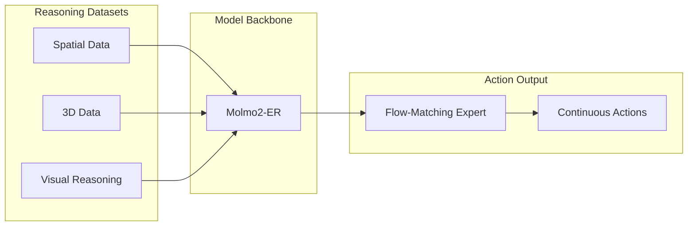

<!-- source: DeepWiki mcp.deepwiki.com · repo allenai/molmoact2 · page 4 Datasets · fetched 2026-10-26 -->

# Datasets

Relevant source files

The following files were used as context for generating this wiki page:

- [README.md](README.md)

MolmoAct2 utilizes a diverse collection of datasets spanning high-level embodied reasoning and low-level robotic control. These datasets are categorized into two primary groups: those used for training the **Molmo2-ER** vision-language backbone and those used for the **MolmoAct2** action-generation stages. All robotics datasets are standardized to the **LeRobot v3.0** format and enhanced with detailed language annotations to facilitate vision-language-action (VLA) learning [README.md:71-78]().

### Dataset Ecosystem Overview

The following diagram illustrates how different data collections feed into the various stages of the MolmoAct2 model pipeline, transitioning from general reasoning to specific robotic control.

**Data Flow from Reasoning to Action**

Sources: [README.md:50-55](), [README.md:71-75]()

---

## Robotics Training Datasets

The robotics datasets used for MolmoAct2 training are designed for closed-loop manipulation. They cover a wide range of hardware platforms, including Franka (DROID), SO-100/101, and the Bimanual YAM platform [README.md:63-65]().

A critical requirement for these datasets is their conversion to the **LeRobot v3.0** format, which ensures compatibility with the training and evaluation scripts found in the `lerobot/` submodule [README.md:77-81](). These datasets often include absolute joint-pose action conventions and are paired with extra language annotations to support the model's instruction-following capabilities.

For a detailed breakdown of specific robotics mixtures, including DROID, BC-Z, Bridge, and RT-1, see [Robotics Training Datasets](#4.1).

**Robotics Data Collections**
| Collection | Description | Access |
| --- | --- | --- |
| **MolmoAct2 Robotics** | Mixture of SO-100, DROID, BC-Z, Bridge, and RT-1. | [HuggingFace Collection](https://huggingface.co/collections/allenai/molmoact2-datasets-69f81e316ec3daafe3f9555c) |
| **BimanualYAM** | Specialized datasets for the Bimanual YAM dual-arm platform. | [HuggingFace Collection](https://huggingface.co/collections/allenai/molmoact2-bimanualyam-dataset-69f81e17b140ec34f430a35e) |

Sources: [README.md:24-29](), [README.md:71-75]()

---

## Embodied Reasoning (ER) Datasets

The **Molmo2-ER** backbone is pre-trained on a massive collection of embodied reasoning data. This stage is crucial for providing the model with a fundamental understanding of 3D space, geometric relationships, and visual reasoning before it ever attempts to predict a robotic action [README.md:35-36]().

These datasets include:
*   **Spatial Reasoning:** Understanding the relative positions of objects.
*   **3D Understanding:** Interpreting depth and volume from 2D images.
*   **Visual Reasoning:** Answering complex questions about scene dynamics.

For more information on the specific data sources and the role of ER data in building the model's "mental model" of the physical world, see [Embodied Reasoning (ER) Datasets](#4.2).

**Reasoning to Action Mapping**

Sources: [README.md:35-36](), [README.md:55](), [README.md:75]()

---

## Dataset Formats and Integration

MolmoAct2 is deeply integrated with the `allenai/lerobot` framework. This allows researchers to use standard LeRobot workflows for training and evaluation.

*   **LeRobot v3.0:** All training data must adhere to this format to be compatible with the `molmoact2-policy` implementation [README.md:77-81]().
*   **Language Annotations:** Unlike standard robotics datasets that may only contain state/action pairs, MolmoAct2 datasets are enriched with language instructions to enable the VLA paradigm [README.md:77-78]().

For technical details on how to prepare your own datasets for MolmoAct2, refer to the [Training and Evaluation Workflows](#5.1) page.

Sources: [README.md:71-82]()

---

