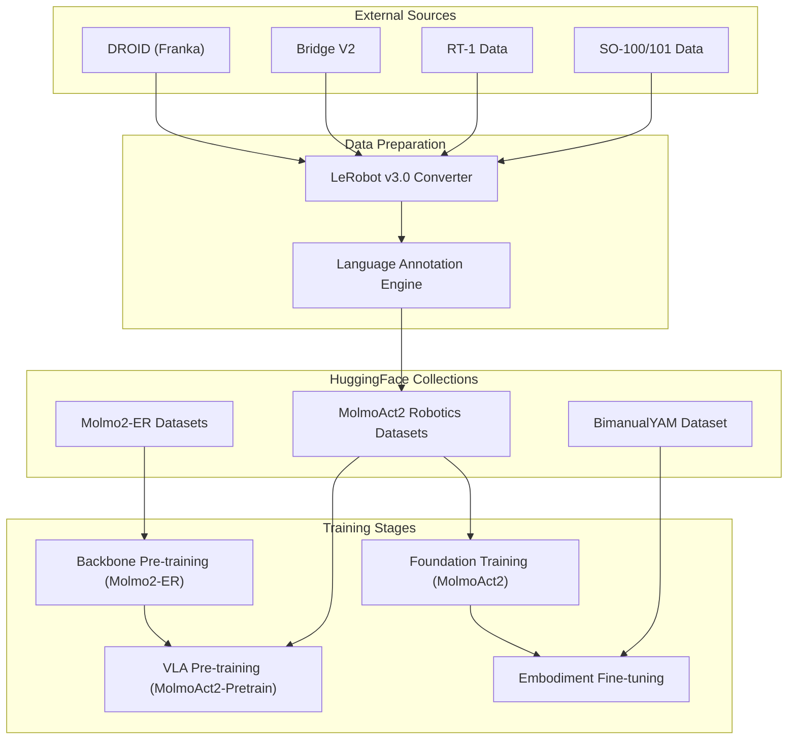
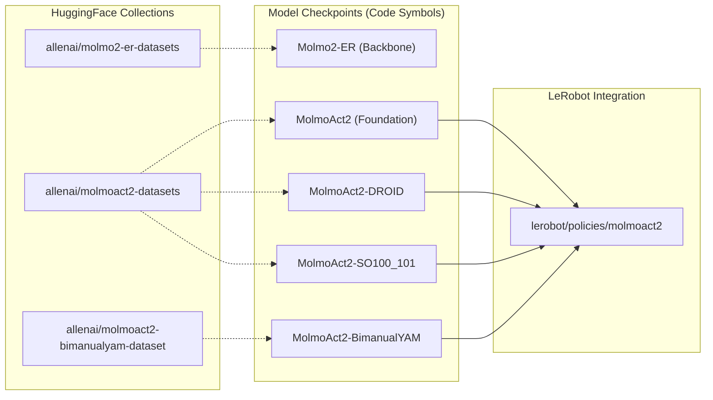

<!-- source: DeepWiki mcp.deepwiki.com · repo allenai/molmoact2 · page 4.1 Robotics Training Datasets · fetched 2026-10-26 -->

# Robotics Training Datasets

Relevant source files

The following files were used as context for generating this wiki page:

- [README.md](README.md)

This page provides a technical overview of the robotics datasets used to train and fine-tune the MolmoAct2 family of models. These datasets cover a diverse range of robotic embodiments, from single-arm manipulators like Franka and SO-100 to complex bimanual setups like the YAM platform. All robotics datasets used in the MolmoAct2 pipeline are standardized to the **LeRobot v3.0 format** and are often augmented with additional natural language annotations to facilitate vision-language-action (VLA) reasoning [README.md:77-77]().

## Dataset Ecosystem Overview

The MolmoAct2 training process utilizes three primary dataset collections hosted on HuggingFace. These collections provide the foundation for spatial reasoning, pre-training, and embodiment-specific fine-tuning.

| Collection Name | Purpose | HuggingFace Path |
| :--- | :--- | :--- |
| **MolmoAct2 Robotics Datasets** | Core robotics data for training and fine-tuning. Includes DROID, BC-Z, Bridge, RT-1, etc. | [allenai/molmoact2-datasets](https://huggingface.co/collections/allenai/molmoact2-datasets-69f81e316ec3daafe3f9555c) |
| **MolmoAct2-BimanualYAM** | Specialized collection for bimanual manipulation training and evaluation. | [allenai/molmoact2-bimanualyam-dataset](https://huggingface.co/collections/allenai/molmoact2-bimanualyam-dataset-69f81e17b140ec34f430a35e) |
| **Molmo2-ER Datasets** | Embodied reasoning data (spatial, 3D, visual reasoning) used for the VLM backbone. | [allenai/molmo2-er-datasets](https://huggingface.co/collections/allenai/molmo2-er-datasets-69f8d605d92d46a5fc24ced2) |

Sources: [README.md:24-32](), [README.md:71-75]()

---

## Data Format and Requirements

### LeRobot v3.0 Standardization
All robotics datasets used for MolmoAct2 pre-training and post-training are converted into the **LeRobot v3.0 format** [README.md:77-77](). This standardization ensures compatibility with the `lerobot` training and evaluation scripts integrated into the repository as a submodule [README.md:81-82]().

### Language Annotations
A key requirement for MolmoAct2 is the pairing of robot trajectories with extra language annotations [README.md:77-77](). These annotations allow the model to associate visual observations and proprioception with high-level textual instructions, enabling the "Observe → Instruct → Infer" loop.

### Action Convention
For the fine-tuned models (DROID, SO-100/101, Bimanual YAM), the datasets are prepared using an **absolute joint-pose action convention** [README.md:63-65](). This ensures consistent control signals across different physical embodiments.

---

## Key Robotics Dataset Collections

### 1. DROID (Franka)
The DROID dataset is a large-scale collection of Franka Emika Panda robot trajectories. For MolmoAct2, a filtered version of this mixture is used [README.md:63-63](). It serves as the primary data source for the `MolmoAct2-DROID` checkpoint.

### 2. Bimanual YAM
This is a specialized collection developed by Ai2 for the Bimanual YAM (Yet Another Manipulator) platform. It includes dual-arm trajectories and is essential for training models to coordinate complex bimanual tasks [README.md:73-73]().

### 3. SO-100 / SO-101
Datasets collected from low-cost SO-100 and SO-101 robot arms. These datasets are used to produce the `MolmoAct2-SO100_101` deployment checkpoint [README.md:65-65]().

### 4. General Robotics Mixture (BC-Z, Bridge, RT-1)
To improve the robustness and generalization of the base `MolmoAct2` model, several foundational robotics datasets are included in the mixture:
*   **BC-Z:** Diverse tasks from Google's robotics research.
*   **Bridge:** Data from the BridgeData project, focusing on kitchen tasks.
*   **RT-1:** Large-scale data from the Robotics Transformer project.
*   **MolmoAct Dataset:** Custom data collected specifically for the MolmoAct project.

Sources: [README.md:63-65](), [README.md:74-74]()

---

## Data Flow: From Dataset to Policy

The following diagram illustrates how the various dataset collections feed into the different stages of the MolmoAct2 training pipeline.

**MolmoAct2 Dataset Integration Flow**

Sources: [README.md:35-35](), [README.md:52-55](), [README.md:71-75](), [README.md:77-77]()

---

## Mapping Datasets to Model Entities

This diagram maps the dataset collections to the specific model checkpoints and policy implementations defined in the codebase.

**Dataset to Code Entity Mapping**

Sources: [README.md:50-67](), [README.md:71-75](), [README.md:81-82]()

---

## Dataset Usage Summary

| Dataset Collection | Primary Checkpoint | Control Type |
| :--- | :--- | :--- |
| **Filtered DROID Mixture** | `allenai/MolmoAct2-DROID` | Absolute Joint-Pose [README.md:63-63]() |
| **Bimanual YAM Mixture** | `allenai/MolmoAct2-BimanualYAM` | Absolute Joint-Pose [README.md:64-64]() |
| **SO-100/101 Datasets** | `allenai/MolmoAct2-SO100_101` | Absolute Joint-Pose [README.md:65-65]() |
| **LIBERO Training Mixture** | `allenai/MolmoAct2-LIBERO` | Task-specific [README.md:66-66]() |
| **ER Reasoning Data** | `allenai/Molmo2-ER` | N/A (Visual/Spatial) [README.md:55-55]() |

Sources: [README.md:50-67]()

---

