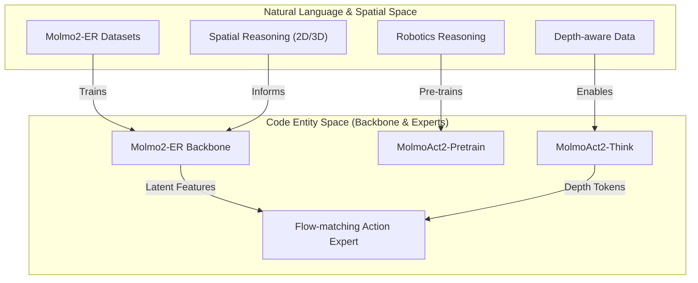
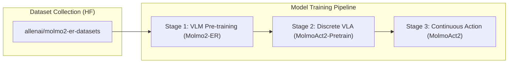

<!-- source: DeepWiki mcp.deepwiki.com · repo allenai/molmoact2 · page 4.2 Embodied Reasoning (ER) Datasets · fetched 2026-10-26 -->

# Embodied Reasoning (ER) Datasets

Relevant source files

The following files were used as context for generating this wiki page:

- [README.md](README.md)

The Molmo2-ER (Embodied Reasoning) dataset collection provides the foundational geometric, spatial, and visual reasoning data used to train the Molmo2-ER vision-language backbone. Unlike standard VLM datasets that focus on general image captioning or document understanding, the ER collection is specifically curated to build the scene-understanding capabilities required for robotic manipulation, such as 3D spatial awareness, object affordances, and physical reasoning [README.md:35-37]().

## Overview of the ER Collection

The Molmo2-ER backbone serves as the perception and language-understanding layer for the entire MolmoAct2 family [README.md:55-56](). The datasets in this collection are designed to bridge the gap between "internet-scale" visual knowledge and the "embodied" knowledge needed to map visual inputs to physical actions.

| Category | Description | Core Capabilities |
| :--- | :--- | :--- |
| **Spatial Reasoning** | 2D and 3D coordinate-based tasks. | Pointing, bounding box detection, and relative positioning. |
| **3D Understanding** | Depth-aware and multi-view datasets. | Depth estimation, surface normals, and 3D scene reconstruction. |
| **Robotics Reasoning** | Annotated robotics trajectories. | Understanding task intent and temporal state changes. |
| **Visual Reasoning** | Complex scene analysis. | Identifying object relationships and physical constraints. |

**Sources:** [README.md:35-37](), [README.md:75-76]()

## Data Flow and Backbone Pre-training

The Molmo2-ER datasets are consumed during the initial pre-training stage of the VLM. This stage establishes the latent representations that the downstream **Continuous Flow-Matching Action Expert** will eventually use to generate control signals [README.md:35-37]().

### From Reasoning to Action

The following diagram illustrates how the Embodied Reasoning datasets transition from high-level visual/spatial concepts into the code entities used by the MolmoAct2 architecture.

**ER Data to Model Architecture Mapping**

**Sources:** [README.md:50-56](), [README.md:75-76]()

## Key Dataset Components

The ER collection is hosted on HuggingFace and includes a mixture of open-source datasets and proprietary annotations [README.md:30-32]().

### 1. Spatial and 3D Reasoning
These datasets train the model to understand the geometry of the workspace. This is critical for the `MolmoAct2-Think` variant, which generates adaptive depth maps as an intermediate reasoning step before outputting actions [README.md:53-54]().
*   **Purpose:** To provide a mapping between RGB pixels and 3D coordinates.
*   **Impact:** Reduces "visual hallucinations" during manipulation by grounding the model in physical space.

### 2. Robotics Reasoning (Pre-training)
Before the model learns to predict continuous actions via flow-matching, it is trained on the `MolmoAct2-Pretrain` dataset. This stage uses discrete autoregressive modeling to predict high-level task components [README.md:54-55]().
*   **Format:** These datasets are typically processed into the **LeRobot v3.0 format** [README.md:77-78]().
*   **Annotations:** Trajectories are paired with extra language annotations to describe the "why" behind specific robot movements.

### 3. Visual Reasoning
General visual reasoning data ensures the model can follow complex instructions, such as "pick up the blue block that is behind the red one."

**ER Dataset Distribution and Integration**

**Sources:** [README.md:50-56](), [README.md:75-76]()

## Implementation and Format

All robotics-related datasets in the ER collection follow the **LeRobot v3.0 format** [README.md:77-78](). This standardization allows the datasets to be seamlessly integrated into the `lerobot/` submodule workflows [README.md:81-83]().

### Language Annotations
A distinguishing feature of the Molmo2-ER collection is the inclusion of "extra language annotations" [README.md:77-78](). While raw robotics data often contains only state-action pairs, the ER datasets include:
1.  **High-level goal descriptions:** "Open the microwave."
2.  **Sub-task descriptions:** "Reach for the handle," "Pull the door open."
3.  **Spatial descriptions:** "The handle is located at the center-right of the frame."

This rich annotation allows the backbone to develop a semantic understanding of the scene that directly supports the **closed-loop manipulation** performed by the action expert [README.md:35-37]().

**Sources:** [README.md:35-37](), [README.md:77-78](), [README.md:81-83]()

---

