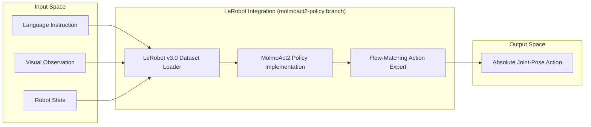

<!-- source: DeepWiki mcp.deepwiki.com · repo allenai/molmoact2 · page 5 LeRobot Integration · fetched 2026-10-26 -->

# LeRobot Integration

<details>
<summary>Relevant source files</summary>

The following files were used as context for generating this wiki page:

- [.gitmodules](.gitmodules)
- [README.md](README.md)

</details>


MolmoAct2 is integrated into the `allenai/lerobot` framework as a first-class policy implementation. This integration allows users to leverage the standard LeRobot ecosystem for training, evaluation, and deployment while utilizing the advanced Vision-Language-Action (VLA) capabilities of MolmoAct2. The repository includes the integration as a Git submodule, ensuring a consistent environment for robotics research and hardware deployment [README.md:79-82]().

## Submodule Architecture

The integration relies on a specific fork of the LeRobot repository maintained by Ai2. This fork contains the necessary policy definitions and configuration files to support the MolmoAct2 architecture, including its continuous flow-matching action expert [README.md:81-82]().

### Repository Relationship

The following diagram illustrates the relationship between the main `molmoact2` repository and the `lerobot` submodule.

**System Architecture: Repository Linkage**
```mermaid
graph TD
    subgraph "allenai/molmoact2 (Main Repo)"
        A[".gitmodules"]
        B["lerobot/ (Submodule Directory)"]
    end

    subgraph "allenai/lerobot (Fork)"
        C["molmoact2-policy (Branch)"]
        D["molmoact2-hf-inference (Branch)"]
    end

    A -->| "defines path/url" | B
    B -.->| "pins to" | C
    C -.->| "alternative for benchmarks" | D
```
Sources: [.gitmodules:1-5](), [README.md:79-82]()

## Integration Components

The integration is structured around three primary pillars:

| Component | Description |
| --- | --- |
| **Submodule Setup** | The `lerobot/` directory is pinned to the `molmoact2-policy` branch of `allenai/lerobot` [.gitmodules:1-5](). |
| **Policy Implementation** | MolmoAct2 is implemented as a standard `LeRobotPolicy`, allowing it to interface with LeRobot's data loaders and environment wrappers [README.md:79-81](). |
| **Data Compatibility** | All robotics datasets provided for MolmoAct2 are formatted in **LeRobot v3.0 format**, including extra language annotations required for the VLM backbone [README.md:77-78](). |

Sources: [README.md:77-82](), [.gitmodules:1-5]()

## Policy Flow and Code Mapping

The following diagram maps the conceptual "Natural Language to Action" flow to the specific entities within the LeRobot integration.

**Data Flow: Natural Language to Code Entities**

Sources: [README.md:35-37](), [README.md:77-82]()

## Child Pages

For detailed technical workflows and implementation specifics, refer to the following child pages:

### [Training and Evaluation Workflows](#5.1)
This page provides a step-by-step guide to initializing the submodule and running training scripts. It covers:
* Initializing the `lerobot` submodule and checking out the `molmoact2-policy` branch.
* Preparing datasets in the required LeRobot v3.0 format.
* Selecting appropriate starting checkpoints (e.g., `MolmoAct2` foundation vs. `MolmoAct2-DROID` fine-tuned) [README.md:46-68]().
* Executing standard LeRobot training and evaluation loops.

### [Inference and Benchmark Reproduction](#5.2)
This page covers the inference stack and the specific requirements for reproducing research benchmarks. It covers:
* Utilizing the `molmoact2-hf-inference` branch for exact LIBERO benchmark reproduction.
* Setting up the closed-loop inference loop (observe → instruct → infer → act).
* Validating model outputs before deploying to physical hardware.

Sources: [README.md:39-41](), [README.md:79-83]()

---

