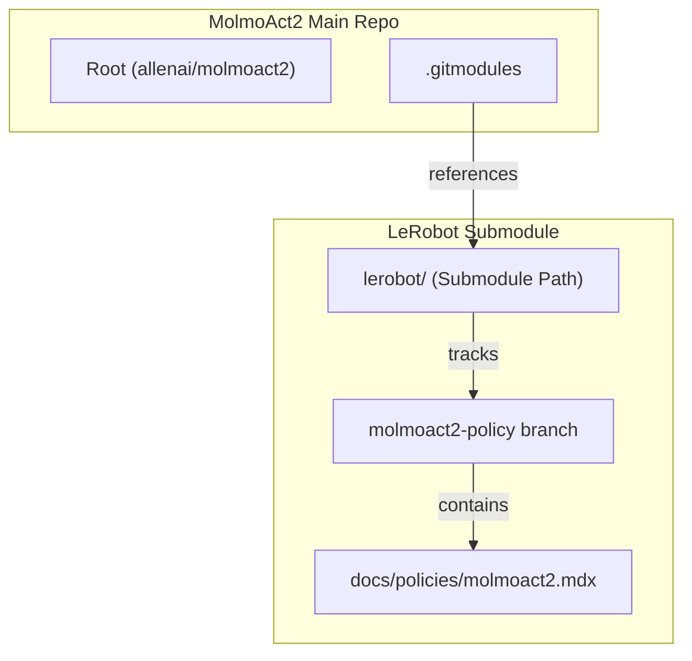
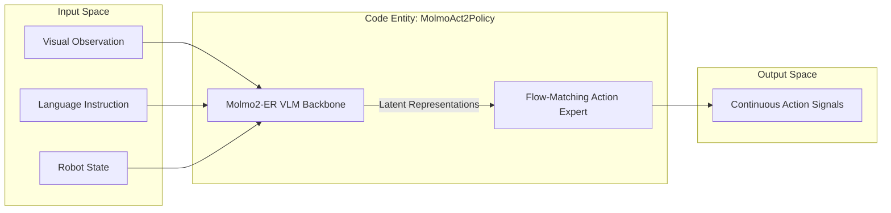

<!-- source: DeepWiki mcp.deepwiki.com · repo allenai/molmoact2 · page 5.1 Training and Evaluation Workflows · fetched 2026-10-26 -->

# Training and Evaluation Workflows

Relevant source files

The following files were used as context for generating this wiki page:

- [.gitmodules](.gitmodules)
- [README.md](README.md)

This page provides a technical guide for using the `lerobot` submodule within the MolmoAct2 repository to perform training and evaluation. MolmoAct2 is integrated as a policy implementation within a specific fork of the LeRobot framework, enabling standard workflows for robotics fine-tuning and benchmark reproduction.

## Submodule Initialization and Setup

MolmoAct2 utilizes a Git submodule to maintain its integration with the LeRobot ecosystem. The submodule is pinned to the `molmoact2-policy` branch of the `allenai/lerobot` repository [[.gitmodules:1-5]]().

To initialize the training environment:

1. **Clone with submodules**: Ensure the submodule is populated during or after cloning the main repository.
2. **Install Dependencies**: Follow the installation instructions within the `lerobot/` directory to set up the necessary environment for VLA (Vision-Language-Action) training.
3. **Reference Documentation**: Detailed technical documentation for the MolmoAct2 policy implementation, including specific configuration parameters and script arguments, is located at `lerobot/docs/policies/molmoact2.mdx` [[README.md:81-83]]().

### Repository Relationship

Sources: [[.gitmodules:1-5]](), [[README.md:79-83]]()

## Dataset Preparation

Training MolmoAct2 requires datasets formatted for the **LeRobot v3.0** specification [[README.md:77-77]](). 

### Data Format Requirements
*   **Format**: LeRobot v3.0.
*   **Annotations**: Datasets must include extra language annotations to support the VLM backbone's instruction-following capabilities [[README.md:77-77]]().
*   **Action Space**: While the model supports various configurations, standard fine-tuned checkpoints (DROID, SO-100, YAM) typically use **absolute joint-pose control** [[README.md:63-65]]().

### Available Dataset Collections
Ai2 provides several dataset collections on HuggingFace that are ready for use with these workflows:
*   **MolmoAct2 Robotics Datasets**: Includes SO-100/SO-101, DROID, MolmoAct Dataset, BC-Z, Bridge, and RT-1 [[README.md:74-74]]().
*   **MolmoAct2-BimanualYAM**: Specialized bimanual datasets with annotated instructions [[README.md:73-73]]().
*   **Molmo2-ER Datasets**: Embodied reasoning data used for backbone pre-training [[README.md:75-75]]().

Sources: [[README.md:71-78]]()

## Selecting a Starting Checkpoint

The workflow differs depending on whether you are performing general foundation training or adapting the model to a specific robot embodiment.

| Checkpoint Type | Recommended Starting Point | Use Case |
| :--- | :--- | :--- |
| **Foundation** | `allenai/MolmoAct2` | Default starting point for new embodiments or benchmarks [[README.md:52-52]](). |
| **Reasoning-Heavy** | `allenai/MolmoAct2-Think` | For tasks requiring intermediate depth-token predictions [[README.md:53-53]](). |
| **Embodiment-Specific** | `allenai/MolmoAct2-DROID`, `SO100_101`, or `BimanualYAM` | Recommended if your target hardware matches Franka, SO-100, or YAM platforms for better initialization [[README.md:83-85]](). |

Sources: [[README.md:50-67]](), [[README.md:83-85]]()

## Training Workflow

Training is executed using standard LeRobot training scripts located within the submodule. The integration connects the Molmo2-ER vision-language backbone to a **continuous flow-matching action expert** [[README.md:35-35]]().

### Data Flow: Observation to Action

### Execution Steps
1.  **Configure**: Define the training configuration (e.g., `hydra` configs in LeRobot) specifying the `molmoact2` policy.
2.  **Initialize**: Load the chosen checkpoint (e.g., `allenai/MolmoAct2`) via the `lerobot` training script.
3.  **Execute**: Run the training script, which handles the flow-matching objective for continuous control [[README.md:35-35]]().

Sources: [[README.md:35-35]](), [[README.md:52-52]](), [[README.md:79-83]]()

## Evaluation Workflow

Evaluation can be performed in simulation (e.g., LIBERO) or via real-world deployment.

### LIBERO Benchmark Reproduction
For exact reproduction of LIBERO results, a specific branch is used:
*   **Branch**: `molmoact2-hf-inference` (pinned for v0.5.1 evaluation stack).
*   **Checkpoints**: `MolmoAct2-LIBERO` or `MolmoAct2-Think-LIBERO` [[README.md:66-67]]().

### Evaluation Pipeline
The evaluation loop operates in a **closed-loop** fashion:
1.  **Observe**: Capture images and robot state.
2.  **Instruct**: Provide the task goal in natural language.
3.  **Infer**: The policy generates action signals using the flow-matching expert.
4.  **Act**: Execute the predicted actions on the robot or simulator [[README.md:35-35]]().

Sources: [[README.md:35-35]](), [[README.md:66-67]]()

---

