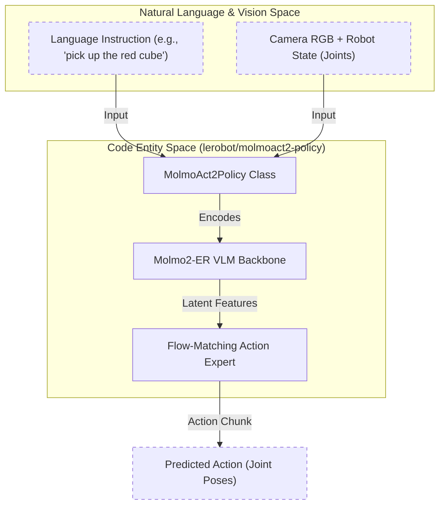
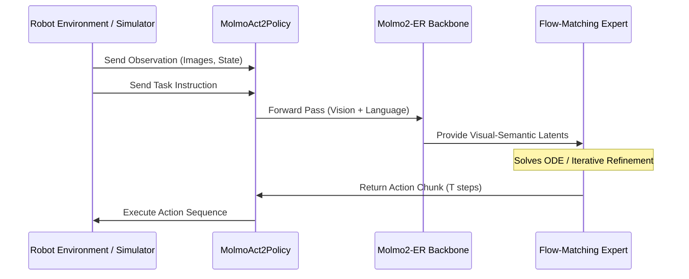

<!-- source: DeepWiki mcp.deepwiki.com · repo allenai/molmoact2 · page 5.2 Inference and Benchmark Reproduction · fetched 2026-10-26 -->

# Inference and Benchmark Reproduction

Relevant source files

The following files were used as context for generating this wiki page:

- [README.md](README.md)

This page details the process of running inference with MolmoAct2 policies using the `lerobot` framework. It covers the closed-loop inference cycle, the implementation of the flow-matching action expert, and the specific configurations required to reproduce benchmark results, particularly for the LIBERO suite.

## Overview of the Inference Stack

MolmoAct2 inference is integrated into the `lerobot` ecosystem, utilizing a specialized policy implementation that bridges the Molmo2-ER vision-language backbone with a continuous action head. For exact reproduction of research results, the repository utilizes a pinned submodule branch.

### Key Components
- **Policy Implementation**: Located in the `lerobot` submodule, specifically the `molmoact2-policy` branch [README.md:39-41]().
- **Action Expert**: A continuous flow-matching head that transforms VLM latent features into robot control signals [README.md:35-36]().
- **Benchmark Stack**: For LIBERO reproduction, a specific `molmoact2-hf-inference` branch is used to match the v0.5.1 evaluation environment.

## The Closed-Loop Inference Loop

The inference process follows an "Observe → Instruct → Infer → Act" cycle. MolmoAct2 models typically operate on absolute joint-pose action conventions [README.md:63-65]().

### Data Flow Diagram: Natural Language to Robot Action
This diagram maps the conceptual inference flow to the code entities within the MolmoAct2 and LeRobot integration.

**Sources:** [README.md:35-36](), [README.md:81-82]()

## Continuous Flow-Matching Inference

Unlike discrete VLA models that predict tokens autoregressively, MolmoAct2 uses a continuous flow-matching action expert [README.md:35-36](). This allows for smoother trajectories and higher precision in manipulation tasks.

### Inference Execution Flow
The following diagram illustrates how the model processes a single inference step to produce a sequence (chunk) of actions.

**Sources:** [README.md:35-36](), [README.md:52-54]()

## Benchmark Reproduction (LIBERO)

To reproduce the LIBERO benchmark results reported in the MolmoAct2 paper (arXiv:2605.02881), users must use specific checkpoints and evaluation environments.

### LIBERO Checkpoints
Two primary models are provided for LIBERO evaluation:
1. **MolmoAct2-LIBERO**: Fine-tuned on the full LIBERO training mixture (Spatial, Object, Goal, and Long suites) [README.md:66-66]().
2. **MolmoAct2-Think-LIBERO**: Includes adaptive depth reasoning for improved geometric understanding [README.md:67-67]().

### Reproduction Environment
Exact reproduction requires the `v0.5.1` evaluation stack. The repository handles this via the `lerobot` submodule pinned to the `molmoact2-policy` branch [README.md:81-82]().

| Benchmark Component | Specification |
| --- | --- |
| **Submodule Branch** | `molmoact2-policy` |
| **Evaluation Stack** | LeRobot v0.5.1 compatible |
| **Action Convention** | Absolute Joint-Pose |
| **Dataset Format** | LeRobot v3.0 [README.md:77-77]() |

## Validation Before Deployment

Before deploying a model to physical hardware (like SO-100 or Franka), it is critical to validate the inference outputs.

1. **Depth Reasoning Check**: For `MolmoAct2-Think` variants, users can visualize the intermediate depth-token predictions to ensure the model correctly perceives the scene geometry [README.md:53-53]().
2. **Action Chunk Inspection**: Since the model outputs a chunk of actions, verify that the predicted joint poses are within the robot's safe operating limits.
3. **Simulation Rollouts**: It is recommended to run the fine-tuned checkpoints in a simulated environment (like those provided in LeRobot) before hardware execution [README.md:81-82]().

**Sources:** [README.md:35-36](), [README.md:53-53](), [README.md:81-82]()

---

