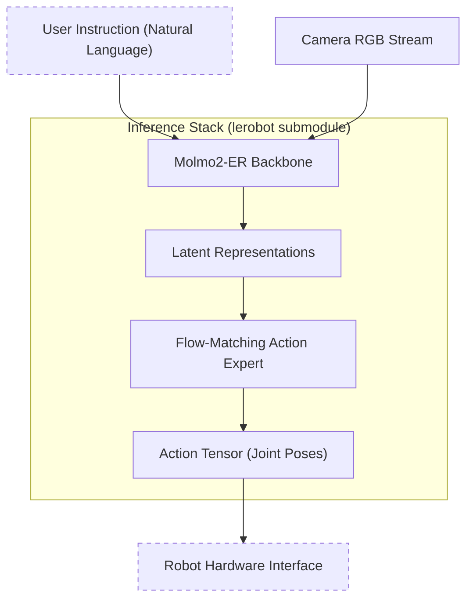
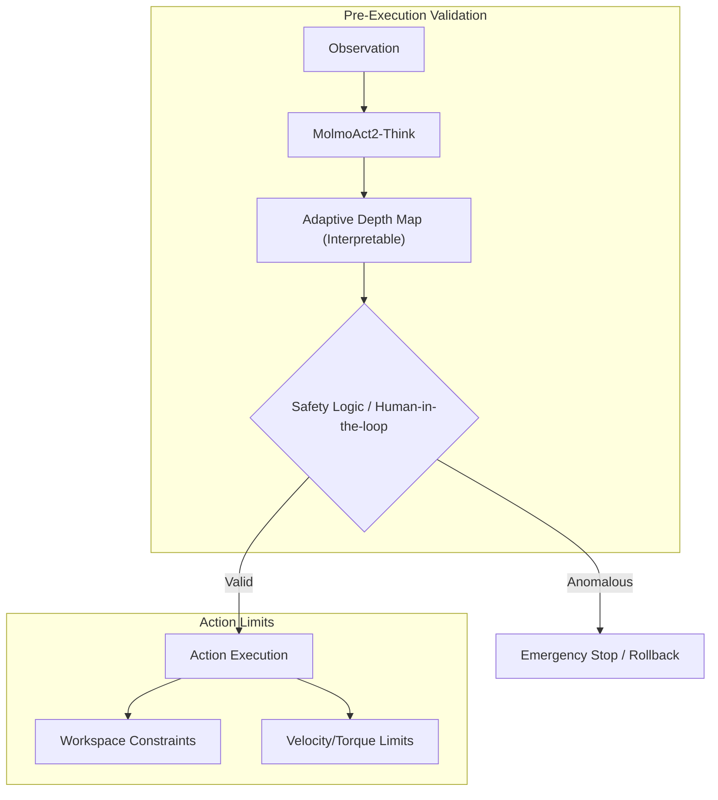

<!-- source: DeepWiki mcp.deepwiki.com · repo allenai/molmoact2 · page 6 Real-World Deployment · fetched 2026-10-26 -->

# Real-World Deployment

Relevant source files

The following files were used as context for generating this wiki page:

- [README.md](README.md)
- [assets/m.png](assets/m.png)

This page provides an overview of deploying **MolmoAct2** on physical robotic hardware. MolmoAct2 is designed for closed-loop manipulation, mapping visual observations and language instructions directly to robot actions [README.md:35-37](). 

Deployment is supported across three primary embodiments, each with dedicated fine-tuned checkpoints that utilize a continuous flow-matching action expert for precise control [README.md:52-53]().

### Supported Embodiments

MolmoAct2 provides specific configurations and models for the following hardware platforms:

| Embodiment | Checkpoint | Action Convention |
| :--- | :--- | :--- |
| **SO-100 / SO-101** | `MolmoAct2-SO100_101` | Absolute Joint-Pose |
| **Bimanual YAM** | `MolmoAct2-BimanualYAM` | Absolute Joint-Pose |
| **Franka (DROID)** | `MolmoAct2-DROID` | Absolute Joint-Pose |

Sources: [README.md:63-67]()

### System Architecture: From Language to Action

The deployment pipeline bridges natural language instructions and visual perception into a continuous control space. The following diagram illustrates the flow from high-level user intent to the low-level code entities responsible for execution.

**Language to Control Mapping**

Sources: [README.md:35-37](), [README.md:81-82]()

---

### 6.1 SO-100 / SO-101 Setup
The SO-100 and SO-101 are low-cost, accessible robot arms. Deployment on this platform requires a specific wrist configuration and third-person camera placement to match the training distribution of the `MolmoAct2-SO100_101` checkpoint.

For details on assembly, camera calibration, and running the policy, see **[SO-100 / SO-101 Setup](#6.1)**.

### 6.2 Bimanual YAM Setup
The Bimanual YAM (Yet Another Manipulator) is a dual-arm platform designed for complex coordinated tasks. This setup uses a custom implementation repository and requires specific annotated language instructions for bimanual coordination.

For parts lists, reference designs, and data collection workflows, see **[Bimanual YAM Setup](#6.2)**.

### 6.3 Franka DROID Setup
Deployment on Franka Emika Research 3 arms leverages the DROID dataset mixture. The `MolmoAct2-DROID` checkpoint is optimized for absolute joint-pose control within the DROID ecosystem.

For integration with the official DROID implementation and environment setup, see **[Franka DROID Setup](#6.3)**.

---

### 6.4 Safety Guidelines and Validation
Before physical deployment, it is critical to validate model outputs. MolmoAct2 provides interpretable intermediate outputs, such as adaptive depth maps in the `MolmoAct2-Think` variant, which can be used as a geometric "sanity check" [README.md:53]().

**Safety Validation Logic**

Sources: [README.md:53](), [README.md:67]()

For comprehensive details on setting action limits, emergency stop mechanisms, and adhering to Ai2's Responsible Use Guidelines, see **[Safety Guidelines and Validation](#6.4)**.

---

