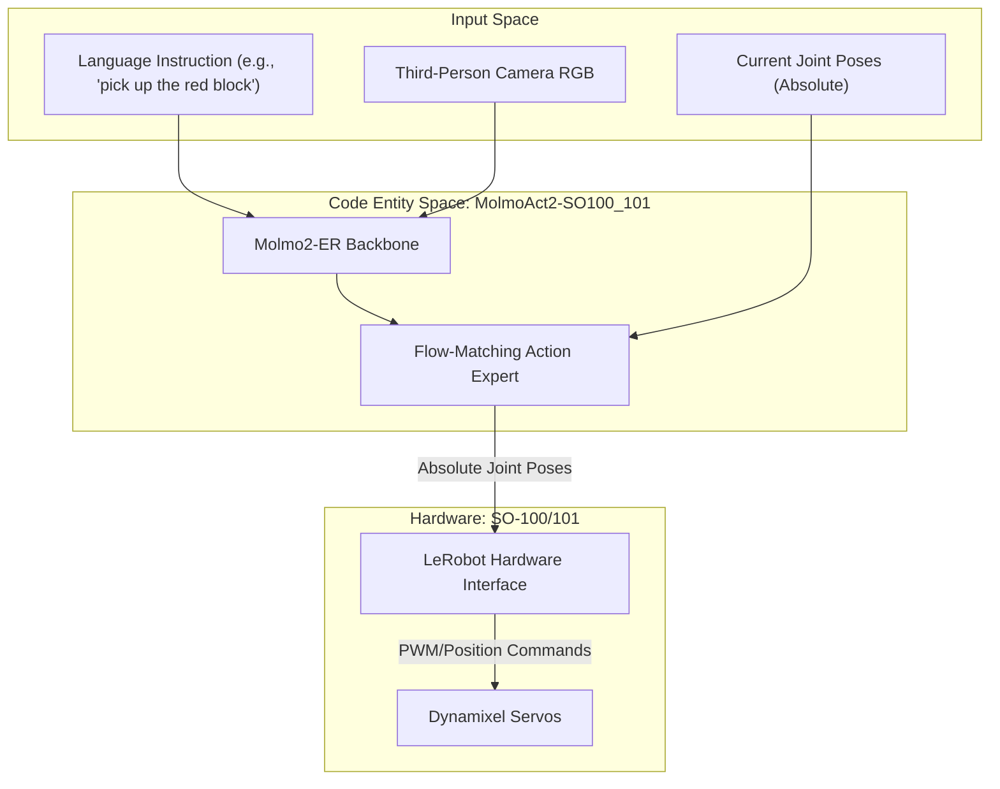
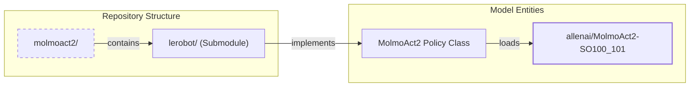

<!-- source: DeepWiki mcp.deepwiki.com · repo allenai/molmoact2 · page 6.1 SO-100 / SO-101 Setup · fetched 2026-10-26 -->

# SO-100 / SO-101 Setup

Relevant source files

The following files were used as context for generating this wiki page:

- [README.md](README.md)

This page provides the hardware and software configuration requirements for deploying MolmoAct2 on the SO-100 and SO-101 low-cost robot arms. It covers the physical setup, the `MolmoAct2-SO100_101` checkpoint, and the action conventions required for successful inference and fine-tuning.

## Hardware Configuration

The SO-100 and SO-101 are low-cost, open-source robot arms typically controlled via Dynamixel-compatible servos. For MolmoAct2 deployment, the system expects a specific physical arrangement to match the training distribution of the fine-tuned model [README.md:65-65]().

### Wrist Configuration
The models are trained with a specific orientation of the end-effector. Deviations from the reference wrist configuration can lead to poor spatial reasoning and grasp failures.
*   **SO-100**: Standard 6-DOF configuration.
*   **SO-101**: Updated version with improved joint stability.

### Camera Placement
MolmoAct2 utilizes a third-person (static) camera view for observation.
*   **Perspective**: The camera should be positioned to provide a clear view of the robot's workspace and the robot arm itself.
*   **Alignment**: The "third-person" view is the primary visual input used by the Molmo2-ER backbone to perceive the scene [README.md:35-35]().

## Software and Model Setup

Deployment on SO-100/101 relies on the `lerobot` integration provided in the repository submodule [README.md:81-81]().

### Model Checkpoint
The recommended starting point for these arms is the `MolmoAct2-SO100_101` checkpoint. This model has been fine-tuned on SO-100/101 datasets with annotated language instructions [README.md:65-65]().

| Feature | Specification |
| :--- | :--- |
| **Checkpoint Path** | `allenai/MolmoAct2-SO100_101` |
| **Backbone** | Molmo2-ER (Embodied Reasoning) |
| **Action Head** | Continuous Flow-Matching Action Expert |
| **Control Mode** | Closed-loop manipulation |

### Action Conventions
The model uses an **absolute joint-pose control** convention [README.md:65-65]().
1.  **Input**: The model receives the current robot state and a language instruction.
2.  **Output**: The flow-matching expert produces a sequence of absolute joint positions.
3.  **Execution**: These positions are sent directly to the servo controllers via the `lerobot` hardware interface.

### System Data Flow
The following diagram illustrates the flow from the high-level language instruction to the low-level servo commands for the SO-100/101 platform.

**SO-100/101 Inference Pipeline**

Sources: [README.md:35-35](), [README.md:65-65](), [README.md:81-81]()

## Deployment via LeRobot

To deploy on physical hardware, use the `allenai/lerobot` fork (branch `molmoact2-policy`) included as a submodule [README.md:39-39]().

1.  **Initialization**: Ensure the submodule is initialized to access the policy implementations [README.md:81-81]().
2.  **Dataset Format**: If collecting new data for fine-tuning on your specific SO-100 setup, data must be stored in **LeRobot v3.0 format** [README.md:77-77]().
3.  **Inference**: Run the inference script provided in the `lerobot` directory, pointing to the `allenai/MolmoAct2-SO100_101` HuggingFace path.

### Integration Mapping
This diagram maps the conceptual deployment steps to the specific code locations and model entities.

**LeRobot Integration Mapping**

Sources: [README.md:39-39](), [README.md:65-65](), [README.md:81-81]()

---

