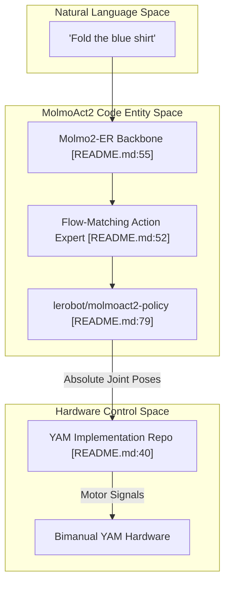
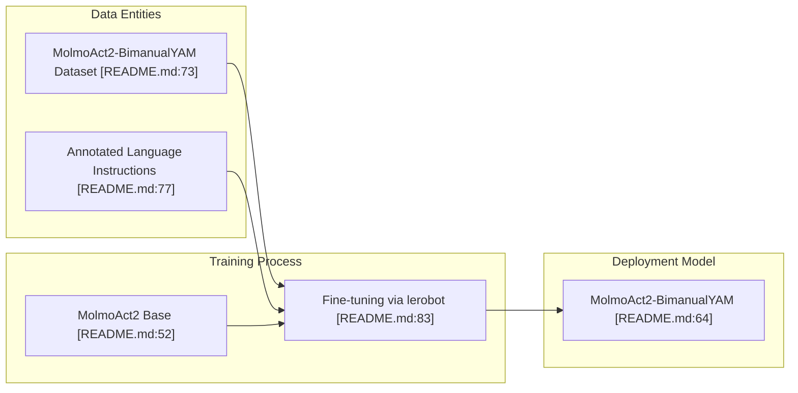

<!-- source: DeepWiki mcp.deepwiki.com · repo allenai/molmoact2 · page 6.2 Bimanual YAM Setup · fetched 2026-10-26 -->

# Bimanual YAM Setup

Relevant source files

The following files were used as context for generating this wiki page:

- [README.md](README.md)
- [assets/m.png](assets/m.png)

This page provides a technical guide for setting up and deploying MolmoAct2 on the **Bimanual YAM (Yet Another Manipulator)** platform. The Bimanual YAM is a dual-arm robot configuration designed for high-dexterity manipulation tasks, utilizing absolute joint-pose control and multi-modal sensory feedback.

### Overview and Purpose
The Bimanual YAM setup integrates the MolmoAct2-BimanualYAM checkpoint—a model fine-tuned on specialized dual-arm datasets—with a physical hardware reference design. This configuration supports complex coordinated tasks such as folding clothes, bimanual handovers, and tool use, driven by the `molmoact2-policy` implementation within the LeRobot framework [README.md:64-65](), [README.md:79-81]().

---

### Hardware Reference Design

The Bimanual YAM platform consists of two robotic manipulators (typically SO-100 or SO-101 units) mounted in a fixed relative transformation. The setup requires a synchronized control loop to manage the 12+ degrees of freedom (DoF) across both arms.

| Component | Specification | Role |
| :--- | :--- | :--- |
| **Manipulators** | 2x SO-100/101 Arms | Primary actuators for bimanual manipulation. |
| **Primary Camera** | Third-person RGB | Global scene context for the VLM backbone. |
| **Wrist Cameras** | 2x RGB (Optional) | Local visual feedback for precision grasping. |
| **Controller** | Linux Workstation | Runs the MolmoAct2 inference loop and hardware drivers. |

**Sources:** [README.md:40-41](), [README.md:64-65]()

---

### Software Implementation and Data Flow

The software stack bridges the high-level language instructions processed by the Molmo2-ER backbone with the low-level motor commands executed by the YAM hardware.

#### System Architecture Diagram
The following diagram illustrates the flow from natural language instructions to hardware execution, mapping system components to their respective roles in the codebase.

"Bimanual YAM Inference Pipeline"

**Sources:** [README.md:35-36](), [README.md:52-55](), [README.md:79-81]()

---

### Data Collection and Annotation

Training the Bimanual YAM model requires data in the **LeRobot v3.0 format** [README.md:77-78](). A critical requirement for this platform is the inclusion of **annotated language instructions** to guide the multi-stage manipulation tasks.

#### Dataset Requirements
1.  **Format:** Episodes must be stored using the LeRobot v3.0 schema.
2.  **Action Space:** 12-DoF absolute joint positions (6 per arm) plus gripper states.
3.  **Language:** Each episode must be paired with a `language_instruction` string describing the specific bimanual task [README.md:64-65]().

#### Data Flow to Checkpoint
The `MolmoAct2-BimanualYAM` checkpoint was produced by fine-tuning the base `MolmoAct2` model on the BimanualYAM dataset collection [README.md:73-74]().

"Dataset to Model Mapping"

**Sources:** [README.md:52-54](), [README.md:64-65](), [README.md:73-78]()

---

### Deployment and Inference

To deploy the model on a Bimanual YAM system, users must use the `allenai/lerobot` fork specifically on the `molmoact2-policy` branch [README.md:39-41](), [README.md:81-82]().

#### Configuration Steps
1.  **Initialize Submodule:** Ensure the `lerobot/` directory is correctly initialized to the `molmoact2-policy` branch [README.md:81-82]().
2.  **Load Checkpoint:** Use the HuggingFace path `allenai/MolmoAct2-BimanualYAM` [README.md:64]().
3.  **Action Convention:** The model outputs **absolute joint-pose control** signals. The hardware driver must be configured to interpret these as target positions for the servos [README.md:64-65]().

#### Key Checkpoints for YAM
| Checkpoint | Role | HF Path |
| :--- | :--- | :--- |
| **MolmoAct2-BimanualYAM** | Production inference on YAM hardware. | `allenai/MolmoAct2-BimanualYAM` |
| **MolmoAct2** | Foundation model for custom YAM fine-tuning. | `allenai/MolmoAct2` |

**Sources:** [README.md:52-54](), [README.md:64-65](), [README.md:79-83]()

---

