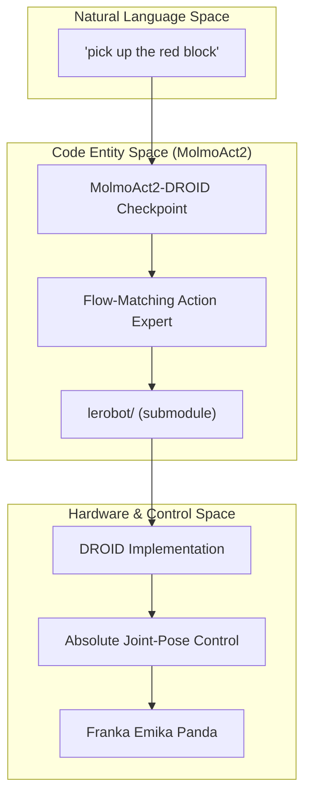
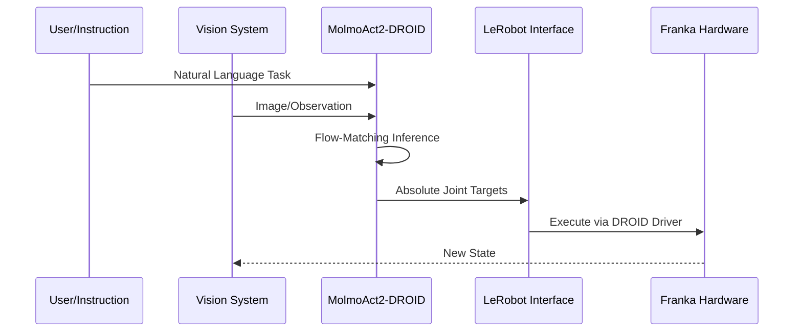

<!-- source: DeepWiki mcp.deepwiki.com · repo allenai/molmoact2 · page 6.3 Franka DROID Setup · fetched 2026-10-26 -->

# Franka DROID Setup

Relevant source files

The following files were used as context for generating this wiki page:

- [README.md](README.md)

This page provides the technical specifications and setup procedures for deploying MolmoAct2 on the Franka Emika Panda robot arm using the DROID (Distributed Robot Interaction Dataset) implementation. This setup utilizes the **MolmoAct2-DROID** checkpoint, which is optimized for absolute joint-pose control and high-precision manipulation tasks.

## 1. System Overview

The Franka DROID setup integrates the Molmo2-ER vision-language backbone with a continuous flow-matching action expert, specifically fine-tuned on a filtered mixture of the DROID dataset. The system operates in a closed-loop fashion: observing the scene via visual sensors, processing natural language instructions, and generating absolute joint-pose targets for the Franka controller.

### Data Flow and Entity Mapping
The following diagram illustrates the relationship between the physical hardware, the dataset conventions, and the code entities within the MolmoAct2 ecosystem.

**Franka DROID System Architecture**

Sources: [README.md:35-35](), [README.md:63-63](), [README.md:81-81]()

## 2. MolmoAct2-DROID Checkpoint

The `MolmoAct2-DROID` model is a specialized version of the MolmoAct2 foundation model. It is designed for direct inference or as a strong initialization for further fine-tuning on Franka-based platforms.

| Attribute | Specification |
| --- | --- |
| **Backbone** | Molmo2-ER (Embodied Reasoning) |
| **Action Head** | Continuous Flow-Matching |
| **Control Convention** | Absolute Joint-Pose |
| **Training Data** | Filtered DROID Franka Mixture |
| **HuggingFace Path** | `allenai/MolmoAct2-DROID` |

The model is trained to handle the specific kinematics and workspace constraints of the Franka arm as represented in the DROID dataset collection.

Sources: [README.md:52-52](), [README.md:63-63]()

## 3. Dataset and Training Mixture

The DROID dataset is a large-scale, diverse collection of Franka Emika Panda demonstrations. For MolmoAct2, this data is processed into the **LeRobot v3.0 format** to ensure compatibility with the training pipeline.

*   **Filtered Mixture:** The training uses a curated subset of DROID to ensure high-quality demonstrations and consistent camera perspectives.
*   **Language Annotations:** Each episode is paired with extra language annotations to bridge the gap between visual reasoning and physical execution.
*   **Action Space:** The actions are represented as absolute joint positions, which provides more stability in long-horizon tasks compared to relative end-effector displacement.

Sources: [README.md:63-63](), [README.md:74-74](), [README.md:77-77]()

## 4. Implementation Details

The implementation relies on the `lerobot` integration located in the repository submodule.

### Key Integration Points
1.  **Policy Class:** The model is wrapped as a LeRobot-compatible policy, allowing it to be used with standard `lerobot` scripts for evaluation and deployment.
2.  **Inference Loop:** The system executes a closed-loop `observe → instruct → infer → act` cycle.
3.  **DROID Implementation:** Users should refer to the official DROID implementation for low-level hardware drivers and robot-side communication.

**Policy Execution Flow**

Sources: [README.md:35-35](), [README.md:81-81]()

## 5. Setup and Deployment

### Software Requirements
*   **Submodule Initialization:** The `lerobot/` directory must be initialized and pinned to the `molmoact2-policy` branch.
*   **Checkpoint Download:** Pull the weights from `allenai/MolmoAct2-DROID`.
*   **Dataset Format:** Ensure any local Franka data is converted to LeRobot v3.0 format for fine-tuning.

### Hardware Configuration
*   **Robot:** Franka Emika Panda.
*   **Control Mode:** Ensure the robot controller is configured for absolute joint-pose commands.
*   **Cameras:** Deployment should mirror the camera placement used in the DROID dataset (typically a combination of wrist and overhead/side views) for optimal performance.

Sources: [README.md:39-40](), [README.md:63-63](), [README.md:81-81]()

---

