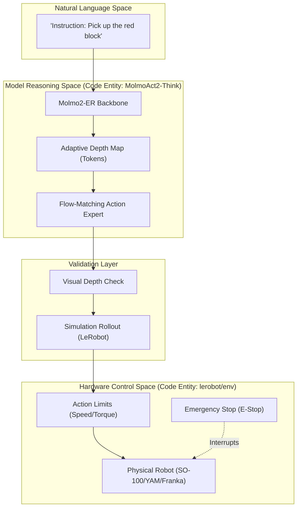

<!-- source: DeepWiki mcp.deepwiki.com · repo allenai/molmoact2 · page 6.4 Safety Guidelines and Validation · fetched 2026-10-26 -->

# Safety Guidelines and Validation

Relevant source files

The following files were used as context for generating this wiki page:

- [README.md](README.md)

MolmoAct2 is designed for real-world robot control, which necessitates rigorous safety practices across model inference and hardware execution. This page outlines the multi-layered safety approach used in MolmoAct2, ranging from interpretable model outputs like adaptive depth maps to low-level hardware constraints and emergency mechanisms.

## 1. Interpretable Safety: Depth-Token Reasoning

The `MolmoAct2-Think` variant provides an inherent safety layer through interpretability. Before generating action sequences, the model produces a set of intermediate "depth tokens" that represent an adaptive depth map of the scene [README.md:53-53]().

### Implementation Logic
By visualizing these depth tokens, operators can validate the model's geometric understanding of the environment. If the model's internal representation of the scene (e.g., the distance to an obstacle or the target object) is incorrect, the resulting actions are likely to be unsafe.

| Component | Role in Safety |
| :--- | :--- |
| **Adaptive Depth Map** | Provides a human-readable visualization of what the model "sees" geometrically. |
| **Geometric Reasoning** | Ensures the model accounts for 3D spatial relationships before planning movement [README.md:35-35](). |
| **Validation Step** | Operators can trigger a "stop" if the depth reasoning does not match the physical scene. |

**Sources:** [README.md:53-53](), [README.md:35-35]()

---

## 2. Validation via Simulation Rollouts

Before deploying checkpoints like `MolmoAct2-DROID` or `MolmoAct2-SO100_101` to physical hardware, they are validated in simulated environments using the LeRobot integration [README.md:81-81]().

### Simulation-to-Real Pipeline
1.  **Checkpoint Selection**: A base or fine-tuned model is loaded via the `molmoact2-policy` branch of the LeRobot submodule [README.md:81-81]().
2.  **Virtual Evaluation**: The model is run against benchmarks like LIBERO to check for erratic movements or collisions [README.md:66-67]().
3.  **Action Distribution Check**: Predicted actions are compared against the training dataset distribution (e.g., the DROID Franka mixture) to ensure the model isn't outputting out-of-distribution (OOD) joint poses [README.md:63-63]().

**Sources:** [README.md:81-81](), [README.md:66-67](), [README.md:63-63]()

---

## 3. Hardware Safety Constraints

MolmoAct2 policies utilize an **absolute joint-pose action convention** [README.md:63-65](). This convention allows for the implementation of hard-coded safety limits within the robot controller layer, independent of the VLA model.

### Action Limits and Guards
The following limits should be enforced in the hardware abstraction layer (e.g., the `lerobot` environment wrapper) when executing MolmoAct2 outputs:

*   **Speed Limits**: Maximum angular velocity for each joint to prevent high-momentum collisions.
*   **Workspace Bounds**: "Geofencing" the robot's end-effector to a safe 3D volume.
*   **Torque/Current Limits**: Monitoring motor effort to detect collisions and trigger an immediate halt.
*   **Contact Force**: Utilizing sensors (if available on platforms like Franka) to stop execution upon unexpected resistance.

### Emergency-Stop Mechanisms
Every deployment of MolmoAct2 (SO-100, Bimanual YAM, or Franka) must include a physical or software-based Emergency Stop (E-Stop).
*   **Physical E-Stop**: Cuts power to the actuators immediately.
*   **Software E-Stop**: A high-priority interrupt in the inference loop that sends a "zero-velocity" or "hold-position" command to the robot.

**Sources:** [README.md:63-65](), [README.md:40-40]()

---

## 4. Responsible Use and Deployment

Deployment of MolmoAct2 is governed by the **Ai2 Responsible Use Guidelines**. These guidelines emphasize that while MolmoAct2 is a powerful tool for research, it should be used with caution in unconstrained environments.

### System Safety Architecture
The following diagram illustrates the flow from the Natural Language Instruction to the physical hardware, highlighting the safety checkpoints.

**Safety Validation Data Flow**

### Key Safety Principles
1.  **Human-in-the-loop**: Initial deployments should always be supervised by an operator with an E-Stop.
2.  **Dataset Alignment**: Ensure the language instructions used during inference align with the `annotated language instructions` provided in the training datasets [README.md:64-65]().
3.  **Closed-Loop Monitoring**: Continuous observation of the `observe -> instruct -> infer -> act` loop to detect drift or model "hallucinations" in action space.

**Sources:** [README.md:35-35](), [README.md:64-65](), [README.md:53-53]()

---

