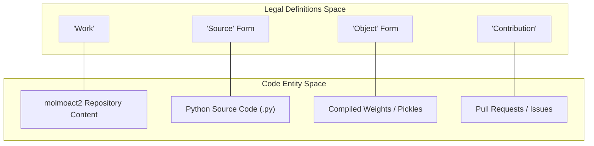
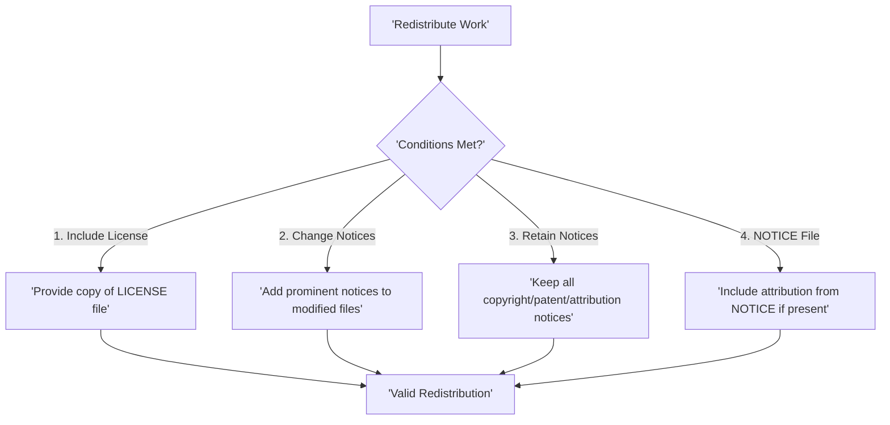

<!-- source: DeepWiki mcp.deepwiki.com · repo allenai/molmoact2 · page 7.1 Apache 2.0 License Terms · fetched 2026-10-26 -->

# Apache 2.0 License Terms

Relevant source files

The following files were used as context for generating this wiki page:

- [LICENSE](LICENSE)

This page provides a technical breakdown of the **Apache License, Version 2.0**, which governs the use, reproduction, and distribution of the MolmoAct2 codebase. The license is designed to facilitate open-source collaboration while providing clear grants of intellectual property rights and protecting contributors from liability.

## 1. Core Definitions and Scope

The license establishes a specific vocabulary to define the entities and artifacts involved in the software lifecycle.

| Term | Definition | Code Reference |
| :--- | :--- | :--- |
| **Work** | The original work of authorship (MolmoAct2) provided under the license. | [LICENSE:35-38]() |
| **Derivative Works** | Modifications or elaborations based on the Work that represent original authorship. | [LICENSE:40-46]() |
| **Contribution** | Any modification or addition to the Work intentionally submitted for inclusion. | [LICENSE:48-60]() |
| **Licensor** | The copyright owner or entity authorized to grant the license. | [LICENSE:12-13]() |
| **Legal Entity** | The union of the acting entity and all entities under common control (50%+ ownership). | [LICENSE:15-21]() |

### Natural Language to Code Entity Mapping: Definitions
The following diagram maps the legal definitions found in the `LICENSE` file to the conceptual entities within the MolmoAct2 repository.

**Conceptual Entity Mapping**

Sources: [LICENSE:7-64]()

---

## 2. Intellectual Property Grants

The Apache 2.0 license provides two primary grants to users: copyright and patents.

### 2.1 Grant of Copyright License
Contributors grant a perpetual, worldwide, non-exclusive, no-charge, royalty-free, and irrevocable license to:
* Reproduce the Work.
* Prepare Derivative Works.
* Publicly display and perform the Work.
* Sublicense and distribute the Work/Derivative Works in Source or Object form.

Sources: [LICENSE:66-71]()

### 2.2 Grant of Patent License
Each contributor grants a patent license to make, use, sell, or import the Work. This grant is specific to patent claims licensable by the contributor that are necessarily infringed by their Contribution(s) [LICENSE:73-81]().

**Defensive Termination Clause:** If a user institutes patent litigation against any entity alleging that the Work constitutes patent infringement, then any patent licenses granted to that user under this license terminate immediately [LICENSE:81-87]().

---

## 3. Redistribution Conditions

Users are permitted to redistribute the Work or Derivative Works, provided they satisfy four primary conditions.

### Redistribution Workflow

*   **Modified Files:** Any files changed by the user must carry prominent notices stating that the files were altered [LICENSE:97-98]().
*   **Notice File:** If the Work includes a `NOTICE` text file, Derivative Works must include a readable copy of the attribution notices contained within that file [LICENSE:106-114]().

Sources: [LICENSE:89-121]()

---

## 4. Submission of Contributions

By default, any Contribution submitted for inclusion in the Work is governed by the terms of the Apache 2.0 license.

*   **Automatic Terms:** Unless explicitly stated otherwise, submissions are under the same license terms [LICENSE:130-134]().
*   **Representations:** Contributors are expected to have the legal right to submit their contributions on behalf of the copyright owner.

Sources: [LICENSE:130-134]()

---

## 5. Warranty and Liability Disclaimers

As is standard for open-source software, the license shifts risk to the user.

### 5.1 Disclaimer of Warranty
Unless required by law or agreed to in writing, the Licensor provides the Work on an **"AS IS" BASIS**, without warranties or conditions of any kind, either express or implied. This includes, but is not limited to:
*   Title or Non-infringement.
*   Merchantability.
*   Fitness for a particular purpose.

Sources: [LICENSE:144-153]()

### 5.2 Limitation of Liability
Under no legal theory (tort, contract, etc.) shall any Contributor be liable for damages, including:
*   Direct, indirect, special, incidental, or consequential damages.
*   Loss of goodwill or work stoppage.
*   Computer failure or malfunction.

Sources: [LICENSE:155-165]()

---

## 6. Indemnification Module

While redistributing the Work, users may choose to offer and charge a fee for acceptance of support, warranty, indemnity, or other liability obligations. However, in doing so:
1.  The user acts only on their own behalf and sole responsibility.
2.  The user must indemnify and hold each Contributor harmless for any liability incurred by, or claims asserted against, such Contributor by reason of the user's warranty or additional liability [LICENSE:171-182]().

Sources: [LICENSE:167-182]()

---

