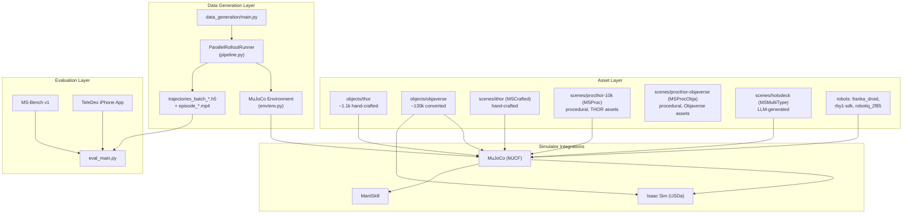
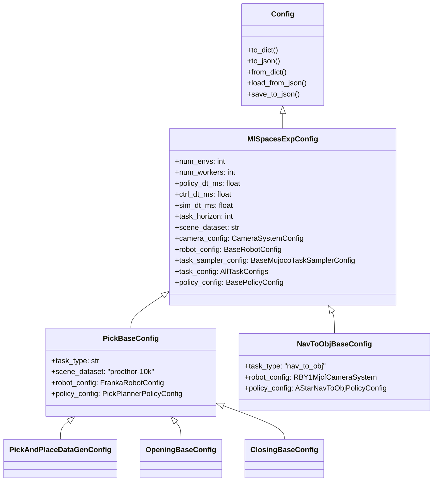
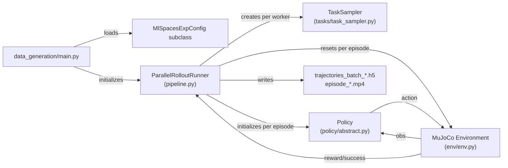

<!-- source: DeepWiki mcp.deepwiki.com · repo allenai/molmospaces · page 1 Overview · fetched 2026-10-26 -->

# Overview

<details>
<summary>Relevant source files</summary>

The following files were used as context for generating this wiki page:

- [LICENSE](LICENSE)
- [README.md](README.md)
- [docs/code_structure.md](docs/code_structure.md)
- [docs/images/MolmoSpacesLogo.png](docs/images/MolmoSpacesLogo.png)

</details>


This page introduces MolmoSpaces at a high level: what it is, who it targets, what problems it solves, and a tour of its major subsystems. For installation steps, see [Installation & Quick Start](#1.1). For directory layout and path conventions, see [Repository Layout](#1.2).

---

## What is MolmoSpaces?

MolmoSpaces (`allenai/molmospaces`) is a large-scale open ecosystem for robot manipulation and navigation research. It provides:

- **A multi-simulator asset library** — 3D objects, indoor scenes, and robot models usable in MuJoCo, Isaac Sim, and ManiSkill.
- **A data generation pipeline** — scripted planners and a parallel rollout runner that produce HDF5 trajectory datasets.
- **A benchmark suite** — MS-Bench v1, a set of atomic pick/open/close tasks for evaluating robot policies.
- **A teleoperation interface** — iPhone-based control via the TeleDex app, feeding into the same evaluation pipeline.

The codebase is licensed under [Apache 2.0](LICENSE). Dataset subsets carry separate licenses: Objaverse subsets use ODC-BY 1.0; all other data subsets use CC BY 4.0.

Sources: [README.md:1-30](), [LICENSE:1-13]()

---

## Major Subsystems

MolmoSpaces is organized into four main layers that interact in a linear flow from assets through data generation to evaluation.

**Ecosystem Topology**



Sources: [README.md:104-203](), [docs/code_structure.md:48-70]()

---

## Subsystem Summaries

### Asset System

MolmoSpaces manages assets (objects, scenes, robots) through a lazy-loading mechanism. Assets are downloaded on demand and versioned via `MLSPACES_ASSETS_DIR` and an optional pinned-assets file.

| Type | Code Name | Paper Name | Description |
|---|---|---|---|
| objects | `thor` | — | ~1.1k hand-crafted kitchen assets |
| objects | `objaverse` | — | ~130k converted Objaverse assets |
| scenes | `ithor` | MSCrafted | Hand-crafted with articulated assets |
| scenes | `procthor-10k` | MSProc | Procedurally generated with THOR assets |
| scenes | `procthor-objaverse` | MSProcObja | Procedurally generated with Objaverse assets |
| scenes | `holodeck` | MSMultiType | LLM-generated with Objaverse assets |
| benchmark | — | MS-Bench v1 | Base benchmark for atomic tasks |

Key API entry points: `get_scenes()` in `molmo_spaces_constants.py`, `install_uid()` and `install_scene_with_objects_and_grasps_from_path()` in `molmo_spaces/utils/lazy_loading_utils.py`.

For full details, see [Asset System](#2), [Objects & Scenes](#2.1), and [Robots & Coordinate Conventions](#2.2).

Sources: [README.md:104-120]()

---

### Simulator Integrations

Assets are cross-simulator compatible:

| Simulator | Format | Entry Point |
|---|---|---|
| MuJoCo | MJCF (`.xml`) | `python -m mujoco.viewer --mjcf <path>` |
| Isaac Sim | USDa | See `molmo_spaces_isaac/README.md` |
| ManiSkill | — | See `molmo_spaces_maniskill/README.md` |

For details, see [Simulator Integrations](#3).

Sources: [README.md:158-167]()

---

### Configuration System

All experiments are defined as Pydantic model subclasses. The hierarchy flows from a shared base down to task-specific configs that compose camera, robot, task-sampler, and policy sub-configs.

**Configuration Class Hierarchy**



For full details, see [Configuration System](#4) and [Base Configuration Classes](#4.1).

Sources: [docs/code_structure.md:73-82]()

---

### Data Generation Pipeline

The pipeline is invoked from `data_generation/main.py`, which loads a config class and runs `ParallelRolloutRunner` from `data_generation/pipeline.py`. Workers sample tasks, execute rollouts in a MuJoCo environment (`env/env.py`), and write output to `.h5` and `.mp4` files.

**Data Generation: Code Entity Flow**



Raw output is then processed by a three-stage postprocessing pipeline (`repair_video_paths.py` → `validate_trajectories.py` → `calculate_stats.py`) before consumption by training pipelines. For details, see [Data Generation](#5) and [Data Postprocessing](#5.4).

Sources: [docs/code_structure.md:48-70](), [README.md:30-38]()

---

### Evaluation & Benchmarking

MS-Bench v1 provides benchmark JSON files for atomic pick, open, and close tasks. The evaluation entry point is `eval_main.py`, which accepts a policy config class and a benchmark directory. Two policy modes are available out of the box:

- `PiPolicyEvalConfig` — runs a learned policy
- `TeleopPolicyEvalConfig` — runs interactive teleoperation via the TeleDex iPhone app

For details, see [Evaluation & Benchmarking](#6).

Sources: [README.md:183-228]()

---

## Supported Robots

| Robot Model | Code Name | Notes |
|---|---|---|
| Franka FR3 + Droid gripper | `franka_droid` | Primary arm; MJCF modified from mujoco_menagerie |
| Robotiq 2F-85 v4 | `robotiq_2f85_v4` | Parallel-jaw gripper |
| Rainbow Robotics RBY1 | `rby1-sdk` | Full-body robot; used for nav tasks |
| CAP Gripper | `cap_gripper` | From NYU GRAIL lab |

**Coordinate convention (all robots):** `+x = forward`, `+y = left`, `+z = up`. Parallel-jaw gripper: `+z = forward`, fingers open along `y`.

For details, see [Robots & Coordinate Conventions](#2.2).

Sources: [README.md:272-279]()

---

## Citing

```
@misc{molmospaces2026,
    title={MolmoSpaces: A Large-Scale Open Ecosystem for Robot Navigation and Manipulation},
    author={Yejin Kim and Wilbert Pumacay and Omar Rayyan and Max Argus and Winson Han and ...},
    year={2026},
}
```

Sources: [README.md:297-303]()

---

