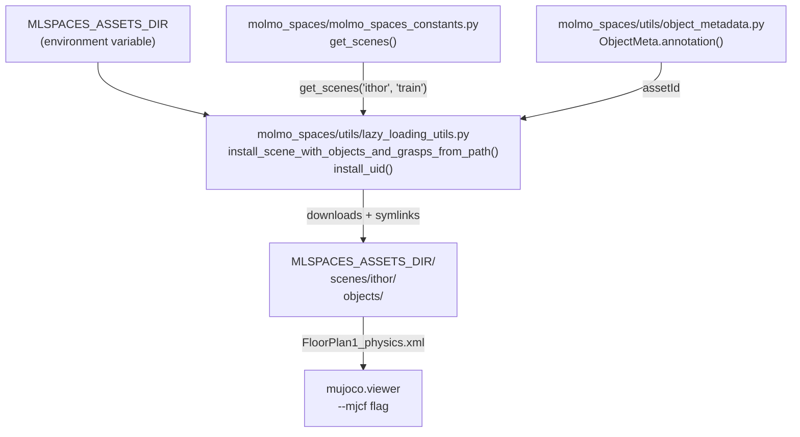
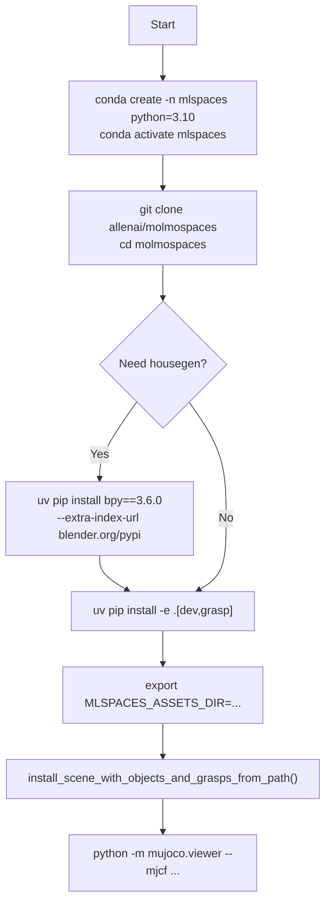

<!-- source: DeepWiki mcp.deepwiki.com · repo allenai/molmospaces · page 1.1 Installation & Quick Start · fetched 2026-10-26 -->

# Installation & Quick Start

<details>
<summary>Relevant source files</summary>

The following files were used as context for generating this wiki page:

- [README.md](README.md)
- [docs/development.md](docs/development.md)

</details>


This page covers the steps needed to install MolmoSpaces and run a first example: setting up the Python environment, configuring environment variables, downloading your first assets, and opening them in the MuJoCo viewer.

For background on what MolmoSpaces is and the subsystems involved, see the Overview (page [1](#1)). For details on how the asset system works after installation, see [Asset System](#2). For simulator-specific integration details beyond MuJoCo, see [Simulator Integrations](#3).

---

## Prerequisites

| Requirement | Version |
|---|---|
| Python | 3.10 |
| conda | Any recent version |
| uv (recommended) | Latest |
| Git | Any recent version |

---

## Environment Setup

### 1. Create a Conda Environment

```bash
conda create -n mlspaces python=3.10
conda activate mlspaces
```

### 2. Clone the Repository

```bash
git clone git@github.com:allenai/molmospaces.git
cd molmospaces
```

### 3. Install the Package

The recommended approach uses `uv`:

```bash
uv pip install -e .[dev,grasp]
```

Or with plain `pip` (if not using `uv`):

```bash
pip install -e .[dev,grasp]
```

#### Optional Dependency Groups

| Group | Purpose |
|---|---|
| `dev` | Code development tools (ruff, pre-commit, mypy) |
| `grasp` | Grasp generation pipeline |
| `housegen` | House generation from iTHOR, ProcTHOR, or Holodeck JSONs |

> **Note for `housegen`:** The `bpy` package required by house generation is not available on PyPI for Python 3.10. Install it separately before the main install:
>
> ```bash
> uv pip install bpy==3.6.0 --extra-index-url https://download.blender.org/pypi/
> ```

Sources: [README.md:40-90](), [docs/development.md:1-30]()

---

## Environment Variables

All environment variables use the `MLSPACES_` prefix. These are optional but configure critical runtime behavior such as where assets are stored.

| Variable | Effect | Default |
|---|---|---|
| `MLSPACES_ASSETS_DIR` | Directory for downloaded assets | `../assets` relative to the repo root |
| `MLSPACES_AUTO_INSTALL` | Update assets without interactive prompting | `True` |
| `MLSPACES_FORCE_INSTALL` | Override existing assets on re-download | `True` |
| `MLSPACES_PINNED_ASSETS_FILE` | Path to a `.json` file that overrides asset versions | *(unset)* |

Set `MLSPACES_ASSETS_DIR` to a persistent location before running any download or simulation:

```bash
export MLSPACES_ASSETS_DIR=/path/to/your/assets
```

#### Pinned Assets File Format

If you need reproducible asset versions, `MLSPACES_PINNED_ASSETS_FILE` should point to a JSON with the same structure as `DATA_TYPE_TO_SOURCE_TO_VERSION` in `molmo_spaces/molmo_spaces_constants.py`:

```json
{
    "robots": {
        "franka_droid": "20260127"
    },
    "scenes": {
        "ithor": "20251217"
    }
}
```

Sources: [README.md:92-103](), [README.md:170-181]()

---

## MuJoCo Quick Start

The following diagrams show how the key installation-time entry points relate to one another.

**Diagram: MuJoCo Quick Start — Code Entity Flow**



Sources: [README.md:122-156]()

### Downloading and Viewing a Scene

Use `get_scenes` from `molmo_spaces.molmo_spaces_constants` to look up a scene path, then pass it to `install_scene_with_objects_and_grasps_from_path` from `molmo_spaces.utils.lazy_loading_utils`:

```python
from molmo_spaces.utils.lazy_loading_utils import install_scene_with_objects_and_grasps_from_path
from molmo_spaces.molmo_spaces_constants import get_scenes

install_scene_with_objects_and_grasps_from_path(get_scenes("ithor", "train")["train"][1])
```

After the download completes, open the scene in the MuJoCo viewer:

```bash
python -m mujoco.viewer --mjcf $MLSPACES_ASSETS_DIR/scenes/ithor/FloorPlan1_physics.xml
```

### Downloading an Object by Category

`thor` objects are installed automatically when the resource manager is initialized. For `objaverse` objects, use `install_uid` from `molmo_spaces.utils.lazy_loading_utils` with an asset ID retrieved from `ObjectMeta.annotation()`:

```python
import random
from pprint import pprint

from molmo_spaces.utils.object_metadata import ObjectMeta
from molmo_spaces.utils.lazy_loading_utils import install_uid

annotation = ObjectMeta.annotation()

apple_annotations = [
    anno for anno in annotation.values()
    if "apple" in anno["category"].lower() and anno["isObjaverse"]
]
random_apple = random.choice(apple_annotations)

pprint(random_apple)

apple_model_path = install_uid(random_apple["assetId"])
print(f"Object downloaded and symlinked to {apple_model_path}")
```

Sources: [README.md:122-156]()

---

## MuJoCo Viewer Tips

| Tip | Details |
|---|---|
| Red boxes on objects | Toggle `Group Enable > Site groups > Site 0` in the left panel |
| Interact with objects | Double-click an object, then Ctrl + right mouse drag (active viewers only) |
| Keyboard shortcuts | See MuJoCo viewer docs: `mujoco.readthedocs.io` |

Sources: [README.md:265-269]()

---

## Other Simulators

For Isaac Sim and ManiSkill, separate setup instructions are maintained in their respective READMEs:

| Simulator | Instructions |
|---|---|
| Isaac Sim | `molmo_spaces_isaac/README.md` |
| ManiSkill | `molmo_spaces_maniskill/README.md` |

For a conceptual overview of how assets map to each simulator format, see [Simulator Integrations](#3).

Sources: [README.md:159-167]()

---

## Benchmark Quick Start

Installing and running the benchmark is currently supported in MuJoCo only.

**Install benchmark assets:**

```bash
export MLSPACES_ASSETS_DIR=/path/to/symlink/resources
python -m molmo_spaces.molmo_spaces_constants
```

**Run the benchmark:**

```bash
python molmo_spaces/evaluation/eval_main.py \
    molmo_spaces.evaluation.configs.evaluation_configs:PiPolicyEvalConfig \
    --benchmark_dir assets/benchmarks/path-to-benchmark/ \
    --task_horizon_steps 500
```

For full benchmark documentation, including teleoperation mode and benchmark asset structure, see [Evaluation & Benchmarking](#6).

Sources: [README.md:183-203]()

---

## Installation Summary

**Diagram: Installation Decision Flow**



Sources: [README.md:40-90](), [docs/development.md:1-50]()

---

