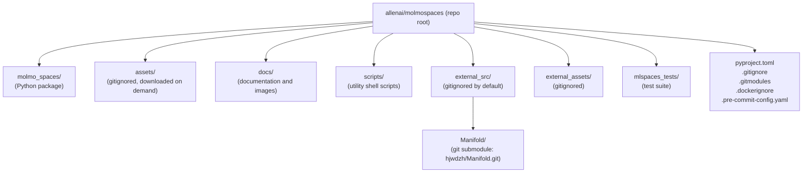
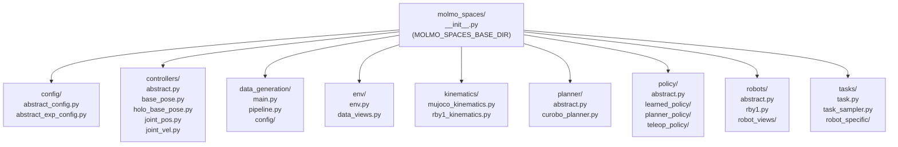
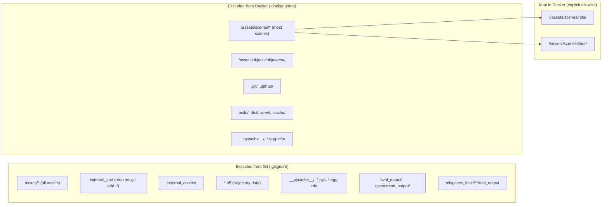

<!-- source: DeepWiki mcp.deepwiki.com · repo allenai/molmospaces · page 1.2 Repository Layout · fetched 2026-10-26 -->

# Repository Layout

<details>
<summary>Relevant source files</summary>

The following files were used as context for generating this wiki page:

- [.dockerignore](.dockerignore)
- [.gitignore](.gitignore)
- [.gitmodules](.gitmodules)
- [docs/code_structure.md](docs/code_structure.md)
- [molmo_spaces/__init__.py](molmo_spaces/__init__.py)

</details>


This page describes the physical organization of the `allenai/molmospaces` repository: what lives in each top-level directory, which paths are version-controlled, and how the package locates itself at runtime. It does not cover the *content* of individual subsystems in depth — for that, see the Asset System ([2](#2)), Configuration System ([4](#4)), Data Generation ([5](#5)), or Evaluation ([6](#6)) pages.

---

## Top-Level Directory Structure

**Top-Level Repository Tree**



Sources: [.gitignore:1-56](), [.gitmodules:1-4](), [.dockerignore:1-50](), [docs/code_structure.md:1-104]()

---

## Directory Descriptions

| Directory | Tracked in Git | Purpose |
|---|---|---|
| `molmo_spaces/` | ✅ Yes | Main Python package; all importable source code |
| `assets/` | ❌ No (`assets/*`) | Downloaded object meshes, scenes, grasps, robot models |
| `docs/` | ✅ Yes (images via `!docs/**/*.png`) | Documentation markdown files and reference images |
| `scripts/` | ✅ Yes | Shell scripts (e.g., `process_data.sh` for postprocessing) |
| `external_src/` | ❌ No (requires `git add -f`) | External source trees; contains the `Manifold` submodule |
| `external_assets/` | ❌ No | External asset files not part of the main asset pipeline |
| `mlspaces_tests/` | ✅ Yes (test output excluded) | Pytest test suite; test artifacts written to `test_output/` subdirs |

Sources: [.gitignore:1-56](), [.gitmodules:1-4]()

---

## The `molmo_spaces/` Package

The package root is defined by a single path anchor in [molmo_spaces/__init__.py:1-3]():

```python
MOLMO_SPACES_BASE_DIR = Path(__file__).parent
```

`MOLMO_SPACES_BASE_DIR` is a `pathlib.Path` pointing to the `molmo_spaces/` directory. Internal modules use it to resolve asset paths, config files, and other runtime resources relative to the package installation location rather than the working directory.

**`molmo_spaces/` Internal Package Structure**



Sources: [docs/code_structure.md:7-44](), [molmo_spaces/__init__.py:1-3]()

| Subpackage | Key Files / Classes | Role |
|---|---|---|
| `config/` | `abstract_config.py`, `abstract_exp_config.py` | Base `Config` and `MlSpacesExpConfig` classes |
| `controllers/` | `joint_pos.py`, `joint_vel.py`, `base_pose.py` | Low-level robot joint and pose control |
| `data_generation/` | `main.py`, `pipeline.py`, `config/` | Entry point and `ParallelRolloutRunner` |
| `env/` | `env.py`, `data_views.py` | MuJoCo environment wrapper and observation types |
| `kinematics/` | `mujoco_kinematics.py`, `rby1_kinematics.py` | Forward/inverse kinematics solvers |
| `planner/` | `abstract.py`, `curobo_planner.py` | Motion planning interface and CuRobo backend |
| `policy/` | `abstract.py`, `planner_policy/`, `teleop_policy/`, `learned_policy/` | Policy implementations |
| `robots/` | `abstract.py`, `rby1.py`, `robot_views/` | Robot model interfaces |
| `tasks/` | `task.py`, `task_sampler.py`, `robot_specific/` | Task definitions and sampling |

Sources: [docs/code_structure.md:7-44]()

---

## The `assets/` Directory

The `assets/` directory is **gitignored in its entirety** ([.gitignore:8]()) and populated at runtime via the asset download system (see [2](#2)). Its expected on-disk layout is:

```
assets/
├── objects/
│   ├── thor/          # ~1,100 hand-crafted MJCF objects
│   └── objaverse/     # ~130,000 converted Objaverse objects
└── scenes/
    ├── refs/          # Scene reference metadata (kept in Docker)
    ├── ithor/         # MSCrafted hand-crafted scenes (kept in Docker)
    ├── procthor-10k/  # MSProc procedural scenes (THOR assets)
    ├── procthor-objaverse/  # MSProcObja procedural scenes (Objaverse assets)
    └── holodeck/      # MSMultiType LLM-generated scenes
```

The environment variable `MLSPACES_ASSETS_DIR` overrides the default asset location. See the Asset System page ([2](#2)) for details on asset versioning and download APIs.

Sources: [.gitignore:8](), [.dockerignore:31-34]()

---

## The `external_src/` Directory and the Manifold Submodule

`external_src/` is gitignored by default. Any file added under it requires an explicit `git add -f`. It currently contains one registered Git submodule:

| Submodule path | Upstream URL |
|---|---|
| `external_src/Manifold` | `https://github.com/hjwdzh/Manifold.git` |

To initialize it after cloning:

```bash
git submodule update --init --recursive
```

Sources: [.gitmodules:1-4](), [.gitignore:13-14]()

---

## Version Control Exclusion Policies

**Git vs. Docker Exclusion Map**



The Docker allowlist preserves `assets/scenes/refs/` (scene reference metadata) and `assets/scenes/ithor/` (hand-crafted scenes) while excluding procedural and Objaverse scenes that are too large to ship in an image.

Sources: [.gitignore:1-56](), [.dockerignore:1-50]()

---

## Runtime Path Resolution

The constant `MOLMO_SPACES_BASE_DIR` in [molmo_spaces/__init__.py:3]() is the single anchor for all in-package path resolution:

```
MOLMO_SPACES_BASE_DIR = Path(__file__).parent
  → resolves to: <install_root>/molmo_spaces/
```

This means that whether the package is installed in editable mode (`pip install -e .`) or as a regular wheel, paths derived from `MOLMO_SPACES_BASE_DIR` always point to the correct location of packaged assets and bundled configs. External assets stored under `assets/` are resolved using the `MLSPACES_ASSETS_DIR` environment variable instead, which decouples large binary data from the package install path.

Sources: [molmo_spaces/__init__.py:1-3]()

---

