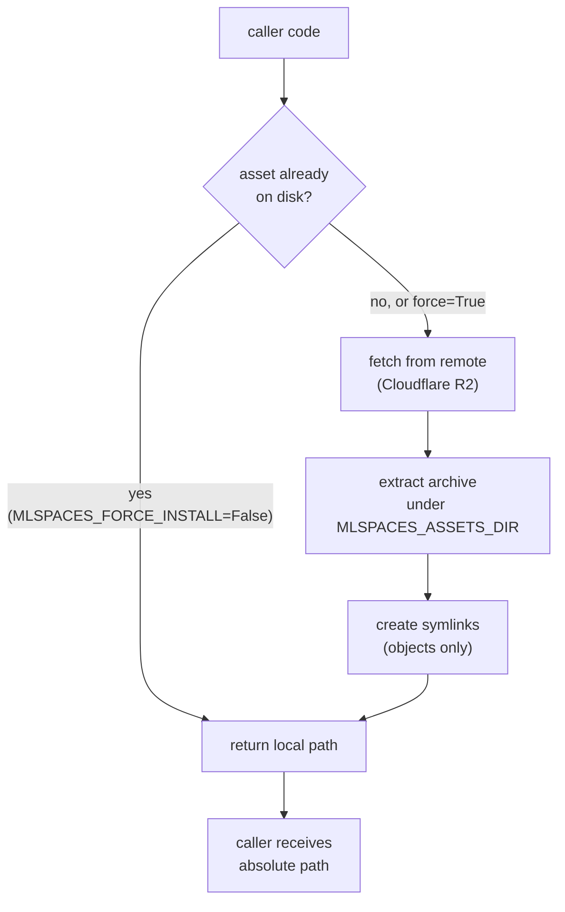
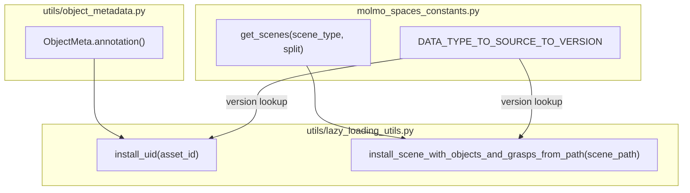
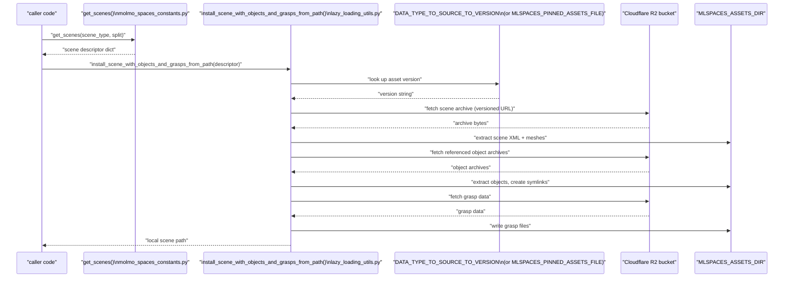

<!-- source: DeepWiki mcp.deepwiki.com · repo allenai/molmospaces · page 2 Asset System · fetched 2026-10-26 -->

# Asset System

<details>
<summary>Relevant source files</summary>

The following files were used as context for generating this wiki page:

- [.dockerignore](.dockerignore)
- [README.md](README.md)

</details>


This page explains the MolmoSpaces asset model: what constitutes an asset, how assets are versioned, how they are fetched on demand, and how they are organized on disk. For details on specific asset collections (object sets, scene types), see [Objects & Scenes](#2.1). For robot model details and coordinate conventions, see [Robots & Coordinate Conventions](#2.2).

---

## What Is an Asset?

An **asset** is any file or file bundle that MolmoSpaces loads at runtime but does not store in the repository itself. Assets are fetched from a remote data store and cached locally under `MLSPACES_ASSETS_DIR`. There are four top-level asset categories:

| Category | Examples | Fetched as |
|---|---|---|
| `objects` | `thor`, `objaverse` | Archive → extracted + symlinked |
| `scenes` | `ithor`, `procthor-10k`, `procthor-objaverse`, `holodeck` | Archive → extracted |
| `robots` | `franka_droid`, `rby1-sdk`, `robotiq_2f85_v4` | Archive → extracted |
| `benchmarks` | MS-Bench v1 | Archive → extracted |

Each category maps to a subdirectory under `MLSPACES_ASSETS_DIR` (e.g., `assets/scenes/ithor/`, `assets/objects/thor/`, `assets/robots/franka_droid/`).

Sources: [README.md:104-118]()

---

## Environment Variables

The asset system is configured entirely through environment variables. These must be set before importing any asset-aware module.

| Variable | Default | Effect |
|---|---|---|
| `MLSPACES_ASSETS_DIR` | `../assets` relative to the repo root | Root directory for all downloaded assets |
| `MLSPACES_AUTO_INSTALL` | `True` | Download/update assets without interactive prompts |
| `MLSPACES_FORCE_INSTALL` | `True` | Overwrite existing assets even if already present |
| `MLSPACES_PINNED_ASSETS_FILE` | _(unset)_ | Path to a JSON file that overrides per-asset versions |

Sources: [README.md:92-103]()

---

## Asset Versioning

Each asset has a version string (typically a date stamp such as `"20260127"`). The canonical version table is `DATA_TYPE_TO_SOURCE_TO_VERSION` in `molmo_spaces/molmo_spaces_constants.py`. Its structure is:

```
{
  "<category>": {
    "<source_name>": "<version_string>",
    ...
  },
  ...
}
```

The `MLSPACES_PINNED_ASSETS_FILE` variable accepts a JSON file with the same nested structure. Any key present in that file overrides the version defined in `molmo_spaces_constants.py`, allowing a project or experiment to pin specific asset versions without modifying source code.

**Example pinned assets file:**

```json
{
    "robots": {
         "franka_droid": "20260127"
    },
    "scenes": {
        "ithor": "20251217"
    }
}
```

Sources: [README.md:170-181]()

---

## Lazy-Loading API

Assets are not downloaded at import time. Instead, two primary functions in `molmo_spaces/utils/lazy_loading_utils.py` trigger downloads on demand:

**Asset Lifecycle Diagram**



Sources: [README.md:120-156]()

### `install_uid`

Located in `molmo_spaces/utils/lazy_loading_utils.py`. Downloads and symlinks a single object asset identified by its `assetId` string (a UID). Returns the local path to the installed model.

Usage pattern from the README:

```python
from molmo_spaces.utils.lazy_loading_utils import install_uid
apple_model_path = install_uid(random_apple["assetId"])
```

Sources: [README.md:137-155]()

### `install_scene_with_objects_and_grasps_from_path`

Located in `molmo_spaces/utils/lazy_loading_utils.py`. Accepts a scene path descriptor (as returned by `get_scenes()`), then downloads the scene archive, any referenced object assets, and associated grasp data. This is the standard entry point for preparing a scene for simulation.

Usage pattern:

```python
from molmo_spaces.utils.lazy_loading_utils import install_scene_with_objects_and_grasps_from_path
from molmo_spaces.molmo_spaces_constants import get_scenes

install_scene_with_objects_and_grasps_from_path(get_scenes("ithor", "train")["train"][1])
```

Sources: [README.md:123-131]()

### `get_scenes`

Located in `molmo_spaces/molmo_spaces_constants.py`. Returns a dictionary of scene path descriptors for a given scene type (e.g., `"ithor"`, `"procthor-10k"`) and split (e.g., `"train"`, `"test"`). The return value is keyed by split name, with each value being a list of scene descriptor objects.

```python
get_scenes("ithor", "train")["train"][1]
# returns the descriptor for the second ithor training scene
```

Sources: [README.md:128-130]()

### `ObjectMeta.annotation`

Located in `molmo_spaces/utils/object_metadata.py`. Class method on `ObjectMeta` that returns a dictionary keyed by `assetId`, where each value is an annotation dict containing fields such as `"category"`, `"isObjaverse"`, and `"assetId"`. Used to query object metadata before downloading.

Sources: [README.md:145-155]()

---

## Code Entity Map

The following diagram maps the public API surface to the files that implement it.



Sources: [README.md:104-156](), [README.md:170-181]()

---

## On-Disk Directory Layout

After assets are downloaded, the directory tree under `MLSPACES_ASSETS_DIR` follows this structure:

```
MLSPACES_ASSETS_DIR/
├── objects/
│   ├── thor/              # ~1.1k hand-crafted kitchen objects
│   │   └── <uid>/
│   └── objaverse/         # ~130k Objaverse-derived objects
│       └── <uid>/         # (symlinks from per-uid archives)
├── scenes/
│   ├── refs/              # reference files (always present)
│   ├── ithor/             # MSCrafted scenes (always present in Docker)
│   ├── procthor-10k/      # MSProc scenes
│   ├── procthor-objaverse/# MSProcObja scenes
│   └── holodeck/          # MSMultiType scenes
├── robots/
│   ├── franka_droid/
│   ├── robotiq_2f85_v4/
│   └── rby1-sdk/
└── benchmarks/
    └── <benchmark_name>/
```

> **Note:** In Docker builds, `assets/objects/objaverse/` and most `assets/scenes/` subdirectories are excluded from the image to reduce size. Only `assets/scenes/refs/` and `assets/scenes/ithor/` are kept. See [Docker & Containerization](#7.3) for details.

Sources: [.dockerignore:31-35](), [README.md:104-118]()

---

## Asset Download Flow (End-to-End)

**Sequence: Scene Download**



Sources: [README.md:120-131](), [README.md:170-181]()

---

## Bootstrapping All Assets

Running `molmo_spaces_constants.py` as a script installs all assets registered in `DATA_TYPE_TO_SOURCE_TO_VERSION`. This is the recommended first step before running the benchmark or data generation pipeline:

```bash
export MLSPACES_ASSETS_DIR=/path/to/assets
python -m molmo_spaces.molmo_spaces_constants
```

Sources: [README.md:188-192]()

---

