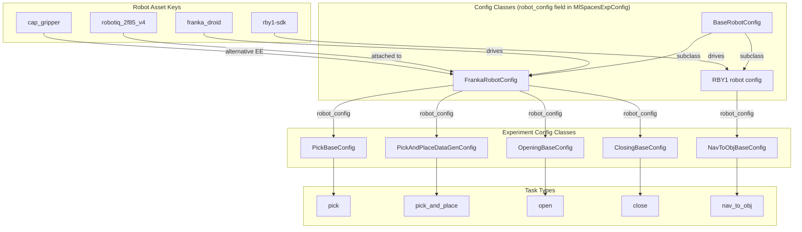

<!-- source: DeepWiki mcp.deepwiki.com · repo allenai/molmospaces · page 2.2 Robots & Coordinate Conventions · fetched 2026-10-26 -->

# Robots & Coordinate Conventions

<details>
<summary>Relevant source files</summary>

The following files were used as context for generating this wiki page:

- [README.md](README.md)
- [docs/images/robot_axis_conventions.png](docs/images/robot_axis_conventions.png)

</details>


## Purpose & Scope

This page documents the robot models included in MolmoSpaces, how robot assets are versioned and downloaded, the shared coordinate frame conventions used across all robots, and how robot configurations are represented in code.

For how `robot_config` composes into a full experiment configuration, see [Configuration System](#4) and [Base Configuration Classes](#4.1). For how robots interact with the task and policy system at runtime, see [Pipeline Architecture](#5.1). For robot assets in non-MuJoCo simulators, see [Simulator Integrations](#3).

---

## Supported Robot Models

MolmoSpaces includes four robot models. Each is derived from an upstream open-source definition and modified to conform to MolmoSpaces coordinate and asset conventions.

| Asset Key | Common Name | Upstream Source | Primary Role |
|---|---|---|---|
| `franka_droid` | Franka FR3 arm | `mujoco_menagerie/franka_fr3` (Franka Robotics) | Manipulation arm (pick, place, open, close) |
| `robotiq_2f85_v4` | Robotiq 2F-85 | `mujoco_menagerie/robotiq_2f85_v4` (ROS-Industrial) | Parallel-jaw end-effector |
| `rby1-sdk` | Rainbow Robotics RBY1 | `RainbowRobotics/rby1-sdk` | Mobile manipulation / navigation |
| `cap_gripper` | CAP Gripper | `jeffacce/cap-policy` (NYU GRAIL) | Alternative end-effector |

Sources: [README.md:290-295]()

---

## Robot Asset Versioning

Robots are managed by the same asset system as scenes and objects. They are registered under the `"robots"` key in `DATA_TYPE_TO_SOURCE_TO_VERSION` inside `molmo_spaces/molmo_spaces_constants.py`.

To pin a robot to a specific asset version, add an entry to the `MLSPACES_PINNED_ASSETS_FILE` JSON:

```json
{
    "robots": {
        "franka_droid": "20260127"
    }
}
```

See [Asset System](#2) for the full asset versioning and lazy-loading API.

Sources: [README.md:170-181]()

---

## Coordinate Conventions

All robot models use a unified coordinate convention enforced consistently across MuJoCo (MJCF), Isaac Sim (USDa), and ManiSkill. The convention is defined for two distinct frames: the **robot base frame** and the **gripper tool frame**.

### Robot Base Frame

| Axis | Assignment |
|---|---|
| `+x` | Forward (in front of the robot) |
| `+y` | Left |
| `+z` | Up |

### Parallel-Jaw Gripper Frame

| Axis | Assignment |
|---|---|
| `+z` | Forward — the tool approach direction (pointing out from the gripper face) |
| `+y` | Finger spread axis (fingers open along +y and −y) |
| `+x` | Lateral (derived by right-hand rule from z and y) |

The reference diagram is at `docs/images/robot_axis_conventions.png`.

Sources: [README.md:272-278]()

---

**Diagram: Robot Base Frame and Gripper Frame Conventions**

```mermaid
graph LR
  subgraph "Robot Base Frame"
    xB[""+x  =  Forward""]
    yB[""+y  =  Left""]
    zB[""+z  =  Up""]
  end

  subgraph "Parallel-Jaw Gripper Frame"
    zG[""+z  =  Tool Approach (forward)""]
    yG[""+y  =  Finger Spread Axis""]
    xG[""+x  =  Lateral (right-hand rule)""]
  end

  RobotOrigin["Robot Base Origin"] --> xB
  RobotOrigin --> yB
  RobotOrigin --> zB

  GripperOrigin["Gripper Tool Origin"] --> zG
  GripperOrigin --> yG
  GripperOrigin --> xG
```

Sources: [README.md:272-278]()

---

## Robot Models and Configuration Classes

Each robot model maps to a configuration class derived from `BaseRobotConfig` (which is a field of `MlSpacesExpConfig`). Task-specific experiment configs set the `robot_config` field to the appropriate robot subclass.

**Diagram: Robot Asset → Config Class → Task Type Mapping**



Sources: [README.md:290-295](), diagrams from system overview (Config Hierarchy, Task and Policy Type Map)

---

## Cross-Simulator Convention Enforcement

The coordinate conventions above are applied at the asset level — robot MJCF and USDa files are modified from their upstream sources so that all simulator representations share the same axis orientation.

| Simulator | Format | Robot Asset Location |
|---|---|---|
| MuJoCo | `.xml` (MJCF) | `$MLSPACES_ASSETS_DIR/robots/<asset_key>/` |
| Isaac Sim | `.usda` (USDa) | Isaac-specific asset bucket (see [Simulator Integrations](#3)) |
| ManiSkill | ManiSkill wrapper | ManiSkill-specific setup (see [Simulator Integrations](#3)) |

Because the convention is baked into the robot asset files rather than applied at runtime, any policy or controller that assumes the standard frame (e.g., computing end-effector poses, planning grasp approach vectors along `+z`) will behave consistently regardless of which simulator backend is active.

Sources: [README.md:24-28](), [README.md:290-295]()

---

