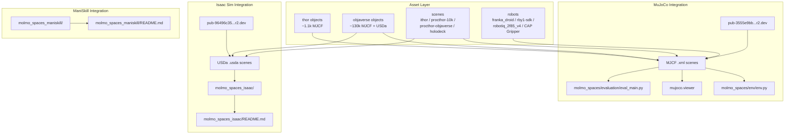
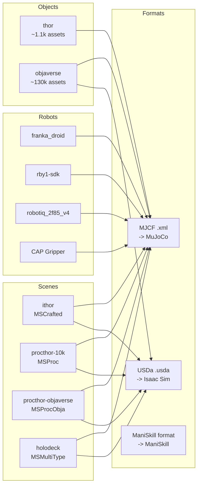

<!-- source: DeepWiki mcp.deepwiki.com · repo allenai/molmospaces · page 3 Simulator Integrations · fetched 2026-10-26 -->

# Simulator Integrations

<details>
<summary>Relevant source files</summary>

The following files were used as context for generating this wiki page:

- [README.md](README.md)
- [docs/images/Multi_Simulator_Pan.jpg](docs/images/Multi_Simulator_Pan.jpg)

</details>


This page describes how MolmoSpaces assets (scenes, objects, and robots) are made available across three simulators: **MuJoCo**, **Isaac Sim**, and **ManiSkill**. It covers the file formats used per simulator, the directory layout of simulator-specific packages, the data endpoints for downloading pre-converted assets, and quick-start viewing instructions.

For information about the assets themselves (scene types, object collections, robots), see the [Asset System](#2) and [Objects & Scenes](#2.1) and [Robots & Coordinate Conventions](#2.2) pages. For MuJoCo-specific runtime usage in data generation and evaluation, see [Pipeline Architecture](#5.1) and [Evaluation & Benchmarking](#6).

---

## Supported Simulators at a Glance

MolmoSpaces provides assets in native formats for each simulator. The benchmarks and data generation pipeline currently run exclusively in MuJoCo; Isaac Sim and ManiSkill are supported as asset targets only.

| Simulator | Asset Format | Package Directory | Benchmark Support | Data Generation |
|---|---|---|---|---|
| MuJoCo | MJCF (`.xml`) | `molmo_spaces/` | ✅ | ✅ |
| Isaac Sim | USDa (`.usda`) | `molmo_spaces_isaac/` | ❌ | ❌ |
| ManiSkill | — | `molmo_spaces_maniskill/` | ❌ | ❌ |

Sources: [README.md:24-28](), [README.md:184-186]()

---

## Simulator Integration Map

**Diagram: Simulator Integrations — Packages and Formats**



Sources: [README.md:24-28](), [README.md:120-167](), [README.md:283-285]()

---

## MuJoCo

MuJoCo is the primary simulator in MolmoSpaces. All data generation, evaluation, and teleoperation run against MuJoCo. Assets are distributed in **MJCF** (`.xml`) format.

### Asset Format

- **Scenes**: `$MLSPACES_ASSETS_DIR/scenes/{scene_type}/{scene_name}.xml`
  - Example: `$MLSPACES_ASSETS_DIR/scenes/ithor/FloorPlan1_physics.xml`
- **Objects**: per-object `.xml` files, symlinked into the asset directory on install
- **Robots**: `.xml` files sourced from `mujoco_menagerie` and vendor SDKs

### Scene Download and Viewing

Scenes are installed on demand via the lazy-loading API. The `install_scene_with_objects_and_grasps_from_path` function handles fetching the scene XML and all referenced object assets. The `get_scenes` function returns a dict of scene paths keyed by split.

```text
# Programmatic install (see molmo_spaces/utils/lazy_loading_utils.py)
install_scene_with_objects_and_grasps_from_path(get_scenes("ithor", "train")["train"][1])

# Viewer
python -m mujoco.viewer --mjcf $MLSPACES_ASSETS_DIR/scenes/ithor/FloorPlan1_physics.xml
```

Sources: [README.md:120-136]()

### Viewer Tips

| Issue | Resolution |
|---|---|
| Red bounding boxes on objects | Toggle `Group Enable > Site groups > Site 0` in left panel |
| Interact with objects | Double-click object → Ctrl + right mouse drag (active viewer only) |
| Keyboard shortcuts | See MuJoCo docs for `sasimulate` sample |

Sources: [README.md:265-269]()

### Runtime Integration

During data generation and evaluation, the MuJoCo environment is managed by `molmo_spaces/env/env.py`. The `ParallelRolloutRunner` in `molmo_spaces/data_generation/pipeline.py` initializes and resets this environment per episode. For evaluation, `molmo_spaces/evaluation/eval_main.py` drives the same MuJoCo environment.

The `mujoco.viewer` module is used separately for offline inspection and is not part of the runtime loop.

Sources: [README.md:195-202]()

### Public Data Endpoint

Pre-converted MJCF assets (scenes and objects) are served from:

```
https://pub-3555e9bb2d304fab9c6c79819e48aa40.r2.dev
```

The asset manager (`molmo_spaces/molmo_spaces_constants.py`) uses this endpoint internally when `install_uid` or `install_scene_with_objects_and_grasps_from_path` is called.

Sources: [README.md:283-285]()

---

## Isaac Sim

Isaac Sim support is provided as a separate top-level package directory `molmo_spaces_isaac/`. Assets for Isaac Sim are distributed in **USDa** format.

### Asset Format

- **Scenes and objects**: `.usda` files (Universal Scene Description, ASCII variant)
- Pre-converted USDa assets are served from a dedicated endpoint separate from the MJCF endpoint

### Setup

Full setup and usage instructions are maintained in the Isaac-specific README:

```
molmo_spaces_isaac/README.md
```

Sources: [README.md:159-162]()

### Public Data Endpoint

Pre-converted USDa assets are served from:

```
https://pub-96496c3574b24d0c98b235219711d359.r2.dev
```

Sources: [README.md:283-285]()

---

## ManiSkill

ManiSkill support is provided as a separate top-level package directory `molmo_spaces_maniskill/`. Setup and usage instructions are maintained in the ManiSkill-specific README:

```
molmo_spaces_maniskill/README.md
```

Sources: [README.md:164-167]()

---

## Format Comparison

**Diagram: Asset Format by Simulator and Asset Type**



Sources: [README.md:104-118](), [README.md:283-285]()

---

## Feature Support by Simulator

| Feature | MuJoCo | Isaac Sim | ManiSkill |
|---|---|---|---|
| Scene assets | ✅ MJCF | ✅ USDa | See README |
| Object assets (thor) | ✅ | ✅ | — |
| Object assets (objaverse) | ✅ | ✅ | — |
| Robot models | ✅ | — | — |
| Data generation pipeline | ✅ | ❌ | ❌ |
| Benchmark evaluation | ✅ | ❌ | ❌ |
| Grasp annotations | ✅ | — | — |
| Teleoperation | ✅ | ❌ | ❌ |
| Lazy asset install API | ✅ | — | — |

Sources: [README.md:184-186](), [README.md:159-167]()

---

## Asset Conversion Notes

Assets distributed for Isaac Sim and ManiSkill are pre-converted and served from their respective public endpoints. The conversion tooling is included in the respective sub-packages (`molmo_spaces_isaac/` and `molmo_spaces_maniskill/`). Refer to each sub-package's README for conversion pipeline details.

The `housegen` optional dependency group (installed via `uv pip install -e .[housegen]`) provides the pipeline for generating MuJoCo-compatible house/scene XMLs from iTHOR, ProcTHOR, or Holodeck JSON scene descriptions. This is a prerequisite step before scenes can be loaded in MuJoCo.

Sources: [README.md:59-67](), [README.md:159-167]()

---

