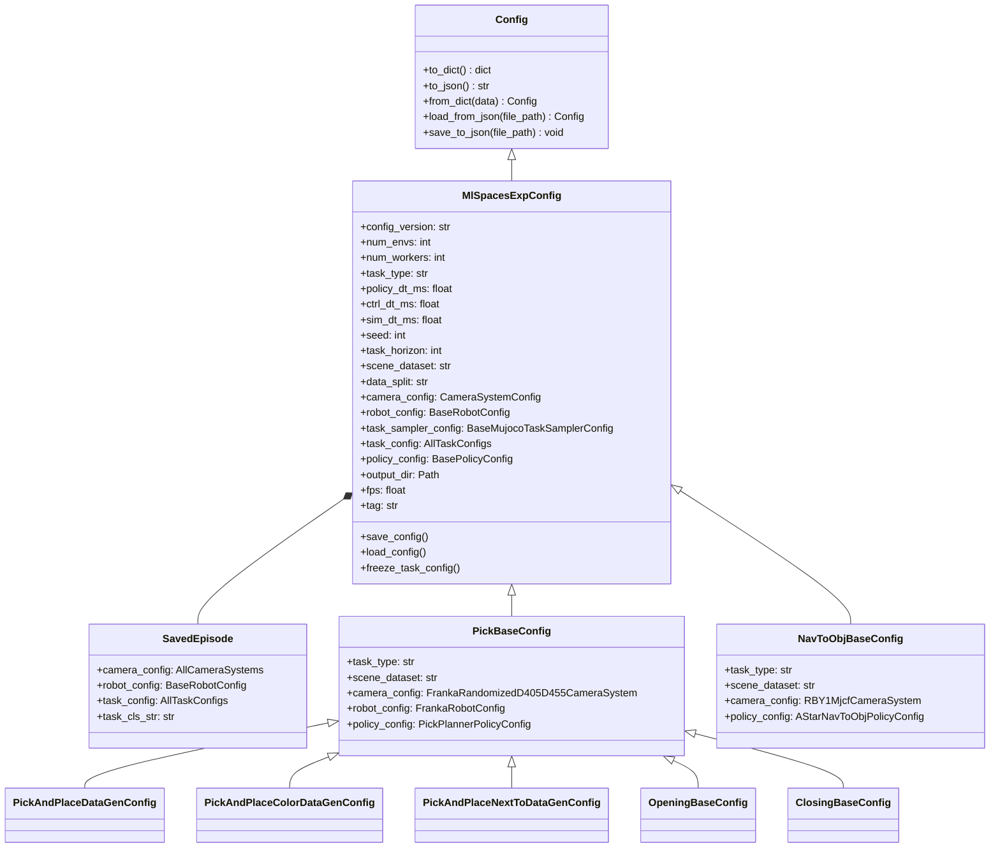
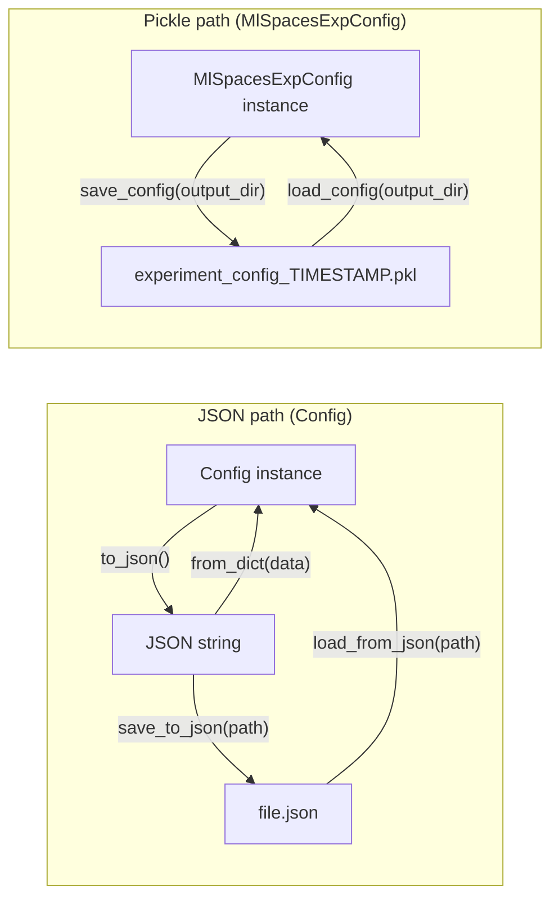

<!-- source: DeepWiki mcp.deepwiki.com · repo allenai/molmospaces · page 4 Configuration System · fetched 2026-10-26 -->

# Configuration System

Relevant source files

The following files were used as context for generating this wiki page:

- [molmo_spaces/configs/__init__.py](molmo_spaces/configs/__init__.py)
- [molmo_spaces/configs/abstract_config.py](molmo_spaces/configs/abstract_config.py)
- [molmo_spaces/configs/abstract_exp_config.py](molmo_spaces/configs/abstract_exp_config.py)

This page gives a conceptual overview of the hierarchical Pydantic-based configuration system used throughout MolmoSpaces. It covers the two base classes (`Config` and `MlSpacesExpConfig`), how sub-configs compose into a single experiment definition, and how configs are serialized and saved at runtime.

For documentation of the concrete task-specific subclasses (`PickBaseConfig`, `NavToObjBaseConfig`, etc.) and the `register_config` decorator, see [Task Configurations](#4.2). For how `MlSpacesExpConfig` is loaded and passed into the data generation pipeline at runtime, see [Pipeline Architecture](#5.1).

---

## Role in the System

Every data generation run, evaluation, and benchmark episode is parameterized by a single config object — a subclass of `MlSpacesExpConfig`. The config carries all timing parameters, scene selection, camera setup, robot model, task definition, and policy choice in one validated, serializable unit. This makes experiments reproducible: the config can be saved to disk and later reloaded to replay an exact episode.

Sources: [molmo_spaces/configs/__init__.py:1-59](), [molmo_spaces/configs/abstract_exp_config.py:1-35]()

---

## Class Hierarchy

**Config hierarchy diagram**

Sources: [molmo_spaces/configs/abstract_config.py:1-43](), [molmo_spaces/configs/abstract_exp_config.py:33-216]()

---

## Sub-Config Composition

`MlSpacesExpConfig` does not contain camera, robot, task, or policy settings directly. Instead, it holds references to dedicated sub-config objects. Each sub-config is independently validated by Pydantic before the parent config is constructed.

**Sub-config composition diagram**

```mermaid
graph TD
    EXP["MlSpacesExpConfig\n(abstract_exp_config.py)"]

    CAM["camera_config\nCameraSystemConfig"]
    ROB["robot_config\nBaseRobotConfig"]
    TS["task_sampler_config\nBaseMujocoTaskSamplerConfig"]
    TC["task_config\nAllTaskConfigs"]
    POL["policy_config\nBasePolicyConfig"]

    CAM_IMPL1["FrankaRandomizedD405D455CameraSystem"]
    CAM_IMPL2["RBY1MjcfCameraSystem"]
    CAM_IMPL3["FrankaDroidCameraSystem"]

    ROB_IMPL1["FrankaRobotConfig"]
    ROB_IMPL2["RBY1RobotConfig"]

    TS_IMPL1["PickTaskSamplerConfig"]
    TS_IMPL2["NavToObjTaskSamplerConfig"]

    TC_IMPL1["PickTaskConfig"]
    TC_IMPL2["OpenTaskConfig"]
    TC_IMPL3["NavToObjTaskConfig"]

    POL_IMPL1["PickPlannerPolicyConfig"]
    POL_IMPL2["AStarNavToObjPolicyConfig"]
    POL_IMPL3["TeleopPolicyConfig"]
    POL_IMPL4["LearnedPolicyConfig"]

    EXP --> CAM
    EXP --> ROB
    EXP --> TS
    EXP --> TC
    EXP --> POL

    CAM --> CAM_IMPL1
    CAM --> CAM_IMPL2
    CAM --> CAM_IMPL3

    ROB --> ROB_IMPL1
    ROB --> ROB_IMPL2

    TS --> TS_IMPL1
    TS --> TS_IMPL2

    TC --> TC_IMPL1
    TC --> TC_IMPL2
    TC --> TC_IMPL3

    POL --> POL_IMPL1
    POL --> POL_IMPL2
    POL --> POL_IMPL3
    POL --> POL_IMPL4
```

Sources: [molmo_spaces/configs/abstract_exp_config.py:65-72](), [molmo_spaces/configs/__init__.py:13-59]()

---

## `Config` — The Base Class

All configuration objects in MolmoSpaces inherit from `Config`, defined in [molmo_spaces/configs/abstract_config.py:9-43](). It is a thin wrapper around Pydantic's `BaseModel` with `arbitrary_types_allowed = True` to accommodate MuJoCo and NumPy types.

| Method | Signature | Description |
|--------|-----------|-------------|
| `to_dict` | `() -> dict` | Calls `model_dump()` to produce a plain dict |
| `to_json` | `() -> str` | Calls `model_dump_json(warnings="error")` |
| `from_dict` | `(data: dict) -> Config` | Class method; calls `model_validate(data)` |
| `load_from_json` | `(file_path: str) -> Config` | Reads a JSON file and calls `model_validate_json` |
| `save_to_json` | `(file_path: str) -> None` | Writes `to_json()` output to a file |

Sources: [molmo_spaces/configs/abstract_config.py:9-43]()

---

## `MlSpacesExpConfig` — The Experiment Config

`MlSpacesExpConfig` is an abstract subclass of `Config` that holds every parameter needed to run one experiment. It is defined in [molmo_spaces/configs/abstract_exp_config.py:33-216]().

### Timing fields

These three timing parameters govern the simulation loop. Validation in `model_post_init` enforces that `policy_dt_ms` is an integer multiple of `ctrl_dt_ms`, which must itself be an integer multiple of `sim_dt_ms`.

| Field | Type | Meaning |
|-------|------|---------|
| `sim_dt_ms` | `float` | Physics integration step (milliseconds) |
| `ctrl_dt_ms` | `float` | Controller update period (milliseconds) |
| `policy_dt_ms` | `float` | Policy query period (milliseconds) |
| `fps` | `float` (property) | Derived as `1000.0 / policy_dt_ms` |

### Parallelism fields

| Field | Type | Default | Meaning |
|-------|------|---------|---------|
| `num_envs` | `int` | — | Batched environments per worker (vectorized physics) |
| `num_workers` | `int` | `1` | Worker processes for episode-level parallelism |

### Scene and task fields

| Field | Type | Default | Meaning |
|-------|------|---------|---------|
| `scene_dataset` | `str` | — | Dataset key: `ithor`, `procthor-10k`, `procthor-objaverse`, `holodeck` |
| `data_split` | `str` | `"train"` | Split: `train`, `val`, or `test` |
| `task_type` | `str` | — | Task identifier string, e.g. `"pick"`, `"nav_to_obj"` |
| `task_horizon` | `int \| None` | `None` | Maximum steps per episode; `None` means no limit |
| `seed` | `int \| None` | `None` | RNG seed; if `None`, a random seed is generated |
| `collision_free_pose_limit` | `int` | `3` | Max retries for collision-free initial pose sampling |

### Sub-config fields

| Field | Type | Notes |
|-------|------|-------|
| `camera_config` | `CameraSystemConfig \| None` | Camera and sensor setup |
| `robot_config` | `BaseRobotConfig` | Robot model parameters |
| `task_sampler_config` | `BaseMujocoTaskSamplerConfig` | How tasks and scenes are sampled |
| `task_config` | `AllTaskConfigs` | Task-specific parameters |
| `task_config_preset_exp` | `AllTaskConfigs \| None` | Cached config for whole-experiment replay |
| `task_config_preset_scn` | `AllTaskConfigs \| None` | Cached config for per-scene replay |
| `policy_config` | `BasePolicyConfig` | Policy parameters |

### Optional runtime/logging fields

| Field | Type | Default | Notes |
|-------|------|---------|-------|
| `benchmark_path` | `Path \| None` | `None` | Path to a JSON file listing fully-specified episodes |
| `eval_runtime_params` | `Any` | auto-initialized | Set during evaluation; defaults to `EvalRuntimeParams()` |
| `output_dir` | `Path` | — | Where results are written |
| `profile` | `bool` | `False` | Enable profiling via `Profiler` |
| `log_level` | `str` | `"info"` | One of `debug`, `info`, `warning`, `error`, `none` |
| `use_wandb` | `bool` | `False` | Enable Weights & Biases logging |
| `filter_for_successful_trajectories` | `bool` | `True` | When `True`, only successful episodes go to the main output directory |

### Abstract members

Subclasses must implement the `tag` property, which returns a human-readable string identifying the experiment variant. This string is used in output directory naming and logging.

Sources: [molmo_spaces/configs/abstract_exp_config.py:33-130]()

---

## Validation: `model_post_init`

After field validation, Pydantic calls `model_post_init` [molmo_spaces/configs/abstract_exp_config.py:99-114](). It performs two assertions:

1. `policy_dt_ms / ctrl_dt_ms` must be an integer — ensures policy steps align on control boundaries.
2. `ctrl_dt_ms / sim_dt_ms` must be an integer — ensures control steps align on physics boundaries.

It also initializes `eval_runtime_params` to a default `EvalRuntimeParams()` instance if not already set, avoiding a circular import by deferring the import to runtime.

Sources: [molmo_spaces/configs/abstract_exp_config.py:99-114]()

---

## Serialization and Persistence

**Config serialization flow**

- `Config.save_to_json` / `Config.load_from_json` — lightweight, human-readable; uses Pydantic's JSON serialization.
- `MlSpacesExpConfig.save_config` — saves the full experiment config as a timestamped `.pkl` file using `pickle.dump`. The timestamp format is `%Y%m%d_%H%M%S`.
- `MlSpacesExpConfig.load_config` — loads from `experiment_config.pkl` in the given directory using `pickle.load`.

> **Note:** The pickle path preserves Python objects (e.g. class references stored in sub-configs) that cannot be round-tripped through JSON.

Sources: [molmo_spaces/configs/abstract_config.py:19-43](), [molmo_spaces/configs/abstract_exp_config.py:121-139]()

---

## Episode Freezing: `SavedEpisode` and `freeze_task_config`

The inner class `SavedEpisode` [molmo_spaces/configs/abstract_exp_config.py:142-148]() is a `Config` subclass that captures the exact state of one sampled episode — camera poses, robot `qpos`, object poses, and task parameters — so the episode can be replayed deterministically later.

`freeze_task_config` [molmo_spaces/configs/abstract_exp_config.py:150-216]() populates a `SavedEpisode` from a live task:

1. Deep-copies `robot_config`, strips non-serializable fields (`robot_cls`, `robot_factory`), and records the actual initial `qpos`.
2. Deep-copies `camera_config`, converts randomized camera types (`MjcfCameraConfig`, `RandomizedExocentricCameraConfig`) to their fixed equivalents (`RobotMountedCameraConfig`, `FixedExocentricCameraConfig`) using the live camera manager state.
3. Records all mobile object poses via `pose_mat_to_7d`.
4. Deep-copies `task_config`, strips `task_cls`, and records `task_cls_str` for later reconstruction.
5. Serializes the `SavedEpisode` with `pickle.dumps` and returns it as a base64-encoded string.

This base64 string is stored in the trajectory HDF5 file and can be decoded and unpickled to recreate the exact episode setup.

Sources: [molmo_spaces/configs/abstract_exp_config.py:142-216]()

---

## Module Exports

The `molmo_spaces.configs` package re-exports all public config symbols from `__init__.py`:

| Symbol | Source module |
|--------|--------------|
| `Config` | `abstract_config` |
| `MlSpacesExpConfig` | `abstract_exp_config` |
| `CameraSystemConfig`, `CameraConfig`, `MjcfCameraConfig`, `RobotMountedCameraConfig`, `FixedExocentricCameraConfig`, `RandomizedExocentricCameraConfig`, `RBY1MjcfCameraSystem`, `FrankaRandomizedD405D455CameraSystem`, `FrankaDroidCameraSystem` | `camera_configs` |
| `BaseRobotConfig`, `FrankaRobotConfig` | `robot_configs` |
| `BaseMujocoTaskConfig`, `PickTaskConfig` | `task_configs` |
| `BaseMujocoTaskSamplerConfig`, `PickTaskSamplerConfig` | `task_sampler_configs` |
| `BasePolicyConfig` | `policy_configs` |

Sources: [molmo_spaces/configs/__init__.py:1-59]()

---

