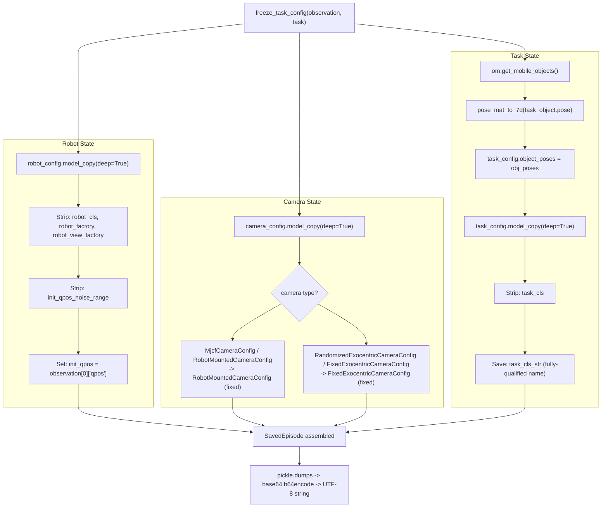
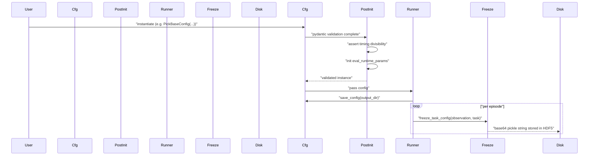

<!-- source: DeepWiki mcp.deepwiki.com · repo allenai/molmospaces · page 4.1 Base Configuration Classes · fetched 2026-10-26 -->

# Base Configuration Classes

<details>
<summary>Relevant source files</summary>

The following files were used as context for generating this wiki page:

- [molmo_spaces/configs/abstract_config.py](molmo_spaces/configs/abstract_config.py)
- [molmo_spaces/configs/abstract_exp_config.py](molmo_spaces/configs/abstract_exp_config.py)

</details>


This page documents the two foundational configuration classes: `Config` (the Pydantic base) and `MlSpacesExpConfig` (the abstract experiment base). These classes define the shared serialization interface and all experiment-level fields that concrete task configurations inherit. For documentation of the concrete task configurations (`PickBaseConfig`, `NavToObjBaseConfig`, etc.) see [Task Configurations](#4.2). For a conceptual overview of how the hierarchy composes, see [Configuration System](#4).

---

## `Config` — The Serialization Base

**File:** [molmo_spaces/configs/abstract_config.py:1-43]()

`Config` wraps Pydantic's `BaseModel` and provides a uniform serialization interface used throughout the codebase. Every configuration class in MolmoSpaces ultimately inherits from `Config`.

The inner `Config` (Pydantic model config) class at [molmo_spaces/configs/abstract_config.py:15-17]() sets `arbitrary_types_allowed = True`, which permits fields that hold non-JSON-primitive objects such as NumPy arrays or class references.

### Methods

| Method | Signature | Description |
|---|---|---|
| `to_dict` | `() -> dict` | Returns `model_dump()` — a plain Python dictionary of all fields. |
| `to_json` | `() -> str` | Returns `model_dump_json(warnings="error")` — a JSON string; serialization warnings are raised as errors. |
| `from_dict` | `(cls, data: dict) -> Config` | Class method; validates and constructs an instance from a dictionary via `model_validate`. |
| `load_from_json` | `(cls, file_path: str) -> Config` | Class method; reads a JSON file and validates it with `model_validate_json`. |
| `save_to_json` | `(file_path: str) -> None` | Writes the JSON representation to a file. |

**Sources:** [molmo_spaces/configs/abstract_config.py:1-43]()

---

## `MlSpacesExpConfig` — The Experiment Base

**File:** [molmo_spaces/configs/abstract_exp_config.py:33-216]()

`MlSpacesExpConfig` is an abstract class (`ABC`) that extends `Config`. It defines all fields that every experiment configuration must supply: timing, parallelism, scene selection, sub-configs for camera/robot/task/policy, and output settings. Concrete subclasses (e.g. `PickBaseConfig`) supply default values for these fields.

**Diagram: Class Relationship**

```mermaid
classDiagram
    direction TB

    class BaseModel {
        <<pydantic>>
    }
    class Config {
        +to_dict() dict
        +to_json() str
        +from_dict(data) Config
        +load_from_json(file_path) Config
        +save_to_json(file_path) None
    }
    class MlSpacesExpConfig {
        <<abstract>>
        +tag: str
        +save_config(output_dir)
        +load_config(output_dir) MlSpacesExpConfig
        +freeze_task_config(observation, task) str
        +model_post_init(_context) None
        +fps: float
    }
    class SavedEpisode {
        +camera_config: AllCameraSystems
        +robot_config: BaseRobotConfig
        +task_config: AllTaskConfigs
        +task_cls_str: str
    }

    BaseModel <|-- Config
    Config <|-- MlSpacesExpConfig
    MlSpacesExpConfig +-- SavedEpisode
```

Sources: [molmo_spaces/configs/abstract_config.py:9-43](), [molmo_spaces/configs/abstract_exp_config.py:33-145]()

---

### Field Reference

Fields are defined at [molmo_spaces/configs/abstract_exp_config.py:39-97]().

#### Timing & Simulation

| Field | Type | Description |
|---|---|---|
| `policy_dt_ms` | `float` | Policy step duration in milliseconds. |
| `ctrl_dt_ms` | `float` | Controller step duration in milliseconds. Must divide evenly into `policy_dt_ms`. |
| `sim_dt_ms` | `float` | MuJoCo simulation step duration in milliseconds. Must divide evenly into `ctrl_dt_ms`. |
| `task_horizon` | `int \| None` | Max steps per episode. `None` means no time limit. |

The `fps` computed property returns `1000.0 / policy_dt_ms` [molmo_spaces/configs/abstract_exp_config.py:62-63]().

The timing hierarchy enforced by `model_post_init` is:

```
policy_dt_ms
    └── ctrl_dt_ms  (policy_dt_ms % ctrl_dt_ms == 0)
            └── sim_dt_ms  (ctrl_dt_ms % sim_dt_ms == 0)
```

#### Parallelism

| Field | Type | Default | Description |
|---|---|---|---|
| `num_envs` | `int` | — | Batched environments per worker (vectorized physics via `CPUMujocoEnv`). |
| `num_workers` | `int` | `1` | Worker processes for episode-level parallelism. |

#### Scene & Task

| Field | Type | Description |
|---|---|---|
| `task_type` | `str` | Task type identifier, e.g. `"pick"`, `"pick_and_place"`. |
| `scene_dataset` | `str` | Scene collection, e.g. `"procthor-10k"`, `"ithor"`. |
| `data_split` | `str` | Dataset split: `"train"`, `"val"`, or `"test"`. Default: `"train"`. |
| `seed` | `int \| None` | Random seed for task sampling. `None` generates a random seed. |
| `collision_free_pose_limit` | `int` | Max attempts to find a collision-free pose. Default: `3`. |

#### Sub-configuration Fields

| Field | Type | Description |
|---|---|---|
| `camera_config` | `CameraSystemConfig \| None` | Camera and sensor configuration. |
| `robot_config` | `BaseRobotConfig` | Robot model configuration. |
| `task_sampler_config` | `BaseMujocoTaskSamplerConfig` | Task and scene sampling configuration. |
| `task_config` | `AllTaskConfigs` | Per-task parameters (object targets, placement constraints, etc.). |
| `task_config_preset_exp` | `AllTaskConfigs \| None` | Cached config frozen at experiment start. |
| `task_config_preset_scn` | `AllTaskConfigs \| None` | Cached config frozen at scene load. |
| `policy_config` | `BasePolicyConfig` | Policy parameters (planner, teleop, or learned). |

#### Output & Profiling

| Field | Type | Default | Description |
|---|---|---|---|
| `output_dir` | `Path` | — | Directory where trajectories and configs are saved. |
| `profile` | `bool` | `False` | Enable profiling. |
| `profiler` | `Profiler \| None` | `None` | Auto-created if `profile=True`. |
| `datagen_profiler` | `bool` | `True` | Run the data generation profiler. |
| `filter_for_successful_trajectories` | `bool` | `True` | If `True`, only successful episodes go to the main output directory. |

#### Logging & Monitoring

| Field | Type | Default | Description |
|---|---|---|---|
| `log_level` | `str` | `"info"` | One of `"debug"`, `"info"`, `"warning"`, `"error"`, `"none"`. |
| `use_wandb` | `bool` | `False` | Enable Weights & Biases logging. |
| `wandb_project` | `str \| None` | `None` | W&B project name. |
| `wandb_name` | `str \| None` | `None` | W&B run name. |

#### Evaluation

| Field | Type | Description |
|---|---|---|
| `benchmark_path` | `Path \| None` | Path to a JSON file listing fully-specified benchmark episodes. |
| `eval_runtime_params` | `Any` | `EvalRuntimeParams` instance from `eval_main`. Auto-initialized in `model_post_init`. |

**Sources:** [molmo_spaces/configs/abstract_exp_config.py:39-97]()

---

### `model_post_init`

[molmo_spaces/configs/abstract_exp_config.py:99-114]()

Called automatically by Pydantic after field validation. It performs two tasks:

1. **Timing assertion** — verifies that `policy_dt_ms` is an integer multiple of `ctrl_dt_ms`, and that `ctrl_dt_ms` is an integer multiple of `sim_dt_ms`. Violating either raises an `AssertionError`.
2. **`eval_runtime_params` initialization** — if `eval_runtime_params` is `None`, imports `EvalRuntimeParams` from `molmo_spaces.evaluation.eval_main` and sets a default instance. The import is deferred to avoid circular dependency.

---

### `tag` (Abstract Property)

[molmo_spaces/configs/abstract_exp_config.py:116-119]()

Every subclass must implement `tag` as a `@property`. It returns a human-readable string identifying the experiment type (e.g. `"pick_procthor10k"`). The tag is used for naming outputs and W&B runs.

---

### `save_config` and `load_config`

[molmo_spaces/configs/abstract_exp_config.py:121-139]()

| Method | Signature | Behavior |
|---|---|---|
| `save_config` | `(output_dir=None) -> None` | Pickles the config object to `{output_dir}/experiment_config_{timestamp}.pkl`. Creates the directory if absent. |
| `load_config` | `(output_dir: Path) -> MlSpacesExpConfig` | Reads `{output_dir}/experiment_config.pkl` and unpickles it. |

> **Note:** `save_config` uses a timestamped filename; `load_config` expects the fixed name `experiment_config.pkl`. The `pkl` format preserves all Python objects including class references, unlike the JSON methods on `Config`.

**Sources:** [molmo_spaces/configs/abstract_exp_config.py:121-139]()

---

### `SavedEpisode` — Reproducible Episode Replay

[molmo_spaces/configs/abstract_exp_config.py:142-148]()

An inner class (itself a `Config` subclass) that records the fully-resolved state of one episode — after randomization has occurred — so that the episode can be re-executed deterministically.

| Field | Type | Description |
|---|---|---|
| `camera_config` | `AllCameraSystems \| None` | Camera positions resolved to fixed values. |
| `robot_config` | `BaseRobotConfig \| None` | Robot config with `init_qpos` set to the actual starting joint state. |
| `task_config` | `AllTaskConfigs \| None` | Task config with `object_poses` filled in. |
| `task_cls_str` | `str \| None` | Fully-qualified class name of the task (e.g. `"molmo_spaces.tasks.pick.PickTask"`). |

**Sources:** [molmo_spaces/configs/abstract_exp_config.py:142-148]()

---

### `freeze_task_config`

[molmo_spaces/configs/abstract_exp_config.py:150-216]()

Captures the post-randomization state of an episode into a base64-encoded pickle string. This string can be stored alongside HDF5 trajectory data and used to exactly reproduce the episode.

**Diagram: `freeze_task_config` Data Flow**



Sources: [molmo_spaces/configs/abstract_exp_config.py:150-216]()

---

### Class Aliases (`ClassVar`)

[molmo_spaces/configs/abstract_exp_config.py:93-95]()

Three `ClassVar` attributes act as backward-compatible aliases for the base config types:

```
MlSpacesExpConfig.CameraConfig  -> CameraSystemConfig
MlSpacesExpConfig.RobotConfig   -> BaseRobotConfig
MlSpacesExpConfig.PolicyConfig  -> BasePolicyConfig
```

Because they are declared as `ClassVar`, Pydantic does not treat them as model fields.

---

## Configuration Lifecycle

**Diagram: Configuration Usage Across the Pipeline**



Sources: [molmo_spaces/configs/abstract_exp_config.py:99-139](), [molmo_spaces/configs/abstract_exp_config.py:150-216]()

---

