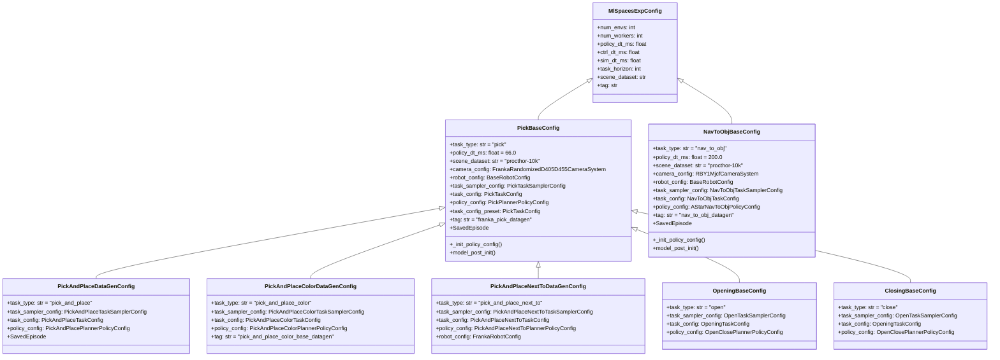

<!-- source: DeepWiki mcp.deepwiki.com · repo allenai/molmospaces · page 4.2 Task Configurations · fetched 2026-10-26 -->

# Task Configurations

<details>
<summary>Relevant source files</summary>

The following files were used as context for generating this wiki page:

- [molmo_spaces/configs/__init__.py](molmo_spaces/configs/__init__.py)
- [molmo_spaces/configs/base_nav_to_obj_config.py](molmo_spaces/configs/base_nav_to_obj_config.py)
- [molmo_spaces/configs/base_open_task_configs.py](molmo_spaces/configs/base_open_task_configs.py)
- [molmo_spaces/configs/base_pick_and_place_color_configs.py](molmo_spaces/configs/base_pick_and_place_color_configs.py)
- [molmo_spaces/configs/base_pick_and_place_configs.py](molmo_spaces/configs/base_pick_and_place_configs.py)
- [molmo_spaces/configs/base_pick_and_place_next_to_configs.py](molmo_spaces/configs/base_pick_and_place_next_to_configs.py)
- [molmo_spaces/configs/base_pick_config.py](molmo_spaces/configs/base_pick_config.py)

</details>


This page documents the concrete experiment configuration classes used to define data generation and evaluation runs in MolmoSpaces. These classes are the primary way to specify which task type is used, which robot and camera system, which task sampler, and which policy. Each class is a Pydantic model that composes the sub-configs described in [Base Configuration Classes](#4.1).

For documentation of the base classes (`Config`, `MlSpacesExpConfig`) that these configs inherit from, see [Base Configuration Classes](#4.1). For documentation of what each task type actually does at runtime, see [Task Types](#5.2).

---

## Class Hierarchy

All concrete task configs derive from either `PickBaseConfig` or `NavToObjBaseConfig`, both of which extend `MlSpacesExpConfig`.

**Class hierarchy diagram:**



Sources: [molmo_spaces/configs/base_pick_config.py:1-115](), [molmo_spaces/configs/base_nav_to_obj_config.py:1-113](), [molmo_spaces/configs/base_open_task_configs.py:1-57](), [molmo_spaces/configs/base_pick_and_place_configs.py:1-29](), [molmo_spaces/configs/base_pick_and_place_color_configs.py:1-34](), [molmo_spaces/configs/base_pick_and_place_next_to_configs.py:1-27]()

---

## PickBaseConfig

**File:** [molmo_spaces/configs/base_pick_config.py]()

`PickBaseConfig` is the parent for all Franka-arm manipulation tasks. It is not intended to be used directly — the file-level comment notes: *"will not work if used directly. Subclass examples in data_generation/configs.py"*.

### Default Sub-Config Bindings

| Field | Default Type | Default Value / Class |
|---|---|---|
| `task_type` | `str` | `"pick"` |
| `camera_config` | `FrankaRandomizedD405D455CameraSystem` | randomized D405+D455 camera rig |
| `robot_config` | `BaseRobotConfig \| None` | `None` (subclasses assign) |
| `task_sampler_config` | `PickTaskSamplerConfig` | `PickTaskSampler` |
| `task_config` | `PickTaskConfig` | `PickTask` |
| `policy_config` | `BasePolicyConfig` | `PickPlannerPolicyConfig()` |
| `task_config_preset` | `PickTaskConfig \| None` | `None` |

### Timing Defaults

| Field | Value | Notes |
|---|---|---|
| `policy_dt_ms` | `66.0` ms | ~15 Hz policy rate |
| `ctrl_dt_ms` | `2.0` ms | control step |
| `sim_dt_ms` | `2.0` ms | simulator step |
| `task_horizon` | `500` | max steps per episode |

### Key Methods

- **`_init_policy_config()`** — Returns `self.policy_config`. Subclasses override this for dynamic (e.g., GPU-conditional) policy initialization.
- **`model_post_init()`** — Calls `_init_policy_config()` and suppresses GPU-related `RuntimeError`s, logging a warning instead. Also auto-instantiates a `Profiler` if `profile=True` and `profiler` is `None`.
- **`tag`** property — Returns `"franka_pick_datagen"`. Subclasses override this to produce meaningful run identifiers.

### SavedEpisode Inner Class

`PickBaseConfig.SavedEpisode` is a `Config` subclass used to serialize enough state to replay a specific episode:

```
SavedEpisode:
  camera_config: AllCameraSystems | None
  robot_config: FrankaRobotConfig | None
  task_config: PickTaskConfig | None
  task_cls_str: str | None
```

Sources: [molmo_spaces/configs/base_pick_config.py:24-115]()

---

## NavToObjBaseConfig

**File:** [molmo_spaces/configs/base_nav_to_obj_config.py]()

`NavToObjBaseConfig` is the base class for mobile manipulation / navigation-to-object tasks. It uses the RBY1 robot and an A* planner rather than the Franka arm and grasp planner.

### Default Sub-Config Bindings

| Field | Default Type | Default Value / Class |
|---|---|---|
| `task_type` | `str` | `"nav_to_obj"` |
| `camera_config` | `RBY1MjcfCameraSystem` | RBY1 onboard cameras |
| `robot_config` | `BaseRobotConfig \| None` | `None` |
| `task_sampler_config` | `NavToObjTaskSamplerConfig` | `NavToObjTaskSampler` |
| `task_config` | `NavToObjTaskConfig` | `NavToObjTask` |
| `policy_config` | `BasePolicyConfig` | `AStarNavToObjPolicyConfig()` |

### Timing Defaults

| Field | Value | Notes |
|---|---|---|
| `policy_dt_ms` | `200.0` ms | 5 Hz — slower than manipulation |
| `ctrl_dt_ms` | `2.0` ms | |
| `sim_dt_ms` | `2.0` ms | |
| `task_horizon` | `500` | |

### Key Differences from PickBaseConfig

- Uses `RBY1MjcfCameraSystem` instead of `FrankaRandomizedD405D455CameraSystem`.
- Policy defaults to `AStarNavToObjPolicyConfig` instead of `PickPlannerPolicyConfig`.
- `policy_dt_ms` is 200 ms (5 Hz) vs. 66 ms (15 Hz) for pick tasks.
- `tag` returns `"nav_to_obj_datagen"`.

### SavedEpisode Inner Class

```
SavedEpisode:
  camera_config: RBY1MjcfCameraSystem | None
  robot_config: RBY1Config | None
  task_config: NavToObjTaskConfig | None
  task_cls_str: str | None
```

Sources: [molmo_spaces/configs/base_nav_to_obj_config.py:23-113]()

---

## PickAndPlaceDataGenConfig

**File:** [molmo_spaces/configs/base_pick_and_place_configs.py]()

Extends `PickBaseConfig` for pick-and-place tasks where a specific object must be moved to a goal receptacle.

### Overrides

| Field | Value |
|---|---|
| `task_type` | `"pick_and_place"` |
| `num_workers` | `1` |
| `task_sampler_config` | `PickAndPlaceTaskSamplerConfig(task_sampler_class=PickAndPlaceTaskSampler, pickup_types=PICK_AND_PLACE_OBJECTS, samples_per_house=20)` |
| `task_config` | `PickAndPlaceTaskConfig(task_cls=PickAndPlaceTask)` |
| `policy_config` | `PickAndPlacePlannerPolicyConfig()` |

The `PICK_AND_PLACE_OBJECTS` constant (from `molmo_spaces.utils.constants.object_constants`) defines the set of eligible object categories.

`samples_per_house=20` means the sampler will generate up to 20 task instances per loaded scene before moving to the next.

### SavedEpisode Inner Class

```
SavedEpisode:
  camera_config: AllCameraSystems | None
  robot_config: FrankaRobotConfig | None
  task_config: PickAndPlaceTaskConfig | None
  task_cls_str: str | None
```

Sources: [molmo_spaces/configs/base_pick_and_place_configs.py:1-29]()

---

## PickAndPlaceColorDataGenConfig

**File:** [molmo_spaces/configs/base_pick_and_place_color_configs.py]()

Extends `PickBaseConfig` for color-conditioned pick-and-place, where the task instruction includes a color attribute (e.g., "pick up the **red** mug").

This class is decorated with `@register_config("PickAndPlaceColorDataGenConfig")`, making it discoverable by name at runtime.

### Overrides

| Field | Value |
|---|---|
| `task_type` | `"pick_and_place_color"` |
| `num_workers` | `1` |
| `output_dir` | `ASSETS_DIR / "experiment_output" / "datagen" / "pick_and_place_color_base_v1"` |
| `wandb_project` | `"molmo-spaces-data-generation"` |
| `task_sampler_config` | `PickAndPlaceColorTaskSamplerConfig(task_sampler_class=PickAndPlaceColorTaskSampler, pickup_types=PICK_AND_PLACE_OBJECTS, samples_per_house=20)` |
| `task_config` | `PickAndPlaceColorTaskConfig(task_cls=PickAndPlaceColorTask)` |
| `policy_config` | `PickAndPlaceColorPlannerPolicyConfig()` |
| `use_passive_viewer` | `False` |

The `tag` property returns `"pick_and_place_color_base_datagen"`.

Sources: [molmo_spaces/configs/base_pick_and_place_color_configs.py:1-34]()

---

## PickAndPlaceNextToDataGenConfig

**File:** [molmo_spaces/configs/base_pick_and_place_next_to_configs.py]()

Extends `PickBaseConfig` for tasks where an object must be placed *next to* a reference object rather than inside a receptacle.

This class is also registered with `@register_config("PickAndPlaceNextToDataGenConfig")`.

### Overrides

| Field | Value |
|---|---|
| `task_type` | `"pick_and_place_next_to"` |
| `num_workers` | `1` |
| `task_sampler_config` | `PickAndPlaceNextToTaskSamplerConfig(task_sampler_class=PickAndPlaceNextToTaskSampler, pickup_types=PICK_AND_PLACE_OBJECTS, samples_per_house=20)` |
| `task_config` | `PickAndPlaceNextToTaskConfig(task_cls=PickAndPlaceNextToTask)` |
| `policy_config` | `PickAndPlaceNextToPlannerPolicyConfig()` |
| `robot_config` | `FrankaRobotConfig()` (explicitly set, unlike other pick variants) |
| `use_passive_viewer` | `False` |

Sources: [molmo_spaces/configs/base_pick_and_place_next_to_configs.py:1-27]()

---

## OpeningBaseConfig and ClosingBaseConfig

**File:** [molmo_spaces/configs/base_open_task_configs.py]()

Both configs extend `PickBaseConfig` and share the same sampler class (`OpenTaskSampler`) and task class (`OpeningTask`). The difference is the initial and goal joint state:

| Property | `OpeningBaseConfig` | `ClosingBaseConfig` |
|---|---|---|
| `task_type` | `"open"` | `"close"` |
| `task_sampler_config.target_initial_state_open_percentage` | `0` (start closed) | `0.5` (start half-open) |
| `task_config.task_success_threshold` | `0.15` (small opening counts) | `0.85` (mostly closed counts) |
| `task_config.any_inst_of_category` | `True` | `False` |
| `policy_config` | `OpenClosePlannerPolicyConfig()` | `OpenClosePlannerPolicyConfig()` |

Both use `joint_index=0` by default in `OpeningTaskConfig`.

The `task_success_threshold` values reflect practical constraints: the opening task uses a low threshold (`0.15`) due to known IK and placement limitations, while the closing task uses a high threshold (`0.85`) to confirm near-full closure.

Sources: [molmo_spaces/configs/base_open_task_configs.py:1-57]()

---

## Config-to-Component Mapping

This diagram bridges config class names to the concrete task, sampler, and policy classes they wire up:

```mermaid
graph TD
    subgraph "PickBaseConfig lineage"
        PBC["PickBaseConfig\nbase_pick_config.py"]
        PAPDC["PickAndPlaceDataGenConfig\nbase_pick_and_place_configs.py"]
        PAPCDC["PickAndPlaceColorDataGenConfig\nbase_pick_and_place_color_configs.py"]
        PAPNTDC["PickAndPlaceNextToDataGenConfig\nbase_pick_and_place_next_to_configs.py"]
        OBC["OpeningBaseConfig\nbase_open_task_configs.py"]
        CBC["ClosingBaseConfig\nbase_open_task_configs.py"]
    end

    PBC -->|"inherits"| PAPDC
    PBC -->|"inherits"| PAPCDC
    PBC -->|"inherits"| PAPNTDC
    PBC -->|"inherits"| OBC
    PBC -->|"inherits"| CBC

    PAPDC --> TS1["PickAndPlaceTaskSampler"]
    PAPDC --> TK1["PickAndPlaceTask"]
    PAPDC --> PL1["PickAndPlacePlannerPolicyConfig"]

    PAPCDC --> TS2["PickAndPlaceColorTaskSampler"]
    PAPCDC --> TK2["PickAndPlaceColorTask"]
    PAPCDC --> PL2["PickAndPlaceColorPlannerPolicyConfig"]

    PAPNTDC --> TS3["PickAndPlaceNextToTaskSampler"]
    PAPNTDC --> TK3["PickAndPlaceNextToTask"]
    PAPNTDC --> PL3["PickAndPlaceNextToPlannerPolicyConfig"]

    OBC --> TS4["OpenTaskSampler\ninitial_open_pct=0"]
    OBC --> TK4["OpeningTask\nthreshold=0.15"]
    OBC --> PL4["OpenClosePlannerPolicyConfig"]

    CBC --> TS5["OpenTaskSampler\ninitial_open_pct=0.5"]
    CBC --> TK5["OpeningTask\nthreshold=0.85"]
    CBC --> PL5["OpenClosePlannerPolicyConfig"]
```



Sources: [molmo_spaces/configs/base_pick_and_place_configs.py:1-29](), [molmo_spaces/configs/base_pick_and_place_color_configs.py:1-34](), [molmo_spaces/configs/base_pick_and_place_next_to_configs.py:1-27](), [molmo_spaces/configs/base_open_task_configs.py:1-57]()

---

## The `register_config` Decorator

`PickAndPlaceColorDataGenConfig` and `PickAndPlaceNextToDataGenConfig` are decorated with `@register_config(name)` from `molmo_spaces.data_generation.config_registry`. This registers the class under the given string key so that `data_generation/main.py` can resolve a config class from a name passed on the command line (e.g., `python -m molmo_spaces.data_generation.main <config_path> PickAndPlaceColorDataGenConfig`).

Not all config classes use `@register_config`. Classes like `PickBaseConfig`, `PickAndPlaceDataGenConfig`, `OpeningBaseConfig`, and `ClosingBaseConfig` are used via direct import or are subclassed further.

Sources: [molmo_spaces/configs/base_pick_and_place_color_configs.py:14](), [molmo_spaces/configs/base_pick_and_place_next_to_configs.py:12]()

---

## The `tag` Property Convention

Every concrete config class exposes a `tag` property that returns a short string identifier for the run. This string is typically used in output directory names and W&B run names.

| Config Class | `tag` Value |
|---|---|
| `PickBaseConfig` | `"franka_pick_datagen"` |
| `NavToObjBaseConfig` | `"nav_to_obj_datagen"` |
| `PickAndPlaceColorDataGenConfig` | `"pick_and_place_color_base_datagen"` |
| `PickAndPlaceDataGenConfig` | *(inherits from `PickBaseConfig`)* |
| `PickAndPlaceNextToDataGenConfig` | *(inherits from `PickBaseConfig`)* |
| `OpeningBaseConfig` | *(inherits from `PickBaseConfig`)* |
| `ClosingBaseConfig` | *(inherits from `PickBaseConfig`)* |

Subclasses that do not override `tag` inherit `"franka_pick_datagen"` from `PickBaseConfig`. It is recommended that new concrete configs override `tag` with a unique value.

Sources: [molmo_spaces/configs/base_pick_config.py:106-108](), [molmo_spaces/configs/base_nav_to_obj_config.py:104-106](), [molmo_spaces/configs/base_pick_and_place_color_configs.py:31-33]()

---

## Summary Table

| Config Class | `task_type` | Robot | Camera System | Default Policy |
|---|---|---|---|---|
| `PickBaseConfig` | `pick` | `None` (subclass) | `FrankaRandomizedD405D455CameraSystem` | `PickPlannerPolicyConfig` |
| `NavToObjBaseConfig` | `nav_to_obj` | `None` (subclass) | `RBY1MjcfCameraSystem` | `AStarNavToObjPolicyConfig` |
| `PickAndPlaceDataGenConfig` | `pick_and_place` | *(from PickBaseConfig)* | `FrankaRandomizedD405D455CameraSystem` | `PickAndPlacePlannerPolicyConfig` |
| `PickAndPlaceColorDataGenConfig` | `pick_and_place_color` | *(from PickBaseConfig)* | `FrankaRandomizedD405D455CameraSystem` | `PickAndPlaceColorPlannerPolicyConfig` |
| `PickAndPlaceNextToDataGenConfig` | `pick_and_place_next_to` | `FrankaRobotConfig` | `FrankaRandomizedD405D455CameraSystem` | `PickAndPlaceNextToPlannerPolicyConfig` |
| `OpeningBaseConfig` | `open` | *(from PickBaseConfig)* | `FrankaRandomizedD405D455CameraSystem` | `OpenClosePlannerPolicyConfig` |
| `ClosingBaseConfig` | `close` | *(from PickBaseConfig)* | `FrankaRandomizedD405D455CameraSystem` | `OpenClosePlannerPolicyConfig` |

Sources: [molmo_spaces/configs/base_pick_config.py:1-115](), [molmo_spaces/configs/base_nav_to_obj_config.py:1-113](), [molmo_spaces/configs/base_pick_and_place_configs.py:1-29](), [molmo_spaces/configs/base_pick_and_place_color_configs.py:1-34](), [molmo_spaces/configs/base_pick_and_place_next_to_configs.py:1-27](), [molmo_spaces/configs/base_open_task_configs.py:1-57]()

---

