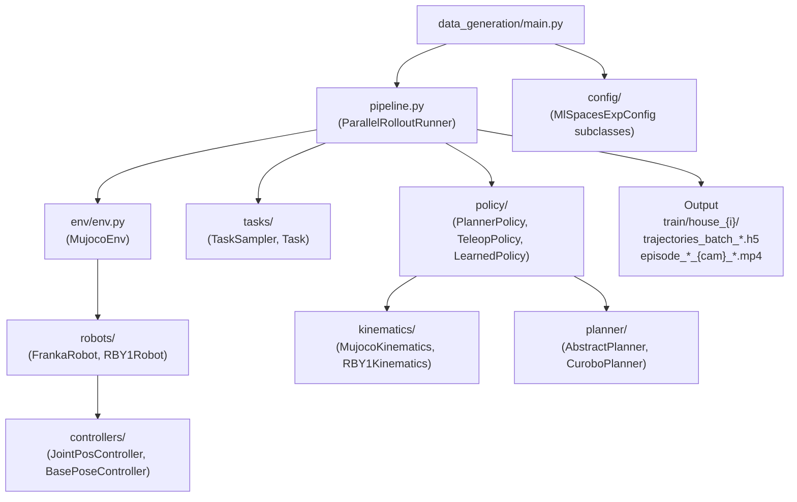

<!-- source: DeepWiki mcp.deepwiki.com · repo allenai/molmospaces · page 5 Data Generation · fetched 2026-10-26 -->

# Data Generation

<details>
<summary>Relevant source files</summary>

The following files were used as context for generating this wiki page:

- [README.md](README.md)
- [docs/code_structure.md](docs/code_structure.md)

</details>


This page provides a top-level introduction to the data generation subsystem: what it is for, how to invoke it, and how its components relate to one another. For architectural details of the pipeline internals, see [Pipeline Architecture](#5.1). For the output file schema, see [Data Format](#5.3). For postprocessing steps that produce training-ready data, see [Data Postprocessing](#5.4). For task-specific behavior, see [Task Types](#5.2). For grasp data generation, see [Grasp Generation](#5.5).

---

## Purpose

The data generation subsystem executes scripted robot demonstrations at scale and records them as trajectory datasets. These trajectories are the primary input to robot learning pipelines. The system runs one or more worker threads in parallel, each of which:

1. Samples a task and scene from a configured distribution
2. Resets a MuJoCo environment to match the scene and task
3. Runs a policy (planner, learned, or teleoperation) for up to `task_horizon` steps
4. Writes the resulting trajectory to an HDF5 file alongside per-camera MP4 video

The output is a structured collection of HDF5 files and videos that are later processed by the postprocessing pipeline before use in training.

Sources: [docs/code_structure.md:49-61](), [README.md:33-36]()

---

## Command-Line Invocation

Data generation is launched as a Python module, passing a config file path and a config class name:

```
python -m molmo_spaces.data_generation.main \
    <path/to/config_file.py> \
    <ConfigClassName>
```

**Example** (from the code structure documentation):

```
python -m molmo_spaces.data_generation.main \
    molmo_spaces/data_generation/config/rby1_door_opening_config.py \
    DoorOpeningDataGenConfig
```

Required environment setup on Linux/macOS:

```
export PYTHONPATH=${PYTHONPATH}:.
export MUJOCO_GL=egl
export PYOPENGL_PLATFORM=egl
```

The `<ConfigClassName>` must refer to a class registered with `@register_config` that inherits from `MlSpacesExpConfig`. Configuration classes are described in detail in [Configuration System](#4) and [Task Configurations](#4.2).

Sources: [docs/code_structure.md:83-95](), [README.md:33-36]()

---

## Component Overview

The data generation subsystem is composed of four cooperating layers:

| Layer | Key Code Entity | Responsibility |
|---|---|---|
| Entry point | `data_generation/main.py` | Load config, instantiate runner |
| Pipeline | `ParallelRolloutRunner` (`pipeline.py`) | Manage worker threads, write HDF5 + MP4 |
| Task sampling | `TaskSampler` (`tasks/task_sampler.py`) | Sample scene + task parameters per episode |
| Policy execution | `Policy` (`policy/abstract.py`) | Produce actions from observations |
| Environment | `MujocoEnv` (`env/env.py`) | Step simulation, return observations |

Supporting modules that the pipeline depends on:

| Module | Path | Role |
|---|---|---|
| Controllers | `controllers/` | Low-level joint/EE command translation |
| Kinematics | `kinematics/` | Forward/inverse kinematics solvers |
| Planner | `planner/` | Motion planning (e.g., A\*, CuRobo) |
| Robots | `robots/` | Robot-specific MuJoCo interface |
| Config | `config/` | Pydantic experiment configuration |

Sources: [docs/code_structure.md:6-45](), [docs/code_structure.md:49-73]()

---

## High-Level Pipeline Flow

**Diagram: Data Generation Runtime Flow**

```mermaid
sequenceDiagram
    participant "main.py" as Main
    participant "MlSpacesExpConfig subclass" as Cfg
    participant "ParallelRolloutRunner" as Runner
    participant "TaskSampler" as TS
    participant "Policy" as Pol
    participant "MujocoEnv (env.py)" as Env
    participant "HDF5 + MP4" as Disk

    Main->>"MlSpacesExpConfig subclass": "load_from_json / from class definition"
    "MlSpacesExpConfig subclass"-->>Main: "camera, robot, task, policy configs"
    Main->>"ParallelRolloutRunner": "initialize(config)"

    loop "Per worker thread"
        "ParallelRolloutRunner"->>"TaskSampler": "create from task_sampler_config"
        loop "Per episode"
            "TaskSampler"-->>"ParallelRolloutRunner": "sampled task + scene"
            "ParallelRolloutRunner"->>"MujocoEnv (env.py)": "reset(scene, task)"
            "ParallelRolloutRunner"->>"Policy": "initialize(policy_config)"
            loop "Per step (up to task_horizon)"
                "MujocoEnv (env.py)"-->>"Policy": "obs: qpos, qvel, images"
                "Policy"-->>"MujocoEnv (env.py)": "action: joint_pos / ee_pose / twist"
                "MujocoEnv (env.py)"-->>"ParallelRolloutRunner": "reward, success, terminated"
            end
            "ParallelRolloutRunner"->>"HDF5 + MP4": "write traj_{ep_idx} to trajectories_batch_*.h5"
            "ParallelRolloutRunner"->>"HDF5 + MP4": "write episode_*_{cam}_*.mp4"
        end
    end
```

Sources: [docs/code_structure.md:49-73]()

---

## Policy Types

Each task configuration specifies a default policy. Three policy families are supported:

| Policy Family | Sub-path | Triggered By |
|---|---|---|
| Planner policies | `policy/planner_policy/` | `PickPlannerPolicyConfig`, `PickAndPlacePlannerPolicyConfig`, `AStarNavToObjPolicyConfig`, `OpenClosePlannerPolicyConfig`, etc. |
| Teleoperation policies | `policy/teleop_policy/` | `TeleopPolicyConfig` — iPhone TeleDex app |
| Learned policies | `policy/learned_policy/` | `LearnedPolicyConfig` |

Planner policies are the default for automated data generation. Teleoperation and learned policies are used mainly during evaluation; see [Evaluation & Benchmarking](#6).

Sources: [docs/code_structure.md:33-40]()

---

## Task Types Summary

Seven task types are available. Each is paired with a configuration class and a default policy:

| Task Type | Config Class | Default Policy Config |
|---|---|---|
| `pick` | `PickBaseConfig` | `PickPlannerPolicyConfig` |
| `pick_and_place` | `PickAndPlaceDataGenConfig` | `PickAndPlacePlannerPolicyConfig` |
| `pick_and_place_color` | `PickAndPlaceColorDataGenConfig` | `PickAndPlaceColorPlannerPolicyConfig` |
| `pick_and_place_next_to` | `PickAndPlaceNextToDataGenConfig` | `PickAndPlaceNextToPlannerPolicyConfig` |
| `open` | `OpeningBaseConfig` | `OpenClosePlannerPolicyConfig` |
| `close` | `ClosingBaseConfig` | `OpenClosePlannerPolicyConfig` |
| `nav_to_obj` | `NavToObjBaseConfig` | `AStarNavToObjPolicyConfig` |

See [Task Types](#5.2) for per-task details including task sampler classes, success thresholds, and relevant config fields.

Sources: [docs/code_structure.md:49-73]()

---

## Module Dependency Graph

**Diagram: data_generation module dependencies**



Sources: [docs/code_structure.md:6-45]()

---

## Output Overview

Each run produces raw output organized by scene (house) index, episode index, and batch index:

```
train/
  house_{i}/
    trajectories_batch_{batch_idx}.h5
    episode_{ep_idx}_{cam_name}_{batch_idx}.mp4
```

The HDF5 files contain full trajectory data: actions, joint states, end-effector poses, camera observations, rewards, success flags, and termination flags. The MP4 files contain per-camera video.

This raw output must be passed through the three-stage postprocessing pipeline (`repair_video_paths.py` → `validate_trajectories.py` → `calculate_stats.py`) before it is suitable for training. See [Data Format](#5.3) for the complete HDF5 schema and [Data Postprocessing](#5.4) for the postprocessing steps.

Sources: [docs/code_structure.md:49-73]()

---

